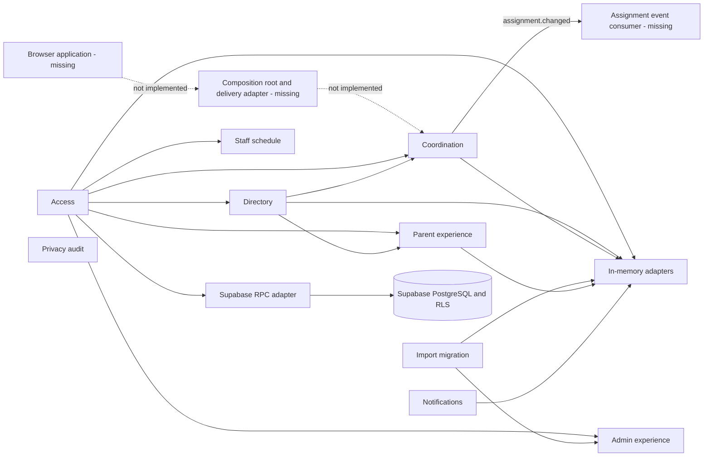
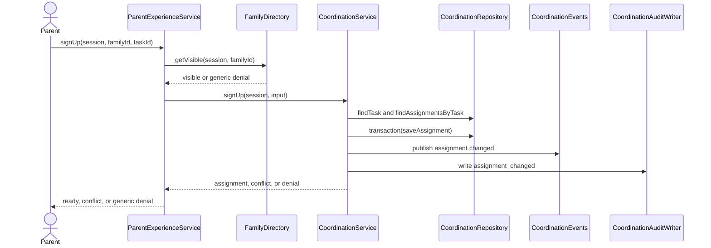
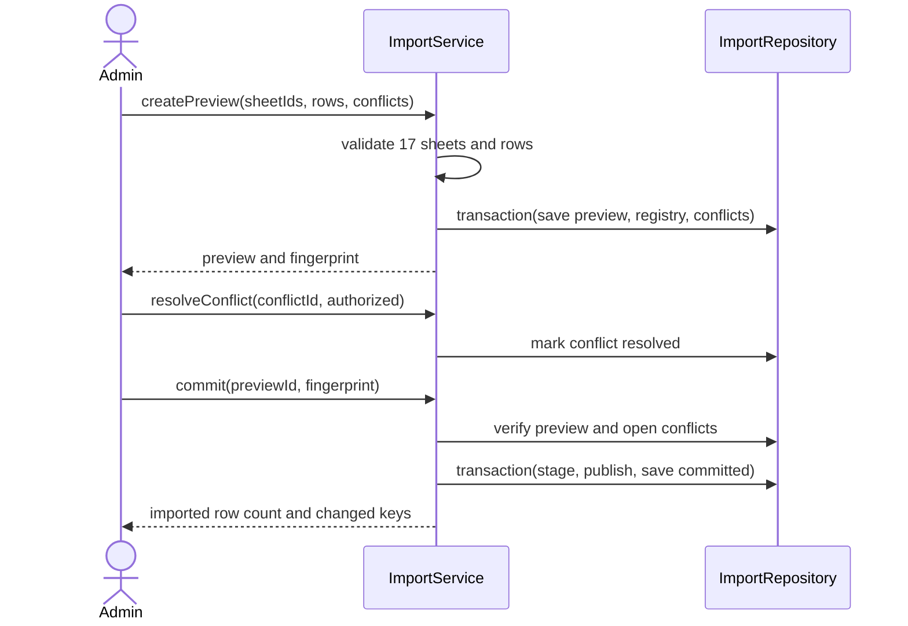
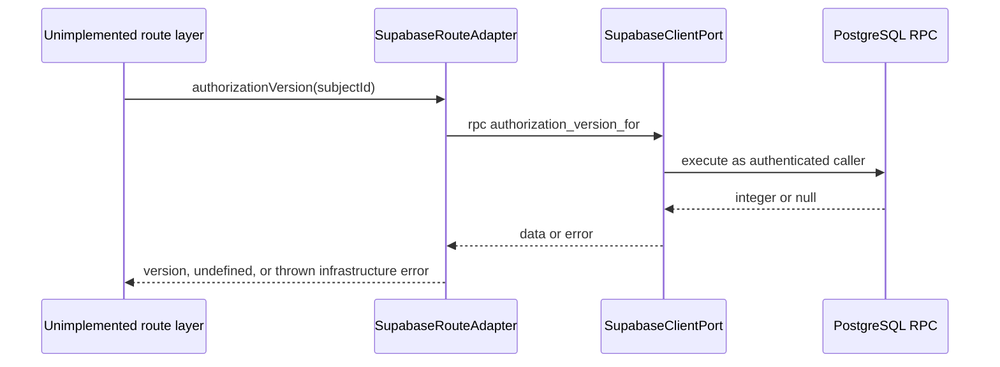

# Architecture

## Observed Architectural Style

The code is a lightweight ports-and-adapters modular monolith implemented as a TypeScript library. Nine functional modules expose domain services or experience façades through module barrels. Services depend on repository, authorization, event, audit, clock, queue, provider, dispatcher, lifecycle, or command ports. In-memory adapters make those services executable in unit tests; a partial Supabase RPC adapter and SQL migration are the only production-technology edges.

There is no deployable monolith yet because there is no composition root or delivery adapter. The architecture is therefore best described as a **domain-core modular monolith under construction**, not as a web application or microservice system.

Text fallback: a missing browser delivery edge would call the domain/application layer. Access is the principal upstream module for directory, coordination, parent, admin, and staff behavior. Directory supplies family visibility to coordination and parent projections. Import feeds administrative conflict work. Coordination publishes an assignment event, but no consumer exists. Most executable persistence is in memory; only the access edge has a partial Supabase adapter backed by PostgreSQL RPCs and RLS.

## Boundaries and Ownership

| Boundary | Owned model and policy | Public collaboration |
|---|---|---|
| Access | Users, role grants, scope authorization, auth versions, redacted access audit | Authorization decisions and grant repositories |
| Directory | Families, parents, children, group/school-year links, field visibility, archive state | Privacy-minimized family views |
| Coordination | Tasks, assignments, capacity, versions, swap/cancellation transitions, contributions | Directory visibility and optional access authorization; publishes assignment change |
| Import migration | Required-sheet registry, preview, conflicts, stage/publish/rollback state | Supplies import-conflict work to administration |
| Notifications | Threshold scheduling, delivery status, durable retries and cancellation | Queue/provider/dispatcher ports; currently no coordination consumer |
| Parent experience | Parent-focused projections and command façade | Directory visibility, parent repository, coordination-like commands |
| Admin experience | Admin queues, school-year projection and operations façade | Access authorization, admin repository and operations |
| Staff schedule | 31-day privacy-minimized schedule | Access authorization and schedule repository |
| Privacy audit | Departure/grace/deletion/anonymization and audit retention policy | Lifecycle repository/processor ports; otherwise standalone |

The boundaries are cohesive and mostly acyclic. `access` has high fan-out by design and is the primary coupling hotspot. Cross-context model sharing is structural rather than packaged: several modules define compatible local `Session`/authorizer shapes and import access types. No module owns production persistence end to end.

## Interaction Diagrams

### Capacity-aware task sign-up

Text fallback: the parent façade first proves family visibility. Coordination then checks the task, expected version and capacity, persists the assignment transactionally, and emits event/audit records. Failure is returned as a discriminated result or generic authorization decision. In the current code the parent command port is injected; no composition root wires it to `CoordinationService`.

### Import preview and commit

Text fallback: the service validates the fixed 17-sheet registry and row privacy conditions before storing a preview. Commit requires the original fingerprint and no open conflicts, then stages and publishes in one repository transaction. The in-memory transaction can roll back its local arrays, but the modeled rollback after publication is reconciliation/state change rather than a demonstrated reversal of external writes.

### Supabase authorization check

Text fallback: a future route layer could use the adapter to call a Supabase client port. The adapter exposes authorization-version and active-scope RPCs only. It is currently unexported from the access barrel, untested, and not wired to any route.

## Architectural Decisions and Trade-offs

### Observed decision: ports-and-adapters modular monolith

**Context.** The domain has meaningful authorization, workflow, privacy, import and reminder rules, while the project is early and has no proven need for independently deployed services.

**Decision.** Keep domain services framework-independent behind explicit ports and assemble them as one modular application boundary.

**Consequences.** Unit isolation, injected clocks and infrastructure substitution are strong. The cost is additional interfaces and an as-yet-missing composition root. Security policy remains testable in domain code, but SQL policy parity must be verified separately.

**Alternatives rejected.** A layered CRUD application would reduce interface count but weaken workflow and privacy isolation. Microservices would add network consistency, deployment, identity propagation and observability costs without independent-scaling evidence.

### Recommended decision for the active intent: thin local delivery edge

**Context.** The active intent requires only local list/create behavior over deterministic synthetic tasks and explicitly excludes live authentication and Supabase.

**Decision.** Add a feature-local task application contract, in-memory implementation, minimal composition root and browser adapter. Clearly label this as a local harness rather than production architecture.

**Consequences.** This is reversible and validates the missing end-to-end boundary without binding unfinished domain contracts to Supabase. Input validation and browser state become explicit. It creates a temporary seam that must either evolve or be removed when production task persistence is designed.

**Alternatives rejected.** Binding directly to the partial Supabase schema would imply unsupported production readiness and expose untested RLS behavior. Reworking all coordination aggregates for a two-operation demo would expand blast radius. Building a server/API now is unnecessary unless the selected browser framework requires it.

Security and compliance implication: synthetic data must contain no real family information; Hungarian generic denials and privacy-minimized projections remain mandatory when real authorization is later connected.

## Failure Modes and Missing Boundaries

- No delivery input validation, UI state model, error boundary or composition root exists.
- Infrastructure errors from the Supabase adapter are thrown without an application error mapping.
- `assignment.changed` has no durable transport or consumer; notifications are not connected to assignment lifecycle.
- Transaction semantics exist as ports but only in-memory behavior is demonstrated; several mutations are not consistently wrapped.
- SQL uses unconstrained text for roles/scopes and has limited referential constraints and indexes.
- No observability boundary exists for logs, metrics, traces, job failures or audit delivery.
- No production repository adapters establish data ownership across the functional modules.

