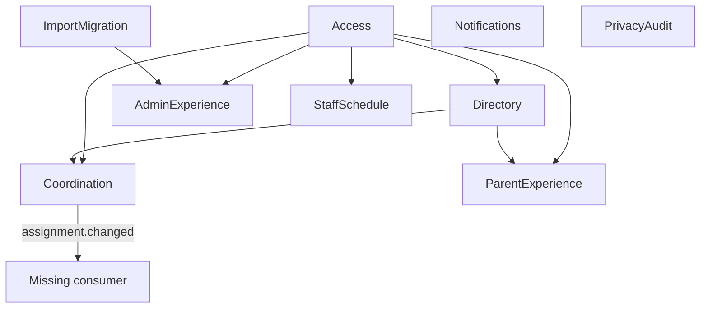

# Dependencies

## External Dependency Graph

```text
Node.js 24
├── native ESM loader and experimental TypeScript stripping
├── node:test
└── experimental coverage

TypeScript 5.9.3
└── @types/node 24.13.3
    └── undici-types 7.18.2

Supabase/PostgreSQL
└── auth.uid(), SQL RPC functions and RLS policies

GitHub Actions
├── actions/checkout@v4
└── actions/setup-node@v4
```

There are no runtime npm packages. Supabase is a SQL-level external dependency only; there is no SDK dependency. The locked dependency audit reported zero high-severity vulnerabilities at the scan timestamp.

## Internal Module Topology



Text fallback: Access is upstream of directory, coordination and all three experience modules. Directory supplies visibility to coordination and parent experience. Import migration supplies administrative conflict work. Coordination emits an unconsumed event. Notifications and privacy audit have no current runtime connection to other modules.

## Port and Adapter Dependencies

Service classes depend inward on TypeScript port interfaces rather than concrete infrastructure. In-memory adapters implement most repositories and recorders. The Supabase adapter depends on a minimal `SupabaseClientPort` rather than an SDK class. This keeps the domain core isolated but leaves production adapter behavior and service composition unverified.

The repository transaction callbacks are synchronous. A future async database adapter cannot faithfully implement them without either changing the port to asynchronous transactions or hiding asynchronous work, so this is a material compatibility constraint.

## Dependency Risks

- Access has the greatest fan-out; incompatible session/scope changes would affect five downstream areas.
- Similar `Session`, authorizer and result shapes are repeated across modules rather than exposed through one stable application contract.
- The SQL role/scope vocabulary is text and not constrained to the TypeScript unions.
- The Supabase adapter consumes only two of three RPCs and is not exported or tested.
- The notification provider dependency is injected but unused by the scheduling path.
- Coordination event publication has no transport, schema version, idempotency key or consumer.
- No browser framework exists, so selecting one will introduce the first runtime npm dependency and a new delivery/build boundary.

## Active-Intent Dependency Strategy

The local list/create slice should depend on a narrow application task port and synthetic in-memory adapter. Existing coordination types may be adapted, but should not be widened solely to serve a demo without confirming the broader aggregate design. Avoid connecting partial Supabase persistence or authorization. Add only the delivery dependencies required to run, build and test the local browser slice, and document their boundary and versions.

