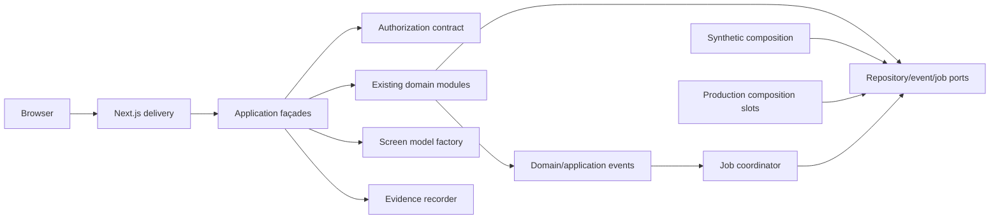

# Component Dependency and Data Flow

## Sources

This topology specializes the current [requirements](../requirements-analysis/requirements.md), [stories](../user-stories/stories.md), CodeKB [architecture](../../../codekb/waldorf-community-task-manager/architecture.md), [component inventory](../../../codekb/waldorf-community-task-manager/component-inventory.md), and [team practices](../practices-discovery/team-practices.md).

## Dependency Direction

Text fallback: the browser enters only through Next.js delivery. Delivery calls application façades, which authorize, call existing domain modules, and build privacy-safe screen models. Repository/event/job ports are implemented by exactly one selected synthetic or production composition. Events feed the job coordinator. Evidence observes redacted results only.

## Dependency Matrix

| Consumer | Allowed dependencies | Forbidden dependencies |
|---|---|---|
| UI components | screen models, action contracts | repositories, raw domain aggregates, Supabase client |
| Route handlers/actions | session, validation, application façades | concrete repositories, domain record mutation |
| Application façades | authorization contract, domain public APIs, screen models, evidence | another module's private adapter |
| Domain modules | declared ports and domain types | Next.js/React, environment variables |
| Synthetic composition | public constructors/ports, fixture registry | production credentials/network |
| Production composition | public constructors/ports, Supabase/provider adapters | synthetic endpoints/profiles |
| Evidence recorder | redacted outcome envelope | raw exception, personal data, secrets |

## Module Topology

Access is upstream of Directory, Coordination, Parent, Admin, Staff, Import entry, Governance, and Lifecycle entry. Directory visibility feeds Coordination and Parent projections. Coordination produces assignment-change events consumed by Jobs/Notifications. Import depends on authorized directory/coordination mappings and audit evidence. Privacy lifecycle depends on authorized family state and redacted audit. UI route groups depend on application façades, never directly on sibling UI groups.

## Communication Matrix

| Trigger | Synchronous transaction | Durable follow-up | Result boundary |
|---|---|---|---|
| Session select/switch/revoke | session/grant version | cache invalidation signal | authorized destination or denial |
| Signup/swap/cancel/approval | assignment/request + redacted audit | reminder replace/cancel | exact application state + idempotency |
| Record/task/event mutation | owning aggregate + audit | projection refresh where needed | success/conflict/denial/failure |
| Import commit/recovery | import run + canonical publish/reconciliation | recovery/status job | immutable preview/result/recovery |
| Reminder retry | job attempt state | scheduled dispatch | success/stale/retry/terminal |
| Lifecycle run | retention/delete/anonymize + audit | retention/purge job | completed/deferred/conflict/failure |

## Shared Resources

- Runtime configuration schema and mode guard.
- Session context and authorization matrix IDs.
- Application result/state union and safe presentation keys.
- Deterministic clock, ID/idempotency interfaces.
- Redacted event/evidence envelope.

These are contract packages, not shared mutable databases. Each domain module retains record ownership.

## Failure and Consistency Flow

Validation fails before domain calls. Authorization denial fails before resource retrieval. Domain conflict leaves state unchanged unless its explicit atomic transaction succeeds. Adapter errors are classified as retryable or terminal; retryable results preserve named safe context and reuse the idempotency key. UI rendering never infers retry from HTTP status or exception strings.

## Cycle Check

Dependencies point delivery → application → domain → ports. Composition implements ports and does not call delivery. Events flow outward to the job coordinator, which calls public application/domain ports but does not import UI. This keeps the dependency graph acyclic and permits later adapter replacement.

