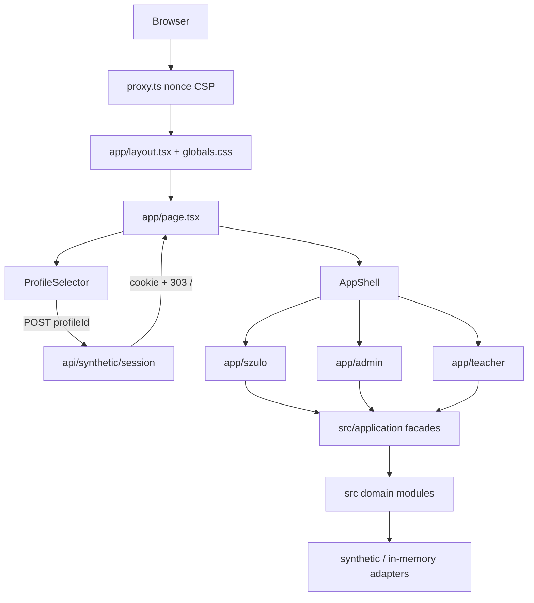
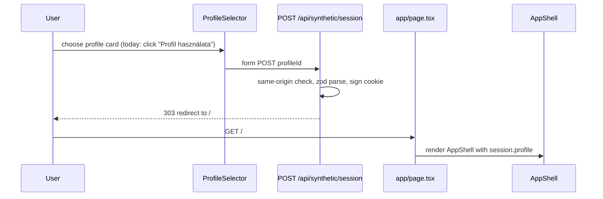
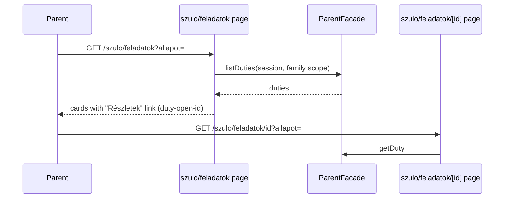
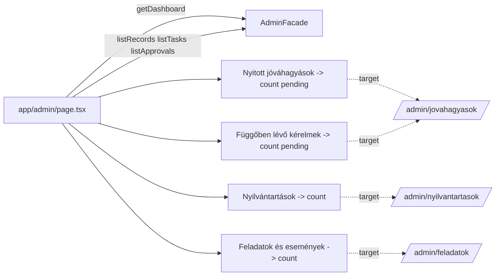

# Architecture

## Architecture Analysis

### System Overview

A single Next.js 16 App Router application. Server components under `app/` resolve a session, build an application facade (via `src/runtime/composition.ts`) and render pages. Domain logic lives in functional modules under `src/` behind explicit ports; runtime currently composes synthetic in-memory adapters (`src/runtime/synthetic/`), with a production composition stub (`src/runtime/production/`) and Supabase RLS migrations (`supabase/migrations/`).

### Architectural Style

Modular monolith with ports/adapters. Evidence: `src/application/*-facade.ts` define ports (`ParentApplicationPort`, `AdminApplicationPort`, `TeacherApplicationPort`); `src/*-web/synthetic-*.ts` and `src/*/in-memory-*.ts` are adapters; `app/*/_lib/facade.ts` resolve them.

### Component Relationships

Text fallback: browser requests pass the CSP proxy, the root layout (global CSS), then the entry page, which shows ProfileSelector or AppShell; role areas call application facades, which call domain modules and synthetic adapters.

### Data Flow

1. Chooser form POSTs `profileId` to `/api/synthetic/session`; same-origin check; signed HMAC cookie `waldorf_local_session` (8 h) set; 303 redirect to `/`.
2. Role layouts (`app/szulo/layout.tsx`, `app/admin/layout.tsx`, `app/teacher/layout.tsx`) resolve the session and wrap content in `AppShell` or an access-state panel.
3. Pages call facades; results are `ApplicationResult` states (`success`, `empty`, `denied`, ...) rendered by `AsyncStatePanel` (admin) or `ParentStatePanel` (parent).
4. Mutations use Server Actions with idempotency keys and expected versions.

### Presentation Layer (intent focus)

- One global stylesheet `app/globals.css` imported at `app/layout.tsx:3`; tokens on `:root` (lines 1-20); no CSS modules, no Tailwind, no font loader.
- Shared chrome is `src/runtime/AppShell.tsx` (skip link, header with profile summary and "Tesztprofil váltása", collapsible nav, `<main id="fo-tartalom">`).
- CSP in `proxy.ts`: `img-src 'self' blob: data:`, `font-src 'self'`, `style-src 'self' 'unsafe-inline'`; remote font stylesheets or images are blocked; `public/` assets and `next/font` self-hosting are permitted.
- Pages are server-rendered with `force-dynamic`; interactive cards can remain server components (plain links/forms).

### Key Design Decisions

- Synthetic-first runtime with explicit mode switch (`APP_RUNTIME_MODE`), production boundary stubbed.
- Expected failures are result states, not exceptions (team rule).
- Accessibility baseline: skip link, 44 px minimum targets (`button, summary, a { min-height: 44px }`), focus-visible outline, `@a11y` axe tests.
- Stable `data-testid` hooks across all pages, relied on by Playwright and Vitest.

### Improvement Opportunities

- Tokenise remaining literal colours and add typography/spacing tokens.
- Replace `overflow-wrap: anywhere` with language-aware hyphenation (`hyphens: auto`, `lang="hu"` already set).
- Make summary and list cards whole-card links to remove duplicate "Részletek" affordances.

## Interaction Diagrams

### Profile selection and shell render

Text fallback: the user submits the profile form, the route validates and sets a signed cookie, redirects to `/`, and the home page renders AppShell for that profile.

### Parent duty list to detail

Text fallback: the list page asks the facade for duties and renders a card per duty with a details link that preserves the status filter; the detail page loads one duty.

### Admin dashboard summary

Text fallback: the dashboard fetches four lists and shows a count in four non-clickable panels; the matching list routes (dotted arrows) already exist and filter by `?state=`.
