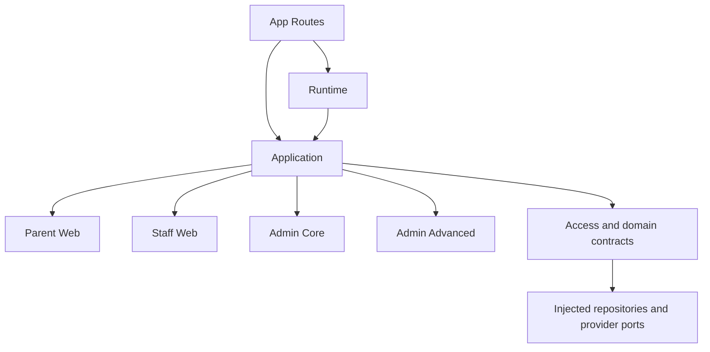
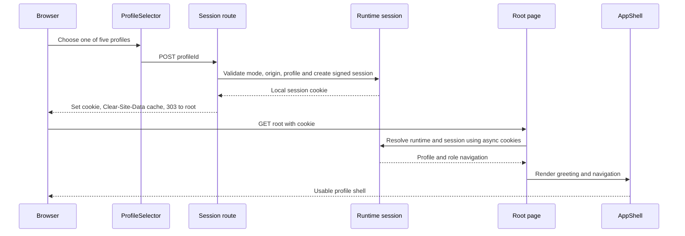

# Architecture

## Architecture Analysis

### System Overview

One TypeScript Next.js App Router application provides public authentication/invitation pages, a synthetic profile selector, protected role pages and Server Actions. Source evidence and module ownership come from the current developer handoff; no running server or integration target was exercised.

### Architectural Style

Observed style: modular monolith with application facades, typed ports and injected domain repositories/providers. Synthetic web stores implement application contracts directly alongside older domain services; this is not a fully unified domain execution path. Production composition is an unlinked configuration boundary (`supabase-unlinked`), not proven durable infrastructure.

### Component Relationships

<!-- Text fallback: App Routes depend on Runtime and Application. Runtime composes Application facades over Parent Web, Staff Web, Admin Core and Admin Advanced synthetic ports. Application also depends on access/domain contracts whose services use injected repository and provider ports. -->

This diagram shows dependency boundaries, not a claim that every synthetic operation executes a legacy domain service. See [component-inventory.md](component-inventory.md) for responsibilities.

### Data Flow

Routes derive cookie-backed sessions and convert them to role/scope contexts. Facades authorize before executing adapter operations, project allowed fields, map expected failures to discriminated results and optionally apply idempotency. Successful mutations commonly revalidate relevant paths. Protected layouts and pages can resolve role sessions separately.

Parent state/cache is module-local; core and advanced admin state is process-global. Neither survives restart or supplies multi-instance durability. Domain services expose repository, audit and event boundaries; import preview/commit uses an injected transaction port, and notification scheduling uses injected queue/dispatcher/provider ports. These contracts do not prove durable deployment. Home navigation reads static profile definitions while business admin boundaries also check dynamic revocation.

### Key Design Decisions

These are observed implementation choices, not newly approved ADRs:

| Choice and context | Consequence and trade-off | Alternatives requiring later evidence |
|---|---|---|
| Local signed synthetic sessions for runnable fixtures | No remote auth dependency in this login chain; signed HttpOnly/Lax cookie and same-origin guard still matter | Real identity-provider sessions; server-side persisted sessions |
| Facades and typed result/port boundaries | Testable authorization/projection; direct synthetic and legacy service paths can diverge | Direct route-to-store operations; one consolidated domain execution path |
| In-memory synthetic stores and unlinked production composition | Repeatable local scenarios; no demonstrated persistence, provider or deployment behavior | Linked durable backend; repository adapters over a local persistent database |

Privacy-sensitive scope and projections must survive any eventual change. No new storage, authentication or deployment decision is made in this synthesis.

### Improvement Opportunities

Measure browser network/redirect/asset and server request/compilation timings on the affected existing local environment before choosing a correction. Cache clearing, compilation/import breadth, output contention and watcher/resource conditions remain hypotheses. Preserve origin guards, signed session isolation and dynamic revocation. Toolchain and verification limitations are recorded in [code-quality-assessment.md](code-quality-assessment.md).

## Interaction Diagrams

### Shared Profile Login Transaction

<!-- Text fallback: A browser submits the ProfileSelector form to the session route. The route validates synthetic mode, origin and profile, creates a local signed session, sets the cookie, clears cache and redirects with 303 to the root. The root resolves runtime/session via asynchronous cookies and renders AppShell with the profile greeting and navigation. -->

All five profiles follow this transaction. Evidence: `src/runtime/ProfileSelector.tsx:18`, `app/api/synthetic/session/route.ts:16`, `:45`, `:51`, `app/page.tsx:25`, `:31`. Redirect is to `/`, not `profile.homePath`; navigating to a business landing page is a subsequent transaction. Empty profile ID signs out through the same endpoint and deletes the cookie. Diagram syntax was checked before writing against the stage protocol's declaration/reference/escaping rules.
