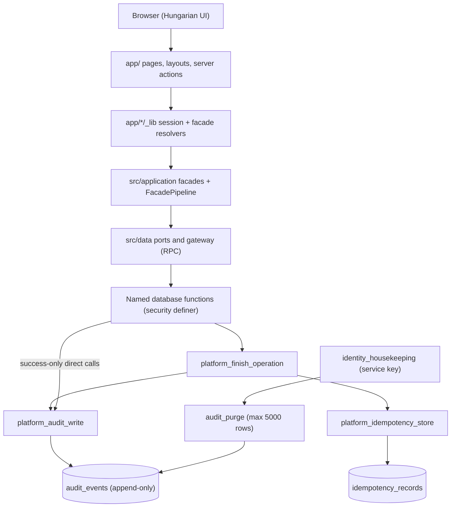
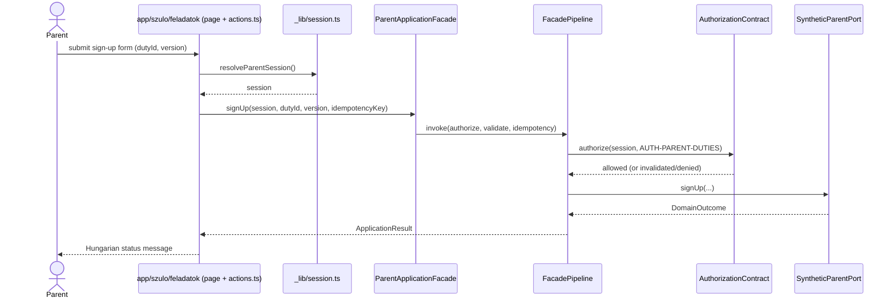
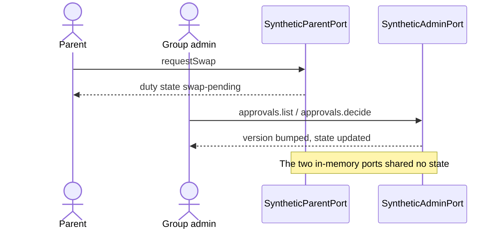
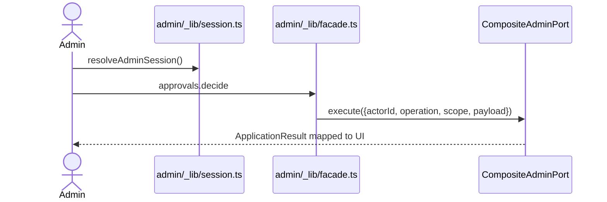
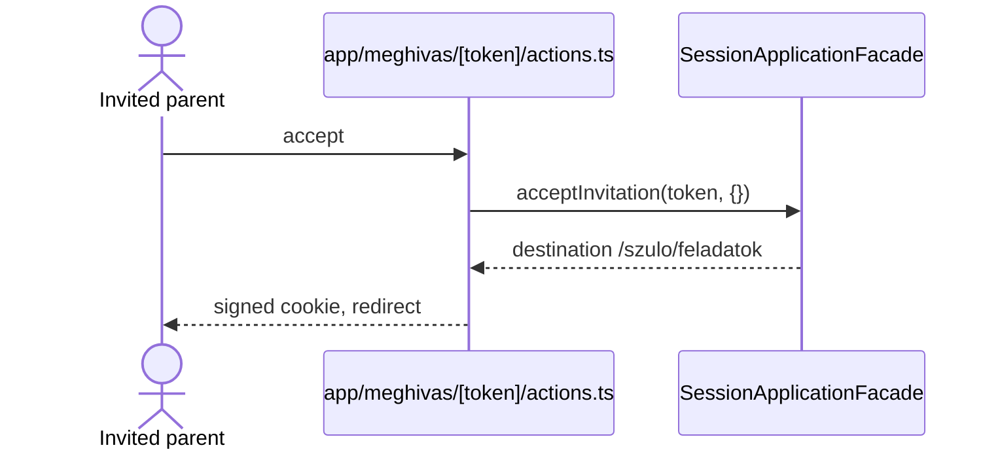
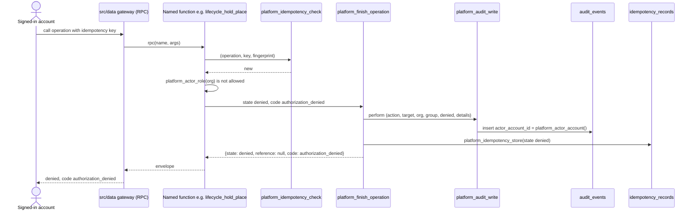
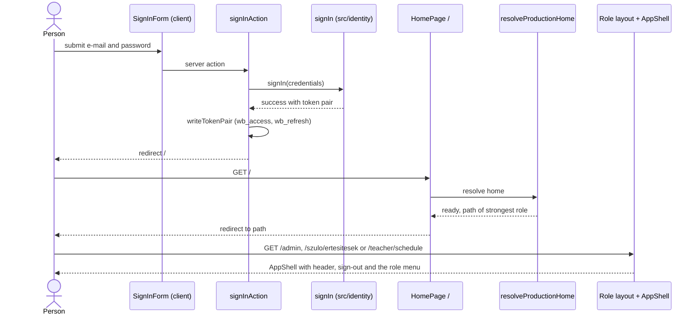
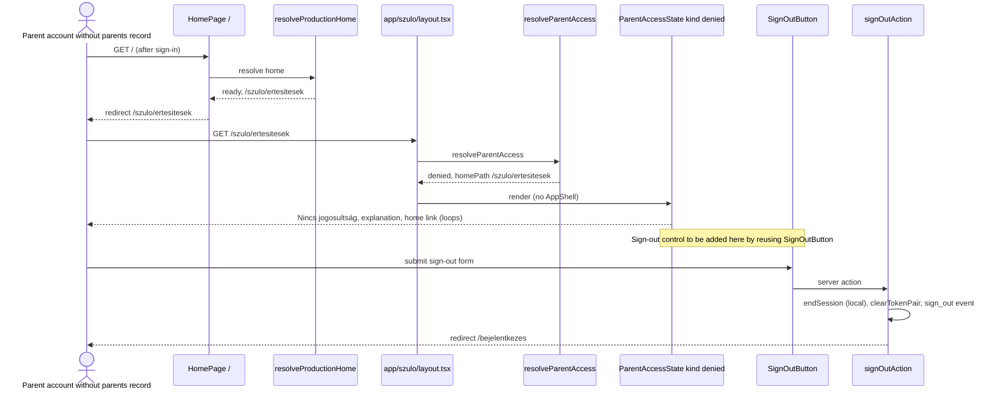
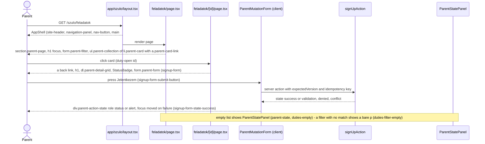
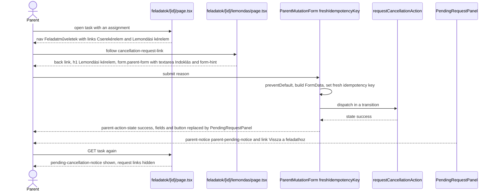

# Architecture Analysis

Full rescan 2026-10-12 (HEAD `80bd4f4`), focused update 2026-10-27 (HEAD `5d2b484`, intent `denied-audit-ratelimit`), focused update 2026-11-02 (HEAD `3456409`, intent `empty-nav-after-login`: sign-in, shell and navigation area, section "Sign-in, session and landing (2026-11-02)" and interaction diagram 7). Revision 2 on 2026-11-02 (same intent, owner asked to also scan the audit area) re-read the audit migrations 20261012, 20261013, 20261015, 20261019, 20261044 and 20261045, `supabase/config.toml` and the database test support, `audit`, `audit-purge` and `migrations` tests; sections marked "(2026-11-02, audit re-verified)" come from it. Focused update 2026-11-02 (HEAD `1070fd6`, intent `no-access-signout`): the "Nincs jogosultság" pages and the sign-out reuse path; new section "Denied pages and sign-out reuse (2026-11-02, after 1070fd6)" and interaction diagram 8; the sign-in landing facts that commit `1070fd6` changed are corrected in the sign-in section and in diagram 7. Focused update 2026-11-04 (HEAD `251c4b3`, intent `stitch-design-update`): `app/`, `tests/browser/` and `proxy.ts` re-read for the visual restyle; new section "Styling architecture and fonts (2026-11-04, after 251c4b3)" and interaction diagrams 9 and 10; facts that commits `78a0ab5` (sign-out on denied pages) and `251c4b3` (`DESIGN.md`) changed are corrected in place and marked "(2026-11-04)". The 2026-10-27 update rewrote "Database Layer" and added "Platform audit write" and interaction diagram 6. Every other section is kept from 2026-10-12 and describes the synthetic prototype as it was then; it is stale wherever the U1 to U5 backend work changed the application (not re-scanned).

## System Overview

A single Next.js 16 App Router application (React 19, TypeScript, zod) with server components and server actions. At the 2026-10-12 scan all business state was held in process memory by four `synthetic-*` adapters behind a layered application module (`src/application`: authorization, facade pipeline, idempotency, result modelling). Since then (2026-10-27 listing) the business state lives in a Supabase PostgreSQL schema built by 40 forward-only migrations (39 at the 2026-10-27 listing; the 40th is `20261046_audit_denied_rate_limit.sql`); the application reaches it through database functions called over the data API (`src/data/gateway.ts`, `client.rpc(name, args)`), each returning the envelope `{state, reference, code}`.

## Architectural Style

Modular monolith, ports-and-adapters flavoured, with a request-scoped composition root (`composeRuntime()`). In the database (2026-10-27) the same style continues: tables are closed to application roles, and every change goes through a named `security definer` function that authorizes, changes, audits and stores the idempotent result in one transaction.

The 2026-10-12 scan found two code families (verified by import grep then):

- **Family A, wired:** `src/application`, `src/runtime`, and the adapters `src/parent-web`, `src/admin-core`, `src/admin-advanced`, `src/teacher-web`.
- **Family B, unwired domain services:** `src/access`, `src/coordination`, `src/directory`, `src/import-migration`, `src/notifications`, `src/parent-experience`, `src/privacy-audit`, `src/admin-experience`, and `TeacherScheduleService` in `src/teacher-tracking`.

## Component Relationships

Text fallback: browser to pages and server actions; resolvers call `src/application` facades; facades call `src/data` ports, which call named database functions over RPC. A named function finishes through `platform_finish_operation`, which calls `platform_audit_write` for a success or a denial and always stores the idempotent result. A few functions call `platform_audit_write` directly, always with outcome `success`. The service-key housekeeping purges audit events older than 365 days. The diagram's application half is from the 2026-10-12 scan plus a 2026-10-27 skim of `src/data/gateway.ts`; the database half was analyzed on 2026-10-27.

## Styling architecture and fonts (2026-11-04, after 251c4b3)

Read-only scan of `app/globals.css` (1418 lines), `app/layout.tsx`, the className use of every `.tsx` file under `app/`, `proxy.ts` and the browser specs. Nothing was built or run.

**One global stylesheet, no build step of its own.** `app/layout.tsx` imports `./globals.css` once (line 3) and renders `<html lang="hu"><body>{children}</body></html>`. There is no CSS module, no CSS-in-JS, no Tailwind or PostCSS config, no `next/font`, no `@font-face` and no font file in the repository. `public/brand/` holds `logo.png` (used by `BrandMark`) and `cover.jpg` (referenced by nothing). Prettier formats the CSS (the `format:check` path includes `app`); ESLint does not lint it and there is no Stylelint.

**Tokens.** `:root` (`globals.css:1-28`) defines 18 custom properties (16 colours and 2 others): colours `--color-background #f8f0e3`, `--color-surface #fffaf1`, `--color-text #2b2118`, `--color-muted #62564a`, `--color-primary #98452f`, `--color-primary-dark #6f2f1f`, `--color-accent-ochre #a8661a`, `--color-success #2f6b3a`, `--color-success-bg #e8f3e6`, `--color-info-bg #f5ecd9`, `--color-danger-bg #fbe9e3`, `--color-read-bg #ebe6de`, `--color-read-text #5a5044`, `--color-focus #1f4e79`, `--color-border #d9c4a9`, `--color-border-strong #8a7762`; plus `--shadow`, `--radius: 1rem`; `color-scheme: light`. The font stack is the system UI stack set on `:root` (`ui-sans-serif, system-ui, -apple-system, BlinkMacSystemFont, "Segoe UI", sans-serif`). There is no font-family token, type scale, spacing scale or dark theme. Repeated literals that act as unnamed tokens: input radius `0.5rem`, pill radius `999px`, minimum target `44px`, status border `0.35rem`, transition `120ms ease`, and `white` text on terracotta (button, `.button-link`, current nav item, skip link). The body background adds a hard-coded terracotta radial glow (`globals.css:42-45`).

**Class families (by area), with the files that use them.**

| Family | Rules in `globals.css` | Used by |
|---|---|---|
| Base elements | `a`, `button`, `summary`, `:focus-visible`, `[tabindex="-1"]:focus`, `h1`, `h2`, `p`, `nav`, `body` | everywhere. `button` is the primary pill (terracotta, white text, 44px). `h1` is `clamp(2rem, 5vw, 4rem)` on every page. Focus ring is a 3px focus-blue outline with 3px offset; focus targets with `tabindex="-1"` show none (tested). |
| Shell and navigation | `.skip-link`, `.app-shell`, `.site-header`, `.site-header-brand`, `.profile-summary`, `.eyebrow`, `.brand-link`, `.brand-mark`, `.navigation-panel`, `nav ul`, `nav a`, `.nav-button` | `src/runtime/AppShell.tsx`, `AppNav.tsx`, `BrandMark.tsx` (outside the snapshot); `.eyebrow` also by almost every page header. Under 44rem the menu collapses into a `
` toggle. |
| Panels and buttons (shared) | `.centered-panel`, `.secondary-button`, `.button-link`, `.button-link-secondary`, `.form-hint`, `.delivery-note`, `.visually-hidden`, `.status-badge*` | `.centered-panel`: sign-in, reset, invitation, denied and access states, the `/` panels (11 uses). `.secondary-button`: `SignOutButton`, swap request actions. `.button-link`: `/` sign-in link, admin create links, filter-clear links, teacher retry. |
| Sign-in and identity | `.parent-public-page`, `.identity-form` (plus `.parent-form`) | `app/bejelentkezes/page.tsx` and the three other identity pages: `main.centered-panel.parent-public-page`, form `.parent-form.identity-form`; alerts get a border and the danger wash. |
| Filters | `.filter-field`, `.filter-actions`, `.admin-filter`, `.teacher-filter`, `.parent-filter`, `.advanced-filter` | one grid layout for all filters (parent duty list, teacher schedule, three admin lists, reminders). Labels above controls; control height `2.9rem`; buttons share the bottom line. |
| Parent | `.parent-page`, `.parent-card` and `-link`, `.parent-collection`, `.parent-state`, `.parent-state-badge`, `.parent-notice`, `.parent-action-state*`, `.parent-form`, `.parent-detail-grid`, `.parent-note-panel`, `.parent-page-actions`, `.swap-*`, `.notification-*` | `app/szulo/**`. Cards are one whole-card link; notification cards are a two-column grid (link left, "read" checkbox right). |
| Teacher | `.teacher-page`, `.teacher-filter`, `.teacher-table*`, `.teacher-card*`, `.teacher-detail-grid`, `.teacher-state*` | `app/teacher/**`. Table on desktop, card list under 44rem; the row or card link is stretched over the whole row with `::after`. |
| Admin | `.admin-page`, `.admin-dashboard-*`, `.dashboard-link`, `.admin-collection`, `.admin-card*`, `.admin-form*`, `.admin-action-state*`, `.admin-detail-grid`, `.admin-pagination`, `.admin-back-link`, `.developer-details*` | `app/admin/**`. |
| Admin advanced | `.advanced-*`, `.import-stepper`, `.blocked-panel`, `.success-panel` | import, reminders, privacy, settings pages. |
| Dead (no user) | `.selector-page`, `.selector-heading`, `.profile-grid`, `.profile-card`, `.profile-card-name`, `.profile-card-summary`, `.selector-hero`, `.selector-cover`, `.selector-hero .brand-mark` | none in `app/` or `src/` (full-tree grep, 2026-11-04). Remains of the removed profile picker; also named in the shared hover/active rules (`globals.css:185-202`) and the reduced-motion block. |

**Coupling to keep in mind.** (1) Grouped selectors: hover and pressed states are one rule for `.profile-card, .parent-card, .admin-card, .teacher-card, .dashboard-link`; the filter grid is one rule for four filter classes; `.selector-page, .centered-panel, .app-shell` share width rules. (2) Reuse across areas: sign-in and the other identity forms use `.parent-form`, so changing the parent task forms changes them too; `.centered-panel` has 11 uses across sign-in, reset, invitation, denied/access states and the `/` panels. (3) `.parent-card` is declared three times (lines 847-856, 896-906, 908-913) and `.form-hint` twice; later rules win. (4) Responsive switches: one breakpoint at `44rem` (menu toggle, card list, column layout) and `20rem` (header brand wraps); `.import-stepper` collapses at `44rem`. (5) `prefers-reduced-motion` removes transforms for a fixed list of hover classes (`globals.css:1363-1389`); new interactive classes must be added there.

**Fonts and the security policy.** `proxy.ts` sets `Content-Security-Policy` per request (`createContentSecurityPolicy`, lines 9-26): `default-src 'self'`; `script-src 'self' 'nonce-<random>' 'strict-dynamic'` (plus `'unsafe-eval'` only in development); `style-src 'self' 'unsafe-inline'`; `img-src 'self' blob: data:`; `font-src 'self'`; `connect-src 'self'`; `object-src 'none'`; `base-uri 'self'`; `form-action 'self'`; `frame-ancestors 'none'`; `upgrade-insecure-requests`. Consequences for self-hosted Vollkorn and Karla: font files served from the app's own origin (`/_next/static/media/...` from `next/font/local`, or a file under `public/`) satisfy `font-src 'self'`, and the inline `@font-face` or `<style>` that `next/font` emits satisfies `style-src 'unsafe-inline'`, so no policy change is needed; a Google Fonts `<link>` or `@import` would be blocked by both `font-src` and `style-src`. The matcher in `proxy.ts` (lines 67-77) leaves `_next/static`, `_next/image`, `api` and prefetch requests out, so those responses carry no CSP header; the page's policy decides. The 320px and 375px no-overflow tests and the "heading keeps its Y position when images fail" test make font metrics a risk: a serif display face at the existing `clamp(2rem, 5vw, 4rem)` heading size, with `hyphens: auto` on `h1, h2, p`, can widen words. `next.config.ts` (skimmed) sets other security headers and `images.qualities [75]`; it has no font setting.

**Pages are thin.** A page file resolves the session and facade, calls the application layer and returns markup of the form `<section className="<area>-page" data-testid="...">` with a header (`.eyebrow`, `h1 tabIndex={-1}` with `autoFocus`), optional filter form and a state panel (`ParentStatePanel`, `AsyncStatePanel`, `TeacherStatePanel`) that shows success, empty, denied or error with `role` and `aria-live`. Because markup, ids, `data-testid` and focus behaviour are already in the pages and the look is only in the stylesheet, a restyle that keeps class names and markup is a CSS change; a restyle that renames classes must touch the pages and the specs that select by class (`.admin-collection`, `.status-badge`, `.parent-state-badge`, `.button-link`, `.notification-card-read`).

## Sign-in, session and landing (2026-11-02)

The synthetic mode, the `waldorf_local_session` cookie and the profile picker described in the 2026-10-12 sections below no longer exist in this area; the application is production-only and signs people in with the Supabase sign-in service.

- **Composition**: `composeRuntime()` (`src/runtime/composition.ts`) validates the settings and always imports `production/composition.ts`; `RuntimeComposition.authenticationBoundary` is `"supabase-session"` and `services.forRequest(accessToken)` builds the parent, admin and teacher facades on a database client acting as that person (`src/runtime/production/services.ts`).
- **Session**: cookies `wb_access` and `wb_refresh` (httpOnly, sameSite lax, 30 days; `src/identity/cookies.ts`). `proxy.ts` renews or clears them per request and sets the CSP nonce (including `form-action 'self'`); it does no role routing. Pages read the session through `currentSession()` (`app/_identity/current-session.ts`, never refreshes, expired reads as signed out) and `productionRequest()` (memoised with `cache`, returns `ready | signed-out | unavailable`).
- **Role resolution**: `resolveParentAccess`, `resolveAdminAccess`, `resolveTeacherAccess` (`src/runtime/production/access.ts`) read the account's grants as the person and return `success` with a `ShellProfile {label, scopeSummary, homePath, navigation}`, or `denied` (carrying `homePath` of the strongest role held, order super admin, group admin, teacher, parent), `signed-out` or `unavailable`. `HOME`: parent `/szulo/ertesitesek`, teacher `/teacher/schedule`, group admin and super admin `/admin`.
- **Home resolution**: `resolveProductionHome()` (`app/_identity/production-home.ts`) returns `ready {path} | signed-out | no-role | unavailable`. `app/page.tsx` (`/`) uses it: `ready` redirects to the path; the other states render panels (sign-in link, no-role with a sign-out button, unavailable). It uses `resolveAdminAccess` as the generic resolver.
- **Shell**: the role layouts `app/admin/layout.tsx`, `app/szulo/layout.tsx`, `app/teacher/layout.tsx` resolve their access and wrap pages in `AppShell` (`src/runtime/AppShell.tsx`): skip link, header (brand link to `profile.homePath`, role label, scope summary, `headerAction` = `SignOutButton` through `shellHeaderAction()` in `app/_identity/shell-action.tsx`), `AppNav` only when `profile.navigation.length > 0`, then the main content. Admin and teacher layouts `redirect("/")` when signed out; the parent layout renders an access panel instead. The menu lists live in `src/runtime/navigation.ts`; `TEACHER_NAVIGATION` is empty by design.
- **Sign-in screen (`/bejelentkezes`)**: not inside any role layout, so it has no shell. `SignInPage` shows the form for a signed-out visitor. (2026-11-04: at `251c4b3` it redirects a signed-in visitor to `/` instead of showing a `signed-in-panel`; the page is `main#fo-tartalom.centered-panel.parent-public-page` with skip link, `BrandMark`, `h1`, `SignInForm`, and the forgot-password link.)
- **Landing after sign-in (2026-11-02, after 1070fd6)**: the gap found on 2026-11-02 at HEAD `3456409` is closed. `signInAction` (`app/bejelentkezes/actions.ts`) now writes the cookies and ends with `redirect("/")`; `/` calls `resolveProductionHome()` and redirects to the role home inside the role layout's `AppShell`. At `3456409` the same action redirected to `/bejelentkezes` (shell-less panel); that text is kept in diagram 7's history below. Whether password reset (`app/jelszo-visszaallitas/uj/actions.ts`) and invitation acceptance (`app/meghivas/[token]/actions.ts`) were changed in `1070fd6` was not re-read in this run (the handoff names only the sign-in action); sign-out still ends on `/bejelentkezes`, which is correct (signed out).

## Denied pages and sign-out reuse (2026-11-02, after 1070fd6)

Intent `no-access-signout` asks that a person who lands on "Nincs jogosultság" can sign out and gets a short Hungarian explanation. Read-only findings from the focused scan (2026-11-04 note: the change was made by commit `78a0ab5`; the text below describes the state before it and is annotated where it changed):

- **Five renderings of "Nincs jogosultság", no shared component**:
  1. `app/szulo/_components/ParentAccessState.tsx`: shown by `app/szulo/layout.tsx` instead of the shell. Non-signed-out branch: `<section id="hozzaferes-megtagadva" tabIndex={-1} data-testid="parent-access-denied">`, one `<h1>Nincs jogosultság</h1>`, one paragraph "A kért tartalom nem érhető el ezzel a profillal.", and a `BackToHomeLink` (`data-testid="parent-access-home-link"`, label "Vissza a biztonságos kezdőoldalra"). The same component serves kinds `denied`, `configuration-error` (text "A helyi futtatási beállítás nem érhető el.") and `signed-out`. No `AppShell`, so no header sign-out. This is the likely landing for an account with the parent role but no linked `parents` record, or whose grant scope does not match the record's family (`resolveParentAccess` returns `denied`). (2026-11-04: now ends with `<AccessStateExit explain={kind === "denied"} />` and omits the home link when `homePath` starts with `/szulo`; the section carries class `centered-panel`.)
  2. `app/admin/_components/AdminAccessState.tsx`: shown by `app/admin/layout.tsx`; testids `admin-denied`, `admin-access-state-home-link`. (2026-11-04: renders `AccessStateExit` too; `main.centered-panel.admin-state`, or `section.admin-page.admin-state` when embedded.)
  3. `app/teacher/_components/TeacherAccessState.tsx`: shown by `app/teacher/layout.tsx`; testids `teacher-denied`, `teacher-access-home-link`; its link goes to `/`. (2026-11-04: renders `AccessStateExit` too; `main.centered-panel.teacher-state`; the signed-out text still says "válasszon óvónői profilt", picker-era wording.)
  4. A `TeacherStatePanel` heading with the same words (teacher schedule state).
  5. The static page `app/hozzaferes-megtagadva/page.tsx` (`data-testid="access-denied-state"`, link `access-denied-home-link`): no code in `app/` or `src/` redirects to it; only `tests/coverage/app-entrypoints.test.tsx` renders it. Possibly legacy; reachable by typing the URL, where a signed-out visitor sees it. (2026-11-04: re-read; it shows `BrandMark`, the heading, the sentence and a link; no sign-out.)
- **Layout contract**: the three role layouts render the access state outside `AppShell`, because the shell needs a `ShellProfile` that a denied person does not have. Introducing the shell for the denied case is not advised; an in-page sign-out is the way.
- **Sign-out reuse path (no new action needed)**: component `SignOutButton` (`app/_identity/SignOutButton.tsx`, `"use client"`, no props): `<form action={signOutAction} data-testid="sign-out-form">` with a submit button (`className="secondary-button"`, `data-testid="sign-out-button"`, label and pending text from `COPY.signOut` in `src/identity/copy.ts`: "Kijelentkezés" / "Kijelentkezés folyamatban…"). Action `signOutAction` (`app/_identity/actions.ts`, `"use server"`): reads the token cookies, calls `endSession` with scope local, emits the `sign_out` event, clears both cookies through `clearTokenPair` and always ends with `redirect("/bejelentkezes")`; it clears the cookies even when the configuration is missing or the service is unreachable. Already used the same way in two places: the `no-role` branch of `app/page.tsx` (a `role="status"` paragraph with `data-testid="production-no-role"` and "Ehhez a fiókhoz még nem tartozik szerepkör. Kérje az adminisztrátort, hogy hívja meg.", then `<SignOutButton />`), which is the closest existing pattern for "explanation plus sign-out", and the `AppShell` header for the role layouts.
- **Session and request safety**: nothing page-specific is needed. Cookies are httpOnly, `proxy.ts` renews them per request and sets a nonce CSP with `form-action 'self'`, and a Next.js server action carries the built-in same-origin check.
- **Back-link loop (concern)**: `deniedFor` in `src/runtime/production/access.ts` sets the denied result's `homePath` to the strongest role's home. For a parent with the role but no linked record that is `/szulo/ertesitesek`, the page already shown, so "Vissza a biztonságos kezdőoldalra" reloads the same denied page. The teacher link goes to `/`, which redirects to the role home and loops the same way for any role holder without a usable page. The design stage should decide whether to keep, reword or hide that link for the dead-end case; the explanation text must not promise that the link helps. (2026-11-04: the parent and admin states now hide the link when the home path is inside their own area.)
- **Shared `ParentAccessState` concerns**: the same markup is shown to a teacher or admin who opens a parent page (existing browser specs assert that a teacher on `/szulo/feladatok` or `/admin` sees "Nincs jogosultság" and can click "Vissza a beosztáshoz") and to the `configuration-error` kind. A sign-out button is harmless there, but new explanation text must be correct for those cases or be limited to the `denied` kind with no usable home. Existing testids and link labels must stay stable. Changing only the parent page leaves the admin and teacher pages without sign-out; scope is a decision for the design stage (a small shared presentational piece is allowed, not required at Minimal depth). (2026-11-04: resolved by the shared `AccessStateExit` in `app/_identity/AccessStateExit.tsx`.)
- **Accessibility and focus**: the denied sections carry `id="hozzaferes-megtagadva"` and `tabIndex={-1}` as focus targets (`focusTarget: "#hozzaferes-megtagadva"` in `src/application/results.ts` and `facade-pipeline.ts`, referenced from the handoff, those files not opened). Keep the id and the single `<h1>`. The parent denied element is a `<section>` without a `<main>` landmark; axe results for the critical flow (no serious or critical violations) must be checked when a form is added. Styling classes `secondary-button` and `centered-panel` exist in `app/globals.css`.

## Runtime Composition (2026-10-12, superseded by the sections above)

- `composeRuntime(env)` (`src/runtime/composition.ts`) is async, called on essentially every request, and dynamic-imports one of two compositions. Result type is a discriminated union `mode: "synthetic" | "production"`.
- Production composition was then a stub (`authenticationBoundary: "supabase-unlinked"`).
- Facade lifetime differs per area: parent facade cached on `globalThis`; admin built per call; teacher built per request with a `scenario` argument.

## Session and Access Model (2026-10-12)

- Cookie `waldorf_local_session`: HMAC-SHA256 signed payload `{profileId, authorizationVersion, issuedAt, nonce}`, 8 h, secret was a source constant.
- `AuthorizationContract.authorize` rejects an inconsistent mode pair (`INVALID_SESSION_MODE`), returns `invalidated` for stale versions, then does matrix lookup and scope containment.
- Gating is in layouts and actions, not in `proxy.ts`.

Database side (2026-10-27): `current_session_is_active()` (20261015:9-22) accepts a request only for a live `auth.sessions` row of an active account (30-day inactivity limit). `platform_actor_account()` (redefined in 20261015:51-67) raises `28000` without a signed-in user and `42501` without an active session, and returns the nil system account `00000000-0000-0000-0000-000000000000` when the caller is `postgres`, `service_role` or `supabase_admin` (`platform_caller_is_system()`, 20261012:14-16).

## Data Flow

Request path (2026-10-12): page or action calls `resolve<X>Session()` then `resolve<X>Facade()`; the facade runs `FacadePipeline.invoke`: authorize, optional validate, idempotency coordinator, domain invoke (the port), project. Results are `ApplicationResult`/`DomainOutcome<T>` mapped to UI state.

Database path (2026-10-27): a named function computes a SHA-256 request fingerprint, calls `platform_idempotency_check` (advisory transaction lock per account, operation and key; returns `new`, `replay` or `conflict`), validates, authorizes with `platform_actor_role(org)` or the identity helpers, changes rows, then returns `platform_finish_operation(...)`. Validation, conflict and terminal states store a result but write no audit event.

## Database Layer (2026-10-27)

- 40 files in `supabase/migrations/` (2026-11-02 listing), applied in file-name order by the project's runner (`npm run db:migrate`, `scripts/db/runner.ts`) into `public` and into the test schemas `worker_1`..`worker_4`; the Supabase CLI migration feature is off (`supabase/config.toml`).
- Forward-only is enforced: the runner stores a checksum per applied file and refuses a changed file ("migrations are forward-only. Reset the schema or add a new file.", `runner.ts:146-151`). Follow-up files say so in their header ("Forward-only: the merged file X is not edited", 20261044:2, 20261045:1-2).
- Schema-neutral is enforced: no `public.`/`worker_N.` qualified names, no fixed `search_path`, no `create schema`; every function uses `set search_path from current` (`runner.ts:41-55`; `migrations.test.ts` checks every function's pinned path).
- Privileges: no table rights for `anon`, `authenticated` or `service_role` on platform tables; functions lose the default PUBLIC execute right and get explicit grants next to their definition (20261019:21-67). A redefinition with `create or replace` keeps the old ACL, but the convention is to restate the revoke/grant lines.
- Units: U1 platform (20261012-20261013), U2 identity (20261014-20261023, 20261033), U3 directory/coordination/kernel/schedule/lifecycle (20261024-20261035), U4 notifications and import (20261036-20261043), U5 audit purge (20261044), follow-up B1 purge isolation (20261045), follow-up B3 denied-event limit (20261046, header read only).

## Platform audit write (2026-10-27)

- Table `audit_events` (20261012:60-82): `id uuid` default `gen_random_uuid()`, `actor_account_id uuid not null`, `actor_role` (check list), `action` (check list, widened in 20261014:88-95 by drop/add of `audit_events_action_check`), `target_type`, `target_id uuid`, `organization_id uuid`, `group_id uuid` nullable, `outcome` in (`success`, `denied`), `details` code-shaped, `occurred_at timestamptz default now()`. Indexes: `audit_events_actor (actor_account_id, occurred_at desc)`, `audit_events_target (target_type, target_id, occurred_at desc)`, `audit_events_time (occurred_at desc)`. RLS on; read policy `audit_events_admin_read` (20261015:152-155); no write policy.
- Append-only trigger `audit_events_refuse_change` (20261012:84-90, redefined 20261044:10-19): refuses every update, and every delete except an aged row inside `audit_purge()`.
- `platform_audit_write(p_action, p_target_type, p_target_id, p_organization_id, p_group_id, p_outcome, p_details) returns uuid` (20261012:94-108), `security definer`, pinned search path, executable by no application role (20261012:109). It inserts one row with `platform_actor_account()` and `platform_actor_role(p_organization_id)` and returns the new id. It is defined in 20261012 and, per the header of 20261046 (not analyzed), redefined there with the same signature and return type to add the denied-event limit; it returns null and writes nothing for a denied event over the limit. Everything below about its body describes the 20261012 definition.
- Denied events reach it only through `platform_finish_operation` (20261013:82-95), called directly by the function or through `identity_deny` (20261015:120-126). The seven direct callers pass `success`.
- Key for a per-account limit: `actor_account_id`, which is the session's `auth.uid()` or the nil system account. A row's time is the transaction start (`now()`).
- Verified again 2026-11-02: `platform_actor_role` calls `platform_actor_account` first, so a caller without an active session raises `42501` and never reaches the insert; the actor key for any limit is therefore a live session's `auth.uid()` or the nil system account.
- `platform_finish_operation` ignores the audit write's return value (`perform`) and builds its result from its own arguments, so a write that is skipped changes neither the returned envelope nor the stored idempotency record.
- Note (2026-11-02, intent `no-access-signout`): the web-side "Nincs jogosultság" pages above are not audit events; a `denied` role resolution in `src/runtime/production/access.ts` writes nothing to `audit_events`.

## Session gate and actor choke point (2026-11-02, audit re-verified)

- `current_session_is_active()` (20261015:9-22, `security definer`, executable by `authenticated`) is true only when the token's `session_id` matches an `auth.sessions` row of the caller's uid, the `accounts` row is `active`, `not_after` is unset or in the future, and the session was refreshed (or created) within 30 days. The same 30 days is configured as `[auth.sessions] inactivity_timeout = "720h"` in `supabase/config.toml`; the database checks it as well so an idle session reads nothing before the sign-in service refuses a refresh.
- The policy helpers `authorization_version_for`, `has_current_role_scope`, `has_super_scope`, `has_core_scope` and the new `identity_*` helpers (`identity_actor_organization`, `identity_can_manage_scope`, `identity_scope_group`, `identity_account_visible`) all call it first (20261015:25-118). Policies on `app_role_grants`, `app_authorization_versions`, `accounts`, `invitations` and `audit_events` require it.
- `platform_actor_account()` (final form 20261015:51-67) is the single choke point of every audited, idempotent operation: system caller gives the nil account, no `auth.uid()` raises `28000`, an inactive session raises `42501` (mapped to `denied` by the application).
- Session cookies of the web layer and this database check are independent: the web redirect after sign-in does not depend on the database session gate, and a `denied` role resolution on the web side is not an audit event.

## Privilege model (2026-11-02, audit re-verified)

- Platform tables (`audit_events`, `idempotency_records`, `lifecycle_holds`) have row-level security on and every right revoked from `public, anon, authenticated, service_role` (20261012:82, 20261013:21, 20261012:138). The only grant is `select on audit_events to authenticated` under the read policy (20261015:163).
- Internal functions (`platform_audit_write`, `platform_actor_account`, `platform_actor_role`, `platform_caller_is_system`, `platform_idempotency_check` / `_store`, `platform_finish_operation`, `platform_result`, `identity_*` helpers except the two granted to `authenticated`) have `revoke all` from the four roles next to their definition; the hold functions are executable by `authenticated` only (20261013:209-216 plus the service-role revoke in 20261019:36-37).
- 20261019 is a one-time sweep: it drops the superseded `app_audit_events` table only if no function, policy of another table, view or foreign key mentions it (7-19); removes every table, sequence and default right of `service_role` (23-30); revokes execute from `public, anon, service_role` on every schema-owned, non-extension function that exists at that moment (42-53); removes `authenticated` execute from trigger functions and `platform_system_account` (54-62); and grants `service_role` exactly ten functions (63-67): `sign_in_lockout_check`, `sign_in_attempt_record`, `sign_in_attempt_clear`, `invitation_lookup`, `invitation_reserve`, `invitation_release`, `invitation_accept`, `account_recovery_check`, `sessions_remove`, `identity_housekeeping`.
- Consequence: the sweep does not cover functions created by later files. PostgreSQL gives PUBLIC execute on new functions, and the default-privilege line revokes only from `service_role` (30). Later files (20261044, 20261045 and the others) therefore restate `revoke all ... from public, anon, authenticated, service_role` and an explicit grant for every function they define. `migrations.test.ts` checks this for the platform functions only.

## Audit purge and housekeeping (2026-11-02, audit re-verified)

- 20261044 changes `audit_events_refuse_change`: every update is refused; a delete is allowed only when `current_setting('app.audit_purge', true)` is `on` and the row is older than 365 days (lines 10-19). The setting is set only inside `audit_purge()` with `set_config(..., true)` (transaction-local) and set to `off` before it returns; no application role holds a delete right, so setting it elsewhere changes nothing.
- `audit_purge()` is `security definer`, checks `platform_caller_is_system()` (else `42501`), returns the number of deleted rows, writes no event and returns no personal data. 20261045 caps it at 5000 rows per call (ids chosen oldest first by `occurred_at, id`, deleted by id) so a long backlog is worked off over several housekeeping runs.
- `identity_housekeeping()` (system caller only, otherwise a `denied` envelope with code `admin_access_required`) releases stale invitation reservations, prunes `sign_in_attempts` (older than 30 minutes and more than 20 per e-mail hash), deletes orphaned invitation users from `auth.users`, deletes old accepted, revoked or replaced invitations (90 days), counts expired invitations, expires imports, and runs the purge. In 20261045 the purge runs in an inner `begin ... exception when others` block: a failing purge rolls back only itself, sets `audit_purge_failed` and the rest commits. The failure carries no error text.
- Both functions are executable by `service_role` only (restated at the end of 20261044 and 20261045).

## Local stack configuration (2026-11-02, audit re-verified)

`supabase/config.toml` configures only what the project uses: Postgres 17 (port 54322, shadow 54320, pooler off), the data API on 54321 exposing `public` and `worker_1` to `worker_4`, the sign-in service (Auth) with the mail catcher on 54324/54325. Realtime, studio, storage, edge runtime and analytics are off; the CLI's own migration and seed features are off because the project runner applies the files. Auth settings: open sign-up refused (`enable_signup = false`), anonymous sign-ins off, minimum password length 8 with letters and digits, 1-hour access tokens with refresh-token rotation (10-second reuse interval), inactivity timeout 720 hours, rate limits 30, e-mail changes need confirmation on both addresses, no sign-up confirmations, Hungarian recovery e-mail template from `supabase/templates/recovery.html`. A password-verification hook (`pg-functions://postgres/public/password_verification_hook`, wired for the default schema only) applies the five-wrong-passwords lockout to direct sign-in-service calls too. `[auth.email] enable_signup = true` is deliberate: in this CLI version it switches the whole e-mail provider, not only open sign-up.

## What a Real-Backend Migration Will Meet (2026-10-12, historical)

Kept for context; most items were addressed by intent `261012-real-backend-local` and the U1 to U5 work and were not re-verified.

- Unwired `src` modules duplicated business rules with the in-memory Family A ports; Family B ports were synchronous.
- Id mismatch: SQL `uuid` versus TypeScript slug ids (`family-boroka`, `org-napsugar`).
- `20260806_access_rls.sql` used the reserved word `grant` as an alias; `migrations.test.ts` now checks that the alias is gone (FR1.2).
- SQL covered only grants, versions, evidence and four thin tables (since extended by 37 files).
- Stub authentication and fake features (literal tokens, fixed import preview, no reminder runner).
- Synthetic-mode footprint of about 50 files; global mutable state on `globalThis`.
- Config accepted only `synthetic` or `production` with an `https://` Supabase URL.
- Environment then: no container runtime or Supabase CLI; Homebrew PostgreSQL 18 needed `LC_ALL=C`; Node 26 default versus 24 required. The local Supabase stack (`npm run db:start`) is now the database used by the tests.

## Key Design Decisions

- Four-role versioned authorization with a single matrix (`four-role-v1`) and revocation by version bump.
- Result-state modelling: 12 states with presentation codes; expected failures never thrown.
- Facade pipeline with idempotency and projection guard around every operation.
- Database (2026-10-27): one audited-operation pattern for all units (idempotency check, authorization, change, `platform_finish_operation`); the actor is never a parameter (BR3.9); the audit write is in the change's transaction (BR3.3); forward-only, schema-neutral migrations so parallel test workers each own a schema.
- ADR-style rule: no executable deployment workflows until a deployable app and target exist.
- Web (2026-11-02, after 1070fd6): one sign-out path (`SignOutButton` calling `signOutAction`) is reused by the shell header, the `/` no-role panel and the sign-in page; denied states render outside the shell and are therefore the places that lack it. (2026-11-04: the denied states now reuse it through `AccessStateExit`; the sign-in page redirects instead.)
- Web (2026-11-04): accessibility behaviour is a design contract encoded in markup and CSS and verified by Playwright: one `h1` per page that takes focus without a drawn box, `fo-tartalom` skip target, 44 px targets, status as icon plus word, `aria-live` state panels, no horizontal scroll at 320 px. The look is one global stylesheet with class families per area; there is no design-token layer beyond the colour variables.

## Improvement Opportunities (observations)

- 2026-11-04 (intent `stitch-design-update`): the stylesheet has no type, spacing or font tokens and repeats literals (`0.5rem`, `999px`, `44px`, `0.35rem`, `120ms`, `white`); about 100 lines of selector/profile-card rules are dead; hover/filter/panel rules are grouped across areas so a flow-by-flow restyle edits shared selectors; `.parent-card` is declared three times; sign-in uses `.parent-form`; empty and no-result states are inconsistent (`ParentStatePanel` versus a bare `
`); `DESIGN.md` says "No webfonts" and must change with the fonts; the "Saját vállalásaim" screen named in the intent has no counterpart in the code.
- 2026-11-02 (intent `no-access-signout`): five separate "Nincs jogosultság" renderings with slightly different copy and link wording and no shared presentational component (2026-11-04: they now share `AccessStateExit` for the exit part, but not the panel); the denied "back" link can point at the page itself; `app/hozzaferes-megtagadva/page.tsx` has no inbound redirect and may be legacy; `react`, `react-dom`, `zod` and several dev tools are pinned to `latest` in `package.json`.
- 2026-11-02: the landing after sign-in was decided by the sign-in action (self-redirect) and by the sign-in page (dead-end panel) rather than by the resolver that already knows the role home; closed by commit `1070fd6` (the action now redirects to `/`).
- 2026-10-12: Family A/B duplication; sync ports versus async facades; hardcoded session secret (not re-verified).
- 2026-11-02 (audit re-verified): the limit that 2026-10-27 observed missing is now merged as 20261046 (header read, not analyzed); the files analyzed here, 20261012 to 20261045, predate it. Other observations from this re-read: a failing purge is visible only through the `audit_purge_failed` flag; the one-time privilege sweep in 20261019 does not cover later functions, so each new file must restate its own revoke.
- 2026-10-27 (since addressed by 20261046): denied events have no volume limit per account, so one account can grow `audit_events` without bound until the 365-day purge (intent `denied-audit-ratelimit`); there is no outcome-aware index for counting an account's recent denials; count-then-insert logic needs a per-account advisory lock if the cap must hold under concurrent calls.

## Interaction Diagrams

Diagrams 1 to 5 are from 2026-10-12 and show the in-memory prototype; diagram 6 is from 2026-10-27; diagram 7 is from 2026-11-02 and was updated after `1070fd6`; diagram 8 is from 2026-11-02 (intent `no-access-signout`); diagrams 9 and 10 are from 2026-11-04 (intent `stitch-design-update`) and show how a styled screen and its test hooks are produced at `251c4b3`.

### 1. Parent signs up for a task (2026-10-12)

Text: the action resolves the session, the pipeline authorizes against the parent matrix row, validates, checks the idempotency key and calls the port, which returned a result state from in-memory data.

### 2. Swap request and approval (2026-10-12)

Text: parent and admin ports were separate in-memory stores at the time.

### 3. Admin approval (2026-10-12)

Text: `CompositeAdminPort` routed 13 operations to `AdvancedWorkflowStore` and the rest to `SyntheticAdminPort`, after facade authorization.

### 4. Invitation (2026-10-12)

Text: acceptance then created no identity or family binding (since replaced by `invitation_*` database functions).

### 5. Reset (test only, 2026-10-12)

`POST /api/synthetic/reset` reset the in-memory stores; the database tests now use `resetWorkerData` (truncate every table of a test schema) instead.

### 6. Denied call and its audit event (2026-10-27)

Text: the named function checks idempotency, finds the caller not authorized and returns through `platform_finish_operation`. That function writes the denied audit event through `platform_audit_write` (actor and role taken from the session), stores the `denied` result for 24-hour replay and returns the envelope. The gateway maps `denied` to `authorization_denied`. A replay with the same key returns the stored `denied` result without a new audit event. `identity_deny` is a one-line wrapper that makes the same `platform_finish_operation` call.

### 7. Sign-in and the role home reached from `/` (2026-11-02, updated after 1070fd6)

Text: after a successful sign-in the action stores the cookies and redirects to `/`, where `resolveProductionHome` finds the strongest role and redirects to its home inside the role layout's `AppShell`. At HEAD `3456409` the action redirected to `/bejelentkezes`, which showed only the shell-less signed-in panel; commit `1070fd6` removed that dead end.

### 8. Parent with a role but no linked record, denied page and sign-out (2026-11-02)

Text: the person signs in and is redirected to the parent home, where the layout resolves access, gets `denied` and renders the access state without the shell. The only link points at the same page. Adding the existing `SignOutButton` (same form and action the `/` no-role panel uses) gives a way out: the action clears the session cookies and redirects to the sign-in page. The sequence of the first half is from the code read in this run (not executed). (2026-11-04: commit `78a0ab5` added the sign-out through `AccessStateExit`, and the loop link is hidden for `/szulo`.)

### 9. Parent opens a task and signs up, with the styled elements and test hooks (2026-11-04)

Text: the parent layout wraps pages in the shell; the list page renders a filter form and one whole-card link per duty; the detail page shows facts, a status badge and, for an available duty, the sign-up form. The form is a client component that calls the server action and shows the result in a live region with a state class (`parent-action-state-success`, `-validation`, `-denied`, `-conflict`, `-invalidated`, `-terminal`); on failure focus moves to it. Browser specs click `duty-open-<id>` and `signup-form-submit-button` and wait for `signup-form-state-success`. All of these hooks sit in markup, so a CSS-only restyle leaves them untouched.

### 10. Parent cancels an assignment (2026-11-04)

Text: from the task page the parent opens the cancellation page, types a reason and submits. The form is sent from its submit handler with a new idempotency key so a retry after a refused attempt keeps the typed text; on success the form content is replaced by the pending panel (a notice and a back link) so the request cannot be sent twice. When the task page is opened again it shows the pending notice and no request links. Specs assert `cancellation-request-form-state-success`, `pending-cancellation-notice`, and that the reason text never appears in the page.
