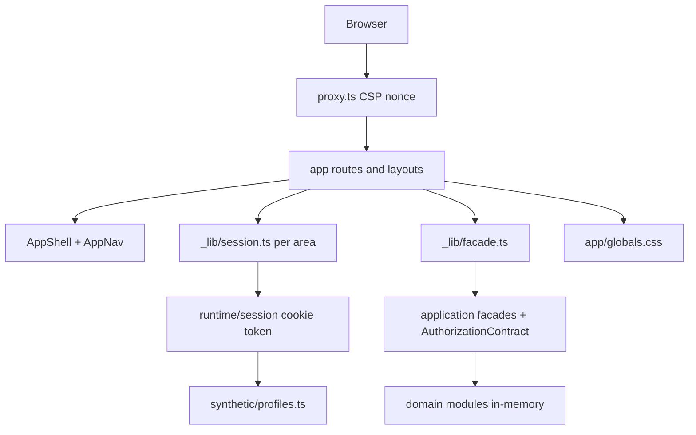
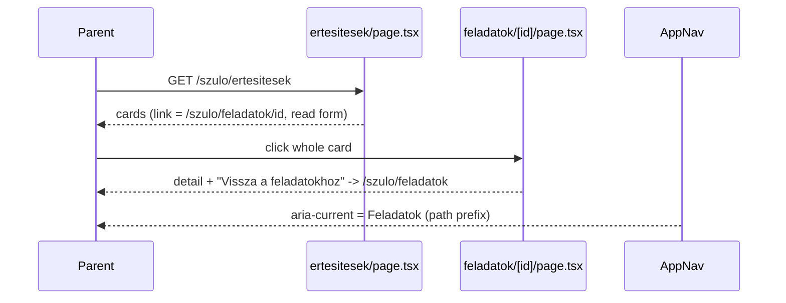
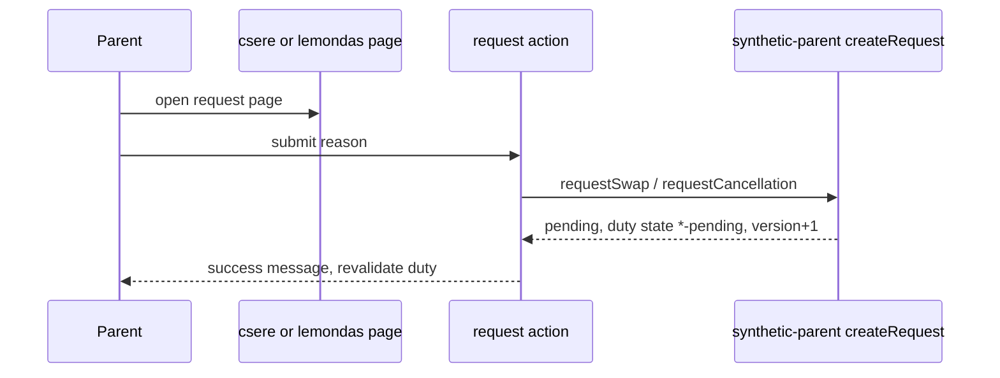
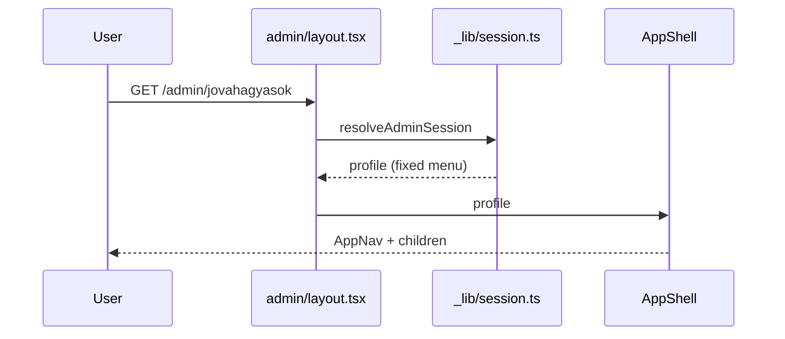

# Architecture

## Architecture Analysis

### System Overview
A single Next.js 16 app-router application (server components, server actions, route handlers) over a set of in-memory domain modules under `src/`. `app/` is the delivery layer; `src/runtime` composes either the synthetic runtime (default) or a production stub; `src/application` holds facades, authorization matrix, idempotency and result mapping; domain modules (`access`, `admin-core`, `parent-web`, `teacher-web`, ...) provide synthetic repositories and services.

### Architectural Style
Layered modular monolith with ports and constructor injection at infrastructure seams. Evidence: `src/runtime/composition.ts` chooses synthetic or production composition; facades take ports (`ParentApplicationPort`, `AdminApplicationPort`, `TeacherApplicationPort`); every protected page resolves a session then a cached facade (`app/*/_lib/session.ts`, `facade.ts`).

### Component Relationships

Text fallback: browser request passes proxy.ts, reaches a route/layout, which resolves the cookie session, hands the profile to AppShell (AppNav renders its menu), calls a cached facade that authorizes against the matrix and reads synthetic domain data.

### Navigation model (changed at HEAD f51c844)
- One menu per profile, defined only in `src/runtime/synthetic/profiles.ts:25-50`: parent `[Feladatok /szulo/feladatok, Értesítések /szulo/ertesitesek]`; teacher empty (no menu); group admin 5 items (Áttekintés, Nyilvántartások, Feladatok és események, Jóváhagyások, Archívum); super admin those 5 plus Importálás, Emlékeztetők, Adatvédelem, Beállítások. `app/admin/_lib/session.ts` no longer rewrites navigation; layouts pass `session.data.profile` to `AppShell`.
- `homePath` per profile: parent `/szulo/ertesitesek` (differs from the first menu item), teacher `/teacher/schedule`, admins `/admin`. `AuthorizationContract.navigation()` in `src/application/authorization.ts` is a separate matrix-derived list not used by the shell.
- `AppNav` (`src/runtime/AppNav.tsx`, client component): `currentNavigationId(items, pathname)` picks the exact href match, else the longest item href that prefixes the path (never `/admin`); sets `aria-current="page"` on that link. The decision uses the path only, so `/szulo/feladatok/<id>` always marks "Feladatok", also when reached from a notification.
- `BackToHomeLink` (`src/runtime/BackToHomeLink.tsx`): link to the person's `homePath`, relabelled "Vissza a beosztáshoz" for the teacher; used only by access-denied/error states. The parent task detail back link ("Vissza a feladatokhoz", `duty-detail-back-link`) is a separate plain `<a>` to `/szulo/feladatok[?allapot=]`.

### Landing and redirect flow
`ProfileSelector` posts `profileId` to `POST /api/synthetic/session`, which sets the signed cookie and 303-redirects to `/`; `app/page.tsx` redirects/renders per profile home. Parent login via `/belepes` returns `destination` (parent home). Admin and teacher layouts redirect signed-out users to `/`.

### Data Flow
Cookie token (HMAC-signed, 8 h) -> `resolveSyntheticSession` -> profile + actor -> page calls facade method -> `AuthorizationContract.authorize` -> domain repository -> projection (allowlist) -> `ApplicationResult` state (`success|empty|denied|...`) -> page maps state to Hungarian UI via `ParentStatePanel` / `AsyncStatePanel` / `TeacherStatePanel`.

### List item pattern (intent-critical)
- Admin: `ResponsiveCollection` renders `li.admin-card` with a whole-card `Link` (title plus `statusLabel(item.state)` badge); used by archivum, jovahagyasok, nyilvantartasok, feladatok. Filter: `AdminFilterBar` (GET `q`, `state`) with a fixed select Minden állapot / Aktív / Archivált / Nyitott / Függőben on every list, although actual values differ per list (records active/archived; tasks open/scheduled; approvals pending/approved). Label source `src/application/status-labels.ts` (`STATUS_LABELS`, `statusLabel`); reminders, privacy lifecycle also use it.
- Parent duties (`app/szulo/feladatok/page.tsx`): whole-card `a.parent-card-link`, own `STATE_LABELS` map (not the shared one), filter `allapot`.
- Parent notifications (`app/szulo/ertesitesek/page.tsx`): whole-card link to `notification.link` plus sibling `NotificationReadForm` (checkbox, auto-submit, focus to card link on success). Read/unread text is rendered from server data (`notification.isRead`).
- Teacher: `ScheduleCollection` table and cards.

### Notification and request state (intent-critical)
- Source of truth: in-memory `state.notifications`, `state.duties`, `state.requests` Maps in `src/parent-web/synthetic-parent.ts`, reset by `/api/synthetic/reset`. Notification fixtures carry a hard-coded `link: "/szulo/feladatok/<dutyId>"`; `markNotificationRead` flips `isRead` and returns the link. Opening a card link does not mark it read; `markNotificationReadAction` does not call `revalidatePath`.
- Swap/cancel: `createRequest` sets duty state `swap-pending` / `cancellation-pending`, bumps version, keeps `assignmentId`; duplicate per kind returns `REQUEST_DUPLICATE`. The duty detail page renders the request links whenever `duty.assignmentId` exists and does not show the duty state; the list shows it via `STATE_LABELS`.

### Admin forms
`AdminMutationForm` (client, `useActionState`) wraps every admin form: status/alert summary, focus on failure, submit button. New record/task pages (`app/admin/nyilvantartasok/uj`, `app/admin/feladatok/uj`) post `saveRecordAction`/`saveTaskAction` with id `new`, expectedVersion 1 and an idempotency key generated at server render (`<prefix>:create:<uuid>`); title validated by `normalizeRequiredText(..., 120)`; success only shows a message (no redirect, no list link). Detail pages show "Verzió: N", and scenario selectors (task "Kapacitási helyzet", privacy "Forgatókönyv", approval hidden `scenario`) exist for test scenarios. No admin page has a back link; each page repeats its own `<header>`.

### Key Design Decisions
Synthetic-first runtime with explicit production boundary; result-state union instead of exceptions at the UI edge; authorization matrix as single permission source; stable `data-testid` hooks used by Playwright; per-browser-project fixture copies ("– Firefox próba", "– mobil próba") because Playwright projects share one server state; single global stylesheet with CSS tokens.

### Improvement Opportunities
Shared state-label map for parent and admin; per-list filter options derived from the list's real values; explicit "from" context for back links and current menu item; revalidate after read-state change; separate test scenario controls from user-facing pages; shared admin page header with back link.

## Interaction Diagrams

### Notification card to duty detail

Text fallback: the card link goes to the duty detail; the menu marks Feladatok and the back link leads to the duties list, not to Értesítések.

### Notification read

Text fallback: ticking the box auto-submits the form; the action marks the in-memory notification read and returns success; the page text "Olvasatlan" is server-rendered and only changes on a fresh render.

### Swap or cancellation request

Text fallback: a request moves the duty to a pending state; a second request of the same kind conflicts.

### Admin page render

Text fallback: the layout resolves the session and renders the shell with the profile's single menu around the page.
