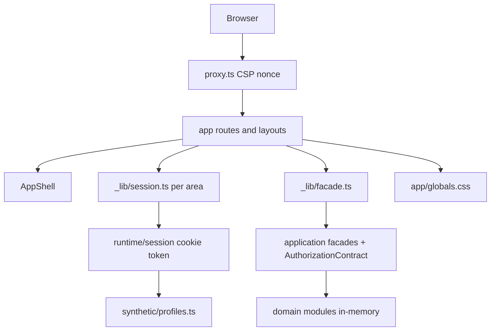
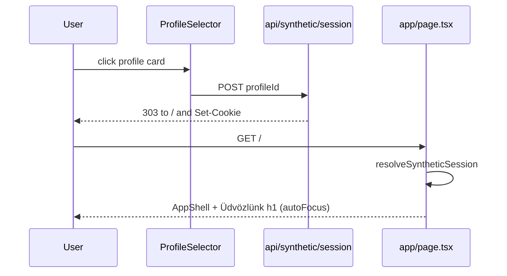
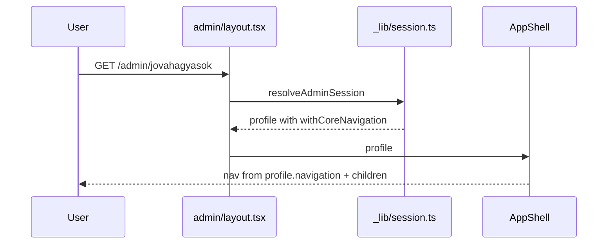
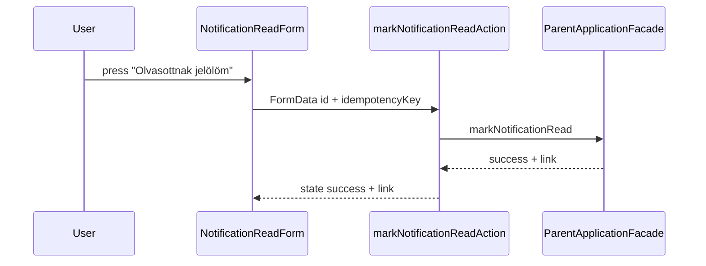

# Architecture

## Architecture Analysis

### System Overview
A single Next.js 16 app-router application (server components, server actions, route handlers) over a set of in-memory domain modules under `src/`. `app/` is the delivery layer; `src/runtime` composes either the synthetic runtime (default) or a production stub; `src/application` holds facades, authorization matrix, idempotency and result mapping; domain modules (`access`, `admin-core`, `parent-web`, `teacher-web`, ...) provide synthetic repositories and services.

### Architectural Style
Layered modular monolith with ports and constructor injection at infrastructure seams. Evidence: `src/runtime/composition.ts` chooses synthetic or production composition; facades take ports (`ParentApplicationPort`, `AdminApplicationPort`, `TeacherApplicationPort`); every protected page resolves a session then a cached facade (`app/*/_lib/session.ts`, `facade.ts`).

### Component Relationships

Text fallback: browser request passes proxy.ts, reaches a route/layout, which resolves the cookie session, builds an area-specific profile for AppShell, calls a cached facade that authorizes against the matrix and reads synthetic domain data.

### Navigation model (intent-critical)
Three independent definitions exist:
1. `src/runtime/synthetic/profiles.ts:25-47` — per-profile `navigation` (parent 2, teacher 1, group admin 3, super admin 8). Used by `app/page.tsx` home, parent and teacher layouts, and as input to the admin layout.
2. `app/admin/_lib/session.ts:76-88` `withCoreNavigation` — replaces admin nav at request time: 5 core items (Áttekintés, Nyilvántartások, "Feladatok és események", Jóváhagyások, Archívum) plus profile items whose ids are not core, so group admin sees 5 and super admin 9 (labels differ: profile nav "Feladatok" vs core "Feladatok és események"; Archívum exists only here). Used only by `app/admin/layout.tsx:16`.
3. `src/application/authorization.ts:46-114` — matrix rows each carry one `navigation` item; `AuthorizationContract.navigation()` (:164-196) returns `{homePath, items}` with `HOME_PATH_BY_ROLE` (:117-122). Not consumed by AppShell; consumed by `SessionApplicationFacade`.
`AppShell` receives a whole `SyntheticProfile` and renders `profile.navigation` unconditionally (no hide-when-single-item logic, no current-page marker). Home path exists in two places (`profile.homePath` and `HOME_PATH_BY_ROLE`); parent value is `/szulo/feladatok` in both.

### Landing and redirect flow
`ProfileSelector` posts `profileId` to `POST /api/synthetic/session`, which sets the signed cookie and 303-redirects to `/` (route.ts:33,46-52). `app/page.tsx` then renders AppShell plus a welcome panel (`<h1 tabIndex={-1} autoFocus>`). Parent login via `/belepes` redirects client-side to `destination` (default `/szulo/feladatok`, actions.ts:53). Admin and teacher layouts redirect signed-out users to `/`.

### Data Flow
Cookie token (HMAC-signed, 8 h) -> `resolveSyntheticSession` -> profile + actor -> page calls facade method -> `AuthorizationContract.authorize` -> domain repository -> projection (allowlist) -> `ApplicationResult` state (`success|empty|denied|...`) -> page maps state to Hungarian UI via `ParentStatePanel` / `AsyncStatePanel` / `TeacherStatePanel`.

### List item pattern (intent-critical)
- Admin: `ResponsiveCollection` renders `li.admin-card` with title, raw `item.state` badge and a "Részletek" `Link` (to `${basePath}/${id}`); used by archivum, jovahagyasok, nyilvantartasok, feladatok pages. Raw English state (active, archived, open, scheduled, pending, approved) is shown; no label map exists for admin.
- Teacher: `ScheduleCollection` renders a table (desktop) and card list (mobile), each with a "Részletek" link; status text is already Hungarian data from the repository.
- Parent duties: already whole-card (`a.parent-card-link` inside `li.parent-card`). Parent notifications: card with "Megnyitás" `<a>` and a separate `NotificationReadForm` button; card has no inner link so `.parent-card {padding:0}` (globals.css:681) leaves text flush with the border.
- Other lists with raw status: reminders (`job.status`), privacy lifecycle (`candidate.eligibility`), import preview.

### Key Design Decisions
Synthetic-first runtime with explicit production boundary; result-state union instead of exceptions at the UI edge; authorization matrix as single permission source; stable `data-testid` hooks used by Playwright; single global stylesheet with CSS tokens (`--color-focus`, terracotta primary).

### Improvement Opportunities
Single navigation source consumed by AppShell; shared state-label map; one `LinkCard` primitive; drop autoFocus headings in favor of explicit skip-link/main focus management; split globals.css.

## Interaction Diagrams

### Profile selection to landing page (current)

Text fallback: card click posts the profile id, the API sets the cookie and redirects to `/`, the home page renders the shell and welcome heading.

### Admin page render with navigation

Text fallback: the layout resolves the session, substitutes the 5/9-item admin navigation and renders the shell around the page.

### Notification read

Text fallback: the client form submits to a server action that calls the parent facade and returns a success state with the target link.
