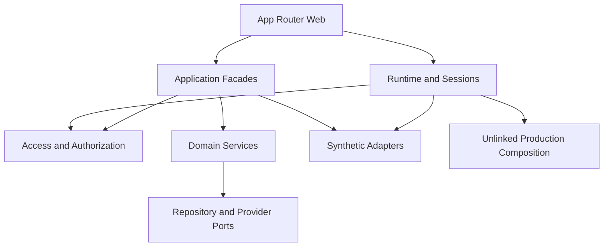
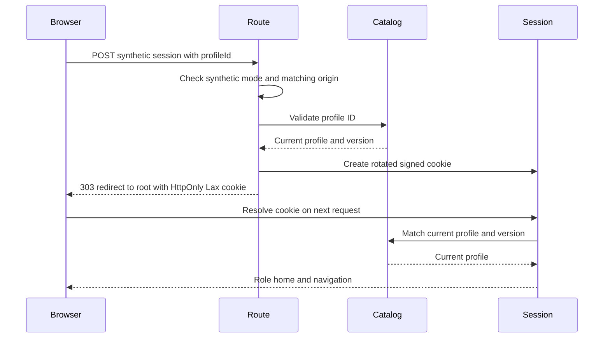
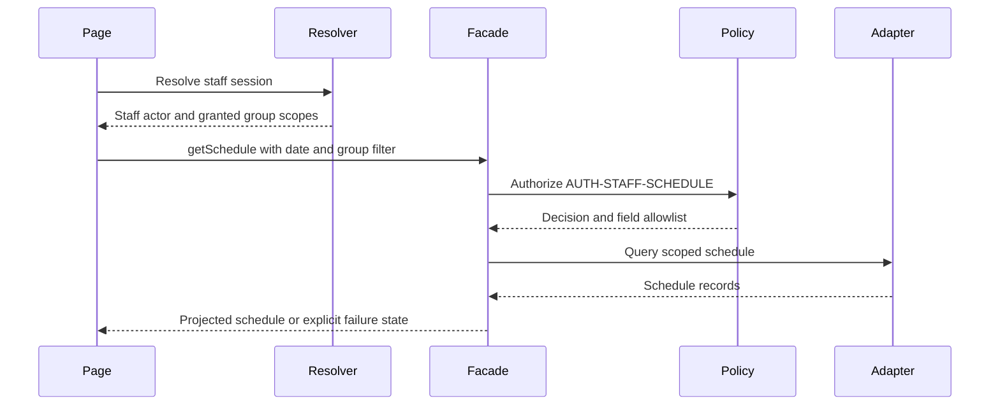

# Architecture Analysis

Static synthesis of the revalidated 2026-10-06 developer scan for `261006-simplify-user-roles`, Standard depth, branch `feature/simplify-user-roles`, observed HEAD `0dce0567f18dc72e46aa88d87e5626708b08bc7d`. Full repository breadth with partial deep coverage. No application changes, tests, builds, browser sessions, migrations or target calls were performed.

## System Overview

One private ESM npm package hosts a Next.js App Router interface, TypeScript application facades and domain services. Synthetic adapters use process-local stores. Production composition validates configuration but returns no current authorization version and makes no backend call.

## Architectural Style

A modular monolith with ports/adapters. Framework entrypoints consume runtime/session resolvers and facades; domain services consume authorization, repository and provider interfaces. No independently deployed services, broker or production transaction guarantee was established.

## Component Relationships

Text fallback: Web resolves sessions and invokes facades. Runtime/facades consume authorization; facades call domain ports or synthetic adapters; domains use repository/provider interfaces. Production is unlinked. This does not imply every synthetic operation executes its domain implementation.

## Data Flow

Signed synthetic cookies carry profile ID and authorization version. Resolution checks signature/expiry and current profile/version. Layouts and actions independently resolve sessions and scopes. Facades apply contract rows, field projections, idempotency and command guards. Synthetic writes change process-local state; domain services express repository transactions and event boundaries. SQL/RLS defines a separate intended backend policy surface.

## Interaction Diagrams

### Profile Selection

Text fallback: mode/origin/profile validation precedes cookie rotation and redirect; next-request resolution checks the current profile/version and selects its home. Invalid input, denied origin and production unavailability return explicit HTTP results; empty profile ID clears the cookie. Profile removal invalidates its cookie unless an alias is designed.

### Scoped Schedule Query

Text fallback: the current resolver accepts synthetic `staff`, emits `read_only_staff` and granted group scopes, then the facade authorizes and projects schedule records. Denied, empty and dependency states remain explicit. Teacher behavior is undecided.

## Key Design Decisions

Observed choices, not new ADRs: one app simplifies delivery; ports permit local adapters; explicit results and projections bound failures and disclosure; production linkage is deferred. Process-local fixtures cannot prove restart durability or real integration semantics.

## Improvement Opportunities

Align role vocabulary and exhaustive runtime rejection across catalog, resolvers, facades/domain checks and SQL. Resolve policy differences before migration, preserving family/group and transaction/event boundaries. Manifest integrity is separate from permission parity. Large facades/adapters have coupling risk; no complete cycle analysis was executed.
