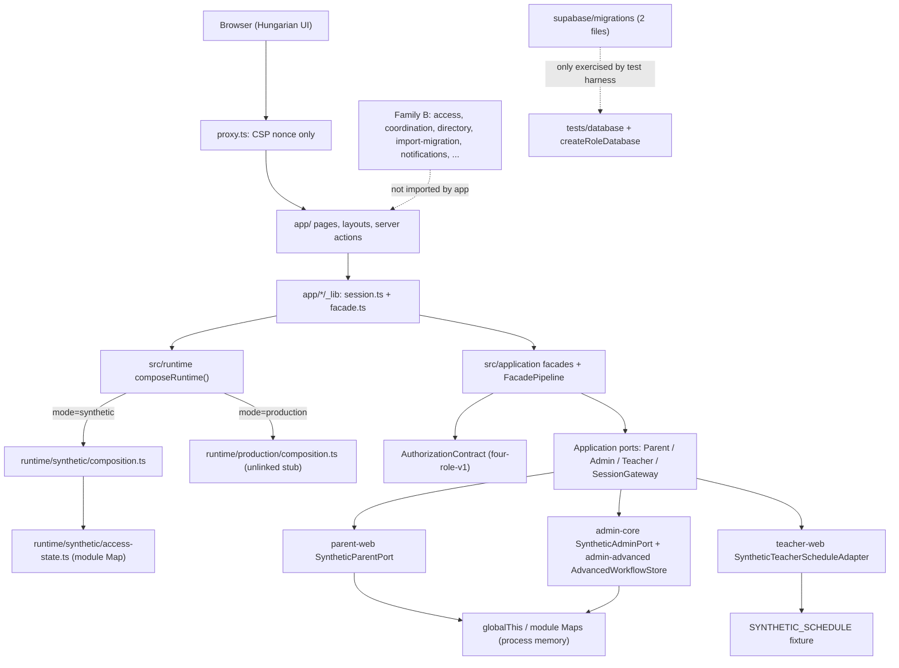
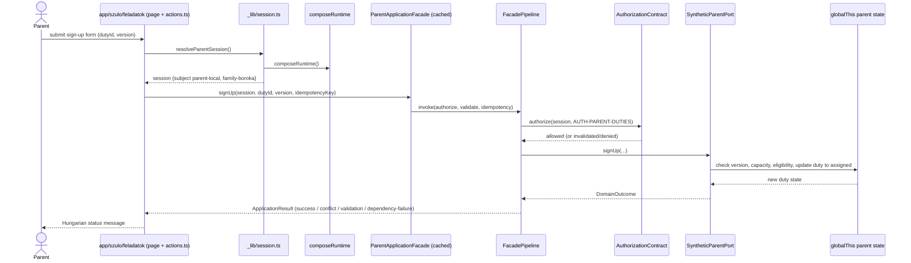
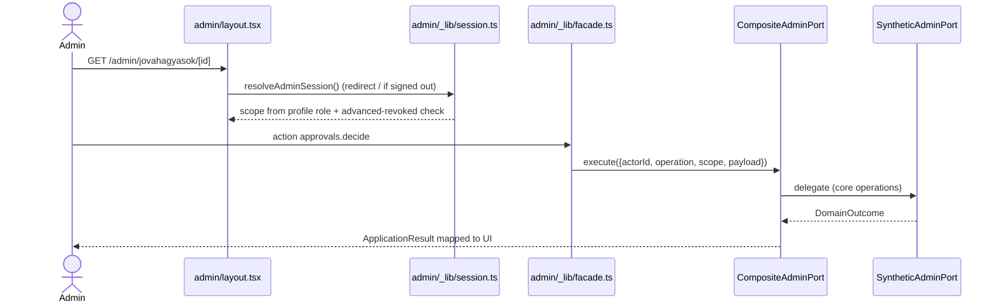
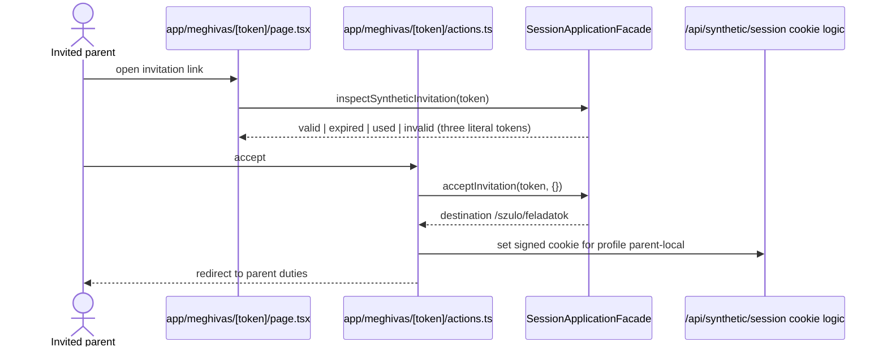

# Architecture Analysis

Full rescan, 2026-10-12, HEAD `80bd4f4`.

## System Overview

A single Next.js 16 App Router application (React 19, TypeScript, zod) with server components and server actions. All business state is held in process memory by four `synthetic-*` adapters. A layered application module (`src/application`) provides authorization, a facade pipeline, idempotency and result modelling in front of those adapters. Alongside the wired path sits a second family of domain modules with repository ports and in-memory implementations that no running code uses. The only database artifacts are two SQL migrations and a throwaway-PostgreSQL test harness.

## Architectural Style

Modular monolith, ports-and-adapters flavoured, with a request-scoped composition root (`composeRuntime()`). Evidence: one `package.json`, no services, `src/<module>/` folders with `types.ts` ports and `in-memory-*` adapters, constructor injection at seams (team rule), explicit result states instead of thrown errors for expected failures.

There are two code families (verified by import grep):

- **Family A, wired:** `src/application`, `src/runtime`, and the adapters `src/parent-web`, `src/admin-core`, `src/admin-advanced`, `src/teacher-web`. Only this code is called by `app/`.
- **Family B, unwired domain services:** `src/access` (services/adapters; only `types`, `role-policy`, `session-grants` are used by Family A), `src/coordination`, `src/directory`, `src/import-migration` (used indirectly by `admin-experience` only), `src/notifications`, `src/parent-experience`, `src/privacy-audit`, `src/admin-experience`, and the `TeacherScheduleService` in `src/teacher-tracking` (its model types are live). They have 258 passing node tests but are referenced only by themselves, their tests, and two integration tests (`tests/integration/retained-workflows.test.ts`, `teacher-boundaries.test.ts`).

## Component Relationships



Text fallback: browser to proxy (CSP only) to pages and server actions; pages call `_lib` session/facade resolvers; these call `composeRuntime()` and `src/application` facades; facades authorize and call the application ports, which are implemented by four in-memory synthetic adapters. Family B modules and the SQL migrations are not on this path.

## Runtime Composition

- `composeRuntime(env)` (`src/runtime/composition.ts`) is async, called on essentially every request, and dynamic-imports one of two compositions. Result type is a discriminated union `mode: "synthetic" | "production"` (`src/runtime/types.ts`).
- The composition only exposes `application.authorization` plus, in synthetic mode, `profiles`. There is no composition-level repository, database handle, clock or facade registry; each `_lib/facade.ts` builds its facade itself.
- Production composition is a stub: `authenticationBoundary: "supabase-unlinked"`, `getCurrentVersion: () => undefined`. Every `_lib/session.ts` and `_lib/facade.ts` returns `denied`/`undefined` unless `mode === "synthetic"`, so production mode serves no feature; `app/page.tsx` shows "Az eles hitelesitesi kapcsolat meg nincs osszekotve".
- Facade lifetime differs per area: parent facade cached on `globalThis[Symbol.for("waldorf.syntheticParentFacade")]`; admin built per call from `getSyntheticAdminPort()`; teacher built per request with a `scenario` argument.

## Session and Access Model

- Cookie `waldorf_local_session`: base64url JSON payload `{profileId, authorizationVersion, issuedAt, nonce}` plus HMAC-SHA256 signature, `httpOnly`, `sameSite: lax`, 8 h, `secure` passed as `false` by every caller. The secret is the source constant `waldorf-local-synthetic-session-key-v1`; `APP_SESSION_SECRET` is validated by production config but never read by session code.
- `profileId` doubles as `subjectId`. Resolution looks up `getSyntheticProfile` and `currentSyntheticActor` and compares the stored authorization version; a version bump is the only revocation. No server-side session record, rotation or per-session id. Sign-out is a POST of `profileId=""` to `/api/synthetic/session`.
- `SessionContext` carries `subjectId`, `authorizationVersion`, `isActive`, `grants`, `roles`, `scopes`, `runtimeMode`, `isSynthetic`. `AuthorizationContract.authorize` rejects an inconsistent mode pair (`INVALID_SESSION_MODE`), returns `invalidated` for stale versions, then does matrix lookup (row id, actions, resources, fields) and scope containment (organization grant contains everything in the org; group/family grants only same type and id).
- Grants per synthetic profile come from `src/runtime/synthetic/access-state.ts`: parent to family `family-boroka` (org `org-napsugar`); teacher to groups `group-oak`, `group-sunflower` (org `org-waldorf-local`); group admin to group `group-boroka` (org `org-napsugar`); super admin to org `org-napsugar`. Grant ids are `<subjectId>:<role>:<scopeType>:<scopeId>`.
- The parent session resolver forces `familyId = PARENT_FAMILY_SCOPE.id` (constant); the admin resolver derives scope from the profile role, not from grants; the teacher resolver derives groups from grants.
- Gating is in layouts and actions, not in `proxy.ts`: `app/admin/layout.tsx` and `app/teacher/layout.tsx` redirect to `/` when signed out; `app/szulo/layout.tsx` renders an access-state panel; denials go to `app/hozzaferes-megtagadva/page.tsx`. `/api/*` is outside the proxy matcher.

## Data Flow

Request path: page or action calls `resolve<X>Session()` (reads cookie, composes runtime, validates version) then `resolve<X>Facade()`; the facade runs `FacadePipeline.invoke`: authorize, optional validate, idempotency coordinator, domain invoke (the port), project (projection guard). Unexpected throws map through `AdapterFailureClassifier` to retryable/terminal dependency failures. Results are `ApplicationResult`/`DomainOutcome<T>` and are mapped to UI state (`mapParentResult`, `mapApplicationResult`). State changes write to in-process Maps; an event journal (`InMemoryApplicationJournal`) and idempotency store (`InMemoryIdempotencyStore`) are also in memory.

## Database Layer (what exists)

- `supabase/migrations/20260806_access_rls.sql` (historical baseline) and `20261006_current_roles.sql` (current roles). Details in `code-structure.md` and `code-quality-assessment.md`.
- `src/access/supabase-route-adapter.ts` is the only application code that speaks to a database port (`SupabaseClientPort` RPC: `authorization_version_for`, `has_current_role_scope`); it is async and unused.
- `scripts/verification/current-role-database.ts` creates a throwaway PostgreSQL 18 cluster (unix socket, port 55439, `psql` CLI) for `tests/database/current-role-migration.test.ts`.

## What a Real-Backend Migration Will Meet

State of the code, as observations.

### Unwired src modules versus the four adapters that run
Nine `src` modules have repository ports and tests but no caller. The logic for sign-up, swap, import, reminders and lifecycle currently exists twice: once in Family B, once embedded in the in-memory Family A ports (`SyntheticParentPort`, `SyntheticAdminPort`, `AdvancedWorkflowStore` mix rules with state). The Family A ports are the async seam the app calls; Family B ports are synchronous (`findById(): User | undefined`, `transaction<T>(op: () => T): T`); `InMemoryAccessTransaction.run` throws `ASYNC_TRANSACTION_UNSUPPORTED` for promises; `IdempotencyStore` is sync. `AuthorizationVersionPort` and `TeacherScheduleRepository.readCurrent` already allow promises.

### Id and organization mismatches between SQL and TypeScript
SQL ids (`subject_id`, `scope_id`, `organization_id`, row ids) are `uuid`. Every TypeScript fixture id, the session cookie, and `verification/fixtures.json` use slug strings (`family-boroka`, `org-napsugar`, `parent-local`); `isValidScope` accepts any non-empty string. Organization slug differs by fixture: teacher data `org-waldorf-local`, parent/admin `org-napsugar`, `verification/fixtures.json` a third set (`family-fenyo`, `group-oak`).

### The unapplicable first migration
`20260806_access_rls.sql` aliases a table with the reserved word `grant` (`from app_role_grants grant`, lines 23 and 32) and fails on real PostgreSQL 18.6 with `syntax error at or near "grant"`; dependent policies then fail with `function has_active_scope(uuid, uuid) does not exist`. `tests/unit/current-role-references.test.ts` pins the file's SHA-256 (`a34b85b7...2449d`). The database test uses `tests/database/fixtures/current-role-baseline.sql` (alias `g`) so it never runs the real file. The file also needs the `auth` schema, `auth.uid()` and roles `authenticated`/`anon`, which exist on hosted Supabase and are emulated only in the test fixture. The file name `20260806_access_rls.sql` has no time part.

### Thin SQL coverage
Covered: role/scope validity, authorization version, grant revocation, core-scope containment. Not covered by any table: school years, groups, children, parents/user profiles, tasks, events, capacity, signups, swap/cancel requests, approvals, notifications, reminder jobs/attempts, invitations, import preview/conflict/sheet registry, contribution notes, settings, recipients, lifecycle holds, contact visibility, idempotency records, evidence/event journal. `app_families` has no name or contact columns; `app_assignments` has no family, task, state or version columns; `app_audit_events` has only `summary`. Teacher reads and the field-level projection "U2 projects" mentioned in SQL comments do not exist.

### Stub authentication and fake features
No user store, e-mail, password or provider identity; invitations accept three literal tokens; login accepts the literal `parent-local`. Fake behaviours: admin `assign` returns success storing nothing; `saveNotes` only bumps the version; dashboard `openImportConflicts` hardcoded `0`; import preview is a fixed fixture (`preview-waldorf-v1`, 30 rows, 1 conflict); reminders have no runner; lifecycle and governance operate on 3 hardcoded rows; provider labels are literal "simulated". The parent flow is single-parent and single-family by construction (`ownsFamily` and notification handlers compare to `"parent-local"`; notifications are one global list).

### Synthetic-mode footprint
About 50 non-test files reference synthetic mode; `scenario` hooks appear in 47 places under `app/` (63 raw word hits in 15 files); nine of eleven Playwright specs call `POST /api/synthetic/reset`; about 40 vitest files import synthetic modules or reset state; evidence tooling (`scripts/verification/core.ts`) encodes `runtimeMode` `synthetic` vs `linked-target`; CI env and `build-metadata.json` carry synthetic env. Global mutable state: three stores on `globalThis` plus a module-level `Map` in `access-state.ts` (a documented multi-module-copy risk after production build).

### Config that rejects a local database
`validateRuntimeConfig` accepts only `APP_RUNTIME_MODE` of `synthetic` or `production`; production requires `SUPABASE_URL` with `https://` (so `http://127.0.0.1:54321` fails with `CONFIG_PRODUCTION_INVALID`), `SUPABASE_ANON_KEY` min 20, `APP_SESSION_SECRET` min 32. `predev`, `prebuild`, `prestart` run `scripts/validate-runtime-config.ts`, so a new mode or variable must pass there too.

### Environment
No `docker`, `podman`, `colima`, `lima`, OrbStack or Supabase CLI. Homebrew `postgresql@18` 18.6_1 is installed, not running; starting a cluster needs `LC_ALL=C` and `LANG=C` (otherwise `FATAL: postmaster became multithreaded during startup`). The existing harness already sets both and uses `initdb --no-locale --encoding=UTF8`. Default `node` is v26.11.1 while the repo requires 24 (`/opt/homebrew/opt/node@24/bin`, 24.21.0). Unix-socket paths over 103 bytes fail, so the temp dir must be short. Disk: about 15 GiB free on `/`. Security tooling (Microsoft Defender, "Admin By Request") may restrict tool installs (inference).

## Key Design Decisions

- Four-role versioned authorization with a single matrix (`four-role-v1`) and revocation by version bump.
- Result-state modelling: 12 states with presentation codes; expected failures never thrown.
- Facade pipeline with idempotency and projection guard around every operation.
- Per-browser server isolation in e2e: three Next servers (ports 3100-3102) each with their own in-memory copy and `SYNTHETIC_TEST_COPIES=1`.
- Honest coverage denominator: every production file must be measured at 80/80/80.
- ADR-style rule: no executable deployment workflows until a deployable app and target exist.

## Improvement Opportunities (observations)

- Family B and Family A duplicate business rules; one of them is dead code for the app.
- Contract tests over the application ports would cover any future adapter; they exist today only against in-memory implementations.
- Sync ports versus async facades, slug versus uuid ids, and the hardcoded session secret are the largest structural gaps between the current code and a persistent backend.

## Interaction Diagrams

All four flows below are how the code behaves today, with in-memory state.

### 1. Parent signs up for a task



Text: page action resolves session, gets the cached facade, pipeline authorizes against the parent matrix row, validates, checks the idempotency key, calls `SyntheticParentPort.signUp`, which checks version/capacity in the in-memory map and returns a result state; ids `duty-retry` and `duty-terminal` inject failures.

### 2. Swap request and approval

```mermaid
sequenceDiagram
  actor P as Parent
  actor A as Group admin
  participant PW as app/szulo/feladatok/[id]/csere
  participant PP as SyntheticParentPort
  participant AD as app/admin/jovahagyasok
  participant AP as SyntheticAdminPort
  P->>PW: request swap (assignment, counterpart; optional ?scenario)
  PW->>PP: requestSwap
  PP-->>PW: duty state swap-pending, request stored in Map
  A->>AD: open approvals list
  AD->>AP: approvals.list
  AP-->>AD: INITIAL_APPROVALS fixture items (4)
  A->>AD: decide (approve or reject, version)
  AD->>AP: approvals.decide
  AP-->>AD: version bumped, state updated
  Note over PP,AP: The two ports share no state, so the parent swap request does not create an admin approval item
```

Text: the parent port and the admin port are separate in-memory stores; `assignment-counterpart` is the magic id used in tests. Auto-approval logic exists in `src/coordination` but is not called here.

### 3. Admin approval



Text: `CompositeAdminPort` routes 13 operations to `AdvancedWorkflowStore` and the rest to `SyntheticAdminPort`; authorization (`AUTH-GROUP-ADMIN-CORE`, `AUTH-SUPER-ADMIN`) is evaluated in the facade pipeline first.

### 4. Invitation



Text: acceptance creates no identity or family binding; the same four-profile cookie is issued. Resend is a no-op gateway call with a non-enumerating message.

### 5. Reset (test only)

`POST /api/synthetic/reset` (404 unless synthetic) resets access state, admin, advanced and parent stores and the parent facade cache; nine Playwright specs call it during setup.
