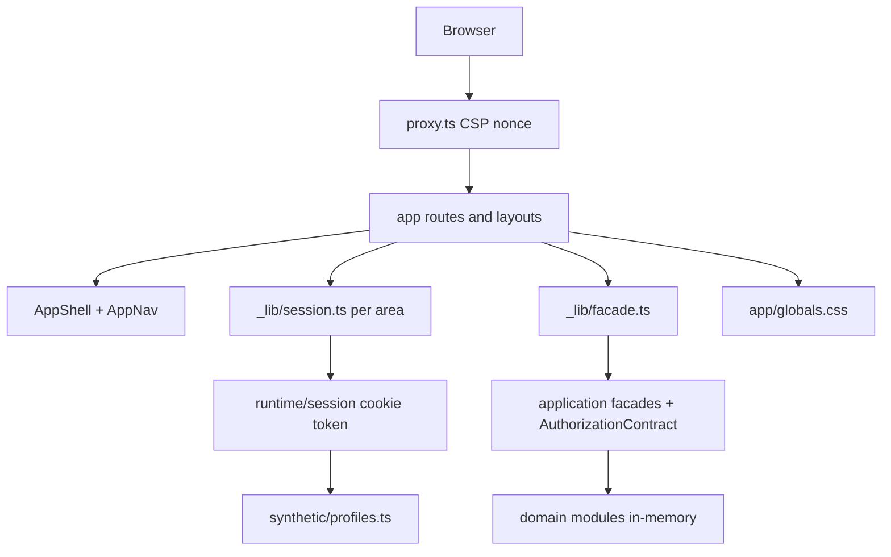
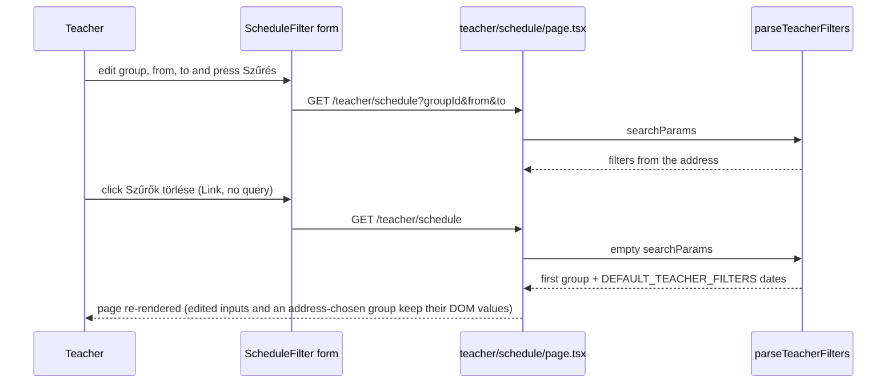
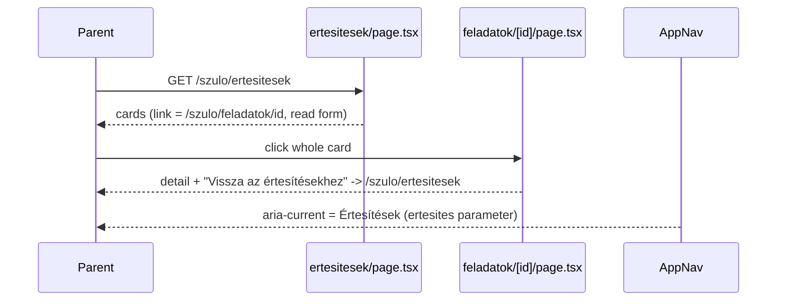
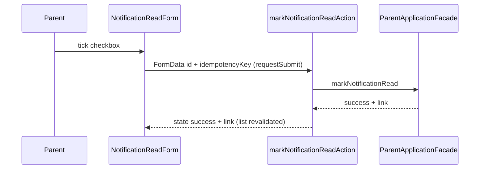
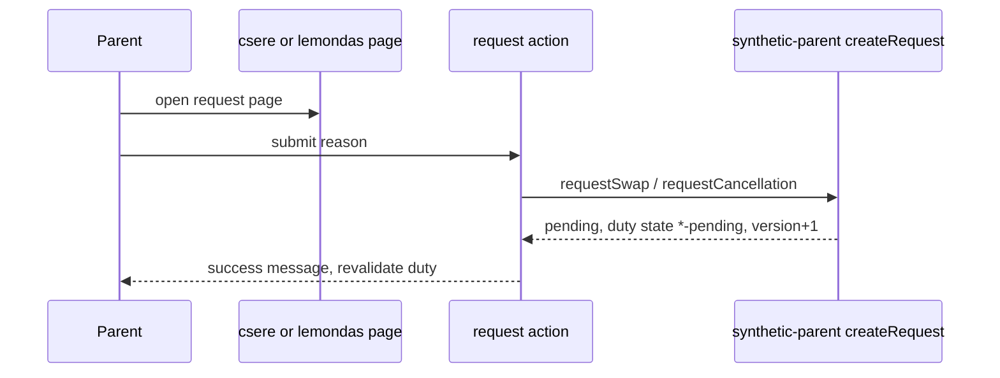
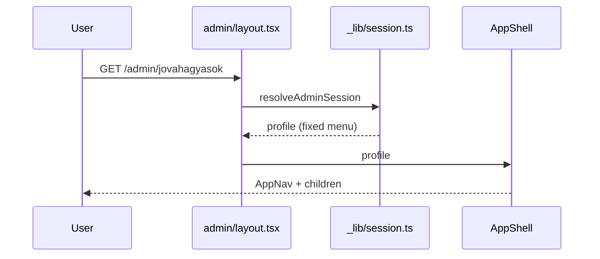

# Architecture

## Architecture Analysis

### System Overview
A single Next.js 16 app-router application (server components, server actions, route handlers) over a set of in-memory domain modules under `src/`. `app/` is the delivery layer; `src/runtime` composes either the synthetic runtime (default) or a production stub; `src/application` holds facades, authorization matrix, idempotency and result mapping; domain modules (`access`, `admin-core`, `parent-web`, `teacher-web`, ...) provide synthetic repositories and services.

### Architectural Style
Layered modular monolith with ports and constructor injection at infrastructure seams. Evidence: `src/runtime/composition.ts` chooses synthetic or production composition; facades take ports (`ParentApplicationPort`, `AdminApplicationPort`, `TeacherApplicationPort`); every protected page resolves a session then a cached facade (`app/*/_lib/session.ts`, `facade.ts`).

### Component Relationships

Text fallback: browser request passes proxy.ts, reaches a route/layout, which resolves the cookie session, hands the profile to AppShell (AppNav renders its menu), calls a cached facade that authorizes against the matrix and reads synthetic domain data.

### Navigation model (HEAD 2cc6e42, deep scan 2026-10-09)
- One menu per profile, defined only in `src/runtime/synthetic/profiles.ts:25-50`: parent `[Értesítések /szulo/ertesitesek, Feladatok /szulo/feladatok]`; teacher empty (no menu); group admin 5 items (Áttekintés, Nyilvántartások, Feladatok és események, Jóváhagyások, Archívum); super admin those 5 plus Importálás, Emlékeztetők, Adatvédelem, Beállítások. `app/admin/_lib/session.ts` no longer rewrites navigation; layouts pass `session.data.profile` to `AppShell`.
- `homePath` per profile: parent `/szulo/ertesitesek` (differs from the first menu item), teacher `/teacher/schedule`, admins `/admin`. `AuthorizationContract.navigation()` in `src/application/authorization.ts` is a separate matrix-derived list not used by the shell.
- `AppNav` (`src/runtime/AppNav.tsx`, client component): `currentNavigationId(items, pathname, openedFromNotification)` picks the exact href match, else the longest item href that prefixes the path (never `/admin`); sets `aria-current="page"` on that link. Since the functional-test fixes the decision is NOT path-only: a `/szulo/feladatok/<id>` path with the `ertesites` query parameter marks "Értesítések" (read through `useSearchParams` inside a `Suspense` boundary whose fallback renders path-only).
- `BackToHomeLink` (`src/runtime/BackToHomeLink.tsx`): link to the person's `homePath`, relabelled "Vissza a beosztáshoz" for the teacher; used only by `ParentAccessState` and `AdminAccessState` (denied/error states). The parent task detail back link (`duty-detail-back-link`) is a plain `<a>`: "Vissza az értesítésekhez" to `/szulo/ertesitesek` when the page was opened from the parent's own notification (validated by `resolveNotificationContext`), else "Vissza a feladatokhoz" to `/szulo/feladatok[?allapot=]`. The swap and cancellation pages always link back to the task only.
- Shell composition: three layouts (`app/szulo/layout.tsx`, `app/admin/layout.tsx`, `app/teacher/layout.tsx`, all `force-dynamic`) resolve their area session, render an access-state page (with `BackToHomeLink`, no shell) when it is not a success, and otherwise wrap children in `AppShell`. `signed-out` redirects to `/` for admin and teacher; the parent layout shows `ParentAccessState` instead. `AppShell` shows the skip link, brand mark, profile summary, the "Tesztprofil váltása" form (POST with empty `profileId` to `/api/synthetic/session`), the menu when the profile has items, `<main id="fo-tartalom">` and a hidden live region.

### Landing and redirect flow
`ProfileSelector` posts `profileId` to `POST /api/synthetic/session`, which sets the signed cookie and 303-redirects to `/`; `app/page.tsx` redirects/renders per profile home. Parent login via `/belepes` returns `destination` (parent home). Admin and teacher layouts redirect signed-out users to `/`.

### Data Flow
Cookie token (HMAC-signed, 8 h) -> `resolveSyntheticSession` -> profile + actor -> page calls facade method -> `AuthorizationContract.authorize` -> domain repository -> projection (allowlist) -> `ApplicationResult` state (`success|empty|denied|...`) -> page maps state to Hungarian UI via `ParentStatePanel` / `AsyncStatePanel` / `TeacherStatePanel`.

### List item pattern (intent-critical)
- Admin: `ResponsiveCollection` renders `li.admin-card` with a whole-card `Link` (title plus `span.admin-state-badge` with `statusLabel(item.state)`, plain muted text); used by archivum, jovahagyasok, nyilvantartasok, feladatok. Filter: `AdminFilterBar` (GET `q`, `state`), per-list options from `ADMIN_LIST_STATUS_OPTIONS` (records active/archived; tasks open/scheduled; approvals pending/approved/rejected), unknown status shows the unfiltered list plus a note. The bar has no clear control and uses uncontrolled `defaultValue` inputs. `AdminPagination` is a static placeholder. Detail and "new" pages use `AdminBackLink`; lists pass `returnQuery` (`vissza` parameter) so the back link restores `q`/`state`. Label source `src/application/status-labels.ts`; reminders, privacy lifecycle also use it.
- Parent duties (`app/szulo/feladatok/page.tsx`): whole-card `a.parent-card-link`, shared `DUTY_STATE_LABELS` / `dutyStateLabel`, filter `allapot` (no clear control).
- Teacher schedule: `ScheduleFilter` GET form (`groupId`, `from`, `to`; uncontrolled, `required` dates) with "Szűrők törlése" `Link` to `/teacher/schedule`; `parseTeacherFilters` (app/teacher/_lib/filters.ts) turns the missing params into the group default and the fixed `DEFAULT_TEACHER_FILTERS` dates, so "clear" means reset-to-defaults. The empty state (`TeacherStatePanel`) shows a second clear link to the same target.
- Filter layout: each surface has its own CSS grid (`.admin-filter` 5 columns, `.teacher-filter fieldset` 4 columns holding 3 label/control pairs plus buttons, `.parent-filter` 3 columns); label and control are flat siblings, not wrapped per field, and all collapse to one column at <=44rem.
- Status presentation: text only. Colour tokens live on `:root` (app/globals.css:3-20) and are contrast-tested; native `select` options show plain text, so any symbol in a filter option would have to be part of the string.
- Create links: "Új rekord" / "Új feladat vagy esemény" are unstyled `Link`s in `div.admin-page-actions`; the global `button` rule is the existing pill style, `.secondary-button` the outlined variant.
- Parent notifications (`app/szulo/ertesitesek/page.tsx`): whole-card link to `notification.link` plus sibling `NotificationReadForm` (checkbox, auto-submit, focus to card link on success). Read/unread text is rendered from server data (`notification.isRead`).
- Teacher: `ScheduleCollection` table and cards.

### Notification and request state (intent-critical)
- Source of truth: in-memory `state.notifications`, `state.duties`, `state.requests` Maps in `src/parent-web/synthetic-parent.ts`, reset by `/api/synthetic/reset`. Notification fixtures carry a hard-coded `link: "/szulo/feladatok/<dutyId>"`; `markNotificationRead` flips `isRead` and returns the link. At HEAD, opening a card goes to `<link>?ertesites=<id>`; the task page mounts `MarkNotificationRead`, which marks the notification read once in the browser; the checkbox path (`NotificationReadForm`) does the same through `markNotificationReadAction`, which calls `revalidatePath("/szulo/ertesitesek")` on success.
- Swap/cancel: `createRequest` sets duty state `swap-pending` / `cancellation-pending`, bumps version, keeps `assignmentId`; duplicate per kind returns `REQUEST_DUPLICATE`. The duty detail page shows the state (`dutyStateLabel`), a pending notice and hides the request links while a request waits; the request pages swap the form for `PendingRequestPanel` after success or when already pending (`ParentMutationForm.afterSuccess`/`alreadyDone`). `revalidateParentDuty` refreshes list and detail.

### Admin forms
`AdminMutationForm` (client, `useActionState`) wraps every admin form: status/alert summary, focus on failure, submit button. New record/task pages (`app/admin/nyilvantartasok/uj`, `app/admin/feladatok/uj`) post `saveRecordAction`/`saveTaskAction` with id `new`, expectedVersion 1 and an idempotency key generated at server render (`<prefix>:create:<uuid>`); title validated by `normalizeRequiredText(..., 120)`; success shows a message plus a link back to the list (`successLink`). Technical fields ("Verzió", scenario selectors) are collapsed in `DeveloperDetails`. Detail and "new" pages carry `AdminBackLink`; each page still repeats its own `<header>`. User-facing wording on the record forms says "rekord" (heading "Új rekord", label "Rekord típusa", submit "Rekord létrehozása", detail heading "Rekord részletei").

### Key Design Decisions
Synthetic-first runtime with explicit production boundary; result-state union instead of exceptions at the UI edge; authorization matrix as single permission source; stable `data-testid` hooks used by Playwright; per-browser-project fixture copies ("– Firefox próba", "– mobil próba") because Playwright projects share one server state; single global stylesheet with CSS tokens.

### Improvement Opportunities
Shared state-label map for parent and admin; per-list filter options derived from the list's real values; explicit "from" context for back links and current menu item; revalidate after read-state change; separate test scenario controls from user-facing pages; shared admin page header with back link.

## Interaction Diagrams

### Teacher filter and clear (current behavior)

Text fallback: submitting sends the three fields in the address; the clear link requests the bare path, the parser fills the group and the fixed default dates. VERIFIED by a browser run on 2026-10-09: untouched date fields reset to 2026-08-12/2026-08-20, but a date typed without submitting stays, and a group that came from the address stays selected after the soft navigation (reload shows the first group); so the unkeyed uncontrolled inputs keep stale values.

### Notification card to duty detail

Text fallback: the card link goes to the duty detail with the notification id; the page marks it read in the browser, the menu keeps Értesítések current and the back link leads to the notification list (without the parameter it behaves as the task list case).

### Notification read

Text fallback: ticking the box auto-submits the form; the action marks the in-memory notification read, revalidates the list and returns success; focus moves to the card link; the text "Olvasatlan" is server-rendered and changes on the refreshed render.

### Swap or cancellation request

Text fallback: a request moves the duty to a pending state; a second request of the same kind conflicts.

### Admin page render

Text fallback: the layout resolves the session and renders the shell with the profile's single menu around the page.
