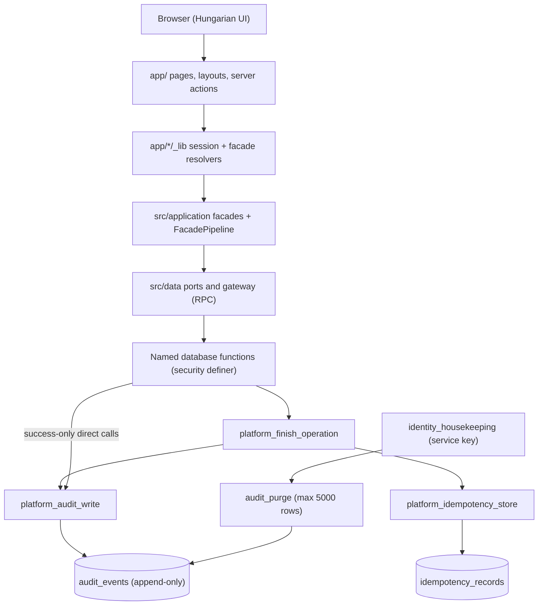
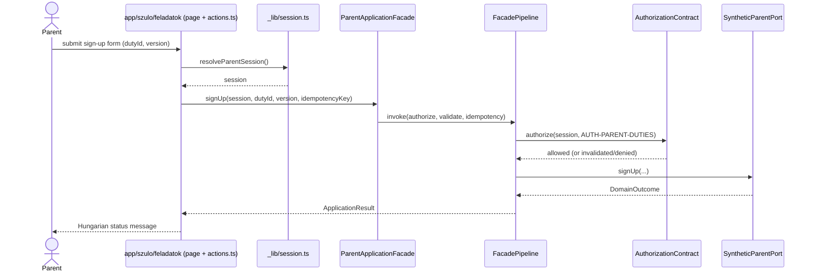
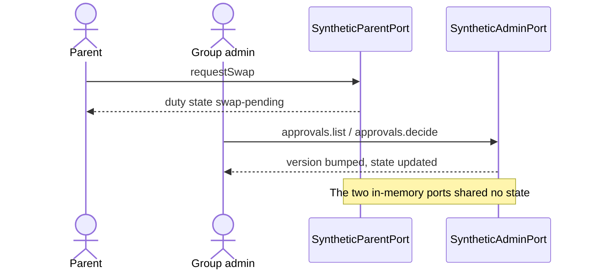
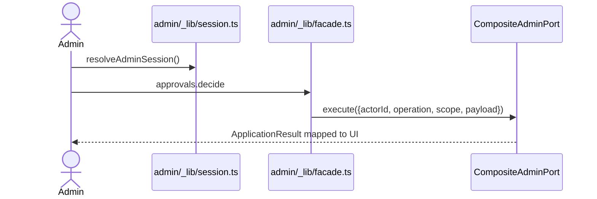
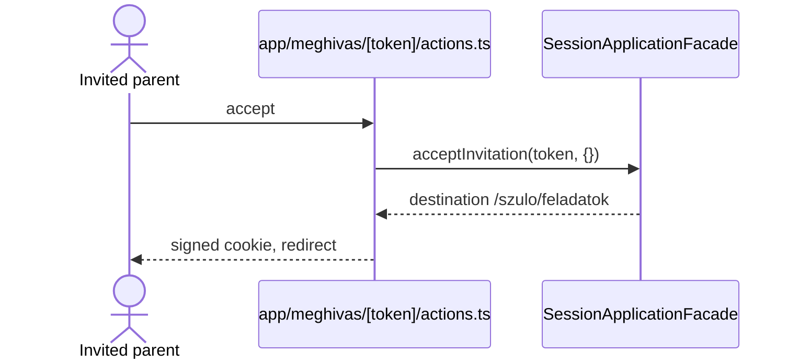
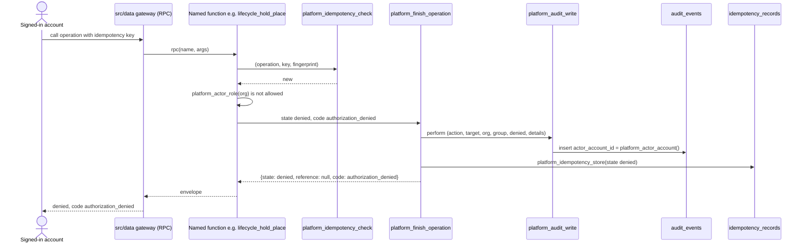

# Architecture Analysis

Full rescan 2026-10-12 (HEAD `80bd4f4`), focused update 2026-10-27 (HEAD `5d2b484`, intent `denied-audit-ratelimit`). The focused update rewrote "Database Layer" and added "Platform audit write" and interaction diagram 6. Every other section is kept from 2026-10-12 and describes the synthetic prototype as it was then; it is stale wherever the U1 to U5 backend work changed the application (not re-scanned).

## System Overview

A single Next.js 16 App Router application (React 19, TypeScript, zod) with server components and server actions. At the 2026-10-12 scan all business state was held in process memory by four `synthetic-*` adapters behind a layered application module (`src/application`: authorization, facade pipeline, idempotency, result modelling). Since then (2026-10-27 listing) the business state lives in a Supabase PostgreSQL schema built by 39 forward-only migrations; the application reaches it through database functions called over the data API (`src/data/gateway.ts`, `client.rpc(name, args)`), each returning the envelope `{state, reference, code}`.

## Architectural Style

Modular monolith, ports-and-adapters flavoured, with a request-scoped composition root (`composeRuntime()`). In the database (2026-10-27) the same style continues: tables are closed to application roles, and every change goes through a named `security definer` function that authorizes, changes, audits and stores the idempotent result in one transaction.

The 2026-10-12 scan found two code families (verified by import grep then):

- **Family A, wired:** `src/application`, `src/runtime`, and the adapters `src/parent-web`, `src/admin-core`, `src/admin-advanced`, `src/teacher-web`.
- **Family B, unwired domain services:** `src/access`, `src/coordination`, `src/directory`, `src/import-migration`, `src/notifications`, `src/parent-experience`, `src/privacy-audit`, `src/admin-experience`, and `TeacherScheduleService` in `src/teacher-tracking`.

## Component Relationships

Text fallback: browser to pages and server actions; resolvers call `src/application` facades; facades call `src/data` ports, which call named database functions over RPC. A named function finishes through `platform_finish_operation`, which calls `platform_audit_write` for a success or a denial and always stores the idempotent result. A few functions call `platform_audit_write` directly, always with outcome `success`. The service-key housekeeping purges audit events older than 365 days. The diagram's application half is from the 2026-10-12 scan plus a 2026-10-27 skim of `src/data/gateway.ts`; the database half was analyzed on 2026-10-27.

## Runtime Composition (2026-10-12)

- `composeRuntime(env)` (`src/runtime/composition.ts`) is async, called on essentially every request, and dynamic-imports one of two compositions. Result type is a discriminated union `mode: "synthetic" | "production"`.
- Production composition was then a stub (`authenticationBoundary: "supabase-unlinked"`).
- Facade lifetime differs per area: parent facade cached on `globalThis`; admin built per call; teacher built per request with a `scenario` argument.

## Session and Access Model (2026-10-12)

- Cookie `waldorf_local_session`: HMAC-SHA256 signed payload `{profileId, authorizationVersion, issuedAt, nonce}`, 8 h, secret was a source constant.
- `AuthorizationContract.authorize` rejects an inconsistent mode pair (`INVALID_SESSION_MODE`), returns `invalidated` for stale versions, then does matrix lookup and scope containment.
- Gating is in layouts and actions, not in `proxy.ts`.

Database side (2026-10-27): `current_session_is_active()` (20261015:9-22) accepts a request only for a live `auth.sessions` row of an active account (30-day inactivity limit). `platform_actor_account()` (redefined in 20261015:51-67) raises `28000` without a signed-in user and `42501` without an active session, and returns the nil system account `00000000-0000-0000-0000-000000000000` when the caller is `postgres`, `service_role` or `supabase_admin` (`platform_caller_is_system()`, 20261012:14-16).

## Data Flow

Request path (2026-10-12): page or action calls `resolve<X>Session()` then `resolve<X>Facade()`; the facade runs `FacadePipeline.invoke`: authorize, optional validate, idempotency coordinator, domain invoke (the port), project. Results are `ApplicationResult`/`DomainOutcome<T>` mapped to UI state.

Database path (2026-10-27): a named function computes a SHA-256 request fingerprint, calls `platform_idempotency_check` (advisory transaction lock per account, operation and key; returns `new`, `replay` or `conflict`), validates, authorizes with `platform_actor_role(org)` or the identity helpers, changes rows, then returns `platform_finish_operation(...)`. Validation, conflict and terminal states store a result but write no audit event.

## Database Layer (2026-10-27)

- 39 files in `supabase/migrations/`, applied in file-name order by the project's runner (`npm run db:migrate`, `scripts/db/runner.ts`) into `public` and into the test schemas `worker_1`..`worker_4`; the Supabase CLI migration feature is off (`supabase/config.toml`).
- Forward-only is enforced: the runner stores a checksum per applied file and refuses a changed file ("migrations are forward-only. Reset the schema or add a new file.", `runner.ts:146-151`). Follow-up files say so in their header ("Forward-only: the merged file X is not edited", 20261044:2, 20261045:1-2).
- Schema-neutral is enforced: no `public.`/`worker_N.` qualified names, no fixed `search_path`, no `create schema`; every function uses `set search_path from current` (`runner.ts:41-55`; `migrations.test.ts` checks every function's pinned path).
- Privileges: no table rights for `anon`, `authenticated` or `service_role` on platform tables; functions lose the default PUBLIC execute right and get explicit grants next to their definition (20261019:21-67). A redefinition with `create or replace` keeps the old ACL, but the convention is to restate the revoke/grant lines.
- Units: U1 platform (20261012-20261013), U2 identity (20261014-20261023, 20261033), U3 directory/coordination/kernel/schedule/lifecycle (20261024-20261035), U4 notifications and import (20261036-20261043), U5 audit purge (20261044), follow-up B1 purge isolation (20261045).

## Platform audit write (2026-10-27)

- Table `audit_events` (20261012:60-82): `id uuid` default `gen_random_uuid()`, `actor_account_id uuid not null`, `actor_role` (check list), `action` (check list, widened in 20261014:88-95 by drop/add of `audit_events_action_check`), `target_type`, `target_id uuid`, `organization_id uuid`, `group_id uuid` nullable, `outcome` in (`success`, `denied`), `details` code-shaped, `occurred_at timestamptz default now()`. Indexes: `audit_events_actor (actor_account_id, occurred_at desc)`, `audit_events_target (target_type, target_id, occurred_at desc)`, `audit_events_time (occurred_at desc)`. RLS on; read policy `audit_events_admin_read` (20261015:152-155); no write policy.
- Append-only trigger `audit_events_refuse_change` (20261012:84-90, redefined 20261044:10-19): refuses every update, and every delete except an aged row inside `audit_purge()`.
- `platform_audit_write(p_action, p_target_type, p_target_id, p_organization_id, p_group_id, p_outcome, p_details) returns uuid` (20261012:94-108), `security definer`, pinned search path, executable by no application role (20261012:109). It inserts one row with `platform_actor_account()` and `platform_actor_role(p_organization_id)` and returns the new id. It is defined once and never redefined.
- Denied events reach it only through `platform_finish_operation` (20261013:82-95), called directly by the function or through `identity_deny` (20261015:120-126). The seven direct callers pass `success`.
- Key for a per-account limit: `actor_account_id`, which is the session's `auth.uid()` or the nil system account. A row's time is the transaction start (`now()`).
- `platform_finish_operation` ignores the audit write's return value (`perform`) and builds its result from its own arguments, so a write that is skipped changes neither the returned envelope nor the stored idempotency record.

## What a Real-Backend Migration Will Meet (2026-10-12, historical)

Kept for context; most items were addressed by intent `261012-real-backend-local` and the U1 to U5 work and were not re-verified.

- Unwired `src` modules duplicated business rules with the in-memory Family A ports; Family B ports were synchronous.
- Id mismatch: SQL `uuid` versus TypeScript slug ids (`family-boroka`, `org-napsugar`).
- `20260806_access_rls.sql` used the reserved word `grant` as an alias; `migrations.test.ts` now checks that the alias is gone (FR1.2).
- SQL covered only grants, versions, evidence and four thin tables (since extended by 37 files).
- Stub authentication and fake features (literal tokens, fixed import preview, no reminder runner).
- Synthetic-mode footprint of about 50 files; global mutable state on `globalThis`.
- Config accepted only `synthetic` or `production` with an `https://` Supabase URL.
- Environment then: no container runtime or Supabase CLI; Homebrew PostgreSQL 18 needed `LC_ALL=C`; Node 26 default versus 24 required. The local Supabase stack (`npm run db:start`) is now the database used by the tests.

## Key Design Decisions

- Four-role versioned authorization with a single matrix (`four-role-v1`) and revocation by version bump.
- Result-state modelling: 12 states with presentation codes; expected failures never thrown.
- Facade pipeline with idempotency and projection guard around every operation.
- Database (2026-10-27): one audited-operation pattern for all units (idempotency check, authorization, change, `platform_finish_operation`); the actor is never a parameter (BR3.9); the audit write is in the change's transaction (BR3.3); forward-only, schema-neutral migrations so parallel test workers each own a schema.
- ADR-style rule: no executable deployment workflows until a deployable app and target exist.

## Improvement Opportunities (observations)

- 2026-10-12: Family A/B duplication; sync ports versus async facades; hardcoded session secret (not re-verified).
- 2026-10-27: denied events have no volume limit per account, so one account can grow `audit_events` without bound until the 365-day purge (intent `denied-audit-ratelimit`); there is no outcome-aware index for counting an account's recent denials; count-then-insert logic needs a per-account advisory lock if the cap must hold under concurrent calls.

## Interaction Diagrams

Diagrams 1 to 5 are from 2026-10-12 and show the in-memory prototype; diagram 6 is from 2026-10-27.

### 1. Parent signs up for a task (2026-10-12)

Text: the action resolves the session, the pipeline authorizes against the parent matrix row, validates, checks the idempotency key and calls the port, which returned a result state from in-memory data.

### 2. Swap request and approval (2026-10-12)

Text: parent and admin ports were separate in-memory stores at the time.

### 3. Admin approval (2026-10-12)

Text: `CompositeAdminPort` routed 13 operations to `AdvancedWorkflowStore` and the rest to `SyntheticAdminPort`, after facade authorization.

### 4. Invitation (2026-10-12)

Text: acceptance then created no identity or family binding (since replaced by `invitation_*` database functions).

### 5. Reset (test only, 2026-10-12)

`POST /api/synthetic/reset` reset the in-memory stores; the database tests now use `resetWorkerData` (truncate every table of a test schema) instead.

### 6. Denied call and its audit event (2026-10-27)

Text: the named function checks idempotency, finds the caller not authorized and returns through `platform_finish_operation`. That function writes the denied audit event through `platform_audit_write` (actor and role taken from the session), stores the `denied` result for 24-hour replay and returns the envelope. The gateway maps `denied` to `authorization_denied`. A replay with the same key returns the stored `denied` result without a new audit event. `identity_deny` is a one-line wrapper that makes the same `platform_finish_operation` call.
