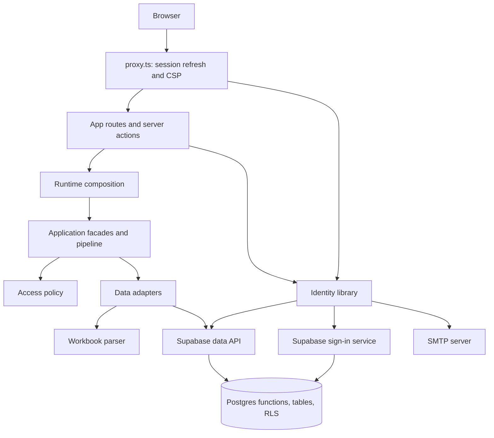
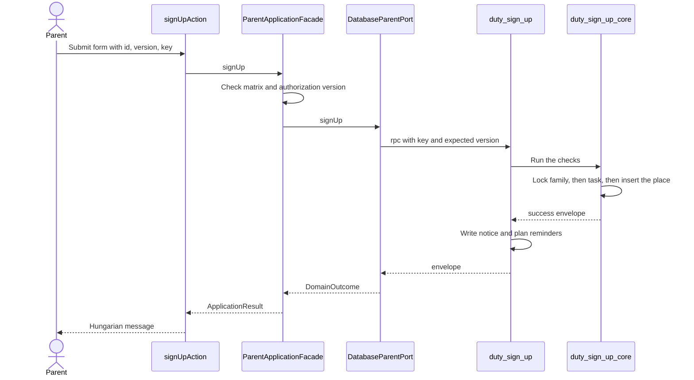
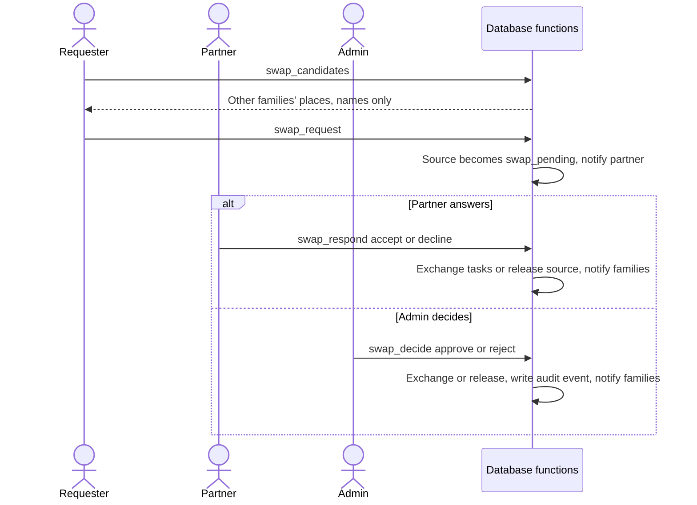
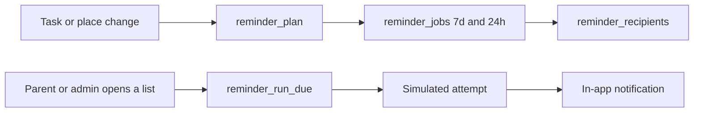
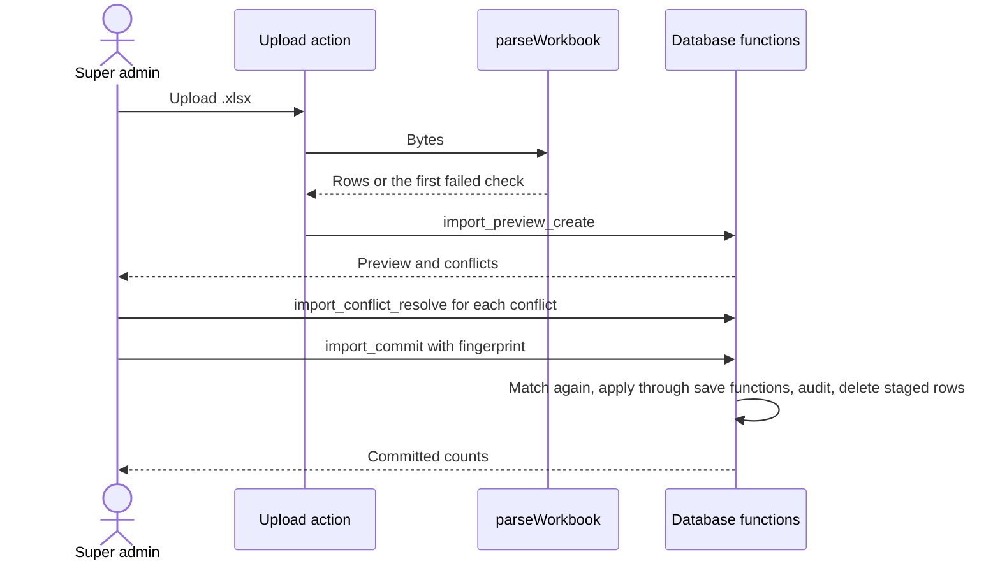

# Architecture

## Architecture Analysis

### System Overview

A single Next.js 16 application (App Router, server components and server actions) talks to one Supabase stack: Postgres, the sign-in service (GoTrue) and the data API (PostgREST). Business rules live mainly in Postgres as named `security definer` functions. The TypeScript layers authorize, translate and present; they contain little domain logic.

On a developer machine and in CI the stack runs in Docker through the Supabase CLI. There is no scheduler, no email provider for reminders and no deployment target.

### Architectural Style

A modular monolith with a database-centred kernel. Evidence:

- One deployable, one package, no workspaces.
- Layers are enforced by convention and tests: screens call facades, facades call ports, ports call database functions.
- Every database change goes through a named function; application roles hold `select` only, with two exceptions (`notifications.read_at`, delete on `import_staged_rows`).
- Blocks inside the database (Directory, Coordination, Notifications, Import, Identity, Platform) own their tables. Links across blocks are typed ids with no foreign key (ADR-001 in the SQL comments), checked inside functions.

### Component Relationships

Text fallback: the browser reaches the app through `proxy.ts`, which renews session cookies and sets the content security policy. Screens and server actions use the runtime composition to get facades per request. Facades check the access policy, then call data adapters. Adapters call the Supabase data API, which runs Postgres functions and row-level policies. The import adapter uses the workbook parser. The identity library talks to the sign-in service, the data API and an SMTP server.

### Layers and Their Contracts

| Layer | Location | Contract |
|---|---|---|
| Screens and actions | `app/` | Reads the session, parses forms, calls one facade method, maps the result to Hungarian text |
| Composition | `src/runtime/production/` | `forRequest(accessToken)` builds facades on a client that acts as the signed-in person |
| Facades | `src/application/*-facade.ts` | Return `ApplicationResult<T>`: `success`, `empty`, `validation`, `denied`, `conflict`, `invalidated`, `recovery`, `dependency-failure-*` |
| Pipeline | `src/application/facade-pipeline.ts` | Authorize against the matrix and the live authorization version, validate, invoke, project, map failures |
| Ports | `src/data/` | One method per operation; `DataGateway` is the only place touching the client |
| Database functions | `supabase/migrations/` | Return `{state, reference, code, ...}` from `platform_result` |

### Data Ownership

| Block | Tables | Boundary rule |
|---|---|---|
| Platform | `audit_events`, `lifecycle_holds`, `idempotency_records` | Append-only audit (365-day purge); only named functions write |
| Identity | `accounts`, `invitations`, `sign_in_attempts`, `app_role_grants`, `app_authorization_versions`, `app_role_conversion_evidence` | Credentials stay in the sign-in service; `accounts` mirrors a user |
| Directory | `organizations`, `school_years`, `groups`, `families`, `group_memberships`, `parents`, `parent_contacts`, `children` | Composite foreign keys with organization inside the block |
| Settings | `organization_settings`, `reminder_settings` | Typed id to the organization |
| Coordination | `events`, `tasks`, `assignments`, `change_requests`, `contribution_notes` | Typed ids to Directory; deferred capacity trigger |
| Notifications | `notifications`, `reminder_jobs`, `reminder_recipients`, `reminder_attempts` | Typed ids to Coordination and Directory |
| Import | `sheet_registry`, `import_runs`, `import_rows`, `import_staged_rows`, `import_conflicts` | Staged rows hold personal data and are visible only to the starting super admin |

Leftovers from the first migration: `app_import_runs` (still read by `scope_probe`) and `app_audit_events`.

### Transaction and Event Boundaries

There is no message bus and no asynchronous event. One database function call is one transaction, and side effects happen inside it:

- A use case writes its notices and re-plans reminders in the same transaction, through a wrapper around the original function (`<name>` calls `<name>_core`, `20261038`).
- A business refusal raises SQLSTATE `U3R00`, which the same function catches, so everything written in that block rolls back and an envelope is returned.
- Only a success is stored under the idempotency key for 24 hours, so a corrected repeat is not stuck on an old refusal.
- Audit events are written in the transaction of the change.
- Reminders run lazily: `reminder_run_due` is called when a parent opens notifications or an admin opens reminders.
- Lock order prevents deadlocks: family row, then task rows ascending, then assignment rows ascending. New bulk functions must follow it.

### Key Design Decisions

| Decision | Implication |
|---|---|
| Rules in Postgres, not TypeScript | Strong guarantees under concurrency; new behaviour means forward-only SQL migrations tested against a real stack |
| No direct table writes | Every new feature needs named functions and grants |
| Parents read through functions, not tables | Exactly controlled projection; a parent directory or shared overview needs new functions |
| Authorization checked twice (matrix and database) | Role additions touch `role-policy.ts`, `authorization.ts`, navigation, the grant constraint, `verification/authorization-matrix.json` and every reach helper |
| Authorization version on every request | A role change takes effect on the next request |
| Merged migrations are never edited | Replacing a function means a new file; the latest definition wins |
| Migrations are schema-neutral | The same files run in `public` and `worker_1` to `worker_4`; a file naming a fixed schema is refused |

### Security and Privacy Boundaries

- Sessions: an active session is required by every helper (`current_session_is_active`), including a 30-day inactivity limit and active-account check.
- Row-level security is enabled on every table; no insert, update or delete policy exists for ordinary tables.
- The service-role key has no table rights and is used only for named system functions, from server-only modules.
- Column rights hide `parents.optional_profile` and `invitations.token_hash`.
- Cross-organization lookups answer exactly like a missing record, so nothing can be probed.
- Teachers get names only. Parents see other families' names only in the swap list and swap requests.
- Workbook parsing is server-only. Cells starting with `=`, `+`, `@` and formulas are refused; limits are read from the ZIP directory before expanding.
- The content security policy uses a per-request nonce and allows only same-origin resources.
- Five wrong passwords in 15 minutes lock an address, enforced also through a sign-in hook.
- Denied audit events are limited to 20 per account per hour.

### Data Flow

Reads: server component → facade → adapter → either a policy-filtered table read (admins) or a named function (parents, teachers) → projected model → render. Writes: form with hidden id, expected version and idempotency key → server action validates shape → facade authorizes → named function checks reach and state under locks → envelope → Hungarian message and `revalidatePath`.

### Improvement Opportunities

- Replace the mandatory group on tasks and events with a scope that can be the community or a working group.
- Add a planning model above `tasks` (calendar, rota, recurrence, templates) instead of many hand-made rows.
- Fix the dropped swap and cancellation reason.
- Add a scheduler boundary before real reminders, since delivery and clean-up depend on page opens and sign-ins today.
- Consider views or a schema dump for the current function definitions, because several functions are redefined across files.

## Interaction Diagrams

### Parent signs up for a task

Text fallback: the action passes the form to the facade, which authorizes and calls the port. The database wrapper runs the core checks in the fixed order (version, closed, already assigned, ineligible, full), inserts the place, then writes `sign_up_confirmed` and re-plans reminders in one transaction.

### Two families swap, with admin fallback

Text fallback: the requester picks a partner from the candidate list; the request marks the source place pending and notifies the partner. The partner can confirm (the tasks of the two places are exchanged with no admin) or decline, or an admin can decide, which also writes an audit event. Stored versions are rechecked at each decision.

### Reminder planning and lazy delivery

Text fallback: any change to a task or a place re-plans its jobs and recipients. When a parent opens notifications or an admin opens reminders, the due jobs run; each records a simulated attempt and writes one in-app notice per linked parent at its first run.

### Workbook import

Text fallback: the server parses the bytes and stages rows; the database decides for each family or task unit whether it is new, an update, unchanged or a conflict. After every conflict is resolved, the commit matches again in one transaction, applies units through the ordinary save functions without notifying parents, writes one audit event and deletes the staged personal data.
