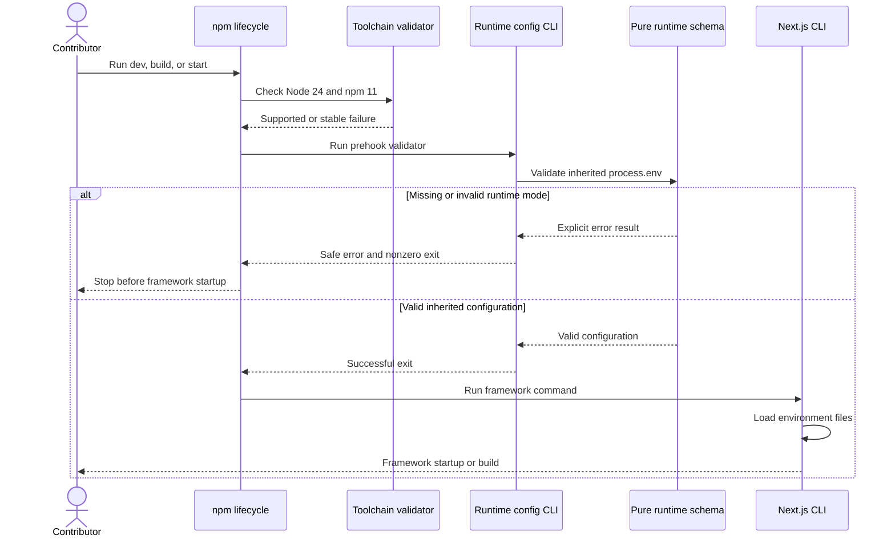
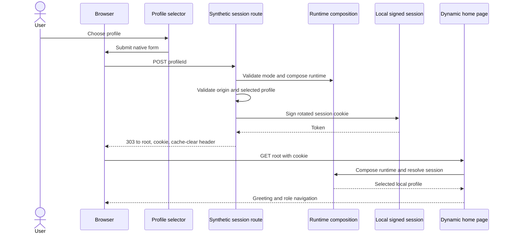
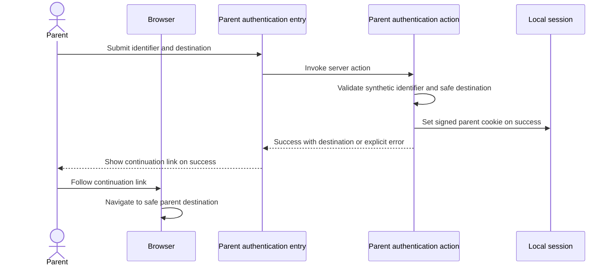

# Architecture Analysis

> Focused merge, 2026-10-02 (`261002-slow-profile-login`): the earlier sections are preserved historical prose from an UNVERIFIED store, including the prior startup diagnosis and pending loader choices. They are not current defect claims. Fresh conclusions are in the profile-login update below; exact newly analyzed files appear in reverse-engineering-timestamp.md. No tests, latency measurements, browser sessions, or backend calls were performed.

> Focused update, 2026-10-01: earlier repository-wide prose is preserved as historical static knowledge; its freshness was UNVERIFIED. Only the deep files listed in reverse-engineering-timestamp.md were analyzed for this update. No tests or runtime/external checks were executed.

## System Overview

The repository is one private npm package and a single Next.js App Router application. App Router pages, layouts, server actions, and route handlers form the delivery layer. Runtime/session composition selects a synthetic or production composition. Role façades and shared application contracts coordinate in-process domain modules through typed ports. The linked local route ends in deterministic in-memory adapters.

The production composition is a configuration-validating placeholder. It labels Supabase unlinked, performs no target call, and has no live authorization-version source. The SQL migration and narrow RPC adapter do not make the application production-backed.

## Architectural Style

**Observed:** modular monolith with one deployable package, domain-oriented source modules, typed application contracts, and partial ports-and-adapters separation. There are no npm workspaces, separate services, or public package API. UI/server routes call in-process TypeScript façades; injected repository, authorization, audit, clock, queue, provider, and event ports mark infrastructure seams.

### Evidence and Alternatives

This is an observed architecture, not a new decision to adopt a future topology. The modular-monolith interpretation is supported by one npm package, one App Router deployment surface, in-process facade/domain calls, and no separately deployable services. A microservice split is not evidenced; it would add network, consistency, deployment, and observability costs before independent service ownership or scaling needs have been established. A thin layered CRUD interpretation also misses the distinct domain services and injected ports present in source. The present monolith keeps local integration simple, while its limitation is that modules cannot be deployed or scaled independently.

The current synthetic/production separation is likewise an implementation boundary, not proof of a production-ready adapter. Synthetic mode enables deterministic local flows; the unlinked production slot limits accidental external calls, but creates a readiness risk if local behavior is mistaken for durable production behavior. Personal data and RLS must be verified only against a separately approved linked target; this scan did not open the workbook or inspect family/child records.

## Component Relationships

See component-inventory.md for the named ownership areas and responsibility details.

~~~mermaid
flowchart LR
  User[Parent Staff or Administrator] --> Browser[Browser]
  Browser --> App[Next.js App Router]
  App --> Runtime[Runtime and session composition]
  Runtime --> Facade[Role experience facade]
  Facade --> Contracts[Application contracts validation and results]
  Contracts --> Domain[Domain modules]
  Domain --> Ports[Injected repository authorization audit clock queue provider event ports]
  Ports --> Synthetic[Deterministic in-memory synthetic adapters]
  Runtime -. configuration only .-> Production[Unlinked production composition]
  Production -. no target call .-> External[Supabase scheduler providers deployment]
~~~

Text fallback: browser requests and actions enter the Next.js delivery layer, which selects a role/runtime facade and typed application contracts. Domain services call injected ports. The active local path resolves to synthetic in-memory adapters. The production composition only validates settings and does not connect those ports to external targets.

## Interaction Diagrams

### Synthetic Role Read and Mutation

~~~mermaid
sequenceDiagram
  actor User
  participant Browser
  participant App as Next.js App Router
  participant Runtime as Runtime composition
  participant Facade as Role facade
  participant Contract as Application contract
  participant Domain as Domain service
  participant Adapter as Synthetic adapter
  User->>Browser: Open a role page
  Browser->>App: Request page
  App->>Runtime: Resolve mode and session
  Runtime->>Facade: Select role experience
  Facade->>Contract: Load projection
  Contract->>Domain: Query role workflow
  Domain->>Adapter: Read synthetic state
  Adapter-->>Domain: Fixture or in-memory result
  Domain-->>Contract: Domain result
  Contract-->>Facade: Typed projection
  Facade-->>App: Page data
  App-->>Browser: Render UI
  User->>Browser: Submit form
  Browser->>App: Invoke server action
  App->>Facade: Dispatch role action
  Facade->>Contract: Validate and authorize command
  Contract->>Domain: Execute command
  Domain->>Adapter: Mutate synthetic state
  Adapter-->>Domain: Result
  Domain-->>Contract: Explicit result state
  Contract-->>App: Mapped action result
  App-->>Browser: Updated UI state
~~~

Text fallback: the browser invokes an App Router page or server action. Runtime composition selects a role facade; application contracts validate and authorize the request and call a domain service. In the current local mode, the service reads or mutates synthetic state and returns a typed result for UI mapping.

### Production Boundary

~~~mermaid
flowchart TD
  Production[Production composition] --> Config[Validate runtime configuration]
  Config --> Port[Authorization version port]
  Port --> Undefined[Returns undefined]
  Config -. no outbound call .-> Supabase[Supabase target]
  Config -. unlinked .-> Scheduler[Scheduler and notification providers]
  Config -. not configured .-> Deploy[Deployment target]
~~~

Text fallback: production composition validates settings, but its authorization-version port returns undefined and it makes no outbound call. Supabase, scheduler/providers, and deployment remain unlinked.

## Data Flow and Ownership

- App Router pages/actions use role-specific facades and shared application contracts.
- Domain services own access, directory, coordination, import/migration, notifications, and privacy/audit rules.
- Synthetic composition wires deterministic local profiles and in-memory stores.
- The single SQL migration declares role/version tables, scoped placeholders, authorization RPCs, and RLS policies. No complete domain persistence adapter or migration runner was found.
- Notification and coordination event/job concepts are expressed behind ports; no external queue, event broker, or provider is linked.

## Risks and Follow-up

- Complete and exercise production authentication, persistence, RLS, scheduler/provider, and deployment integrations before production-readiness claims.
- Keep the synthetic/production boundary explicit. Confirm data ownership and transaction semantics when a durable adapter is designed.
- Current CI has validation and provenance work but no deploy job.
- All architectural conclusions are static; no runtime or integration checks were performed.

## Focused Startup Boundary

The pure configuration schema is shared by the standalone lifecycle validator and application runtime composition. Each npm prehook first checks the toolchain, then starts the validator in a separate process. The validator currently reads only inherited `process.env`; Next's environment-file loading occurs later, after the prehook succeeds. Configuration failure therefore blocks the framework before `.env.local` can satisfy the documented recipe.

## Interaction Diagrams: Local Startup

Text fallback: npm checks the toolchain and validates inherited environment values before launching Next. Missing/invalid mode stops the command. Only successful validation lets Next load environment files. Thus a value present solely in `.env.local` arrives too late for the current prehook. The diagram syntax was manually checked before writing: declared participants, valid message arrows, and balanced `alt`/`else`/`end`.

## Startup Design Constraints and Alternatives

No new loader decision is accepted by this investigation. A framework-compatible loader such as `@next/env` is supported by the installed Next documentation and avoids a second interpretation of precedence; making its current transitive dependency explicit would stabilize ownership. A generic dotenv loader needs explicit reproduction of shell precedence, environment-file ordering, and command-specific `NODE_ENV` behavior. A blanket synthetic default would hide missing/invalid configuration and conflicts with the intent. Requirements and implementation planning must select the approach before code changes.

The loader belongs at the CLI boundary; preserve pure schema validation, result states, secret-safe formatting, and mode-based composition. Dev defaults to development; build/start default to production. Runtime synthetic mode remains independent of `NODE_ENV`. No loading step may initiate a production target call.

A validator subprocess cannot export file values back to npm. Existing start-shell host/port expansion still uses inherited shell values; nondefault file-based listener settings are outside this confirmed fix. Preserve default loopback behavior.

## Profile Login Architecture Update — 2026-10-02

### System Overview and Data Flow

The freshly analyzed selector path stays within the Next.js process and browser: native form submission, local session creation, 303 root navigation, then dynamic profile greeting. Production composition remains an unlinked placeholder. No remote authentication or database bootstrap appears on this path. Role page loading occurs after a separate native anchor navigation; layout/page session resolution and facade composition can repeat local work.

### Key Design Decisions

These describe source behavior, without selecting a fix. Local HMAC-signed sessions, token rotation and origin validation isolate synthetic profiles. Dynamic page rendering and per-request session lookup preserve profile-specific output. Cache invalidation currently requests origin-wide browser cache clearing on every successful selection; its causal latency effect is unknown. Targeted invalidation and preserving cache with independently verified session isolation are alternatives to evaluate against measurements; changing transport to client navigation adds state/redirect complexity. No alternative is accepted here.

### Interaction Diagrams

#### Synthetic Profile Selection

Text fallback: profile selection posts to the synthetic session route. It validates runtime/origin/profile, signs the cookie and sends a cache-clear request with a 303 to root. The browser requests root with the cookie; runtime resolves it and renders the profile greeting. The role dashboard is a later request. A failed validation returns the explicit API error described in api-documentation.md.

#### Parent Authentication Entry

Text fallback: the signed-out parent submits the authentication form. Synthetic `parent-local` success creates a cookie and returns a safe destination. The entry displays a link; the parent explicitly follows it. Invalid input returns an error state. Manual continuation must be distinguished from action latency when defining the target.

The new diagrams were manually syntax-validated before writing: declared unique participants, valid Mermaid message arrows, and no unbalanced control blocks. Preserved historical flow/sequence blocks were also checked for declarations and balanced control blocks.

### Improvement Opportunities and Impact

Cache clearing, first-use development route compilation/module loading, broad application-barrel imports and full reload cost are hypotheses requiring click-to-ready measurements. Repeated composition is verified, but the small local work has no measured multi-second cost. Capture first and repeat selections in development and built start before choosing the smallest fix. Preserve cookie rotation, expiry, origin checks, authorization versions, mode separation and absence of prior profile projections; globally cached session-specific output would violate that boundary. Add focused timing coverage after requirements resolve readiness. See dependencies.md for coupling and code-quality-assessment.md for the regression gap.
