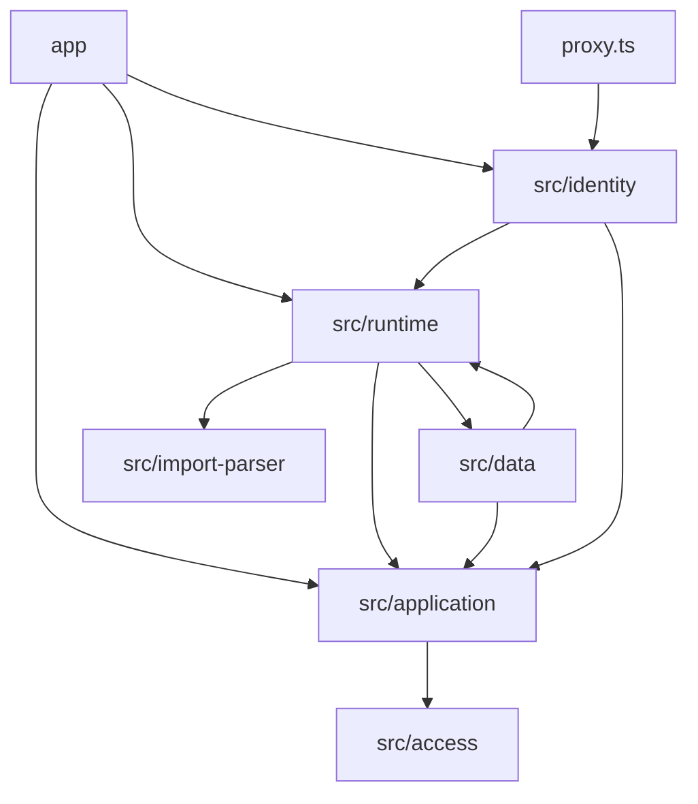

# Dependencies

## External Dependencies

| Dependency | Used by | Runtime or dev | Replaceable? |
|---|---|---|---|
| Supabase Postgres, data API, sign-in service | Everything | Runtime | Deep: `auth.uid()`, `auth.jwt()`, `auth.sessions`, `auth.users` appear in SQL |
| next, react, react-dom | `app/`, `src/runtime/` | Runtime | Framework |
| @supabase/supabase-js | `src/runtime/database/client.ts`, identity | Runtime | Behind `DatabaseClient` |
| nodemailer | `src/identity/mail.ts` | Runtime | Behind `MailTransport` |
| @e965/xlsx | `src/import-parser/workbook.ts` | Runtime | Behind `WorkbookParser` |
| zod | `src/runtime/config.ts` | Runtime | Small use |
| SMTP server | Invitation email | Runtime | Local mail catcher today; real provider unverified |
| Docker | Local stack | Dev | Required by the Supabase CLI |

Full versions are in `technology-stack.md`. Dependency scanning is `npm audit --audit-level=high`; the last report mentions 5 moderate findings, none high or critical. That count is historical.

## Internal Dependencies

Text fallback: `app` depends on `src/runtime`, `src/application` and `src/identity`; `proxy.ts` on `src/identity`. `src/runtime` depends on `src/application`, `src/data` and `src/import-parser`. `src/data` depends on `src/application` and on the database client in `src/runtime`. `src/application` depends on `src/access`. `src/identity` depends on `src/application` result types and the database client.

`src/data` and `src/runtime` depend on each other in one direction each: `src/runtime/production` imports `src/data`, and `src/data` imports only the `DatabaseClient` type from `src/runtime/database`. This is a folder-level cycle, not a module-level one.

## Database Dependencies Between Blocks

| Block | Depends on | How |
|---|---|---|
| Identity | Platform | Audit and idempotency functions |
| Directory | Identity, Platform | `current_session_is_active`, `has_super_scope`, `identity_actor_organization` |
| Coordination | Directory, Identity, Platform | Reach helpers; typed ids to groups, families and parents |
| Notifications | Coordination, Directory, Settings | Wrappers around `duty_sign_up`, `swap_*`, `task_save` and others |
| Import | Directory, Coordination, Notifications | Calls `structure_save`, `directory_save`, `event_save`, `task_save`, `assignment_assign_core`, `reminder_plan_tasks` |
| Lifecycle | Directory, Coordination, Identity, Notifications, Import | Runs across all of them |

## Migration Order Dependencies

Files apply in name order. Notable ordering facts:

- Four files share the prefix `20261035`, and `placeholder_drop` must sort last among them.
- `20261006` refuses to run unless the session sets `waldorf.authoritative_issuer_baseline`; the runner sets it for fresh schemas.
- Rewriting a function requires knowing whether a wrapper already renamed it. The `_core` functions in `20261038` hold the original bodies of `duty_sign_up`, `assignment_assign`, `assignment_remove`, `swap_request`, `swap_respond`, `coordination_decide`, `family_archive`, `task_save`, `event_save`, `settings_save`, `lifecycle_run`.

## Cross-Cutting Sync Points

Things that must stay in step, usually guarded by a test:

| Pair | Guard |
|---|---|
| `src/import-parser/template.ts` and the `sheet_registry` seed | Database test |
| `IMPORT_LIMITS.maxBodyBytes` and `next.config.ts` body limit | Unit test |
| `[api] schemas` in `config.toml` and `supabase/roles.sql` | Unit test |
| `app/globals.css` token format and `tests/unit/design-tokens.test.ts` | Unit test |
| Authorization matrix in TypeScript and `verification/authorization-matrix.json` | `verify:manifests` |
| `PARENT_NOTIFICATION_USE_CASES`, `ADMIN_NOTIFICATION_USE_CASES` and the use cases that change assignments | Test |
| The README command list and `package.json` | `tests/unit/readme-commands.test.ts` |
| Pinned dependency versions | `tests/unit/dependency-pins.test.ts` |

## Dependency Risks

- Seven development dependencies float on `latest`, so a release can change check results without a code change. The five named in the team rule are now pinned; these seven are not.
- Upgrades to `next` must be read against the guide bundled in `node_modules/next/dist/docs/`, as `AGENTS.md` warns.
- Real-target behaviour of Supabase, the scheduler, mail and Vercel is recorded as outstanding evidence.
