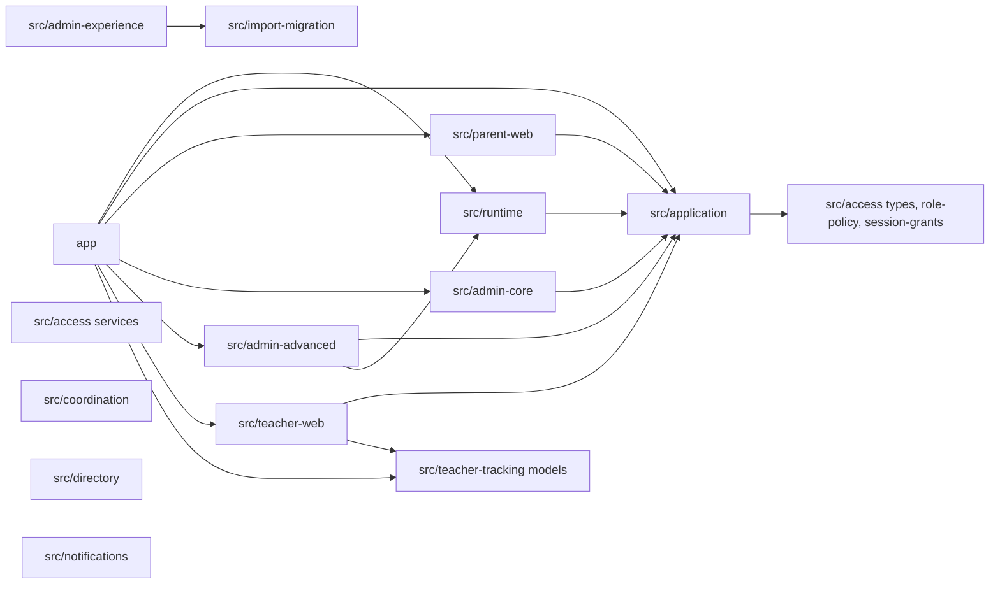

# Dependencies

Full rescan, 2026-10-12, HEAD `80bd4f4`.

## External dependencies

See `technology-stack.md` for versions. Runtime: next, @next/env, react, react-dom, zod. Dev: vitest (+ istanbul, v8), Playwright, @axe-core/playwright, Testing Library, jsdom, ESLint with eslint-config-next, Prettier, TypeScript, @types/node. CI additionally installs PostgreSQL 18 client and server binaries and Playwright browsers (chromium, firefox); `build_evidence` generates a CycloneDX SBOM.

External services referenced but not connected: Supabase (auth, Postgres, RLS), Vercel, an e-mail provider (port only, `EmailProvider`). No credentials are stored; `.env.example` forbids private Vercel/Supabase tokens in local verification.

## Internal module dependency topology (imports verified by grep)

Text: Family A modules depend on `src/application`; `src/application` imports only types and helpers from `src/access` and the tracking model from `src/teacher-tracking`. Family B modules have no inbound edges from `app/` or `src/runtime`.

## Cross-cutting couplings

- `src/runtime/synthetic/access-state.ts` is imported by `src/admin-advanced` (revocation) and by session resolvers.
- `tests/unit/current-role-references.test.ts` reads `aidlc/spaces/default/intents/261006-simplify-user-roles/construction/.../source-manifest.json` and hashes `supabase/migrations/20260806_access_rls.sql` (SHA-256 `a34b85b7...2449d`).
- `scripts/verification/core.ts` imports `SYNTHETIC_PROFILES` from runtime and validates evidence with `runtimeMode` `synthetic` or `linked-target`.
- `playwright.config.ts` starts `npm run start` (needs a prior `npm run build`) on three ports with synthetic env.
- `scripts/verification/current-role-database.ts` needs `psql` 18.x on `PATH` or in `/opt/homebrew/opt/postgresql@18/bin`.
- Lint/format scopes: `eslint app src/application src/runtime tests scripts *.config.* proxy.ts`; Prettier over `app src/application src/runtime tests scripts verification *.config.* README.md`. Other `src/*` modules are outside both; `tsc --noEmit` covers all.
