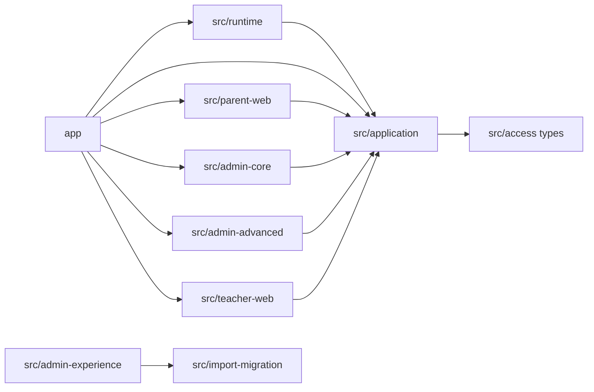
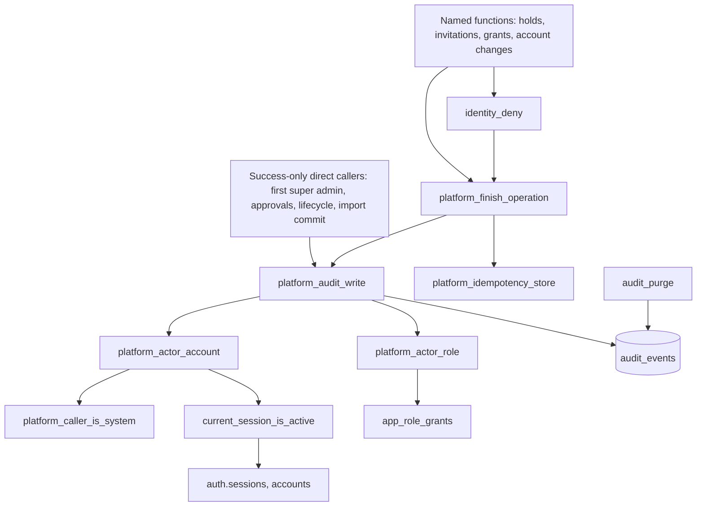

# Dependencies

Full rescan 2026-10-12 (HEAD `80bd4f4`), focused update 2026-10-27 (HEAD `5d2b484`, intent `denied-audit-ratelimit`). The focused update added "Database object dependencies of the audit write" and "Database test dependencies"; the module topology is kept from 2026-10-12 and does not show `src/data`, `src/identity` or `scripts/db`.

## External dependencies

See `technology-stack.md`. External services: Supabase (sign-in service, Postgres, RLS, data API; local stack in development and CI), Vercel (target, not wired), an e-mail provider (local mail catcher in development).

## Internal module dependency topology (2026-10-12)

Text: Family A modules depended on `src/application`, which imported only types and helpers from `src/access`; Family B modules had no inbound edges from `app/` at that time.

## Database object dependencies of the audit write (2026-10-27)

Text: denied events come only from `platform_finish_operation` (directly or through `identity_deny`); success events also come from seven direct calls. `platform_audit_write` depends on the two actor helpers, which depend on the system-caller check, the active-session check (sign-in service sessions and `accounts`) and `app_role_grants`. `audit_purge` is the only deleter. A redefinition of `platform_audit_write` with the same signature keeps every caller working without change; a changed signature would break the seven direct callers and `platform_finish_operation`, which cannot be edited in place.

## Database test dependencies (2026-10-27)

- `tests/database/*.test.ts` -> `tests/database/stack-support.ts` -> `scripts/db/common.ts` (connection settings, `.env` service file), `scripts/db/worker.ts` (`setupWorker`, `resetWorkerData`, `bootstrapSql`), `scripts/db/runner.ts` (`applyMigrations`, `readMigrationFiles`, `checksumOf`, `TRACKING_SCHEMA = "migration_runner"`), `scripts/db/migrate.ts` (`FRESH_SCHEMA_SETTINGS`).
- Tracking: applied files are recorded per schema in `migration_runner.applied_migrations (schema_name, filename, checksum)`.
- Test registration: npm `test:database:*` scripts and `scripts/db/shuffled-tests.ts` list files explicitly; `scripts/verification/run-local-verification.ts` runs every one of those scripts.

## Cross-cutting couplings (2026-10-12, not re-verified)

- `src/runtime/synthetic/access-state.ts` imported by `src/admin-advanced` and session resolvers.
- `tests/unit/current-role-references.test.ts` hashes `supabase/migrations/20260806_access_rls.sql` and reads an AI-DLC record manifest (that file was since edited to remove the reserved-word alias, per `migrations.test.ts` FR1.2).
- `playwright.config.ts` starts `npm run start` on three ports with synthetic env.
- Lint/format scopes cover `app src/application src/runtime tests scripts ...`; other `src/*` modules were outside both.
