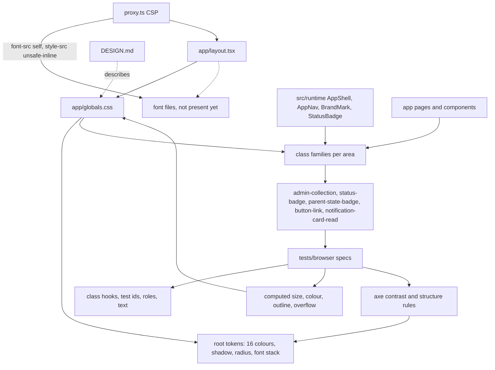
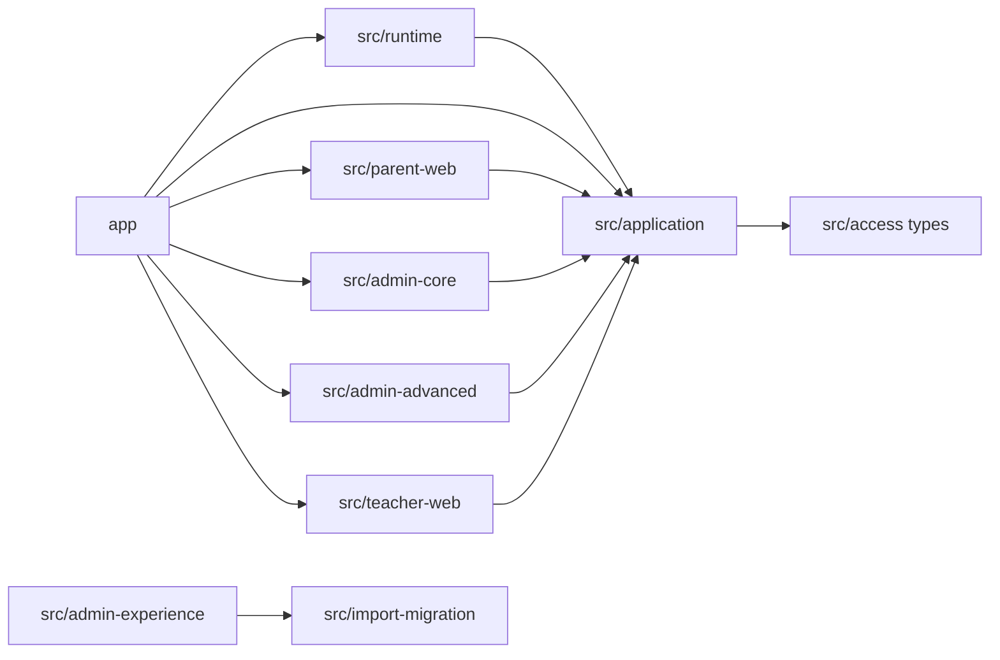
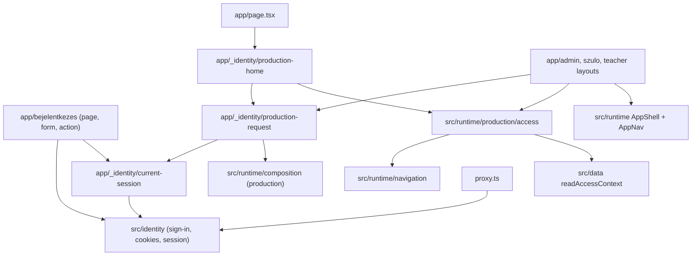
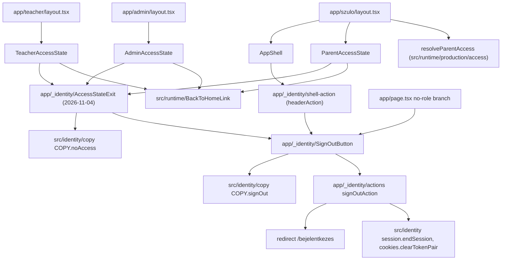
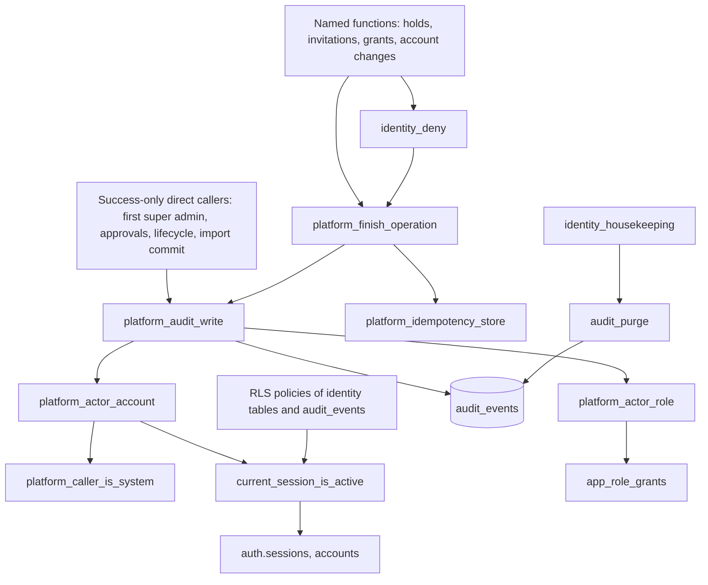

# Dependencies

Full rescan 2026-10-12 (HEAD `80bd4f4`), focused update 2026-10-27 (HEAD `5d2b484`, intent `denied-audit-ratelimit`), focused update 2026-11-02 (HEAD `3456409`, intent `empty-nav-after-login`; section "Sign-in and shell dependencies (2026-11-02)"). Revision 2 on 2026-11-02 (same intent, owner asked to also scan the audit area) re-read the audit migrations 20261012, 20261013, 20261015, 20261019, 20261044 and 20261045, `supabase/config.toml` and the database test support, `audit`, `audit-purge` and `migrations` tests; sections marked "(2026-11-02, audit re-verified)" come from it. Focused update 2026-11-02 (HEAD `1070fd6`, intent `no-access-signout`): the sign-in section corrected and "Denied pages and sign-out dependencies (2026-11-02, after 1070fd6)" added. Focused update 2026-11-04 (HEAD `251c4b3`, intent `stitch-design-update`): new section "Style and font dependencies (2026-11-04, after 251c4b3)"; the denied-pages text is corrected in place for commit `78a0ab5`. The 2026-10-27 update added "Database object dependencies of the audit write" and "Database test dependencies"; the module topology is kept from 2026-10-12 and does not show `src/data`, `src/identity` or `scripts/db`.

## External dependencies

See `technology-stack.md`. External services: Supabase (sign-in service, Postgres, RLS, data API; local stack in development and CI), Vercel (target, not wired), an e-mail provider (local mail catcher in development).

## Style and font dependencies (2026-11-04, after 251c4b3)

Text: `app/layout.tsx` is the only importer of `app/globals.css`; every page, the shell components in `src/runtime` and the browser specs depend on its class names. Tokens feed the browser specs through colour contrast (axe) and through computed-colour comparisons; geometry checks (44 px, overflow, label position) depend on the layout rules. A font would be attached in `layout.tsx` (dashed edge: the files do not exist yet) and must satisfy the CSP set by `proxy.ts`. `DESIGN.md` describes the stylesheet in words (the CSS wins if they disagree). Coupling to watch: grouped selectors (hover/pressed state of five card classes, one filter grid for four classes), the shared `.parent-form` and `.centered-panel` classes used by several flows, and the reduced-motion list of hover classes. `src/runtime` components (outside the verified set) own markup with classes `site-header`, `navigation-panel`, `nav-button`, `status-badge*`, `brand-mark`, so a shell restyle edits CSS only if their markup stays as it is. No npm dependency is involved in styling today (no CSS tooling package, no font package); adding `@fontsource` packages would be a new runtime dependency, while `next/font/local` and `public/` files would not.

Test dependencies on style: Vitest tests `tests/integration/app-nav.test.tsx`, `admin-components.test.tsx`, `status-badge.test.tsx`, `filter-clear-link.test.tsx` and `tests/coverage/admin-functional-fixes.test.tsx` match class names (grep only, not opened).

## Internal module dependency topology (2026-10-12)

Text: Family A modules depended on `src/application`, which imported only types and helpers from `src/access`; Family B modules had no inbound edges from `app/` at that time.

## Sign-in and shell dependencies (2026-11-02)

Text (corrected after `1070fd6`): at `3456409` the sign-in page and action depended on `src/identity` only and nothing routed a freshly signed-in person to their home. Since `1070fd6` the sign-in action redirects to `/`, so the flow reaches `production-home` through the `/` request (an HTTP redirect, not an import edge; whether the action module gained an import was not re-read). `app/page.tsx` consumes `production-home`. The role layouts use `production-request` and `access` for the profile and `AppShell` for the menu. `proxy.ts` depends on the cookie names and refresh logic of `src/identity`. (2026-11-04: the sign-in page imports `BrandMark`, `COPY`, `currentSession` and `SignInForm`, and redirects a signed-in visitor to `/`.)

Test dependencies: `tests/browser/*.spec.ts` -> `tests/browser/support/seeded-schema.ts` -> `scripts/db/{seed,reset,seed-support}` and `projects.ts`; `signInAs` is used across the browser specs. `tests/integration/*` mock `next/headers`, `next/navigation`, `server-only` and the `app/_identity` modules. (2026-11-04: `scenarios.ts` also imports `tests/database/stack-support.ts` (`openDatabase`) to insert a second notification; `playwright.config.ts` imports `scripts/db/common.ts`, `scripts/verification/firefox-launch.ts` and `projects.ts`.)

## Denied pages and sign-out dependencies (2026-11-02, after 1070fd6)

Text: `SignOutButton` is shared by the shell header (through `shellHeaderAction`), the `/` no-role panel and, since `78a0ab5`, the three access-state components through `AccessStateExit` (2026-11-04; at `1070fd6` they did not use it). They all depend on `BackToHomeLink`, whose target comes from the access resolver's denied `homePath`. A change to `ParentAccessState` touches `app/szulo/` and `app/_identity/`. `ParentAccessState` is also used for the `configuration-error` and `signed-out` kinds and is rendered by tests in `tests/integration/parent-components.test.tsx` and `tests/coverage/parent-pages.test.tsx`. Test mocks to reuse: `vi.mock("../../app/_identity/actions.ts", () => ({ signOutAction: vi.fn() }))`, `vi.mock("server-only", () => ({}))`, `vi.mock("next/navigation", ...)` and the request-world mock of `production-request.ts`.

## Database object dependencies of the audit write (2026-10-27)

Text: denied events come only from `platform_finish_operation` (directly or through `identity_deny`); success events also come from seven direct calls. `platform_audit_write` depends on the two actor helpers, which depend on the system-caller check, the active-session check (sign-in service sessions and `accounts`) and `app_role_grants`. `audit_purge` is the only deleter. `identity_housekeeping` calls `audit_purge` inside its own exception block (20261045); the RLS policies and the `has_*_scope` helpers call `current_session_is_active`. A redefinition of `platform_audit_write` with the same signature keeps every caller working without change (this is what 20261046 does, per its header); a changed signature would break the seven direct callers and `platform_finish_operation`, which cannot be edited in place.

## Database test dependencies (2026-10-27)

- `tests/database/*.test.ts` -> `tests/database/stack-support.ts` -> `scripts/db/common.ts` (connection settings, `.env` service file), `scripts/db/worker.ts` (`setupWorker`, `resetWorkerData`, `bootstrapSql`), `scripts/db/runner.ts` (`applyMigrations`, `readMigrationFiles`, `checksumOf`, `TRACKING_SCHEMA = "migration_runner"`), `scripts/db/migrate.ts` (`FRESH_SCHEMA_SETTINGS`).
- Tracking: applied files are recorded per schema in `migration_runner.applied_migrations (schema_name, filename, checksum)`.
- Test registration: npm `test:database:*` scripts and `scripts/db/shuffled-tests.ts` list files explicitly; `scripts/verification/run-local-verification.ts` runs every one of those scripts.

## Migration and config dependencies (2026-11-02, audit re-verified)

- Order dependencies between the audit files: 20261013 needs `platform_audit_write` and `platform_actor_account` from 20261012; 20261015 redefines `platform_actor_account` and adds `identity_deny`, which calls `platform_finish_operation`; 20261019 revokes execute on `lifecycle_hold_*` and `platform_cleanup_expired` (20261013) and refers to the `sign_in_*`, `invitation_*`, `account_recovery_check` and `sessions_remove` functions of earlier identity files; 20261044 redefines `identity_housekeeping` "last defined in 20261043" and needs `invitation_release_stale` and `import_expire_all`; 20261045 redefines `audit_purge` and `identity_housekeeping` from 20261044.
- `20261019` and `20261015` depend on the Supabase `auth` schema (`auth.sessions`, `auth.users`, `auth.uid()`, `auth.jwt()`), so the migrations cannot run on plain PostgreSQL.
- `supabase/config.toml` ties together: the schema list exposed by the data API (`public`, `worker_1` to `worker_4`) with the worker schemas created by `scripts/db/worker.ts`; the password-verification hook with `public.password_verification_hook` from the identity migrations; the 720-hour inactivity timeout with the 30-day check in 20261015; the recovery template path with `supabase/templates/recovery.html`.
- No application code dependency on the audit table exists beyond the RPC calls; the web sign-in flow does not touch `audit_events`.

## Cross-cutting couplings (2026-10-12, not re-verified)

- `src/runtime/synthetic/access-state.ts` imported by `src/admin-advanced` and session resolvers.
- `tests/unit/current-role-references.test.ts` hashes `supabase/migrations/20260806_access_rls.sql` and reads an AI-DLC record manifest (that file was since edited to remove the reserved-word alias, per `migrations.test.ts` FR1.2).
- `playwright.config.ts` starts `npm run start` on three ports with synthetic env. (2026-11-04: it starts `npm run start` on three ports, one per browser project, with the production-mode environment listed in `api-documentation.md`; each server has its own database schema.)
- Lint/format scopes cover `app src/application src/runtime tests scripts ...`; other `src/*` modules were outside both. (2026-11-04: the lint script covers `app src/application src/data src/identity src/import-parser src/runtime tests scripts *.config.* proxy.ts`; the format script covers the same folders plus `verification` and `README.md`.)
