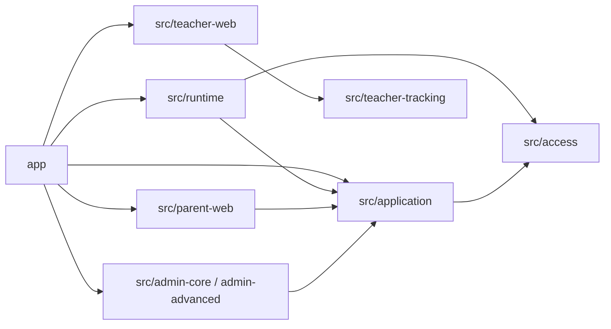

# Dependencies

## External (package.json)
- Runtime: @next/env 16.4.0, next 16.4.0, react latest, react-dom latest, zod latest.
- Dev: @axe-core/playwright, @playwright/test, @testing-library/jest-dom and react, @types/node ^24, @types/react(-dom), @vitest/coverage-istanbul and -v8 4.1.11, eslint, eslint-config-next 16.3.8, jsdom, prettier, typescript ^5.9, vitest 4.1.11. Override maps `fast-glob` to tinyglobby for the Next ESLint plugin.
- Unpinned `latest` ranges are resolved only by package-lock.json; `npm audit --audit-level=high` runs in `verify:security`.

## Internal

Text fallback: app depends on runtime, application and the web/admin domain modules; runtime and application depend on access; no import cycles were observed in the files read (skimmed modules not exhaustively checked).

Intent-relevant coupling: `app/admin/_lib/session.ts` imports `SyntheticProfile` from runtime (no longer rewrites navigation at HEAD); `AppShell` imports the `SyntheticProfile` type; tests import `SYNTHETIC_PROFILES` directly (tests/browser/visual-overhaul.spec.ts, support/profile-login-measurement.ts, tests/unit/navigation-access.test.ts), so profile shape or menu-order changes ripple into specs. Per-browser demo fixtures in `src/parent-web/synthetic-parent.ts` are coupled to `projectSuffix` in tests/browser/parent-web.spec.ts. Parent pages now use `DUTY_STATE_LABELS`/`dutyStateLabel` from `src/application/status-labels.ts` (the page-local `STATE_LABELS` is gone). `AppNav` imports `NavigationItem` from `src/application`; the three area session modules (`app/{admin,szulo,teacher}/_lib/session.ts`) import `resolveSyntheticSession` and the cookie name from `src/runtime/session/session.ts`; `src/runtime/session/session.ts` depends on `synthetic/access-state.ts`, which depends on `src/access`; `app/szulo/feladatok/[id]/page.tsx` imports `formatBudapestDate` from `app/szulo/feladatok/page.tsx` and notification helpers from `src/parent-web/notification-context.ts`.
