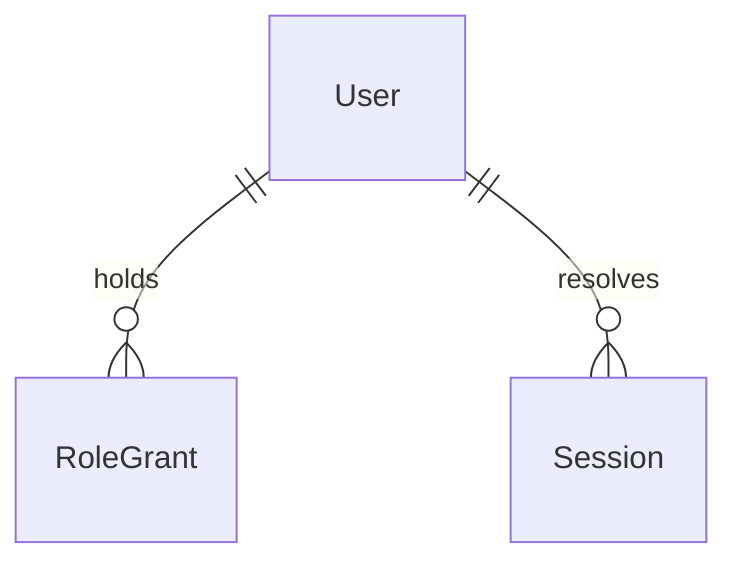

# Current-role Foundation Functional Specification

## Unit Boundary and Authoritative Inputs

U1 delivers Access policy, grant conversion, current versions and Runtime current profile/session resolution. It changes shared policy consumers needed for compilation and parity. U2 owns teacher source/projection/pages and URL redirects; U3 owns retained workflow behavior, archive metadata and final scenario/reference cleanup. Ownership is fixed by [components.md](../../../inception/domain-design/components.md) and [unit-of-work.md](../../../inception/units-generation/unit-of-work.md). [unit-of-work-story-map.md](../../../inception/units-generation/unit-of-work-story-map.md) assigns the acceptance criteria enumerated in traceability.json. [requirements.md](../../../inception/requirements-analysis/requirements.md) and C1/C2/C5 of [contract-summary.md](../../../inception/contract-design/contract-summary.md) fix policy, migration and recovery behavior. entities.md and rules.md are authoritative for data and decisions; this file is authoritative for ordered workflows and transitions.

## Current Access Workflow

1. Validate the current role/profile vocabulary at input, without a default role. Normal inputs never accept the two migration-only role values.
2. Resolve signature, expiry and current profile where applicable, then current subject activity/version and effective grants. Missing or mismatched state returns invalidated/unauthenticated before querying protected data.
3. Validate role-specific scope: Parent family, Group admin group, Kindergarten teacher group, Super administrator organization. Require same organization and the existing membership relation for nested family/group resources. A matching identifier in a different organization is denied.
4. Evaluate each candidate grant as a complete role-and-scope permission. Do not combine an organization scope from one grant with a role from another. Reject malformed persisted roles/scope shapes rather than interpreting them as teacher access.
5. Apply the same role/action/resource/field cases to domain checks, application rows, runtime gates and intended persistence enforcement. Teacher reads only schedule/coordination tracking display fields; no raw family read or command. Parent field restrictions and existing own-family actions remain. Group admins use the existing core operation set within granted groups. Organization imports/reminders/privacy/settings/governance require Super administrator.
6. Only an allowed decision reaches the existing query/command port. Denied results contain no data and leave state untouched; append redacted authorization evidence. Unexpected dependency errors map to existing explicit failure states.

Navigation derives only from current valid roles/grants after version/mode validation. Teacher navigation uses the current teacher contract supplied to U2; U1 cannot treat an old route as an independently authorizing role. Full U2 page delivery follows in its Unit. Existing synthetic/current profile mapping is explicit: parent-local, group-admin-local, kindergarten-teacher-local, super-admin-local. Removed staff-local and kindergarten-admin-local fail lookup and selection without aliasing. Current teacher label is Óvónő.

## Populated Conversion Workflow

1. Explicitly invoke conversion through its migration/test boundary, never on an ordinary browser request. Capture the supported schema and session-issuer/version preconditions. Preserve all original business and historical records.
2. Acquire a writer-exclusive transaction over grant, version and conversion-evidence persistence. The persisted implementation must lock the grant and version tables against inserts/updates/deletes before preflight, maintain a consistent lock order for all cooperating grant writers, and retain the lock through validation/commit. The fixture adapter supplies a snapshot transaction with rollback, rather than independent partial repository saves.
3. Check all required columns, identity types and version representation against the supported baseline. Reject unknown required triggers, alternate issuer/version semantics or other incompatible structures instead of guessing. Extra passive columns may survive unchanged. Inspect every row, including revoked rows, for one of four supported current values or two documented legacy values and valid role-specific scope. Unsupported staff organization scopes and kindergarten-admin group scopes block the whole transaction. No row is deleted to satisfy validation.
4. Precompute the changed grants and distinct affected subjects. Check positive valid existing versions and overflow before writing. For an existing version, increment once per affected subject, including subjects whose changed grants are revoked/inactive. If a subject has no version row in the supported baseline, initialize to 2: the baseline default is 1 and authoritative resolution rejects a missing version, so no previously accepted version exists for that missing row. This initialization is valid only when every accepting session boundary requires authoritative version lookup; unknown issuers or a boundary that accepts arbitrary missing-row generations block conversion until repaired. A fresh session must use the resulting generation; never restore a missing row from a presented token.
5. Change read_only_staff to kindergarten_teacher on existing group grants and kindergarten_admin to super_admin on existing organization grants. Preserve grant identifiers, subjects, organization/group/family associations, timestamps where present, revoked state and subject activity. Equivalent target grants remain separate historical rows, with effective access deduplicated only at resolution. No new permission row is inserted to merge a collision.
6. Apply each precomputed version change and append transaction-bound redacted conversion evidence retaining original/current roles and stable identifiers, with no names/contact data/tokens. Do not overwrite earlier audit records. The existing persistence evidence table lacks a complete conversion envelope, so the implementation must add a dedicated restricted conversion-evidence record or an equivalent transactional extension before claiming this step works; it must not fabricate a subject organization from absent data.
7. Validate the transformed rows, install/validate the current-role restriction and replace obsolete permission policies/helpers as one transaction. Explicitly inventory and remove prior permissive policies so their union cannot broaden the new rules. Normal persistence writes reject removed/unknown roles and invalid role/scope combinations after conversion. Commit only if every step succeeds.
8. On any failure, restore original grants, versions, evidence and enforcement configuration. Return blocked for unsupported role/scope/schema or failed for transaction failure. Safe failure detail contains reason categories/counts, not business content. An explicit rerun after remediation is repeat-safe: with no legacy rows there is no second conversion evidence or version increment; enforcement setup may be checked/reconciled without inventing conversion work.

The current persisted baseline has grant identifiers/scopes/revocation and integer subject versions, but no persisted user activity or family-to-group display relation. Preserve activity through the existing domain subject repository, never create persisted activation. Scope-only helpers cannot provide private-field or teacher projection enforcement. Parent own-family raw-record access must use the existing family identity relation (the family row identifier), while core group access uses the record group scope. If the required relationship cannot be established for an actual schema, deny and report unsupported coverage rather than widening reads. Current schedule display remains U2's allowlisted read model; this migration does not grant teachers broad table select.

## Grant Mutation and Session Recovery

Normal role creation validates current roles/scopes, resolves the acting Super administrator and authorizes governance in the same organization before saving. Normal revocation/downgrade checks current actor and target under transaction protection. Count qualifying active subjects with unrevoked organization-scoped super grants in the target organization; duplicate grants for one subject are not independent administrators. Evaluate the post-operation state, accounting for another surviving equivalent grant. Deny an operation that leaves no qualifying administrator. The existing synthetic final-admin outcome is retained; shared Access policy must enforce it beyond a scenario shortcut. A successful effective access change invalidates the affected subject generation and appends redacted evidence atomically. A no-op revocation emits no second change.

Session transitions: unauthenticated -> ready only after valid current selection/sign-in; ready -> invalidated after version change/revocation/removed profile; invalidated -> ready only through fresh valid selection/sign-in. Invalidated -> denied remains possible for inactive subjects or no current grants. A pure resolver rejects stale bytes without writing cookies. Existing writable session boundaries clear/rotate cookies and preserve origin/mode/signature/expiry/secure behavior. No protected cached view may survive an invalidated result. Unlinked production remains unavailable without synthetic fallback.

Conversion transitions: not-started -> validating -> prepared -> converted -> committed; any precommit state -> blocked/failed with rollback. Repeated successful conversion -> unchanged when no legacy rows remain. Intermediate converted state is never visible outside the transaction. Revoked grant transitions to revoked current grant, not active; inactive subjects remain inactive. Business groups/tasks/owners never enter this conversion state machine.

## Failure and Presentation Mapping

| Boundary result | Existing presentation outcome | Protected data |
| --- | --- | --- |
| Allowed | Existing success result and APP-SUCCESS | Existing allowlisted result only |
| Unknown/removed role or forbidden action/scope | AUTHORIZATION_DENIED / APP-DENIED, assertive, denied focus | None |
| Stale/missing current version | AUTHORIZATION_VERSION_STALE / APP-INVALIDATED; cache clear and safe recovery | None |
| Missing synthetic/current profile | SESSION_REQUIRED or PROFILE_NOT_AVAILABLE and existing recovery | None |
| Incompatible conversion | blocked with supported contract reason | None |
| Transaction/dependency failure | failed or existing terminal dependency result; no automatic conversion retry | None |

This mapping reuses the existing result envelope; no competing response wrapper is introduced. The synthetic session form retains its existing clear-session action and origin/mode checks and the C5 validation/status outcomes. Current catalogs never silently authorize a removed role.

## Derived Entity and Rule Views

<!-- Text fallback: One User can hold multiple RoleGrants and resolve multiple Sessions. Data details and constraints are authoritative in entities.md. -->

The two entity declarations and balanced relationship syntax were checked before writing. This diagram is a derived relationship view, not a persisted new Session table.

| Rule group | Derived workflow responsibility |
| --- | --- |
| BR1.1–2 | Reject obsolete/unknown values; current catalog and historical boundary |
| BR2.1–4 | Fresh role/scope/action/field evaluation at every protected boundary |
| BR3.1–3 | Atomic state-preserving conversion and repeat-safe enforcement |
| BR3.4 | Transactional final-administrator preservation |
| BR4.1 | Redacted failures/evidence |

## Verification Scenarios and Handoff

Design coverage includes current/unknown/removed catalog values, teacher read versus every mutation, wrong organization/group/family, field denial, inactive/revoked/duplicate grants, equivalent active current grants, supported and unsupported scope conversions, repeat run, missing and overflowing version rows, rollback after each persistence step, concurrent conversion/writer ordering, old-profile cookies and fresh recovery, final active administrator versus surviving equivalent grant, and unchanged business identifiers/owners/history.

Code Generation will implement each applicable layer then write/run its tests under the affirmed test-after posture. The approved Unit checkpoint is npm run typecheck plus npm test; full coverage/build/start/browser/accessibility/security proof remains integrated Build and Test. Populated fixture checks, static migration checks, actual local database execution and real-target enforcement are separate evidence categories. No application tests, browser runs, implementation or database migration have run for this design. The production target remains unlinked. Keep the local-only next-env.d.ts edit excluded from commits.

## Assumptions & Open Questions

None for product behavior. Version initialization explicitly supports only the known authoritative baseline and blocks unknown issuer semantics. Actual persistence enforcement and unavailable integration tools must be reported with their evidence limits; these preconditions are not claims of live compatibility.
