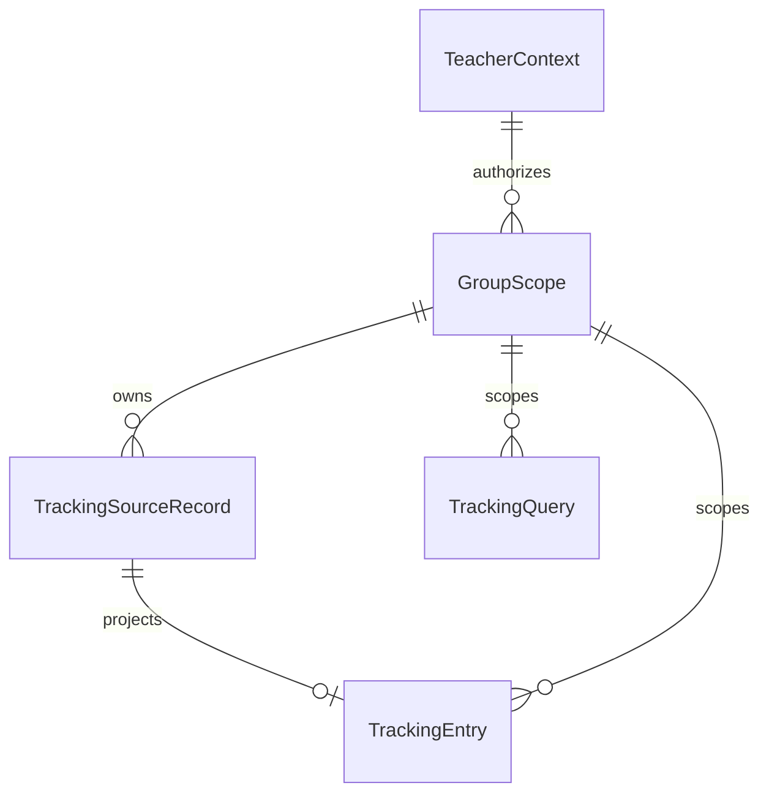

# Teacher Tracking Functional Specification

## Scope and Sources

U2 implements AC1.1.2, AC2.1.1–6 and AC2.2.1. U1 supplies shared grant/session/mutation enforcement; U3 consumes renamed routes, exports and final cleanup. This document is authoritative for workflow order and view-state transitions. entities.md and rules.md own shapes and decisions respectively.

[requirements.md](../../../inception/requirements-analysis/requirements.md), [unit-of-work.md](../../../inception/units-generation/unit-of-work.md), [unit-of-work-story-map.md](../../../inception/units-generation/unit-of-work-story-map.md), [components.md](../../../inception/domain-design/components.md), [contract-summary.md](../../../inception/contract-design/contract-summary.md).

The existing tracking source has dates, groups, titles, locations and optional coordination, but no owner/assignee/status fields. Extend that authoritative source seam explicitly. Do not derive owner from coordination or join unrelated administration fixtures. Local synthetic values are declared fixture data, never evidence of a populated backend.

## Ordered Workflows

### W1 List and filter

1. Resolve current session and current grants. Invalidated session uses existing profile/sign-in recovery without schedule data.
2. Build group choices from current active teacher grants and matching organizations. No static global options or unauthorized fallback.
3. Parse canonical groupId, from and to. Absent filter defaults retain the established date window where applicable and select only a currently granted group. No grants means denied. Malformed supplied values remain validation errors; a well-formed ungranted group is denied.
4. Verify the requested group and organization against current authority before fetching source data. Then validate real calendar dates and maximum 31-day elapsed difference. For a fully authorized actor, date errors allow correction without data.
5. Fetch current records through the existing source boundary using inclusive UTC day bounds. Preserve existing filtering by record start instant within those bounds; do not expand to overlap semantics.
6. Validate returned record shape and owning scope. A mixed or mismatched scope fails closed as a whole, without partial output.
7. Build each TrackingEntry through explicit allowlist projection.
8. Return existing success/empty/validation/denied/invalidated/dependency outcomes. No second outcome protocol.
9. Render responsive table/cards with identical authorized data, existing location/coordination and added owner, assignees and status. Format visible dates in Hungarian with the established Budapest timezone.

### W2 Detail and back navigation

1. Execute W1 authorization, filter and source workflow on every request.
2. Find the requested identifier only within that authorized result. Absent entry yields generic denial, without revealing whether it exists elsewhere.
3. Show the same projection and missing-value wording as list/cards.
4. Preserve validated group/date context in the fixed schedule back link. Never persist raw source data in the URL.

### W3 Current refetch and failure recovery

1. A new filter submission, refresh or retry starts a new authorized read.
2. Recheck session version, role and current grants; revoked access cannot reuse a prior successful projection.
3. Read current backing records. Source changes to owner, assignments or status appear on the next request; no live updates or new history store are promised.
4. Loading, invalidation and failures expose no stale schedule rows, hidden data or previous counts.
5. Retryable failure offers a native fresh retry retaining only safe validated filter context. Terminal failure provides existing later-retry guidance.
6. Test fixtures may change the backing record between reads through a separate test/operator seam. The teacher port has no mutation capability.

### W4 Existing bookmarks

1. Receive GET at the existing schedule or detail bookmark.
2. Translate existing csoport/kezdet/veg into canonical groupId/from/to. Canonical values may be accepted only when unambiguous; conflicting or repeated ambiguous values produce safe destination validation, never a privileged default.
3. Whitelist and validate identifiers and dates. Omit unknown fields including arbitrary destination/return inputs and local scenario switches.
4. Redirect with temporary status 307 to /teacher/schedule or /teacher/schedule/{encoded-id}, fixed same origin. Identifier must be one encoded path segment.
5. Missing date context may use established destination defaults; malformed supplied context must not silently become a wider authorized query.
6. Destination independently performs W1/W2. Compatibility does not create, alias or upgrade a session cookie. A well-formed unauthorized group stays unauthorized.
7. Compatibility retains a minimal read/redirect surface only; no old implementation remains writable.

### W5 Direct write attempts

1. Teacher UI presents no edit, create, assignment, approval, administration or governance controls.
2. Forged direct mutation requests still use U1 current-role authorization and denial/audit behavior.
3. Pair successful tracking with denied mutations in integration checks. Both paths preserve task, assignment and group data.

## State Transitions

| Starting state | Trigger | Result | Data exposure |
| --- | --- | --- | --- |
| Initial or any previous view | New read | Loading | No stale records |
| Loading | Current session invalid | Invalidated | Recovery only |
| Loading | Scope unauthorized | Denied | Generic denial only |
| Loading | Authorized invalid filter | Validation error | Correctable fields, no records |
| Loading | Authorized valid source, records | Success | Allowlisted entries |
| Loading | Authorized valid source, none | Empty | Empty guidance, no create action |
| Loading | Dependency unavailable, retryable | Retryable failure | Safe retry only |
| Loading | Malformed source or terminal failure | Terminal failure | Safe later guidance |
| Retryable failure | Retry | Loading | Fresh authorization and read |
| Success or empty | Filter/refresh/revocation | Loading | Prior projection discarded |

These are view outcomes, not task lifecycle mutations. Status remains the current source label; U2 creates no status enum or status-transition mechanism.

## Derived Entity Relationships

Text fallback: a current teacher context authorizes existing groups; each group owns source records and scopes queries and projections; a source record yields at most one authorized projection. Diagram identifiers, relationships and cardinalities were checked against entities.md before writing.

## Derived Rules Summary

- BR2.1: Current assigned-group authority.
- BR2.2: Strict calendar range.
- BR2.3: Current source integrity.
- BR2.4: Browser field allowlist.
- BR2.5: Explicit absence.
- BR2.6: Fresh refetch and safe recovery.
- BR2.7: Empty and denied distinction.
- BR2.8: Read-only boundary.
- BR2.9: Teacher naming and navigation.
- BR2.10: Responsive accessible parity.
- BR2.11: Safe bookmark compatibility.
- BR2.12: Preserve source ownership and records.

## Integration and Verification Boundaries

C3 tracking and C4 bookmark contracts govern this unit. U1 owns grant resolution, version invalidation and shared mutation denials. Coordination/Directory retain data ownership. U3 receives teacher names/routes and final executable-reference cleanup. Existing U1 review R-01 (scope-aware Super administrator selection for mixed-organization grants) remains unresolved and must be fixed and checked in the retained administration consumer before release; teacher design does not resolve it.

Unit checks must cover both groups, an ungranted group, missing values, sensitive extra source fields, scope mismatch, invalid calendar/range boundaries, current source modification followed by refetch, invalidated/revoked sessions, retry/terminal states, responsive/detail parity and direct mutation denial. Browser accessibility, coverage thresholds, production build/start, security and real database/RLS evidence remain Build and Test responsibilities; this design claims none of those executions.

