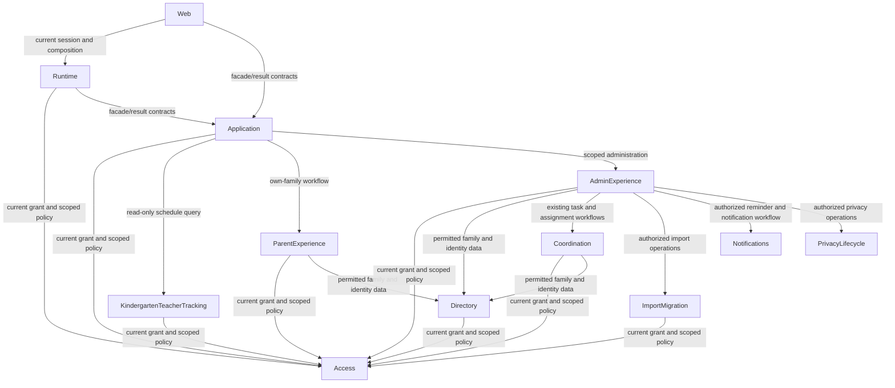

# Domain Components

## Catalogue and Scope

Twelve logical components describe the existing modules affected by the four-role change and their immediate business collaborators. These are software responsibilities, not proposed deployed services or a repository-wide redesign. The user selected existing boundaries and minimal old-schedule URL redirects in [domain-design-questions.md](domain-design-questions.md). English development role name: Kindergarten teacher; Hungarian UI label: `Óvónő`.

```yaml
components:
  - name: Access
    summary: "Own current roles, scoped grants, authorization and revocation."
    behaviour: "Recognize exactly the four approved roles; deny unknown roles explicitly. Own legacy grant conversion, preservation of scope and inactive/revoked state, deduplication, authorization-version invalidation, redacted audit and last-super-administrator protection. Define the policy semantics consumed by application and persistence enforcement."
    responsibilities: ["Current role policy and grant lifecycle","Grant conversion and safe authorization outcomes"]
    depends_on: []
    dependents: [{"component":"Directory","interaction":"current grant and scoped policy"},{"component":"Coordination","interaction":"current grant and scoped policy"},{"component":"KindergartenTeacherTracking","interaction":"current grant and scoped policy"},{"component":"ParentExperience","interaction":"current grant and scoped policy"},{"component":"AdminExperience","interaction":"current grant and scoped policy"},{"component":"ImportMigration","interaction":"current grant and scoped policy"},{"component":"Application","interaction":"current grant and scoped policy"},{"component":"Runtime","interaction":"current grant and scoped policy"}]
    external_dependencies: [{"name":"Existing grant/user repositories and SQL/RLS","kind":"database","purpose":"Persist grants and enforce matching scoped policy; production integration remains unlinked."}]
    entities: [{"name":"User","identifier":"id","attributes":["isActive","authorizationVersion"]},{"name":"Session","identifier":"subjectId","attributes":["authorizationVersion"]},{"name":"RoleGrant","identifier":"id","attributes":["subjectId","role","scope","grantedAt","revokedAt"]}]
  - name: Directory
    summary: "Own family, parent, child and business-group identity."
    behaviour: "Preserve real business groups, families and school-year relationships. Resolve permitted identity display data separately from sensitive contact/profile fields; preserve own-family and granted-group privacy."
    responsibilities: ["Family and identity lifecycle","Authorized directory visibility"]
    depends_on: [{"component":"Access","interaction":"current grant and scoped policy","style":"sync"}]
    dependents: [{"component":"Coordination","interaction":"permitted family and identity data"},{"component":"ParentExperience","interaction":"permitted family and identity data"},{"component":"AdminExperience","interaction":"permitted family and identity data"}]
    external_dependencies: []
    entities: [{"name":"Family","identifier":"id","attributes":["scope","parents","children","archivedAt"]},{"name":"ParentProfile","references":[{"entity":"User","owned_by":"Access","relationship":"Parent identity refers to its access subject"}],"identifier":"id","attributes":["userId","displayName","email","phone","locality","optionalProfile","optionalProfileConsent"]},{"name":"Child","identifier":"id","attributes":["displayName","groupScope","schoolYearId"]}]
  - name: Coordination
    summary: "Own tasks, assignments and coordination changes."
    behaviour: "Retain task/assignment ownership and existing workflow state. Teacher tracking must not create a duplicate writable task store or new event state machine. Preserve signup, capacity, swap and approval boundaries and existing assignment events."
    responsibilities: ["Task and assignment lifecycle","Coordination transaction/event boundaries"]
    depends_on: [{"component":"Access","interaction":"current grant and scoped policy","style":"sync"},{"component":"Directory","interaction":"permitted family and identity data","style":"sync"}]
    dependents: [{"component":"AdminExperience","interaction":"existing task and assignment workflows"}]
    external_dependencies: []
    entities: [{"name":"Task","identifier":"id","attributes":["scope","capacity","version"]},{"name":"Assignment","references":[{"entity":"Family","owned_by":"Directory","relationship":"Assignment refers to its participating family"}],"identifier":"id","attributes":["taskId","familyId","state","version"]}]
  - name: KindergartenTeacherTracking
    summary: "Provide assigned-group read-only schedule projections."
    behaviour: "Replace staff scheduling with teacher tracking. Recheck grants, apply the existing date filter limit, project dates/title/group/owner/assignees/current status and existing permitted location/coordination values. Distinguish denied, authorized empty, invalid filter, partial fields and dependency/session recovery. Never expose private fallback fields or mutations."
    responsibilities: ["Read-only schedule query and projection","Tracking display fields and explicit absence states"]
    depends_on: [{"component":"Access","interaction":"current grant and scoped policy","style":"sync"}]
    dependents: [{"component":"Application","interaction":"read-only schedule query"}]
    external_dependencies: [{"name":"Schedule repository port","kind":"other","purpose":"Read authoritative task/event tracking data through the existing injected repository; no new durable store."}]
    entities: [{"name":"ScheduleEntry","identifier":"id","attributes":["groupId","startsAt","endsAt","title","location","coordinationDisplayName","ownerDisplayName","assigneeDisplayNames","currentStatusLabel"]}]
  - name: ParentExperience
    summary: "Preserve own-family parent duties and actions."
    behaviour: "Retain parent own-family visibility and existing commands; use current grants and versions without granting advanced administration."
    responsibilities: ["Parent workflow orchestration"]
    depends_on: [{"component":"Access","interaction":"current grant and scoped policy","style":"sync"},{"component":"Directory","interaction":"permitted family and identity data","style":"sync"}]
    dependents: [{"component":"Application","interaction":"own-family workflow"}]
    external_dependencies: []
    entities: []
  - name: AdminExperience
    summary: "Preserve core group administration and current super-admin workflows."
    behaviour: "Group admins retain granted-group core records/tasks/assignments/approvals. Super administrators own organization-scoped advanced operations and governance, including converted kindergarten-admin access. Do not introduce a promotion wizard or broaden group-admin advanced permissions."
    responsibilities: ["Core administrative workflow orchestration","Advanced workflow dispatch"]
    depends_on: [{"component":"Access","interaction":"current grant and scoped policy","style":"sync"},{"component":"Directory","interaction":"permitted family and identity data","style":"sync"},{"component":"Coordination","interaction":"existing task and assignment workflows","style":"sync"},{"component":"ImportMigration","interaction":"authorized import operations","style":"sync"},{"component":"Notifications","interaction":"authorized reminder and notification workflow","style":"sync"},{"component":"PrivacyLifecycle","interaction":"authorized privacy operations","style":"sync"}]
    dependents: [{"component":"Application","interaction":"scoped administration"}]
    external_dependencies: []
    entities: []
  - name: ImportMigration
    summary: "Own existing import coverage and archive process ownership."
    behaviour: "Restrict advanced import operations to super administrators. Replace obsolete executable administrator-owner metadata while preserving sheet/archive coverage, business records, conflicts and transaction/rollback semantics."
    responsibilities: ["Import and archive conversion workflow"]
    depends_on: [{"component":"Access","interaction":"current grant and scoped policy","style":"sync"}]
    dependents: [{"component":"AdminExperience","interaction":"authorized import operations"}]
    external_dependencies: []
    entities: []
  - name: Notifications
    summary: "Retain notification scheduling, dispatch and reminder behavior."
    behaviour: "Preserve existing parent notification behavior and dispatch/retry/cancel semantics; advanced administrative reminder control belongs to super administrators."
    responsibilities: ["Notification lifecycle and provider boundary"]
    depends_on: []
    dependents: [{"component":"AdminExperience","interaction":"authorized reminder and notification workflow"}]
    external_dependencies: []
    entities: []
  - name: PrivacyLifecycle
    summary: "Retain privacy lifecycle and redacted audit behavior."
    behaviour: "Administrative privacy operations remain super-admin only at the invoking authorization boundary. Preserve existing holds, deferral and deletion/anonymization lifecycle; teacher projections never expose protected reasons."
    responsibilities: ["Existing privacy lifecycle transaction boundary"]
    depends_on: []
    dependents: [{"component":"AdminExperience","interaction":"authorized privacy operations"}]
    external_dependencies: []
    entities: []
  - name: Application
    summary: "Orchestrate facades and explicit contract/result states."
    behaviour: "Apply current-role policy at every protected facade/command boundary, maintain field allowlists and direct-request denial, align executable authorization manifests with domain and SQL semantics, and preserve existing idempotency/evidence outcomes."
    responsibilities: ["Facade contracts and policy enforcement","Projection/result/idempotency boundaries"]
    depends_on: [{"component":"Access","interaction":"current grant and scoped policy","style":"sync"},{"component":"KindergartenTeacherTracking","interaction":"read-only schedule query","style":"sync"},{"component":"ParentExperience","interaction":"own-family workflow","style":"sync"},{"component":"AdminExperience","interaction":"scoped administration","style":"sync"}]
    dependents: [{"component":"Runtime","interaction":"facade/result contracts"},{"component":"Web","interaction":"facade/result contracts"}]
    external_dependencies: []
    entities: []
  - name: Runtime
    summary: "Compose adapters and resolve current profiles and sessions."
    behaviour: "Expose four current profile categories, use English role identifiers and Hungarian labels, validate signed session/version against current grant state, and refresh or require sign-in after conversion/revocation. Legacy profiles are not independent available roles. Synthetic adapters remain local; production is not declared linked."
    responsibilities: ["Current profile catalog and session resolution","Adapter composition"]
    depends_on: [{"component":"Access","interaction":"current grant and scoped policy","style":"sync"},{"component":"Application","interaction":"facade/result contracts","style":"sync"}]
    dependents: [{"component":"Web","interaction":"current session and composition"}]
    external_dependencies: [{"name":"Existing repository/provider adapters","kind":"other","purpose":"Bind ports to current synthetic adapters; production configuration remains unlinked."}]
    entities: []
  - name: Web
    summary: "Render authorized current-role screens and safe legacy redirects."
    behaviour: "Use the existing profile cards and teacher table/cards/detail/state panels with equal tracking fields on both layouts. Preserve safe filters on old schedule/detail redirects and reauthorize destinations. Hide mutation controls and also rely on independent request authorization."
    responsibilities: ["Localized role navigation and responsive presentation","Minimal old-URL compatibility"]
    depends_on: [{"component":"Runtime","interaction":"current session and composition","style":"sync"},{"component":"Application","interaction":"facade/result contracts","style":"sync"}]
    dependents: []
    external_dependencies: []
    entities: []
```

## Component Diagram



Text fallback: Web calls Runtime and Application. Runtime resolves Access and composes Application. Application uses Access and the teacher, parent and administrator workflows. Teacher tracking uses Access and a schedule repository port. Parent uses Access and Directory. Admin uses Access, Directory, Coordination, ImportMigration, Notifications and PrivacyLifecycle. Directory and imports use Access; Coordination uses Access and Directory. No dependency cycle is introduced. Diagram syntax was checked structurally before writing: all nodes declared, labels quoted and edges correspond to the catalogue; no diagram renderer or application tests were run.

## Component Summary

| Component | Purpose | Depends On | Dependents | Entities Owned |
| --- | --- | --- | --- | --- |
| Access | Own current roles, scoped grants, authorization and revocation. | — | Directory, Coordination, KindergartenTeacherTracking, ParentExperience, AdminExperience, ImportMigration, Application, Runtime | User, Session, RoleGrant |
| Directory | Own family, parent, child and business-group identity. | Access | Coordination, ParentExperience, AdminExperience | Family, ParentProfile, Child |
| Coordination | Own tasks, assignments and coordination changes. | Access, Directory | AdminExperience | Task, Assignment |
| KindergartenTeacherTracking | Provide assigned-group read-only schedule projections. | Access | Application | ScheduleEntry |
| ParentExperience | Preserve own-family parent duties and actions. | Access, Directory | Application | — |
| AdminExperience | Preserve core group administration and current super-admin workflows. | Access, Directory, Coordination, ImportMigration, Notifications, PrivacyLifecycle | Application | — |
| ImportMigration | Own existing import coverage and archive process ownership. | Access | AdminExperience | — |
| Notifications | Retain notification scheduling, dispatch and reminder behavior. | — | AdminExperience | — |
| PrivacyLifecycle | Retain privacy lifecycle and redacted audit behavior. | — | AdminExperience | — |
| Application | Orchestrate facades and explicit contract/result states. | Access, KindergartenTeacherTracking, ParentExperience, AdminExperience | Runtime, Web | — |
| Runtime | Compose adapters and resolve current profiles and sessions. | Access, Application | Web | — |
| Web | Render authorized current-role screens and safe legacy redirects. | Runtime, Application | — | — |

## Entity Ownership

| Entity | Owning Component | Identifier | Attributes | References |
| --- | --- | --- | --- | --- |
| User | Access | id | isActive, authorizationVersion | — |
| Session | Access | subjectId | authorizationVersion | User subject identity within Access |
| RoleGrant | Access | id | subjectId, role, scope, grantedAt, revokedAt | User subject identity within Access |
| Family | Directory | id | scope, parents, children, archivedAt | — |
| ParentProfile | Directory | id | userId, displayName, email, phone, locality, optionalProfile, optionalProfileConsent | User in Access |
| Child | Directory | id | displayName, groupScope, schoolYearId | — |
| Task | Coordination | id | scope, capacity, version | — |
| Assignment | Coordination | id | taskId, familyId, state, version | Task in Coordination; Family in Directory |
| ScheduleEntry | KindergartenTeacherTracking | id | groupId, startsAt, endsAt, title, location, coordinationDisplayName, ownerDisplayName, assigneeDisplayNames, currentStatusLabel | Authorized source task/event through schedule port; exact link specified in Contract Design |

Entities are captured at ownership/shape depth only. Scope and business-group identifiers remain existing shared values, not permission roles to delete. Family owns its aggregate relationship to parents/children; each named entity has one component owner. Directory's existing group/school-year storage remains unchanged and is not expanded into a new schema here. Other existing import, notification and privacy records remain owned by their listed lifecycle components; their schemas are outside this role change.

ScheduleEntry is an existing read model, not an additional durable task entity. Its owner/assignee/status display attributes are proposed projection additions. Current staff records only contain dates/title/group/location/coordination; current Coordination Task lacks these presentation fields, and the synthetic admin adapter has separate task/event fixture records. Therefore no automatic shared-ID join or coordination-contact-as-owner assumption is made. Contract Design must define a schedule source record with explicit authoritative owner, assignment and status inputs; Functional Design must specify the source mapping and synthetic fixture alignment. Missing source values produce explicit absences; no newly invented owner or status is permitted. This integration work is required for the approved story, not a deferred optional feature. Coordination remains owner of writable task/assignment behavior; Directory remains owner of identity records. TeacherTracking reads the injected port instead of calling a writable service or copying a private directory record.

## External Dependencies

| Component | Dependency | Kind | Purpose |
| --- | --- | --- | --- |
| Access | Existing grant/user repositories and SQL/RLS | database | Persist grants and enforce matching scoped policy; production integration remains unlinked. |
| KindergartenTeacherTracking | Schedule repository port | other | Read authoritative task/event tracking data through the existing injected repository; no new durable store. |
| Runtime | Existing repository/provider adapters | other | Bind ports to current synthetic adapters; production configuration remains unlinked. |

Existing storage/provider ports in unaffected workflows remain unchanged. SQL/RLS, synthetic stores and framework infrastructure are enforcement/adapter dependencies, not separate domain components. No cloud service selection, production linkage, new persistence or deployment topology is decided here.

## Rationale

| Component | Reason for boundary |
| --- | --- |
| Access | Grant lifecycle, revocation, migration and policy change together; owns the current role semantics. |
| Directory | Family/group and sensitive identity visibility have a distinct lifecycle from tracking. |
| Coordination | Writable task/assignment transactions remain distinct from read-only presentation. |
| KindergartenTeacherTracking | Existing schedule query/projection concern is preserved and renamed; cannot mutate task ownership. |
| ParentExperience | Existing own-family workflow remains independently testable. |
| AdminExperience | Existing scoped admin orchestration retains core and advanced distinctions. |
| ImportMigration | Existing sheet coverage, conflicts and rollback remain cohesive. |
| Notifications | Delivery/retry lifecycle stays separate from administrative authorization. |
| PrivacyLifecycle | Existing retention/hold/anonymization transaction behavior remains separate. |
| Application | Current facade contracts/results and enforcement orchestration remain an integration boundary. |
| Runtime | Profile/session and composition lifecycle is separate from business data ownership. |
| Web | Localization, responsive UI and redirect compatibility remain presentation concerns. |

Option A, retained boundaries: smaller change and preserves repository ports; policy consumers still require parity checks. Option B, new combined policy/tracking component: fewer feature-local boundaries but couples grants/revocation to schedule presentation and demands wider restructuring. Both can be reversed with code changes, but B costs more to unwind. The user selected A; approval at this gate affirms this catalogue. **Alternatives Rejected:** combined policy/tracking component and separate teacher task store. See [decisions.md](decisions.md), ADR-001–ADR-003.

## Policy, Conversion and Transaction Boundaries

Access defines the four current roles and explicit unknown-role denial. Application, runtime, domain consumers and SQL implement the same behavior, with a shared executable permission-case corpus rather than claiming SQL can import TypeScript. Parent own-family and Group admin core-group rules remain, while imports/reminders/privacy/settings/governance require organization-scoped Super administrator. Teacher read access requires current explicit group grants and a field allowlist.

Grant conversion belongs to Access and its persistence migration: map staff to teacher and kindergarten-admin to super-admin without changing subject, scope or inactive/revoked state. Deduplication must preserve evidence and must never turn an inactive source into an active grant. Persist conversion and authorization-version invalidation together where a transaction exists; capture redacted conversion audit atomically with the change. Check populated rows for unsupported roles before enabling the four-role constraint; unknown/unmapped roles block migration with a remediation report, never default to teacher. Exact transaction/SQL and collision behavior is specified in Contract/Functional Design. Existing last-super-administrator protection applies to normal later grant mutation. Live execution is not claimed.

Existing coordination transaction/event boundaries remain intact; this feature adds no broker or new domain event. Conversion advances current authorization so old cookies cannot continue from stale claims; refresh or reauthentication uses current grants. Removed synthetic profile IDs may invalidate their sessions and require selection/sign-in; old route compatibility does not imply old-profile authorization compatibility. History is preserved as evidence, while executable catalogs, fixtures, manifests and archive-owner metadata use the current role vocabulary.

Platform perspective: align SQL with application/domain scope checks; preserve existing provider boundaries and unlinked-target status. No infrastructure change or production execution evidence follows from this catalogue. Design perspective: retain approved teacher table/cards/detail and focused state panels; owner, assignment and current status appear in both responsive views. Old schedule/detail routes perform only safe compatibility navigation, with destination authorization and validated filter context; they are not a fifth role or alternate data endpoint.

## Traceability and Sources

All eight approved stories map to declared components in [traceability.json](traceability.json). US1.1 role catalog: Access/Runtime/Web; US2.1 tracking: KindergartenTeacherTracking/Application/Web; US2.2 denial: Access/Application; US3.1–US3.2 conversion: Access/Runtime; US3.3 current session: Access/Runtime/Application; US4.1 retained workflows: ParentExperience/AdminExperience and their collaborators; US4.2 cleanup and records: Access/Directory/ImportMigration/Runtime/Application/Web. NFR privacy/parity, existing quality targets and maintainability remain required; this stage does not certify their execution.

Sources: [requirements.md](../requirements-analysis/requirements.md), [stories.md](../user-stories/stories.md), shared CodeKB [architecture.md](../../../../codekb/waldorf-community-task-manager/architecture.md), [component-inventory.md](../../../../codekb/waldorf-community-task-manager/component-inventory.md) and dependencies.md; [team-practices.md](../practices-discovery/team-practices.md); approved refined mockups. Bounded source reads confirmed current access/directory/coordination entity shapes and schedule projection limitations. Historical CodeKB descriptions of undecided teacher behavior are superseded by the approved requirements, not rewritten as current design evidence.

## Assumptions & Open Questions

No unresolved product or boundary choices. Detailed source projection, schema, route strings, migration collisions and adapter wiring are required downstream design deliverables. No application code, tests, browser runs or live migrations were performed.

