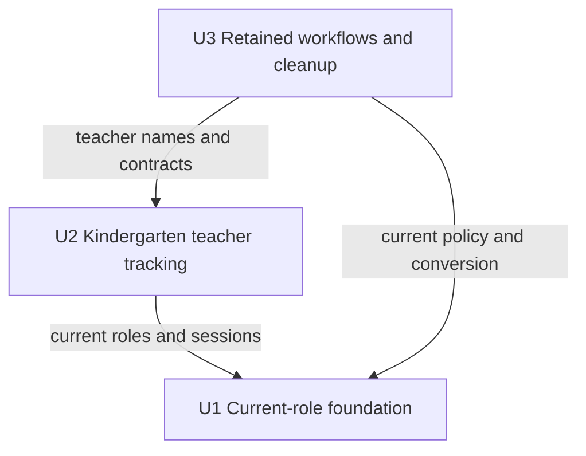

# Unit Dependencies

## Authoritative Dependency Graph

Unit names equal their construction directory names and remain stable. An edge means the caller unit requires the prerequisite's delivered contract/implementation. All units retain the kinds approved in [units-generation-questions.md](units-generation-questions.md).

```yaml
units:
  - name: u1-current-role-foundation
    kind: library
    depends_on: []
  - name: u2-teacher-tracking
    kind: service
    depends_on: [u1-current-role-foundation]
  - name: u3-retained-workflows-cleanup
    kind: service
    depends_on: [u1-current-role-foundation, u2-teacher-tracking]
```



Text fallback: U1 has no unit prerequisites. U2 depends on U1. U3 depends directly on U1 and U2. Every node is declared, labels are quoted, and these three edges match the YAML; syntax and acyclicity were checked structurally before writing. No renderer or application test was executed.

## Integration Points

| Consumer | Prerequisite | Required boundary |
| --- | --- | --- |
| U2 | U1 | Four-role identity, explicit authorization outcomes, granted-group/current-session resolution and field/mutation policy; no old role aliases. |
| U3 | U1 | Current Parent/Group admin/Super administrator policy, converted grants/session versions, migration output and governance safeguards. |
| U3 | U2 | Teacher source/projection/result contract, current names/routes and validated old-URL compatibility, needed by final executable scenario/reference cleanup. |

Shared types and synchronous in-process ports retain existing architecture. SQL is a matching persistence enforcement dependency; TypeScript policy is not imported into SQL. No new broker, HTTP service split or durable event is introduced. Existing coordination/notification events retain their owning modules' boundaries. Contract Design pins these contracts; unit dependencies do not redefine component ownership.

## Parallelism and Release Boundaries

There is no pair of units without a dependency path between them, so no independent implementation batch is available in this approved graph. Pure read-only analysis can happen independently, but it is not an implementation authorization. Test fixtures allow unit-local checks with prerequisite contracts. Shared files still need explicit section ownership or serial integration in Delivery Planning.

Classic scope has walking-skeleton ceremony off. U1 is an embedded foundation, not a purported integrated skeleton. The existing application is the shared release boundary for all units; separate partial production deployment is not proposed. Live database application/target linkage remains outside this intent. This document records topology only; Bolt grouping and economic delivery choices belong to Delivery Planning.

## Sources and Coverage

[components.md](../domain-design/components.md) and [decisions.md](../domain-design/decisions.md) constrain logical ownership. [requirements.md](../requirements-analysis/requirements.md) and [stories.md](../user-stories/stories.md) constrain behavior. [unit-of-work.md](unit-of-work.md) defines U1–U3; [unit-of-work-story-map.md](unit-of-work-story-map.md) maps every story. No implementation, tests or live execution are claimed.
