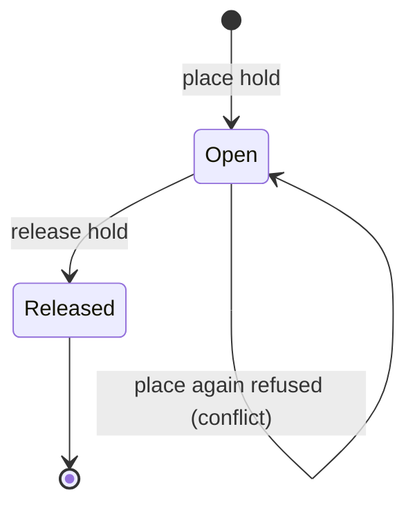
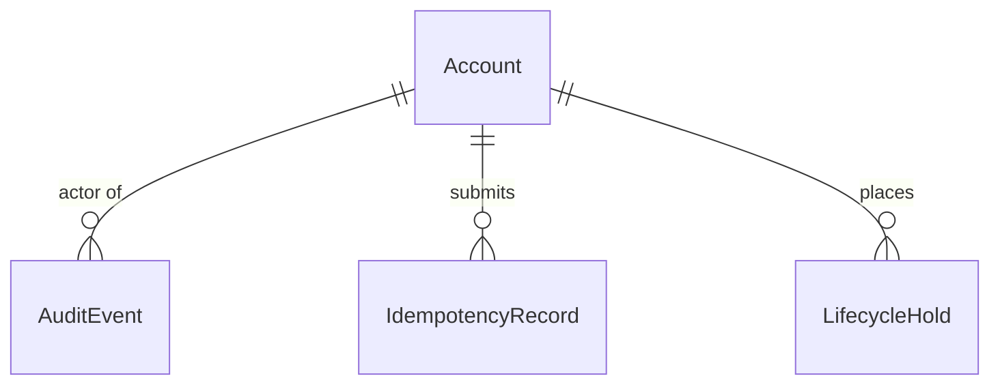

# Functional Specification: U1 Local platform and audit

Behaviour of the foundation unit. Entities are in `entities.md` and rules in `rules.md`; this file is the source of truth for the step sequences. Source: requirements FR1.1 to FR1.4, FR3.x, FR4.2, FR10.2, FR10.3, FR11.1 and the answers in `functional-design-questions.md`.

## Workflows

### W1: Start, migrate and stop the local stack (BR1.1, BR1.2, BR1.5)

1. The developer runs the start command. It checks Docker is available and starts Postgres, the sign-in service and the mail catcher.
2. It waits until each is healthy, then prints the local database address and the public key; the service-role key stays with the tooling.
3. The developer runs the migration command. The runner applies every migration file in order to the default schema, substituting the schema name where a file carries the placeholder.
4. If a file fails, the runner stops and names the file.
5. The stop command stops the three services and keeps their data.

### W2: Application startup and configuration (BR1.3, BR1.4)

1. The application reads the database address, the public key and the session secret from the environment.
2. If any is missing or its address form is wrong (a local `http://` address for a local run, an `https://` address for a hosted run), startup stops with a message naming the setting.
3. There is no synthetic fallback and no mode switch. The service-role key is not read by the application.

### W3: An audited change (BR3.2, BR3.3, BR3.4, BR3.5)

1. The kernel calls the named database function for the change (for example a role grant), passing an idempotency key. The actor is not a parameter: the function derives the actor account and role from the signed-in session (or from a verified system actor for the operator command and seed).
2. In one transaction the function checks the actor's grants (U2), applies the change, calls the audit write function with the action (from the fixed list), target, scope, outcome and a code-shaped details text, and stores the idempotency record. The audit write function is not callable by application roles.
3. If the actor is not allowed, the function returns a denied result normally (no error is raised) and commits only the `denied` event.
4. If any step raises an error, the whole transaction rolls back, change and event together, and the kernel returns a retryable or terminal result (a retryable result is never stored).

### W4: A repeated submission (BR3.6, BR3.7)

1. Inside the operation's database function, the lookup finds (account, operation, key). If none exists, or it has expired, the function performs the operation and stores the record with a 24-hour expiry, replacing an expired row on conflict.
2. If an unexpired one exists with the same fingerprint, it returns the stored result state and reference and does nothing else.
3. If an unexpired one exists with a different fingerprint, it returns a conflict result.
4. Only success, validation, denied, conflict and terminal results are stored; a retryable result is never stored, so a retry acts again.
5. A cleanup function removes expired rows as housekeeping; seed and reset run it, and the operator can call it on a hosted database.

### W5: A stale update (BR3.8)

1. An update carries the version the caller last read.
2. If the stored version differs, the kernel returns a conflict result and nothing changes; if it matches, the update is applied and the version increases by one.

### W6: A worker schema (BR10.1)

1. When a test worker starts, the tooling creates a schema named for the worker and applies all migrations to it through the runner of W1.
2. The tooling adds the schema to the data API's exposed-schema list and triggers a configuration reload before the first request (BR10.3).
3. The worker's test server process reads its schema from the validated database schema setting (default `public`) and uses it for every request; one process serves one schema.
4. Before each test file the tooling resets that schema's data and removes the worker's accounts (found by the worker's name prefix in the shared sign-in user table); tests create the accounts they need.
5. The audit, idempotency and (from U2) policy tests also run once against the unmodified default schema (BR10.4), so the schema that ships is the schema that is tested.
6. A setup failure stops the run and names the worker, schema and step.

### W7: Privacy scan (BR11.1, BR11.2)

1. The scan lists tracked files.
2. It fails if any `.xlsx`, `.xls` or `.csv` file is tracked outside the fictitious-fixtures folder.
3. It fails if a tracked file outside that folder and outside the allowed-example list contains an email address or phone number.
4. The failure names the file; CI runs the scan on every change.

### W8: CI (BR10.2)

1. CI starts the database service, applies the migrations and runs the database-backed tests with the other checks.
2. Deployment workflows remain disabled.

## Lifecycle: LifecycleHold

Text fallback: a hold is Open when placed and Released when released; placing a second hold on the same target while one is open is refused with a conflict result.

## Derived Views

### Entity relationships (derived from `entities.md`)

Text fallback: AuditEvent, IdempotencyRecord and LifecycleHold each refer to one Account (an unconstrained reference to Identity's entity, built in U2).

### Rules summary (derived from `rules.md`)

BR1.1 to BR1.5 stack, migrations, configuration and secrets; BR3.1 conventions; BR3.2 to BR3.5 and BR3.9 audit; BR3.6 to BR3.8 idempotency and versions; BR4.1 result states; BR10.1 to BR10.4 isolation and CI; BR11.1 and BR11.2 privacy.

## Edge Cases and Corners

- Docker not running: W1 stops with a clear message; nothing starts on mocks.
- Port already in use: the start command names the port and the process holding it.
- A migration file with a hard-coded schema name: the runner refuses it (BR1.5).
- Two requests with the same key at the same time: the unique constraint lets one win; the other gets the stored result or a retryable result.
- Audit write fails: the whole change rolls back (BR3.3), never a change without its event.
- Clock changes: expiry compares against the database clock only.
- Worker names with unsafe characters: the tooling accepts only lowercase letters, digits and underscores.
