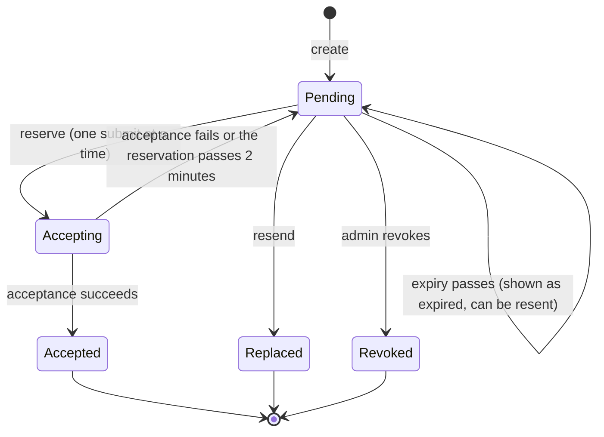
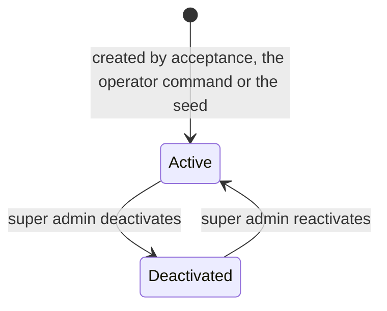
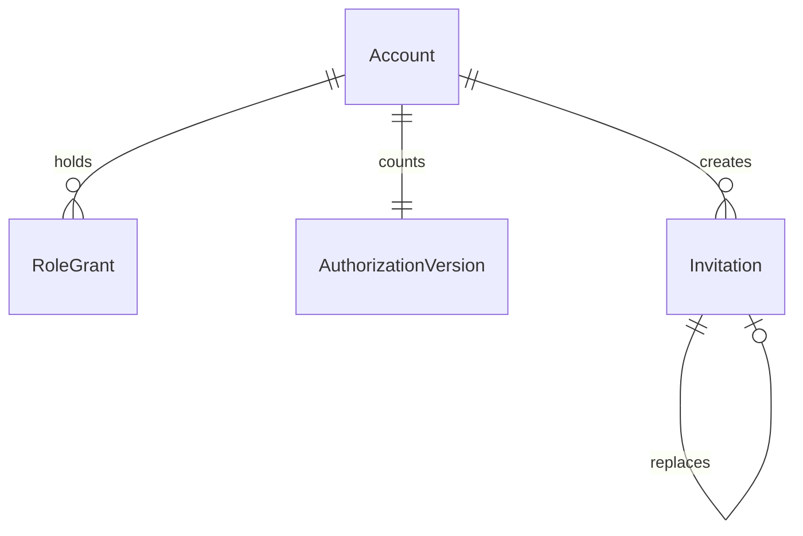

# Functional Specification: U2 Identity and access

Behaviour of the identity unit. Entities are in `entities.md` and rules in `rules.md`; this file is the source of truth for the step sequences and the invitation lifecycle. Source: requirements FR2.1 to FR2.5, FR3.3, ADR-004, ADR-009, ADR-011, ADR-012 and the answers in `functional-design-questions.md`.

## How a Request Becomes a Database Identity

The sign-in service issues the session; the browser only holds it in an httpOnly cookie. On every request the server reads the cookie, refreshes the access token when it is close to expiry, and sends database requests with that token, so the database sees `auth.uid()` and the token's session id. The helper `current_session_is_active()` (BR2.6) checks that the session still exists in the sign-in service's session table and that the account is active; every policy helper and elevated function calls it first. Sign-out, the 30-day inactivity limit, deactivation and password reset therefore take effect in the database itself, and a token that did not come through a live session grants nothing.

## Workflows

### W1: Sign in (BR2.1, BR2.2, BR2.3, BR2.5)

1. The person opens `/bejelentkezes` and submits email and password.
2. The lockout function counts wrong attempts for the keyed email hash in the last 15 minutes; with 5 or more it shows the try-again-later message and stops, without checking the password.
3. The server asks the sign-in service to verify the credentials. On a wrong password it records one attempt and shows the generic message.
4. If the account is deactivated or unknown the sign-in fails the same way, records one attempt like any wrong password, and shows the same generic message.
5. On success it clears the person's attempts, sets the cookie with the sign-in service's tokens (httpOnly, sameSite lax, secure over https) and sends the person to their home screen.

### W2: Every request (BR2.5, BR2.6, BR2.7, BR2.8)

1. The kernel reads the cookie and checks the token's session is active and the account is active (through `current_session_is_active()`).
2. It refreshes the access token when needed; a failed refresh means the session is over.
3. Policy-filtered reads and the named functions run as the signed-in user; the grants are read from the database each time, so a change of grants applies on the very next request.
4. Detail screens call the scope probe first (W8).
5. A request that fails step 1 is redirected to `/bejelentkezes`; a request without the needed grant gets a denied result.

### W3: Sign out (BR2.8)

1. The person chooses sign out; that session is ended in the sign-in service (scope local) and the cookie cleared. Other sessions are unaffected.

### W4: Invite a person (BR2.9, BR2.10)

1. An admin chooses role, scope and email (and, for a parent, the family). The kernel calls the invitation create function with an idempotency key.
2. The function checks the actor's reach (super admin: any role in the organization; group admin: parent or kindergarten_teacher in their own group), refuses a duplicate pending invitation, stores the hash of a new 32-byte token and sets the expiry 7 days ahead.
3. The server sends the invitation email itself through the stack's mail server (the mail catcher locally) with the link `/meghivas/<token>`.
4. To resend, the admin chooses resend on a pending or expired invitation; a new invitation replaces it (the old one becomes `replaced`) with a new token and expiry. An admin can also revoke a pending invitation.

### W5: Accept an invitation (BR2.4, BR2.10, BR2.11)

1. The person opens `/meghivas/<token>`; a narrow pre-session function finds the invitation by token hash and returns only role, scope and validity. If it is expired, replaced, revoked or accepted, the not-valid screen explains how to ask for a new one.
2. The person sets a password (BR2.4 is checked on screen and on the server).
3. The server calls the reserve function, which locks the invitation and moves it from pending to accepting (a reservation older than 2 minutes is released first); a second concurrent submit gets a retry or not-valid result. Only the reservation holder continues.
4. The server creates the sign-in user tagged with the invitation id (or reuses a leftover one without an Account from an earlier failed attempt, setting its password), then calls the acceptance function, which in one transaction creates the Account (with the invitation's organization), the grant and its version row, marks the invitation accepted, writes the audit event and leaves the Parent-link hook for U3.
5. If the function fails, the reservation goes back to pending and the server deletes the sign-in user only when no Account exists for it (never a user that has an Account); a user that cannot be deleted is reused on the next attempt and removed by housekeeping. The person sees a retry message. A repeated submit with the same idempotency key returns the stored success; a new submit on an accepted invitation shows the not-valid message.
6. The person is signed in (W1 step 5) and sent to their home screen.

### W6: Password reset (BR2.4, BR2.12)

1. The person opens `/jelszo-visszaallitas`, enters the email and sees the same neutral message whatever the address.
2. For a known active account the sign-in service emails a recovery link through the stack's mail server (the mail catcher locally), valid 1 hour, pointing at `/jelszo-visszaallitas/uj?token_hash=...&type=recovery`.
3. Opening the link only shows the page. When the person submits the new password, the server exchanges the hash once for a session (a POST, so a mail scanner opening the link cannot use up the code), checks BR2.4, sets the password, ends all other sessions of the account with the session-removal function, clears the attempts, and signs the person in.

### W7: Change a grant, deactivate or reactivate (BR2.2, BR2.13, BR2.14)

1. An admin chooses add grant, revoke grant, deactivate or reactivate for an account within their reach (group admins: parent and kindergarten_teacher grants of their own group only; deactivate and reactivate: super admins only).
2. The function takes a row lock on the organization's super admin grants, checks the actor, refuses removing the last active super admin, applies the change, increases the authorization version and writes the audit event, all in one transaction. A denied attempt commits only its denied event.
3. For deactivation the server then bans the sign-in user and calls the session-removal function; until that finishes, the database already refuses the account (BR2.6). The audit event carries the account's own organization.
4. The affected person's next request sees the new grants.

### W8: The scope probe (BR2.17)

1. A detail screen sends the record type and id to the probe.
2. The probe, which runs with elevated rights and returns minimal columns, answers allowed, denied or not_found for the signed-in account; a record of another organization always answers not_found.
3. allowed runs the normal read; denied shows the Hungarian access-denied state; not_found shows the missing state.

### W9: First super admin (BR2.18)

1. The operator runs the command from their own machine with the organization id and the email.
2. The command refuses if an active super admin exists for that organization. Otherwise it asks the operator to type the target host and compares it with the database address, then asks for the password without echo and checks BR2.4.
3. Under an advisory lock it creates the sign-in user, the Account, the organization grant and the version row and writes role.first_super_admin; any failure removes the new user and leaves nothing behind.

## Lifecycle: Invitation

Text fallback: an invitation starts Pending. A submit reserves it (Accepting); success makes it Accepted, a failure or a reservation older than 2 minutes returns it to Pending; resending makes it Replaced and creates a new Pending one; an admin can revoke it (Revoked). When the expiry passes it is still stored as Pending but shown as expired and cannot be accepted; resend is the way forward.

## Lifecycle: Account

Text fallback: an account is Active when created; a super admin can deactivate and later reactivate it.

## Derived Views

### Entity relationships (derived from `entities.md`)

Text fallback: an Account holds many RoleGrants, has one AuthorizationVersion and creates many Invitations; an Invitation may replace an earlier one. SignInAttempt stands alone, keyed by a keyed hash of the email. Sessions live in the sign-in service.

### Rules summary (derived from `rules.md`)

BR2.1 to BR2.8 sign-in, sessions and deactivation; BR2.9 to BR2.11 invitations; BR2.12 reset; BR2.13 and BR2.14 roles and grants; BR2.15 to BR2.17 row-level security, elevated list and scope probe; BR2.18 operator command; BR2.19 and BR2.20 screens and coexistence; BR2.21 and BR2.22 housekeeping and clean-up.

## Stack Configuration This Design Needs (checked in code generation)

| Setting | Value | Rule |
|---|---|---|
| Open sign-up | off in both places the configuration file has it (the general auth switch and the email-provider switch) | BR2.13 |
| Session inactivity timeout | 30 days | BR2.5 |
| Access token lifetime | about 1 hour, refreshed by the server | BR2.5 |
| One-time code (recovery) lifetime | 1 hour | BR2.12 |
| Password minimum length | 8 | BR2.4 |
| Rate limits of the sign-in service | set explicitly in the configuration file (sign-in and token requests per address and per 5 minutes, and emails per hour), values fixed in code generation and recorded in its summary | BR2.3 risk |
| Mail server | the local mail catcher | BR2.10, BR2.12 |
| Recovery email template | links to the app's reset route with the token hash | BR2.12 |

Where the local stack's version cannot set one of these, the fallback is stated in code generation and reported (for example an app-side inactivity check inside `current_session_is_active()`).

## Elevated Function List (authoritative; BR2.16)

| Function (planned name) | Owner unit | Who may call it |
|---|---|---|
| platform_audit_write | U1 | Only other named functions |
| platform_finish_operation, platform_idempotency_check, platform_idempotency_store | U1 | The kernel on behalf of the signed-in account (not service_role) |
| platform_cleanup_expired | U1 | The seed, reset and the operator through the owner connection (not service_role, BR2.23) |
| platform_actor_role, platform_actor_account, platform_caller_is_system | U1 | The other functions |
| lifecycle_hold_place, lifecycle_hold_release | U1 | A super admin, or the system actor (not service_role, BR2.23) |
| current_session_is_active, authorization_version_for, has_current_role_scope, has_super_scope, has_core_scope | U2 (baseline from the current-roles migration) | Policies and the other functions (not callable by anon) |
| sign_in_lockout_check, sign_in_attempt_record, sign_in_attempt_clear | U2 | admin access: the server before and after sign-in |
| invitation_lookup | U2 | admin access: the server before sign-in; returns role, scope and validity only |
| invitation_reserve, invitation_accept | U2 | admin access: the server on a valid token; reserve also checks whether the email already has an Account |
| sessions_remove (delete a user's session and refresh-token rows) | U2 | admin access: the server after deactivation or reset |
| identity_housekeeping | U2 | admin access: the seed, reset and the operator |
| account_find_by_email | U2 | A signed-in admin within reach (their own session, not admin access): returns the account id and status within the caller's organization only |
| invitation_create, invitation_resend, invitation_revoke | U2 | An admin within reach |
| grant_change | U2 | A super admin, or a group admin within their group |
| account_deactivate, account_reactivate | U2 | A super admin |
| scope_probe | U2 | Any signed-in account (returns only allowed, denied or not_found) |
| operator_first_super_admin | U2 | The operator's command only (system actor) |
| sign-up and approval, notification creation, import commit, lifecycle execution | U3, U4 | Added by those units |

"Admin access" means the server-only admin module that holds the sign-in service's service-role key; it may execute only the functions marked so (BR2.23).

## Edge Cases and Corners

- Two browsers signed in as two people at once: independent sessions (BR2.8).
- The same person opens an invitation twice: the second submit with the same key returns the stored result; a new submit shows the not-valid message.
- An admin resends while the first link is being used: the first accept wins; the replaced link is refused.
- A grant is revoked while a request is in flight: the request that started before the change may finish; the next request is refused.
- The email of an invitation already has an Account: acceptance refuses with a message to ask an admin to grant the role to the existing account.
- Clock changes: expiry compares against the database clock.
- Sign-in service down: sign-in shows a retry message and no session is created (retryable result).
- An attacker locks a victim's address for 15 minutes by repeated wrong passwords: accepted as a known cost of the owner's choice; it does not reveal whether the address exists.
- Two super admins revoke each other at the same time: the row lock lets one succeed and the other is refused as removing the last super admin.
- A direct call to the sign-in service with a stolen password gets a session that works like any other session of that account; the lockout does not cover it (recorded risk).
