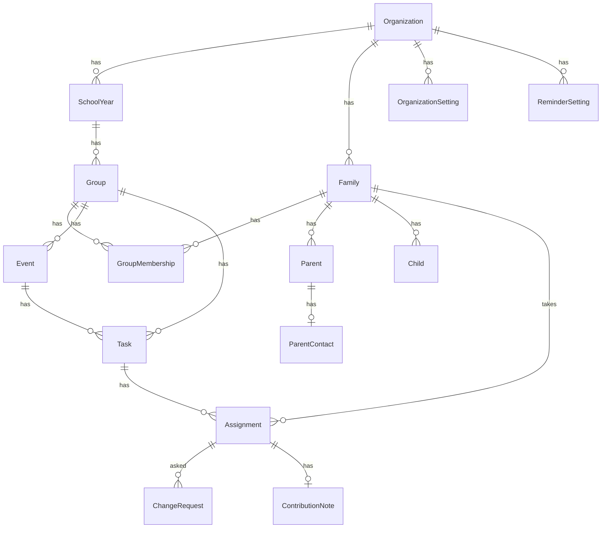

# Functional Specification: U3 Directory, settings and coordination

Behaviour of the unit. Entities are in `entities.md` and rules in `rules.md`; this file is the source of truth for the step sequences and the state machines. Source: requirements FR2.3 (link), FR2.8, FR3.4, FR3.5, FR4.1 to FR4.4, FR5.1 to FR5.5, FR6.1, the confirmed answers Q1 to Q8, the first architecture review and ADR-001 to ADR-013. Audit events are written only for approvals and lifecycle actions (U1 BR3.2). Stories do not exist for this intent, so requirements are the reference.

The unit is designed in two parts that match the build order: **Part A** Directory and Settings (W1 to W4), **Part B** Coordination, the kernel use cases and the teacher schedule (W5 to W12).

## State Machines

### Assignment

| From | Event | To | Rule |
|---|---|---|---|
| (none) | parent signs up, admin assigns | active | BR31.2, BR31.7 |
| active | swap requested | swap_pending | BR31.4 |
| swap_pending | other family confirms, or admin approves | active (on the exchanged task) | BR31.4, BR31.5 |
| swap_pending | other family declines, or admin rejects | active | BR31.4, BR31.5 |
| active | cancellation requested | cancellation_pending | BR31.6 |
| swap_pending | requester withdraws the request | active | BR31.4 |
| cancellation_pending | requester withdraws the request | active | BR31.4 |
| cancellation_pending | admin approves | removed | BR31.5 |
| cancellation_pending | admin rejects | active | BR31.5 |
| active, swap_pending, cancellation_pending | admin removes, task cancelled, family archived (future tasks) | removed | BR31.1, BR31.7, BR30.7 |

`removed` is final; a family signs up again to get a new assignment.

### ChangeRequest

open → applied (swap confirmed by both), open → approved or rejected (admin decision), open → withdrawn (other family declines, requester withdraws, family archived). Only one request is open per assignment.

### Family

active ⇄ archived (BR30.7). Archived families are hidden, keep their history, and lose future places.

### Task

open → closed (admin) → open; open or closed → cancelled (final). Fullness is derived from the taken places, not stored.

## Workflows

### W1: Manage structure (BR30.9)

1. A super admin opens the structure screen and creates or renames a school year or group, with the version check.
2. The function validates dates, uniqueness and the active parent record, writes the change and returns the new version (no audit event, U1 BR3.2).

### W2: Save a family, its parents and children (BR30.1, BR30.2, BR30.4, BR30.6)

1. An admin in reach opens a family or starts a new one.
2. The admin saves the family name, parents (display name, optional profile with consent) and children; contact details are saved through the same call but stored in ParentContact.
3. The function checks reach and the version, validates fields, stores the records and increases versions in one transaction.
4. A group admin creating a family gives it a membership in their own group in the same call.

### W3: Group membership (BR30.6)

1. An admin who reaches both the family and the group adds or ends a family's membership of a group in the same organization.
2. A repeat of an active membership is refused; ending a membership does not remove existing assignments (the admin decides about them in W11).

### W4: Archive and restore a family (BR30.7)

1. An admin in reach chooses archive on a family.
2. In one transaction (kernel use case family.archive): the family and its people become archived, future assignments become removed, open requests become withdrawn and the task versions increase.
3. Restore (family.restore) makes the family and its people active again; removed places are not restored.

### W5: Parent opens the task list (BR31.11, BR32.2)

1. The kernel finds the family from the session's account; no linked parent or an archived family gives the no-family message.
2. The list function returns the tasks of the family's groups with the state available, full, ineligible, assigned, swap-pending or cancellation-pending, each with its version, and the empty state when nothing qualifies.

### W6: Sign up (BR31.2, BR31.3)

1. The parent chooses a task and signs up with the task version shown on screen.
2. The function locks the task row and checks, in this order, version, open status and start time, duplicate, eligibility and capacity (BR31.2), creates the assignment and raises the task version.
3. On DUTY_VERSION_STALE, DUTY_CLOSED, DUTY_ALREADY_ASSIGNED, DUTY_INELIGIBLE or DUTY_FULL the screen shows the matching Hungarian message and reloads the list; the second of two simultaneous parents sees the first one's sign-up.

### W7: Request and answer a swap (BR31.4, BR32.7)

1. The parent opens their assignment's swap page; it lists partner tasks (other families' active assignments on other open, not-started tasks of the same group, showing task title, date and family display name only).
2. The parent chooses one and sends the request with both versions; the function checks the rules of BR31.4, creates the request (requester confirmed) and sets the source to swap_pending.
3. The other family sees the request on a new page listing swap requests addressed to it (swap.incoming), and confirms or declines (swap.respond).
4. On confirmation the function repeats all checks, locks the two task rows in task-id order, exchanges the two assignments' tasks, raises versions and marks the request applied; on decline the request is withdrawn and the source returns to active; if a check fails at confirmation the request stays open for the admin or the requester.
5. If the other family does not answer, the admin decides (W10); the requester can withdraw an open request (swap.withdraw), which returns the source assignment to active.

### W8: Request a cancellation (BR31.6)

1. The parent requests cancellation of their own active assignment before the task starts.
2. The function creates the request and sets cancellation_pending; the place stays taken.

### W9: Contribution note (BR31.8)

1. A parent of the family saves the note from the duty page (last save wins); an admin edits the event's allergen, supply and food notes with the event version; other parents cannot read the contribution note.

### W10: Admin decides approvals (BR31.5)

1. The admin opens the approvals list (open requests in reach).
2. Approve or reject runs the matching state change (a swap exchange repeats the checks and locks tasks in id order) in one transaction with the deciding account and time and one approval.approve or approval.reject audit event; a request that is no longer open gives APPROVAL_ALREADY_DECIDED, a changed one APPROVAL_INVALIDATED, and the list reloads.

### W11: Admin manages events, tasks and places (BR31.1, BR31.7)

1. The admin saves an event or task with the extended form fields (capacity not below taken places; group matches event; event notes with the event version).
2. The admin assigns a chosen family or removes an assignment; an ineligible family or a full task is refused with ASSIGNMENT_INELIGIBLE or ASSIGNMENT_CAPACITY_FULL; there is no override.

### W12: Teacher schedule (BR33.1, BR33.2, BR33.3)

1. The teacher opens the schedule for a granted group and sets a date filter.
2. The filter is validated (real dates, order, at most 31 days, one-sided limits allowed).
3. The schedule function returns entries ordered by start time, or the empty state, or denied; it exposes no contacts, allergen notes or people ids.

### W13: Settings (BR30.10)

1. An admin opens settings and sees the reminder choices and the version.
2. A super admin saves; a stale version or an invalid recipient is refused with the codes the screen already handles.

### W14: Invitation acceptance links the parent (BR30.3, BR32.3)

1. U2's acceptance runs for an invitation whose target is a parent.
2. The kernel use case creates the account, the grant with version and links the Parent's account in one transaction; if the parent is already linked, archived or outside the invitation's family, the invitation stays pending and an admin sees a conflict.

### W15: Lifecycle (BR35.1, BR35.2)

1. A super admin opens the lifecycle list: archived families with their state (eligible-delete, eligible-anonymize, or blocked with the reason).
2. The admin runs the lifecycle for one candidate with confirmation and the candidate version.
3. In one transaction the family's data is deleted or anonymized, the parents' accounts are deactivated and one lifecycle.delete or lifecycle.anonymize audit event is written.

### W16: Governance (BR32.10)

1. An admin revokes or changes a grant through the governance screen; U2's grant functions apply, plus the self-lockout refusal.

## Edge Cases and Business Scenarios

- Two parents race for the last place: one succeeds, the other gets DUTY_VERSION_STALE (or DUTY_FULL when the screen was fresh) (BR31.3).
- A family double-clicks sign-up: the second request is refused as already assigned.
- A swap request for an assignment that was removed or changed in the meantime gives REQUEST_VERSION_STALE.
- A task is cancelled with active assignments: all become removed and open requests are withdrawn (no audit event, U1 BR3.2).
- A family is archived while it has a swap pending: the request is withdrawn and the other family's assignment returns to active.
- Capacity is lowered below the taken places: refused with a validation message naming the taken places.
- A parent without a linked account cannot be edited into another family's account (unique link, BR30.3).
- A teacher of another group opens the schedule URL of this group: denied, no data.
- Database unavailable: retryable or terminal failure, never database text on screen (BR32.4).
- A swap partner's task starts before the other family answers: confirmation is refused as conflict and the request stays for the admin.
- Two swaps involving the same assignment: only one request can be open per assignment.
- A real parent opens the notification page before U4: the empty state, no dead links (BR32.9).

## Entity-Relationship View (derived from `entities.md`)

Text fallback: organizations contain school years, families and settings; school years contain groups; families have parents (each with at most one contact record), children and group memberships; groups have events and tasks; tasks have assignments taken by families; assignments have change requests and one contribution note.

## Rules Summary (derived from `rules.md`)

BR30.1 to BR30.10 cover directory reach, staleness, parent link, consent, contact privacy, memberships, archive, family visibility, structure and settings. BR31.1 to BR31.11 cover events, tasks, sign-up, race, swaps, cancellations, admin assignment, notes, allergens, atomicity and task states. BR32.1 to BR32.10 cover the ports, the family from the database, the invitation link, failure mapping, the dashboard, policy tests, the approved screen changes, result codes, interim behaviour and grants. BR33.1 to BR33.3 cover the teacher schedule. BR34.1 covers the carry-over ledger. BR35.1 and BR35.2 cover the lifecycle.

## Port Operation to Function Table

Function names are fixed here; the code plan fills the signatures. Every function is added by U3 to U2's elevated-function catalogue (BR32.6), except the plain table reads that run as the signed-in user under row-level policies.

| Port operation | Function | Kind |
|---|---|---|
| parent listDuties, getDuty | duty.list, duty.get | elevated (reads Directory) |
| parent signUp | duty.sign_up | elevated |
| parent requestSwap | swap.request (partners from swap.candidates) | elevated |
| (new) respond to a swap | swap.respond | elevated |
| (new) list swap requests (incoming and own open requests) | swap.incoming | elevated |
| (new) withdraw a request | swap.withdraw | elevated |
| parent requestCancellation | cancellation.request | elevated |
| parent updateOwnContribution | contribution.save | elevated |
| admin records.list, records.get | policy-filtered reads of the Directory and Coordination tables | policies |
| admin records.save, records.archive, records.restore | directory.save (family with parents, contacts, children, memberships), structure.save (school year, group), family.archive, family.restore, directory.archive_item and directory.restore_item (group, school year or child on its own) | elevated for family archive and restore, the rest checked functions |
| admin tasks.list, tasks.save | policy-filtered reads, task.save and event.save | checked functions |
| admin assignments.assign | assignment.assign, assignment.remove | elevated |
| admin approvals.list, approvals.decide | policy-filtered read of open requests, swap.decide, cancellation.decide | elevated for decisions |
| admin notes.save | event.save_notes | checked function |
| admin dashboard.get | dashboard.get | elevated |
| admin settings.get, settings.save | policy-filtered read, settings.save | checked function |
| admin governance.list, governance.update (the old update only revokes a grant) | grants read (U2), governance.revoke (calls U2's functions plus the self-lockout check) | elevated |
| admin lifecycle.list, lifecycle.run | lifecycle.list, lifecycle.run | elevated |
| teacher schedule read | schedule.get | elevated |
| invitation acceptance | invitation.accept_parent | elevated (U2's acceptance function calls it) |
