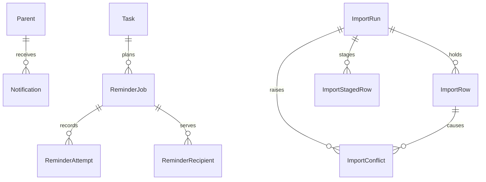

# Functional Specification: U4 Notifications and Excel import

Behaviour of the unit. Entities are in `entities.md` and rules in `rules.md`; this file is the source of truth for the step sequences and the state machines. Source: requirements FR4.4, FR5.2, FR7.1 to FR7.3, FR8.1, the confirmed answers Q1 to Q7, U3's design, the first architecture review and ADR-001 to ADR-013. Stories do not exist for this intent, so requirements are the reference. The unit is designed in two parts that match the build order: **Part A** Notifications and reminders (W1 to W6), **Part B** Import (W7 to W13).

## State Machines

### ReminderJob

| From | Event | To | Rule |
|---|---|---|---|
| (none) | planned for a task and threshold | queued | BR40.4 |
| queued, retrying | run while due: simulated success | sent | BR40.6 |
| queued, retrying | run while due: simulated failure, attempt 1 or 2 | retryable | BR40.6 |
| queued, retrying | run while due: simulated failure, attempt 3 | terminal | BR40.6 |
| retryable | admin retries | retrying | BR40.7 |
| queued, retryable, retrying | task start changes | stale | BR40.5 |
| queued, retryable, retrying | task cancelled or closed with its event, no active recipient left, reminders switched off | cancelled | BR40.5 |

A job serves all its recipient families (ReminderRecipient: active or removed); one simulated attempt covers all active recipients.

### ImportRun

| From | Event | To | Rule |
|---|---|---|---|
| (none) | valid workbook uploaded | previewed (step 4 or 5) | BR41.3 |
| previewed | last conflict resolved | confirmed (step 5) | BR41.5 |
| previewed (no open conflict), confirmed | commit succeeds | committed (step 7) | BR41.6 |
| previewed (no open conflict), confirmed | commit finds a changed match | previewed (with new conflicts), nothing applied | BR41.6 |
| previewed, confirmed | commit fails with a retryable failure and the marking call succeeds | interrupted (step 6) | BR41.9 |
| interrupted | recovery 'resume' succeeds | recovered (step 7) | BR41.9 |
| previewed, confirmed, interrupted | the admin cancels, or a new upload by the same admin | cancelled | BR41.3, BR41.8 |
| previewed, confirmed, interrupted | 7 days pass | expired | BR41.8 |

`committed`, `recovered`, `cancelled` and `expired` are final; the staged rows are deleted when a run reaches any of them.

## Workflows

### W1: A use case creates notifications (BR40.1, BR42.5)

1. A U3 use case from the table in BR40.9 (sign-up, admin assign or remove, swap request, response, withdrawal or decision, cancellation decision, family archive or restore, task, event and settings changes, lifecycle) finishes its changes.
2. In the same transaction it inserts the notices the table prescribes for the linked parents of the right families, with a dedupe key, and adjusts the reminder jobs and recipients (W3).
3. If anything fails, the whole use case rolls back, notices included.

### W2: A parent reads and opens notifications (BR40.2, BR40.3)

1. The parent opens the notification list; the server first runs the lazy reminder tick for the organization (W4); the function returns only their own notifications, newest first, with title, link, read state and the timing and provider fields mapped as BR40.2 prescribes, or the empty state.
2. Opening a notification marks it read (first time kept) and returns the link to the task or request page.
3. Another parent's notification gives denied and changes nothing.

### W3: Plan reminders (BR40.4, BR40.5)

1. When an assignment is created or moved, a task start changes or the reminder setting changes, `reminder_plan` runs for the task inside the U3 use case.
2. For each threshold it ensures one live job for the task (scheduled for start minus 7 days or 24 hours; immediately if that moment has passed and the task has not started; none if it has started, is closed or cancelled) and its recipient families.
3. Jobs of an old start become stale; jobs of a cancelled or closed task become cancelled; a family's recipient row is removed when its place goes; a job without active recipients is cancelled.

### W4: Run due reminders (BR40.6)

1. The lazy tick (opening the notification list or the reminders screen), the seed and housekeeping call `reminder_run_due` for the organization.
2. Each due job records one simulated attempt for all its active recipients; at the job's first run the in-app reminder notification is created for each linked parent of each recipient family (idempotent, even if that attempt failed); success marks the job sent; a failure marks it retryable, or terminal after the third attempt.
3. Running it twice changes nothing the second time.

### W5: Admin reminders screen (BR40.7, BR40.8)

1. An admin opens the list (optionally filtered by status) and sees one row per task and threshold in reach with a count of families, never names.
2. Retry on a retryable job (with its version) sets it to retrying; the next run records the attempt for all recipients at once.

### W6: Dashboard conflict count (BR41.12)

1. The dashboard function returns the open approvals (U3) and the number of unresolved import conflicts (zero for non-super admins).

### W7: Upload a workbook (BR41.1, BR41.2, BR41.3, BR42.2)

1. A super admin chooses a `.xlsx` file on the import screen and submits it (step 1 to 3 of the screen).
2. The server reads the file as bytes with the pinned library: format, size limits (from the file's own directory, before expansion), the 17 sheets, the template headers and cell safety are checked in the order of BR41.2; phone cells starting with + are valid; any failure returns the matching IMPORT_* code and creates nothing.
3. The rows are parsed into staged rows, matched (W8) and classified; an ImportRun, ImportRows and conflicts are created in one transaction with the fingerprint; any earlier open run of the same super admin is cancelled first.
4. The preview screen shows the file name, totals, the changed-row summary and the conflicts (step 4, or step 5 without conflicts); the model carries the run id and run version that every later call sends.

### W8: Match rows to existing records (BR41.4)

1. The matching follows the ordered decision table of BR41.4: email hits first (one family is an update, several are a conflict), then the family name in the group (an unambiguous name without conflicting emails is an update), otherwise a new family; a duplicate in the file is a conflict.
2. Task sheets find the group, the task (group, title, start) and the assigned family by name; unknown groups or families are conflicts.
3. Each matched row records the record's id and version for the commit's re-check. The conflict list shows only the sheet and row number and a fixed reason text.

### W9: Resolve conflicts (BR41.5)

1. For each conflict the super admin chooses keep-existing or use-import, sending the run id and the current run version; each answer returns the new version for the next conflict.
2. A stale run gives IMPORT_PREVIEW_STALE and the screen reloads; when the last conflict is resolved the run is confirmed (step 5).

### W10: Confirm and commit (BR41.6, BR41.10)

1. The super admin confirms ('yes') with the fingerprint and run id shown in the preview.
2. In one transaction every row is matched again (a changed match returns the run to the preview with new conflicts and applies nothing: IMPORT_MATCH_CHANGED); otherwise the interactive sheets are applied through U3's save functions with the recorded versions and derived idempotency keys in ascending id lock order, archive sheets are recorded as archived and counted as skipped, ImportRow outcomes and counts are set, the audit event `import.commit` is written and the staged rows are deleted.
3. Success shows the result (step 7: imported and skipped counts). A fingerprint mismatch, an open conflict or a missing confirmation gives its code and changes nothing.

### W11: Interruption and recovery (BR41.9)

1. If the commit fails with a retryable failure, nothing was applied; the adapter marks the run interrupted (step 6) with `import_mark_interrupted` and the screen shows the recovery step; if the marking fails too, the run stays as it was and the commit can simply be repeated.
2. 'Resume' re-runs the commit from the still-staged rows with the same fingerprint (recovered, step 7); 'cancel' deletes the staged rows; after 7 days the run has expired and a new upload is needed.

### W14: Import status and a new upload (BR41.13)

1. When the import screen opens it calls `import_expire`, then `import_status`, which returns the latest previewed, confirmed, interrupted, committed or recovered run mapped to the screen's states ('conflicts', 'preview', 'confirmed', 'committed', 'interrupted', 'recovered'); cancelled and expired runs are not returned, so the upload form shows.
2. A finished run keeps the result step visible with a link to start a new upload.

### W12: Expiry and cleanup (BR41.8)

1. `import_expire` runs from housekeeping, the seed, reset and when the import screen opens; it marks old runs expired and deletes their staged rows.

### W13: Cancel an import (BR41.8)

1. The super admin cancels a run; its staged rows are deleted and the run becomes cancelled.

## Edge Cases and Business Scenarios

- A sign-up is repeated with the same idempotency key: the stored result returns, no second notice (BR40.1).
- Two admins decide the same swap: one notice per parent and kind only (dedupe).
- A task is moved by two hours: its jobs become stale, new ones are planned, old notices stay but show as stale (BR40.2, BR40.5).
- A family has no linked parent: its reminders are planned but no notices are created for it; a parent who is linked later is not backfilled and sees the reminders of tasks planned after linking.
- The reminder setting is switched off: existing live jobs become cancelled and none are planned; switched on again, jobs are planned for upcoming tasks.
- The workbook has a text cell starting with `=`: the whole upload is refused with IMPORT_UNSAFE_CELL; a phone cell '+36 30 123 4567' is fine.
- A second super admin tries to read the first one's staged rows or conflicts: nothing is returned (BR41.7).
- The browser closes during the preview: the run stays for up to 7 days, then expires and the staged rows are deleted.
- The server dies during a commit: the database rolled back; the screen offers recovery.
- The same workbook is uploaded twice and committed: the second commit finds matching families and treats them as updates; a double click on commit commits once (BR41.6).
- A family is added by hand between preview and commit: the commit finds the changed match, applies nothing and returns the run to the preview with a new conflict.
- Two super admins upload at the same time: each has their own run and cannot see the other's.
- A swap is withdrawn: the other family's earlier swap_requested notice reads as cancelled.

## Entity-Relationship View (derived from `entities.md`)

Text fallback: a parent receives notifications; a task plans reminder jobs (one per threshold) that serve recipient families, each with up to three attempts; an import run holds import rows, short-lived staged rows and conflicts, and each conflict belongs to one import row.

## Port Operation to Function Table

Function names are fixed here; the code plan fills the signatures. U4 adds each function to U2's elevated catalogue (BR42.4).

| Port operation | Function | Kind |
|---|---|---|
| parent listNotifications | notification_list | elevated (builds titles from the target) |
| parent markNotificationRead | notification_mark_read | elevated |
| (U3 use cases) | notification writes inside the existing functions of the hand-off list | inside U3 functions |
| (internal) plan reminders | reminder_plan | elevated |
| (lazy tick, seed, housekeeping) run due reminders | reminder_run_due | elevated, system caller or any member of the organization |
| admin reminders.list | reminder_list | elevated |
| admin reminders.retry | reminder_retry | elevated |
| admin import.preview | import_preview_create (the server parses the file and sends the rows) | elevated, super admin |
| admin import.status | import_status | elevated, super admin |
| admin import.resolve | import_conflict_resolve | elevated, super admin |
| admin import.commit | import_commit | elevated, super admin |
| admin import.recover | import_recover | elevated, super admin |
| (adapter after a failed commit) | import_mark_interrupted | elevated, super admin (starter) |
| (screen) cancel | import_cancel | elevated, super admin |
| (housekeeping) | import_expire | elevated |
| admin dashboard.get | dashboard_import_conflicts (U3's function, body replaced, called by dashboard_get) | elevated |

## Rules Summary (derived from `rules.md`)

BR40.1 to BR40.9 cover notice creation, the parent's list and mark-as-read, reminder planning, change handling, simulated running and retry, the admin list and the per-use-case behaviour. BR41.1 to BR41.13 cover import access, upload checks, preview, matching, conflict resolution, atomic commit with re-matching, staged-data privacy and expiry, interruption and recovery, the sheet registry, fictitious data, the dashboard count and the status mapping. BR42.1 to BR42.5 cover the adapters, the import screen changes, result codes, policy tests and the U3 hand-off. BR43.1 covers the carry-over ledger.
