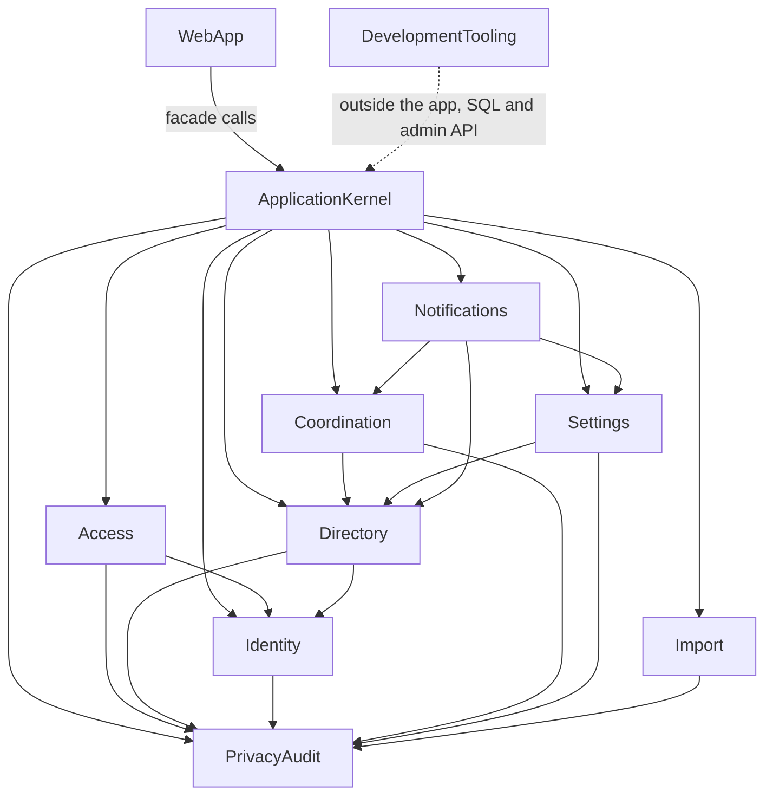

# Component Catalogue: Real backend, sign-in and seed data

Target building blocks for the real-backend work (revision 2, after the architecture review). A component is code we write; the database, the sign-in service and the mail catcher are external dependencies of components. Decisions behind the cut are in `decisions.md` (ADR-001 to ADR-013). Source: `requirements.md` (FR1 to FR12) and the confirmed answers in `domain-design-questions.md` (referred to as "design Q1 to Q11"; "requirements Q1 to Q14" are in the requirements file).

Rules of this design:

- The eight domain blocks never call each other to perform a write that spans blocks. Such use cases (invitation acceptance, sign-up with notification, swap and cancellation approval, import commit, lifecycle execution) are database functions run in one transaction, owned and called by the ApplicationKernel (ADR-011). Blocks depend on each other only through declared entity references.
- Account ids stored to record who did something (`invited_by`, `granted_by`, `decided_by`, `started_by`, the audit actor) are intentionally unconstrained, typed uuid values with no reference: audit and history rows must survive an account being removed. They create no dependency.
- A reference whose target kind varies (`scope_id`, `target_ref`, `target_id`) is a typed, intentionally unconstrained reference; the owning blocks are listed in its attribute note and checked by the owning use case.

```yaml
components:
  - name: WebApp
    summary: Hungarian screens, layouts and server actions; calls only the application kernel.
    behaviour: >
      Renders every page and runs the server actions. Sign-in, invitation acceptance and password-reset screens are
      new; every other screen keeps its markup, copy and test ids. Holds no business rules and no data access; reads
      the session only through the kernel.
    responsibilities:
      - pages, layouts, server actions, route handlers
      - session cookie handling at the edge, through the kernel
    depends_on:
      - component: ApplicationKernel
        interaction: every page and action resolves a session and calls a facade
        style: sync
    dependents: []
    external_dependencies:
      - name: Next.js runtime
        kind: other
        purpose: rendering and request handling
    entities: []

  - name: ApplicationKernel
    summary: Runtime configuration, composition, facades, the facade pipeline, result states, idempotency and the cross-block use cases.
    behaviour: >
      Holds no business rules; it orchestrates. Validates configuration at start-up (accepts a local or hosted
      database address and names the missing setting). Resolves the session, maps the account to its parent and
      grants, then runs the checks that stay in the kernel: (1) the session is active, (2) the authorization version
      is current, (3) for a detail screen a scope probe tells a denied item from a missing one before the read,
      (4) the idempotency record. Normal reads and writes run as the signed-in user so the database policies apply;
      the named elevated functions (idempotency write, audit write, invitation acceptance, import commit, lifecycle
      execution) run with elevated rights on the server only. Cross-block use cases are database functions that run
      in one transaction, audit included; a use case that also creates a sign-in user removes or deactivates it if
      the function fails afterwards. A lint or dependency rule fails the build if the kernel contains table-level SQL
      other than calls to named functions.
    responsibilities:
      - runtime configuration and composition (one runtime, no synthetic mode)
      - facades and ports the screens call (parent, admin, teacher schedule, session)
      - facade pipeline, projection guard and explicit result states
      - persisted idempotency records
      - cross-block use cases as named database functions
      - the elevated server-only database access and its list of allowed functions
    depends_on:
      - component: Identity
        interaction: resolve the signed-in account for a request
        style: sync
      - component: Access
        interaction: read roles, scopes, the authorization version and the scope probe
        style: sync
      - component: Directory
        interaction: families, groups, children and parents for the screens
        style: sync
      - component: Coordination
        interaction: events, tasks, assignments, swaps, cancellations, approvals, teacher schedule view
        style: sync
      - component: Notifications
        interaction: notification and reminder records
        style: sync
      - component: Import
        interaction: Excel import preview, conflicts and commit
        style: sync
      - component: PrivacyAudit
        interaction: audit log and lifecycle candidates for the admin screens
        style: sync
      - component: Settings
        interaction: organization and reminder settings
        style: sync
    dependents:
      - component: WebApp
        interaction: every page and action resolves a session and calls a facade
    external_dependencies:
      - name: PostgreSQL (Supabase)
        kind: database
        purpose: idempotency records and the use-case functions
    entities:
      - name: IdempotencyRecord
        identifier: idempotency_record_id
        attributes: [idempotency_record_id, subject_id, operation, request_key, result_state, created_at, expires_at]

  - name: Identity
    summary: Sign-in, sessions, invitations and password reset on top of the database's sign-in service.
    behaviour: >
      Email and password sign-in with Hungarian errors; inactive accounts cannot sign in. Sessions are verified on the
      server for every request, expire after a fixed lifetime and end at sign-out. An admin invites a person by email,
      role and scope; the invitation expires, can be resent and, when accepted, results in an account (through the
      kernel's invitation use case). Password reset by emailed link. Identity exposes no direct account creation;
      the seed and the operator command use the sign-in service's admin access outside the app.
    responsibilities:
      - sign-in, sign-out, session resolution
      - invitation lifecycle state (create, expire, resend, accepted)
      - password reset
      - the account record that mirrors the sign-in user
    depends_on:
      - component: PrivacyAudit
        interaction: record account events
        style: sync
    dependents:
      - component: ApplicationKernel
        interaction: resolve the signed-in account for a request
      - component: Access
        interaction: role grants refer to accounts
      - component: Directory
        interaction: a parent refers to an account
    external_dependencies:
      - name: Supabase Auth
        kind: third-party-api
        purpose: users, passwords, sessions, emails
      - name: Local mail catcher
        kind: other
        purpose: receives invitation and reset emails in the local environment
    entities:
      - name: Account
        identifier: account_id
        attributes: [account_id, email, status, last_sign_in_at]
      - name: Invitation
        identifier: invitation_id
        attributes: [invitation_id, email, role, scope_type, scope_id, target_type, target_id, token_state, expires_at, accepted_at, invited_by_account_id]

  - name: Access
    summary: Roles, grants, scopes, authorization versions, the scope probe and the row-level security policies.
    behaviour: >
      Four roles (parent, teacher, group admin, super admin) with family, group or organization scope. A change of
      grants bumps the authorization version so it takes effect within the stated window. Every table carries the
      scope columns the policies need (organization, and group where applicable) so that each policy is a
      single-table check. The policies decide who may read or write each table; parent contact details are readable
      only through the ParentContact policy. A per-role, per-read-path policy test list is part of this block.
    responsibilities:
      - role grants and scopes
      - authorization versions and revocation
      - row-level security policies for every table and the policy test list
      - the scope probe used by detail screens
    depends_on:
      - component: Identity
        interaction: grants refer to accounts
        style: sync
      - component: PrivacyAudit
        interaction: record role changes
        style: sync
    dependents:
      - component: ApplicationKernel
        interaction: read roles, scopes, the authorization version and the scope probe
    external_dependencies:
      - name: PostgreSQL (Supabase)
        kind: database
        purpose: grants, versions and policies
    entities:
      - name: RoleGrant
        identifier: grant_id
        attributes: [grant_id, account_id, role, scope_type, scope_id, status, granted_by_account_id, granted_at]
        references:
          - entity: Account
            owned_by: Identity
            relationship: each RoleGrant belongs to one Account
      - name: AuthorizationVersion
        identifier: account_id
        attributes: [account_id, version, changed_at]
        references:
          - entity: Account
            owned_by: Identity
            relationship: each AuthorizationVersion belongs to one Account

  - name: Directory
    summary: Organizations, school years, groups, families, group memberships, parents, parent contacts and children.
    behaviour: >
      Owns the people and the structure of the kindergarten community. Parent contact details live in their own
      table with an admin-in-scope policy; a parent reads only their own entry and teachers read none. A family
      belongs to a group through a membership per school year, so archiving a school year keeps history and a family
      can move to the next year's group. A school year can be archived; archived data stays readable.
    responsibilities:
      - organizations, school years, groups
      - families, memberships, parents, parent contacts, children
      - archive and restore of school years and records
      - anonymization and deletion functions for lifecycle execution
    depends_on:
      - component: Identity
        interaction: a parent refers to an account
        style: sync
      - component: PrivacyAudit
        interaction: record changes to people and structure
        style: sync
    dependents:
      - component: ApplicationKernel
        interaction: families, groups, children and parents for the screens
      - component: Settings
        interaction: settings belong to an organization
      - component: Coordination
        interaction: tasks and assignments refer to groups and parents
      - component: Notifications
        interaction: notifications are for parents
    external_dependencies:
      - name: PostgreSQL (Supabase)
        kind: database
        purpose: people and structure
    entities:
      - name: Organization
        identifier: organization_id
        attributes: [organization_id, name, status]
      - name: SchoolYear
        identifier: school_year_id
        attributes: [school_year_id, organization_id, name, starts_on, ends_on, status]
        references:
          - entity: Organization
            owned_by: Directory
            relationship: each SchoolYear belongs to one Organization
      - name: Group
        identifier: group_id
        attributes: [group_id, organization_id, school_year_id, name, status]
        references:
          - entity: SchoolYear
            owned_by: Directory
            relationship: each Group belongs to one SchoolYear
      - name: Family
        identifier: family_id
        attributes: [family_id, organization_id, display_name, status]
        references:
          - entity: Organization
            owned_by: Directory
            relationship: each Family belongs to one Organization
      - name: GroupMembership
        identifier: group_membership_id
        attributes: [group_membership_id, organization_id, family_id, group_id, status]
        references:
          - entity: Family
            owned_by: Directory
            relationship: each GroupMembership is for one Family
          - entity: Group
            owned_by: Directory
            relationship: each GroupMembership is in one Group
      - name: Parent
        identifier: parent_id
        attributes: [parent_id, organization_id, family_id, account_id, display_name, status]
        references:
          - entity: Family
            owned_by: Directory
            relationship: each Parent belongs to one Family
          - entity: Account
            owned_by: Identity
            relationship: each Parent has at most one Account
      - name: ParentContact
        identifier: parent_id
        attributes: [parent_id, organization_id, contact_email, contact_phone, updated_at]
        references:
          - entity: Parent
            owned_by: Directory
            relationship: each ParentContact belongs to one Parent
      - name: Child
        identifier: child_id
        attributes: [child_id, organization_id, family_id, display_name, status]
        references:
          - entity: Family
            owned_by: Directory
            relationship: each Child belongs to one Family

  - name: Coordination
    summary: Events, tasks, assignments, sign-ups, swaps, cancellations, approvals and the teacher schedule view.
    behaviour: >
      Parents sign up for tasks within capacity; admins assign parents; a parent requests a swap or a cancellation for
      their own assignment and the admin in scope approves or rejects it. The teacher schedule is a read model over
      events, tasks and assignments for the groups granted to the teacher and contains no contact fields. Repeated
      submissions never duplicate. Notifications about requests and decisions are created by the kernel's use cases,
      not by this block.
    responsibilities:
      - events, tasks, capacity
      - assignments and sign-ups
      - swap and cancellation requests and their approvals
      - contribution notes
      - teacher schedule read model
    depends_on:
      - component: Directory
        interaction: groups and parents that tasks and assignments belong to
        style: sync
      - component: PrivacyAudit
        interaction: record approvals and assignment changes
        style: sync
    dependents:
      - component: ApplicationKernel
        interaction: events, tasks, assignments, swaps, cancellations, approvals, teacher schedule
      - component: Notifications
        interaction: reminder jobs and notifications point at tasks and requests
    external_dependencies:
      - name: PostgreSQL (Supabase)
        kind: database
        purpose: events, tasks, assignments and requests
    entities:
      - name: Event
        identifier: event_id
        attributes: [event_id, organization_id, group_id, title, starts_at, ends_at, status]
        references:
          - entity: Group
            owned_by: Directory
            relationship: each Event belongs to one Group
      - name: Task
        identifier: task_id
        attributes: [task_id, organization_id, group_id, event_id, title, category, capacity, starts_at, status, version]
        references:
          - entity: Group
            owned_by: Directory
            relationship: each Task belongs to one Group
          - entity: Event
            owned_by: Coordination
            relationship: a Task may belong to one Event
      - name: Assignment
        identifier: assignment_id
        attributes: [assignment_id, organization_id, task_id, parent_id, source, status, version]
        references:
          - entity: Task
            owned_by: Coordination
            relationship: each Assignment is for one Task
          - entity: Parent
            owned_by: Directory
            relationship: each Assignment is for one Parent
      - name: ChangeRequest
        identifier: change_request_id
        attributes: [change_request_id, organization_id, assignment_id, requested_by_parent_id, kind, reason, status, decided_by_account_id, decided_at]
        references:
          - entity: Assignment
            owned_by: Coordination
            relationship: each ChangeRequest is about one Assignment
          - entity: Parent
            owned_by: Directory
            relationship: each ChangeRequest is requested by one Parent
      - name: ContributionNote
        identifier: contribution_note_id
        attributes: [contribution_note_id, organization_id, assignment_id, text, updated_at]
        references:
          - entity: Assignment
            owned_by: Coordination
            relationship: each ContributionNote belongs to one Assignment

  - name: Notifications
    summary: Per-parent notification records and reminder jobs with their attempts; delivery stays simulated.
    behaviour: >
      A notification is visible only to its parent, who can mark it read. Reminder jobs read tasks and follow the
      reminder settings; they keep their attempts and status. No email or SMS is sent, and the statuses are
      labelled as simulated. A notification's target is a typed, unconstrained reference (task or change request,
      owned by Coordination).
    responsibilities:
      - notification records and read state
      - reminder jobs, attempts and status
    depends_on:
      - component: Directory
        interaction: notifications are for parents
        style: sync
      - component: Coordination
        interaction: reminder jobs and notifications point at tasks and requests
        style: sync
      - component: Settings
        interaction: reminder thresholds and recipient scopes
        style: sync
    dependents:
      - component: ApplicationKernel
        interaction: notification and reminder records
    external_dependencies:
      - name: PostgreSQL (Supabase)
        kind: database
        purpose: notifications and reminder jobs
    entities:
      - name: Notification
        identifier: notification_id
        attributes: [notification_id, organization_id, parent_id, kind, target_type, target_ref, read_at, created_at]
        references:
          - entity: Parent
            owned_by: Directory
            relationship: each Notification is for one Parent
      - name: ReminderJob
        identifier: reminder_job_id
        attributes: [reminder_job_id, organization_id, task_id, threshold, status, scheduled_for]
        references:
          - entity: Task
            owned_by: Coordination
            relationship: each ReminderJob is for one Task
      - name: ReminderAttempt
        identifier: reminder_attempt_id
        attributes: [reminder_attempt_id, organization_id, reminder_job_id, outcome, attempted_at]
        references:
          - entity: ReminderJob
            owned_by: Notifications
            relationship: each ReminderAttempt belongs to one ReminderJob

  - name: Import
    summary: Excel import: upload, preview, conflicts and the staged data for an atomic commit.
    behaviour: >
      Reads an xlsx workbook with the 17-sheet structure, stores a preview with counts and conflicts, and lets an
      admin resolve each conflict. The commit itself is a kernel use case (a database function) that writes through
      Directory and Coordination tables in one transaction; an interrupted commit leaves the data as it was. Only a
      fictitious workbook of the same structure is used in tests and seeds.
    responsibilities:
      - workbook parsing and the sheet registry
      - preview and conflict detection
      - staged rows and conflict resolutions
    depends_on:
      - component: PrivacyAudit
        interaction: record import runs
        style: sync
    dependents:
      - component: ApplicationKernel
        interaction: Excel import preview, conflicts and commit
    external_dependencies:
      - name: xlsx reading library
        kind: other
        purpose: reading workbooks (chosen at design time; none installed today)
      - name: PostgreSQL (Supabase)
        kind: database
        purpose: import runs, rows and conflicts
    entities:
      - name: ImportRun
        identifier: import_run_id
        attributes: [import_run_id, organization_id, workbook_name, workbook_fingerprint, status, started_by_account_id, committed_at]
      - name: ImportRow
        identifier: import_row_id
        attributes: [import_row_id, organization_id, import_run_id, sheet, row_number, outcome]
        references:
          - entity: ImportRun
            owned_by: Import
            relationship: each ImportRow belongs to one ImportRun
      - name: ImportConflict
        identifier: import_conflict_id
        attributes: [import_conflict_id, organization_id, import_run_id, import_row_id, resolution]
        references:
          - entity: ImportRow
            owned_by: Import
            relationship: each ImportConflict is about one ImportRow

  - name: PrivacyAudit
    summary: The audit log, lifecycle candidates and holds.
    behaviour: >
      Every other block records audit events through this block's port, inside the same transaction as the change.
      Lifecycle candidates (anonymize or delete) are evaluated and tracked with their holds; blocked records cannot
      be deleted. The actor and the target of an event are intentionally unconstrained typed ids (audit rows survive
      the removal of what they describe). Executing a lifecycle action is a kernel use case that calls the owning
      block's anonymization or deletion function after checking the holds. Contact visibility is enforced by the
      ParentContact policy owned by Access.
    responsibilities:
      - audit events
      - lifecycle candidates and holds
    depends_on: []
    dependents:
      - component: ApplicationKernel
        interaction: audit log and lifecycle candidates for the admin screens
      - component: Identity
        interaction: record account events
      - component: Access
        interaction: record role changes
      - component: Directory
        interaction: record changes to people and structure
      - component: Coordination
        interaction: record approvals and assignment changes
      - component: Import
        interaction: record import runs
      - component: Settings
        interaction: record settings changes
    external_dependencies:
      - name: PostgreSQL (Supabase)
        kind: database
        purpose: audit events, lifecycle candidates and holds
    entities:
      - name: AuditEvent
        identifier: audit_event_id
        attributes: [audit_event_id, organization_id, actor_account_id, action, target_type, target_id, occurred_at]
      - name: LifecycleCandidate
        identifier: lifecycle_candidate_id
        attributes: [lifecycle_candidate_id, organization_id, target_type, target_id, eligibility, evaluated_at]
      - name: LifecycleHold
        identifier: lifecycle_hold_id
        attributes: [lifecycle_hold_id, organization_id, target_type, target_id, reason, status]

  - name: Settings
    summary: Organization settings and reminder settings.
    behaviour: >
      Holds the organization-level settings and the reminder thresholds and recipient scopes that Notifications
      follows. Changes are audited.
    responsibilities:
      - organization settings
      - reminder settings
    depends_on:
      - component: Directory
        interaction: settings belong to an organization
        style: sync
      - component: PrivacyAudit
        interaction: record settings changes
        style: sync
    dependents:
      - component: ApplicationKernel
        interaction: organization and reminder settings
      - component: Notifications
        interaction: reminder thresholds and recipient scopes
    external_dependencies:
      - name: PostgreSQL (Supabase)
        kind: database
        purpose: settings
    entities:
      - name: OrganizationSetting
        identifier: organization_setting_id
        attributes: [organization_setting_id, organization_id, key, value]
        references:
          - entity: Organization
            owned_by: Directory
            relationship: each OrganizationSetting belongs to one Organization
      - name: ReminderSetting
        identifier: reminder_setting_id
        attributes: [reminder_setting_id, organization_id, threshold, recipient_scope, enabled]
        references:
          - entity: Organization
            owned_by: Directory
            relationship: each ReminderSetting belongs to one Organization

  - name: DevelopmentTooling
    summary: Local environment scripts, seed, reset, per-worker test setup and the operator command; never part of the running app.
    behaviour: >
      Starts and stops the local stack, applies migrations, seeds the small fixed set or the 30-family set with
      fictitious data and known test passwords, and resets to a clean state. The seed creates accounts through the
      sign-in service's admin access and the other rows with SQL against the blocks' tables; it imports nothing from
      the app runtime (a test checks this). Repeatable; a failed seed leaves no half state; the seed refuses to run
      unless the database address is a local one (loopback host and the local stack's port). It creates each test
      worker's schema and account namespace and resets them between test files. A separate operator command, which
      is not the seed, creates the first super admin on any database with the operator's explicit confirmation of
      the target and records an audit event. The privacy scan that fails on real-data files also lives here.
    responsibilities:
      - start, stop and migrate the local stack
      - seed (small set and 30-family set) and reset
      - per-worker schema and account namespace setup and reset
      - the operator command for the first super admin
      - the privacy scan of tracked files
    depends_on: []
    dependents: []
    external_dependencies:
      - name: Docker Desktop and the local Supabase stack
        kind: other
        purpose: runs Postgres, sign-in and the mail catcher locally
      - name: Supabase Auth admin API
        kind: third-party-api
        purpose: creating seeded accounts and the first super admin
      - name: PostgreSQL (Supabase)
        kind: database
        purpose: seeding and resetting the tables
    entities: []
```

## Component Diagram



The dotted edge is not a dependency: DevelopmentTooling imports nothing from the app; it works on the same database and sign-in service from outside.

Text fallback: the screens (WebApp) call the ApplicationKernel; the kernel calls each domain block and owns the cross-block use cases as database functions; the domain blocks depend only through declared entity references (Access and Directory on Identity; Settings, Coordination and Notifications on Directory; Notifications also on Coordination and Settings); PrivacyAudit is the leaf that everyone records audit events to; DevelopmentTooling sits beside the app.

## Component Summary

| Component | Purpose | Depends On | Dependents | Entities Owned |
|---|---|---|---|---|
| WebApp | Screens, layouts, server actions | ApplicationKernel | none | none |
| ApplicationKernel | Config, composition, facades, pipeline, idempotency, cross-block use cases | Identity, Access, Directory, Coordination, Notifications, Import, PrivacyAudit, Settings | WebApp | IdempotencyRecord |
| Identity | Sign-in, sessions, invitations, password reset | PrivacyAudit | ApplicationKernel, Access, Directory | Account, Invitation |
| Access | Roles, grants, scopes, versions, policies, scope probe | Identity, PrivacyAudit | ApplicationKernel | RoleGrant, AuthorizationVersion |
| Directory | Organizations, school years, groups, families, memberships, parents, contacts, children | Identity, PrivacyAudit | ApplicationKernel, Settings, Coordination, Notifications | Organization, SchoolYear, Group, Family, GroupMembership, Parent, ParentContact, Child |
| Coordination | Events, tasks, assignments, swaps, approvals, teacher schedule view | Directory, PrivacyAudit | ApplicationKernel, Notifications | Event, Task, Assignment, ChangeRequest, ContributionNote |
| Notifications | Notification records, reminder jobs and attempts | Directory, Coordination, Settings | ApplicationKernel | Notification, ReminderJob, ReminderAttempt |
| Import | Excel import preview and staging | PrivacyAudit | ApplicationKernel | ImportRun, ImportRow, ImportConflict |
| PrivacyAudit | Audit log, lifecycle candidates and holds | none | ApplicationKernel, Identity, Access, Directory, Coordination, Import, Settings | AuditEvent, LifecycleCandidate, LifecycleHold |
| Settings | Organization and reminder settings | Directory, PrivacyAudit | ApplicationKernel, Notifications | OrganizationSetting, ReminderSetting |
| DevelopmentTooling | Local stack, seed, reset, test setup, operator command, privacy scan | none | none | none |

## Entity Ownership

| Entity | Owning Component | Identifier | Attributes | References |
|---|---|---|---|---|
| IdempotencyRecord | ApplicationKernel | idempotency_record_id | idempotency_record_id, subject_id, operation, request_key, result_state, created_at, expires_at | none |
| Account | Identity | account_id | account_id, email, status, last_sign_in_at | none |
| Invitation | Identity | invitation_id | invitation_id, email, role, scope_type, scope_id, target_type, target_id, token_state, expires_at, accepted_at, invited_by_account_id | typed unconstrained: scope_id and target_id (owned by Directory: Organization, Group, Family, Parent); invited_by_account_id opaque actor id |
| RoleGrant | Access | grant_id | grant_id, account_id, role, scope_type, scope_id, status, granted_by_account_id, granted_at | Account (Identity); scope_id typed unconstrained (Directory: Organization, Group, Family); granted_by opaque actor id |
| AuthorizationVersion | Access | account_id | account_id, version, changed_at | Account (Identity) |
| Organization | Directory | organization_id | organization_id, name, status | none |
| SchoolYear | Directory | school_year_id | school_year_id, organization_id, name, starts_on, ends_on, status | Organization |
| Group | Directory | group_id | group_id, organization_id, school_year_id, name, status | SchoolYear |
| Family | Directory | family_id | family_id, organization_id, display_name, status | Organization |
| GroupMembership | Directory | group_membership_id | group_membership_id, organization_id, family_id, group_id, status | Family, Group |
| Parent | Directory | parent_id | parent_id, organization_id, family_id, account_id, display_name, status | Family, Account (Identity) |
| ParentContact | Directory | parent_id | parent_id, organization_id, contact_email, contact_phone, updated_at | Parent |
| Child | Directory | child_id | child_id, organization_id, family_id, display_name, status | Family |
| Event | Coordination | event_id | event_id, organization_id, group_id, title, starts_at, ends_at, status | Group (Directory) |
| Task | Coordination | task_id | task_id, organization_id, group_id, event_id, title, category, capacity, starts_at, status, version | Group (Directory), Event |
| Assignment | Coordination | assignment_id | assignment_id, organization_id, task_id, parent_id, source, status, version | Task, Parent (Directory) |
| ChangeRequest | Coordination | change_request_id | change_request_id, organization_id, assignment_id, requested_by_parent_id, kind, reason, status, decided_by_account_id, decided_at | Assignment, Parent (Directory); decided_by opaque actor id |
| ContributionNote | Coordination | contribution_note_id | contribution_note_id, organization_id, assignment_id, text, updated_at | Assignment |
| Notification | Notifications | notification_id | notification_id, organization_id, parent_id, kind, target_type, target_ref, read_at, created_at | Parent (Directory); target_ref typed unconstrained (Coordination: Task, ChangeRequest) |
| ReminderJob | Notifications | reminder_job_id | reminder_job_id, organization_id, task_id, threshold, status, scheduled_for | Task (Coordination) |
| ReminderAttempt | Notifications | reminder_attempt_id | reminder_attempt_id, organization_id, reminder_job_id, outcome, attempted_at | ReminderJob |
| ImportRun | Import | import_run_id | import_run_id, organization_id, workbook_name, workbook_fingerprint, status, started_by_account_id, committed_at | started_by opaque actor id |
| ImportRow | Import | import_row_id | import_row_id, organization_id, import_run_id, sheet, row_number, outcome | ImportRun |
| ImportConflict | Import | import_conflict_id | import_conflict_id, organization_id, import_run_id, import_row_id, resolution | ImportRow |
| AuditEvent | PrivacyAudit | audit_event_id | audit_event_id, organization_id, actor_account_id, action, target_type, target_id, occurred_at | actor and target are opaque typed ids (intentionally unconstrained) |
| LifecycleCandidate | PrivacyAudit | lifecycle_candidate_id | lifecycle_candidate_id, organization_id, target_type, target_id, eligibility, evaluated_at | target typed unconstrained (Directory: Family, Parent, Child) |
| LifecycleHold | PrivacyAudit | lifecycle_hold_id | lifecycle_hold_id, organization_id, target_type, target_id, reason, status | target typed unconstrained (Directory, Coordination) |
| OrganizationSetting | Settings | organization_setting_id | organization_setting_id, organization_id, key, value | Organization (Directory) |
| ReminderSetting | Settings | reminder_setting_id | reminder_setting_id, organization_id, threshold, recipient_scope, enabled | Organization (Directory) |

## External Dependencies

| Component | Dependency | Kind | Purpose |
|---|---|---|---|
| WebApp | Next.js runtime | other | rendering and request handling |
| ApplicationKernel | PostgreSQL (Supabase) | database | idempotency records and use-case functions |
| Identity | Supabase Auth | third-party-api | users, passwords, sessions, emails |
| Identity | Local mail catcher | other | invitation and reset emails in the local environment |
| Access | PostgreSQL (Supabase) | database | grants, versions and policies |
| Directory | PostgreSQL (Supabase) | database | people and structure |
| Coordination | PostgreSQL (Supabase) | database | events, tasks, assignments and requests |
| Notifications | PostgreSQL (Supabase) | database | notifications and reminder jobs |
| Import | xlsx reading library | other | reading workbooks (chosen at design time) |
| Import | PostgreSQL (Supabase) | database | import runs, rows and conflicts |
| PrivacyAudit | PostgreSQL (Supabase) | database | audit events, lifecycle candidates and holds |
| Settings | PostgreSQL (Supabase) | database | settings |
| DevelopmentTooling | Docker Desktop and the local Supabase stack | other | runs the database, sign-in and mail catcher locally |
| DevelopmentTooling | Supabase Auth admin API | third-party-api | creating seeded accounts and the first super admin |
| DevelopmentTooling | PostgreSQL (Supabase) | database | seeding and resetting the tables |

## Where the Existing Modules Go

| Existing code | Target block |
|---|---|
| `src/application` (authorization contract, facades, pipeline, ports) | ApplicationKernel (simplified: visibility from database policies; the four kernel checks stay) |
| `src/runtime` (config, composition, session cookie, shell) | ApplicationKernel (config, composition) and Identity (sessions); the synthetic profiles, access-state map and profile picker are removed |
| `src/parent-web`, `src/admin-core`, `src/admin-advanced`, `src/teacher-web` (in-memory adapters) | replaced by database adapters in Directory, Coordination, Notifications, Import, PrivacyAudit and Settings; the rules they hold are carried over (the disposition ledger is a Functional Design output) |
| `src/access` | Access (and Identity for invitation state) |
| `src/coordination`, `src/parent-experience` | Coordination (sign-up, swap rules; parent read model) |
| `src/directory` | Directory |
| `src/notifications` | Notifications |
| `src/import-migration`, `src/admin-experience` | Import (sheet registry, conflicts) and ApplicationKernel (admin shell) |
| `src/privacy-audit` | PrivacyAudit |
| `src/teacher-tracking` | Coordination (teacher schedule read model) |
| `supabase/migrations` | each block's tables; Access owns the policies; one fixed baseline per requirements |
| `scripts` and `verification` | DevelopmentTooling |

## Outside the Cut

Not building blocks, because they are files and documents rather than code that runs: the CI workflow (FR10.3), the README and the Hungarian testing guide (FR1.5, FR12.1), and the manual history rewrite of the workbook by the owner (FR11.2). Their owner is the repository; they are covered by plan steps in Construction, not by a component.

## Backlog Coverage (P1 to P11)

| Proto-unit | Building blocks |
|---|---|
| P1 Local environment | DevelopmentTooling |
| P2 Identity and sessions | Identity, Access, ApplicationKernel (session resolution) |
| P3 Directory data | Directory |
| P4 Events and tasks | Coordination |
| P5 Parent interaction | Coordination, Notifications, ApplicationKernel (sign-up and approval use cases) |
| P6 Notifications and reminders records | Notifications, Settings |
| P7 Invitation sign-up | Identity, Access, Directory, ApplicationKernel (invitation acceptance use case) |
| P8 Teacher schedule | Coordination (read model) |
| P9 Excel import | Import, ApplicationKernel (import commit use case) |
| P10 Seed and reset | DevelopmentTooling |
| P11 Test migration and synthetic removal | ApplicationKernel (synthetic composition removed), WebApp (scenario hooks removed), DevelopmentTooling (per-worker schemas and accounts) |

## Rationale

| Component | Why it is a separate building block | Alternatives Rejected |
|---|---|---|
| WebApp | Distinct concern (presentation) and change rate (copy and layout); holds no rules or data access | Merging with the kernel: would mix screens with business rules |
| ApplicationKernel | One place for the four kernel checks, idempotency, result states and the cross-block use cases; blocks stay independent of each other | Letting blocks call each other for cross-block writes: cycles and no single transaction boundary |
| Identity | Distinct lifecycle (accounts, sessions, invitations, reset) and an external dependency (sign-in service) | Putting invitations in Directory: mixes people data with token state |
| Access | Distinct concern (who may see what) with its own change rate and security review; owns every policy and the policy test list | Spreading policies across blocks: no single place to review visibility |
| Directory | Shared people and structure data with distinct lifecycle (school years, archive, lifecycle functions) | A larger Core Data block: hides ownership boundaries |
| Coordination | One business workflow (tasks, sign-ups, swaps, approvals) with one set of entities | Splitting tasks and swaps: they share assignments and always change together |
| Notifications | Distinct lifecycle (records, reminders) and later a real delivery adapter | Folding into Coordination: reminders also serve non-task cases |
| Import | A one-time migration workflow with its own data and an external library | Folding into Directory: imports also write tasks and events |
| PrivacyAudit | Single owner of the audit entity, candidates and holds; everyone writes to it | Each block with its own audit tables: inconsistent shapes |
| Settings | Distinct data with its own audit trail, read by Notifications | Folding into Directory: different change rate |
| DevelopmentTooling | Never shipped with the app; seeds through the admin API and SQL, imports nothing from the app | Seed code inside the persistence layer: could be imported by the app by mistake |

The dependency graph, declared edges and entity references together, is acyclic: PrivacyAudit is the leaf; Identity depends on it; Access and Directory on Identity and PrivacyAudit; Settings and Coordination on Directory and PrivacyAudit; Notifications on Directory, Coordination and Settings; Import on PrivacyAudit; the kernel on all eight domain blocks; WebApp on the kernel; DevelopmentTooling on none. The previous revision's cycles (Identity with Access and Directory, Coordination with Notifications) were removed by moving cross-block writes into kernel use cases and recording actor ids as unconstrained values.
