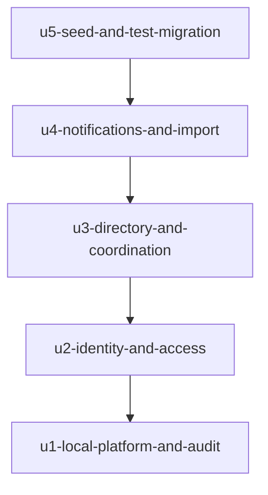

# Unit Dependencies: Real backend, sign-in and seed data

Topology only. The order in which the units are built is chosen at Delivery Planning; this file states what can depend on what.

## Dependency Graph



Text fallback: U2 depends on U1; U3 depends on U2; U4 depends on U3; U5 depends on U4 (and so, transitively, on every earlier unit). The graph is a single chain and is acyclic.

## Edge Block

```yaml
units:
  - name: u1-local-platform-and-audit
    kind: service
    depends_on: []
  - name: u2-identity-and-access
    kind: service
    depends_on: [u1-local-platform-and-audit]
  - name: u3-directory-and-coordination
    kind: service
    depends_on: [u2-identity-and-access]
  - name: u4-notifications-and-import
    kind: service
    depends_on: [u3-directory-and-coordination]
  - name: u5-seed-and-test-migration
    kind: packaging
    depends_on: [u4-notifications-and-import]
```

## Why Each Edge Exists

| Edge | Reason |
|---|---|
| U2 depends on U1 | Identity and Access need the running stack, the migration baseline with its conventions (uuid ids, scope columns, pinned search path), the audit write function and CI that runs database tests. |
| U3 depends on U2 | Directory's Parent refers to Identity's Account, Access's grants and policies protect every Directory and Coordination table, and the kernel's session resolution and checks must exist before data screens use real sessions. |
| U4 depends on U3 | Notifications refer to Directory's Parent and Coordination's Task and ChangeRequest; the import writes Directory and Coordination tables through the kernel's commit use case. |
| U5 depends on U4 | The seed writes every table of U1 to U4; moving the tests and removing synthetic mode needs a real replacement for every area. |

## Integration Points Between Units

- **Application ports** (the facades the screens call: parent, admin, teacher schedule, session): each unit replaces the in-memory adapter behind the ports it owns; a later unit may rely only on the ports and migrations earlier units provide (Q5).
- **Shared schema**: one migration set grows unit by unit; each unit adds its own migration files, policies, functions and tests; the baseline conventions of U1 apply to all tables.
- **Kernel use-case functions**: the cross-block database functions are named in the unit that first needs them (U2 operator and session checks, U3 sign-up, approval and invitation acceptance, U4 notification and import commit) and listed in the single authoritative elevated-function list.
- **Audit write function** (U1): called by every later unit inside its transactions.
- **Temporary coexistence**: until U5 removes it, the synthetic composition remains available so that unmigrated screens and tests keep running; this is a construction-time state, not a product mode.

## Parallel Development Opportunities

None between whole units: the graph is a chain, so one valid topological order exists. Inside a unit, work can be split (for example, U4's notifications and import share no tables and could be developed in either order), but that is a build-order choice for Delivery Planning, not a dependency.
