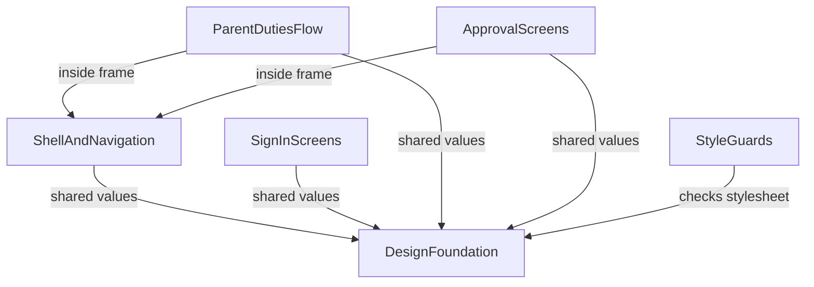

# Component Catalogue: Stitch restyle

For a look-only change the "building blocks" are the parts of the app that carry the visual style and the screen groups that use it. No data is added, so no component owns an entity. Inputs: `requirements.md` (FR1 to FR6), the code map (`architecture.md`, `component-inventory.md`, section "Styled components and style hooks") and the team's practices (`team-practices.md`). Answers in `domain-design-questions.md` are tagged `[Q1]` to `[Q3]`.

## Catalogue

```yaml
components:
  - name: DesignFoundation
    summary: Fonts, shared colour and type values, base elements and shared controls in the one stylesheet, plus the design description file.
    behaviour: >
      Loads Vollkorn and Karla from files stored in the app through Next.js built-in font loading, with a
      readable fallback if a file fails. Defines colours, font families and the main type sizes once as named
      values in the one stylesheet app/globals.css [Q1]. Styles base elements and the shared controls (buttons,
      cards, status badges, form fields, focus ring, 44 px targets). Removes the unused profile-picker styles.
      Keeps colour tokens in the form --name: #rrggbb inside :root so the token test keeps working. Keeps
      class names and test ids the browser specs rely on. Updates DESIGN.md to describe the new fonts and look.
    responsibilities:
      - Font files, their licences and the font wiring in the root layout
      - Named values for colour, font family and main type sizes
      - Base element and shared control styles
      - Removal of dead profile-picker styles
      - DESIGN.md content
    depends_on: []
    dependents:
      - component: ShellAndNavigation
        interaction: uses the shared values, controls and fonts
      - component: SignInScreens
        interaction: uses the shared values, controls and fonts
      - component: ParentDutiesFlow
        interaction: uses the shared values, controls and fonts
      - component: ApprovalScreens
        interaction: uses the shared values, controls and fonts
      - component: StyleGuards
        interaction: checks its stylesheet
    external_dependencies:
      - name: Vollkorn and Karla font files (SIL Open Font License)
        kind: other
        purpose: heading and body typefaces, including Hungarian accented letters
      - name: Next.js built-in font loading
        kind: other
        purpose: serves the font files from the app's own address
    entities: []

  - name: ShellAndNavigation
    summary: The page frame every signed-in role sees (header, brand mark, menu, skip link, sign-out).
    behaviour: >
      Restyles the header, brand mark, collapsible menu and skip link using the shared values. Keeps the
      aria-current marking, 44 px menu targets and the test ids app-shell-*, brand-link and sign-out-button.
    responsibilities:
      - Look of the header, menu and skip link
    depends_on:
      - component: DesignFoundation
        interaction: shared values, controls and fonts
        style: sync
    dependents:
      - component: ParentDutiesFlow
        interaction: parent screens render inside the frame
      - component: ApprovalScreens
        interaction: teacher and admin screens render inside the frame
    external_dependencies: []
    entities: []

  - name: SignInScreens
    summary: Sign-in, password reset, invitation and the signed-out start page, together with the denied-access panels.
    behaviour: >
      Restyles the centred panels and forms. This group is the first slice the owner checks, together with the
      page frame [Q3]. Keeps the sign-in test ids, the single h1, the heading position when images fail, and
      the sign-out and guidance on the denied panels.
    responsibilities:
      - Look of the centred panels, forms and denied-access panels
    depends_on:
      - component: DesignFoundation
        interaction: shared values, controls and fonts
        style: sync
    dependents: []
    external_dependencies: []
    entities: []

  - name: ParentDutiesFlow
    summary: The parent task list with filter and empty states, task details and signup confirmation, and cancellation with its confirmation.
    behaviour: >
      Restyles the cards, filter form, status badges, detail grid and the signup and cancel forms. The task
      list at /szulo/feladatok already shows the family's own tasks, so it serves as "Saját vállalásaim"; its
      heading stays "Családi feladatok" [Q2]. No new section, filter or route. Keeps status as icon plus word,
      the whole-card click target and the label-above-control form layout.
    responsibilities:
      - Look of the parent list, detail, signup and cancellation screens
    depends_on:
      - component: DesignFoundation
        interaction: shared values, controls and fonts
        style: sync
      - component: ShellAndNavigation
        interaction: screens render inside the page frame
        style: sync
    dependents: []
    external_dependencies: []
    entities: []

  - name: ApprovalScreens
    summary: Teacher schedule and admin approvals (list, filter, detail and decision form).
    behaviour: >
      Restyles the teacher schedule table and card list and the admin approvals list, detail and decision
      form. Keeps the table-to-cards switch under 44rem, the .admin-collection and .teacher-table hooks and
      the approval test ids.
    responsibilities:
      - Look of the teacher schedule and admin approval screens
    depends_on:
      - component: DesignFoundation
        interaction: shared values, controls and fonts
        style: sync
      - component: ShellAndNavigation
        interaction: screens render inside the page frame
        style: sync
    dependents: []
    external_dependencies: []
    entities: []

  - name: StyleGuards
    summary: The automatic checks added for this work: the CSS linter and the pinned tool versions.
    behaviour: >
      Adds Stylelint for app/globals.css as a blocking check and pins react, react-dom, zod,
      @axe-core/playwright and @playwright/test to the installed versions. Existing gates stay as they are.
    responsibilities:
      - CSS linter configuration and its place in the blocking checks
      - Pinned versions of the five tools
    depends_on:
      - component: DesignFoundation
        interaction: checks its stylesheet
        style: sync
    dependents: []
    external_dependencies:
      - name: Stylelint
        kind: other
        purpose: finds mistakes in app/globals.css
    entities: []
```

## Component Diagram



Text fallback: DesignFoundation depends on nothing. ShellAndNavigation, SignInScreens and StyleGuards depend on DesignFoundation. ParentDutiesFlow and ApprovalScreens depend on DesignFoundation and ShellAndNavigation.

## Component Summary

| Component | Purpose | Depends On | Dependents | Entities Owned |
|---|---|---|---|---|
| DesignFoundation | Fonts, shared values, base and shared controls, DESIGN.md | none | ShellAndNavigation, SignInScreens, ParentDutiesFlow, ApprovalScreens, StyleGuards | none |
| ShellAndNavigation | Page frame for signed-in roles | DesignFoundation | ParentDutiesFlow, ApprovalScreens | none |
| SignInScreens | Sign-in, reset, invitation, signed-out and denied panels | DesignFoundation | none | none |
| ParentDutiesFlow | Parent list, details, signup, cancellation | DesignFoundation, ShellAndNavigation | none | none |
| ApprovalScreens | Teacher schedule, admin approvals | DesignFoundation, ShellAndNavigation | none | none |
| StyleGuards | CSS linter, pinned versions | DesignFoundation | none | none |

## Entity Ownership

| Entity | Owning Component | Identifier | Attributes | References |
|---|---|---|---|---|
| none | none | none | none | none |

This change adds, removes or changes no data. The tables and records behind the screens belong to the existing parts of the app and are untouched.

## External Dependencies

| Component | Dependency | Kind | Purpose |
|---|---|---|---|
| DesignFoundation | Vollkorn and Karla font files | other | typefaces, including ő and ű |
| DesignFoundation | Next.js built-in font loading | other | serves the files from the app's own address |
| StyleGuards | Stylelint | other | checks app/globals.css |

## Rationale

| Component | Why it is a separate block |
|---|---|
| DesignFoundation | Everything else reads from it, and it changes first (the gated first slice). One owner for fonts and shared values avoids repeating them in each flow. |
| ShellAndNavigation | Used by every signed-in role and shared by the flows, but changes on its own schedule: it is part of the first slice with the sign-in page. |
| SignInScreens | Used before sign-in and outside the frame; it is the screen the owner checks first [Q3]. |
| ParentDutiesFlow | One user flow with its own owner review and its own pull request. |
| ApprovalScreens | Teacher and admin screens share table and card patterns and are reviewed together. |
| StyleGuards | Tooling, not look: it changes the checks, not what users see, and has its own risks (linter rules, pinned versions). |

Alternatives rejected: splitting by styling layer (base, layout, components) would make a flow touch several blocks and would not match how the owner reviews (one flow at a time). Treating the whole app as one block would hide the order the owner chose (first slice, then one flow at a time). See ADR-004 in `decisions.md`.

Behaviour that must not change (FR5.1 to FR5.6) is enforced through the existing browser, unit and accessibility checks and is owned centrally by DesignFoundation; each flow keeps the class names, test ids and measurements its specs rely on.
