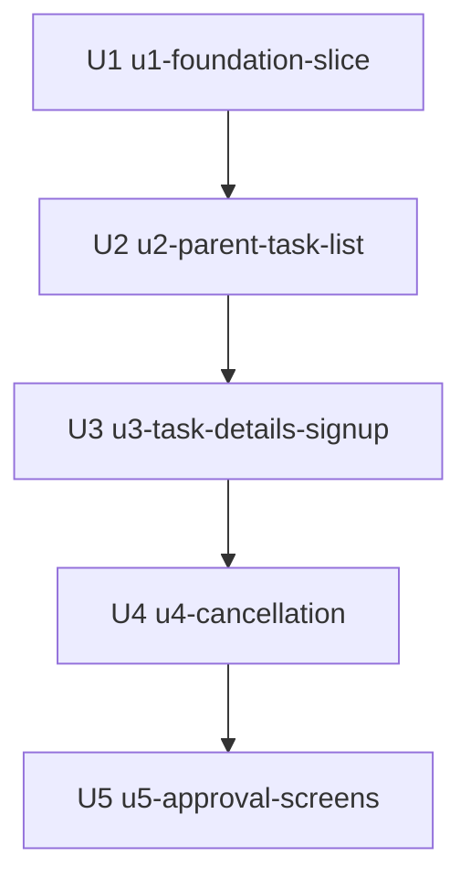

# Unit Dependencies: Stitch restyle

Topology only. The order in which to ship is decided by the owner and recorded in the answer to Q2 of `units-generation-questions.md`: one flow at a time, in a fixed order.

## Dependency graph

- U2 `u2-parent-task-list` depends on U1 `u1-foundation-slice`: it uses the fonts, shared values and shared controls.
- U3 `u3-task-details-signup` depends on U2: both edit the parent card and form rules in the one stylesheet, so they are kept in sequence.
- U4 `u4-cancellation` depends on U3: it reuses the form and notice styles that U3 restyles.
- U5 `u5-approval-screens` depends on U4: no code dependency on the parent flow, but the owner asked for one flow in progress at a time because every unit edits `app/globals.css`.



Text fallback: U1 has no dependency. U2 depends on U1, U3 on U2, U4 on U3, U5 on U4. No cycle.

## Integration points

- The shared stylesheet `app/globals.css`: named values (colour, font family, type sizes) and shared controls defined in U1 are used by U2 to U5. U2 to U5 add or change rules only for their own screens.
- The font wiring in the root layout `app/layout.tsx` (U1 only).
- Class names and test ids the browser specs assert: every unit keeps them or changes the matching spec in the same pull request.
- No data, API or event is shared between units.

## Parallel development opportunities

U1 has no dependency. After U1, U2 to U5 have no technical need to follow one another in this order: U5 does not use any parent-flow style, and U3 or U4 could be built without U2. The owner chose a strict sequence to avoid editing the same stylesheet at the same time, so no parallel work is planned.

```yaml
units:
  - name: u1-foundation-slice
    kind: ui
    depends_on: []
  - name: u2-parent-task-list
    kind: ui
    depends_on: [u1-foundation-slice]
  - name: u3-task-details-signup
    kind: ui
    depends_on: [u2-parent-task-list]
  - name: u4-cancellation
    kind: ui
    depends_on: [u3-task-details-signup]
  - name: u5-approval-screens
    kind: ui
    depends_on: [u4-cancellation]
```

The first unit in this order, U1, is the integrated slice: it already runs the whole way through (browser, production build, start and smoke tests) with the new fonts and look on the sign-in page and the page frame.
