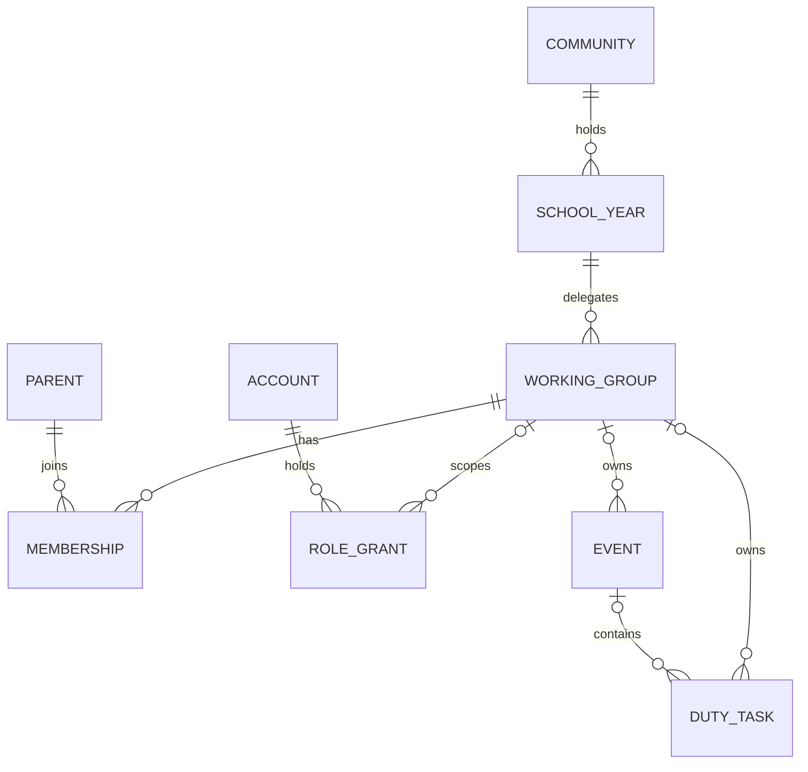

# Functional Specification: u1-community-foundation

This unit (U1 in `unit-of-work.md`, mapped in `unit-of-work-story-map.md`) implements US1.1, US1.2, US1.3 and US19.1 from `stories.md`, against FR1 and FR19 in `requirements.md`, the components in `components.md` and contracts C1, C2 and C6 in `contract-summary.md`. Decisions: ADR-001, ADR-009 and ADR-010 in `decisions.md`, and the owner's answers in `functional-design-questions.md`. Contains no names or contact details.

## Scope

The app keeps working with today's screens on the new structure. The only new screen is the working-group list. Joining and leaving, coordinators, member lists and the coordinator's page belong to U4 and U12.

## Workflows

### W1. Apply the structure change (AC1.1.3, AC19.1.1; BR1.4, BR7.1)

1. `npm run db:migrate` reaches the change on the owner's local database.
2. One transaction deletes all rows of: `change_requests`, `contribution_notes`, `assignments`, `tasks`, `events`, `notifications`, `reminder_attempts`, `reminder_recipients`, `reminder_jobs`, `group_memberships`, `groups`, `children`, `parent_contacts`, `parents`, `families` and `invitations`, and every role grant except `super_admin`. `organizations`, `school_years`, `accounts`, super-admin grants, settings and the audit log stay.
3. The same transaction converts the structure: working group with description, membership per parent, optional group on events and tasks, the new role and scope pairs on grants and invitations.
4. It converts the rules listed under "Conversion of Existing Code", adds the C2 and C6 functions, and removes the import's functions and tables.
5. Any failure rolls everything back and the old structure stays.
6. The owner runs `npm run db:reset -- --yes`, then `npm run db:seed` (W2). The reset removes what step 2 left, including sign-in accounts, so the seed never duplicates a record.

Every record is test data (Q6 of `user-stories-questions.md`), so nothing is converted row by row.

### W2. Load the starting data (AC1.2.1; BR2.1)

1. The seed creates the community and the 2026-2027 school year.
2. It creates the six working groups from one list kept in the repository, with the text below.
3. It creates invented families and parents, and accounts for every role, including a group administrator who is also a parent and member, and an administrator of two groups.
4. It creates invented community-wide and working-group events and tasks.

The hosting work must load the same list of six groups. It is not invented data.

| Group | Card text (draft, checked in the owner's screenshot review) |
|---|---|
| Játszókert | Rendszeresen bejárja az udvari játszóterületeket és növényeiket, és figyeli, hogy biztonságosak és használhatók-e. Az egyszerű hibákat maga javítja, a többit jelzi az Óvónői Konferenciának. |
| Karbantartó | Elvégzi a kisebb ház körüli és kerti javításokat, és rendszeresen körbejárja az épületet és az udvart. Fogadja az óvónők javítási kéréseit, a költséggel járó munkákat egyezteti az Óvónői Konferenciával. |
| Ünnep-előkészítő | Segít az ünnepek előkészítésében: berendezi és visszarendezi a termet, és beszerzi a szükséges anyagokat. |
| Kreatív-alkotó | Saját készítésű termékekkel képviseli az óvodát a közeli Waldorf-iskolák rendezvényein, és megszervezi ezek elkészítését. Alkotófoglalkozásokat is szervez. |
| Nagytakarítás szervezése | Megszervezi a szünetek utáni nagytakarításokat: meghatározza a takarítás rendjét, elmagyarázza a szülőknek, és átveszi az elkészült munkát. |
| Állatgondozás | Összefogja az óvoda állatainak időszakos gondozását, és figyel arra, hogy a napi állatgondozási ügyeletek be legyenek töltve. |

### W3. Open the working-group list (AC1.2.1, AC1.2.2; BR2.3, BR2.4)

1. A signed-in person opens Munkacsoportok: `/szulo/munkacsoportok`, `/teacher/munkacsoportok` or `/admin/munkacsoportok`, according to their area.
2. The list function checks the caller and returns the active groups.
3. The screen shows cards with name, description and school year, and works at phone width and by keyboard.
4. With no groups it shows "Még nincs munkacsoport."
5. A signed-out visitor goes to sign-in and receives no data. A refusal or failed read shows the existing denied or error state, not the empty one.

### W4. A group administrator acts on an event or task (AC1.3.1, AC1.3.2; BR3.2 to BR3.5, BR3.10)

1. The administrator opens Feladatok és események, which lists the items of every group they hold.
2. The form's group selector offers only those groups and requires one.
3. Saving, assigning a family or deciding an approval calls the same function as the screen would, with the item's group checked in the database.
4. A request naming another group's item, a community-wide item or a made-up id gets the same denied refusal and changes nothing.
5. Assigning a family offers every active family by name only.

### W5. A super admin creates a community-wide item (AC1.1.1, AC1.1.2; BR1.1 to BR1.3, BR3.5)

1. The group selector offers "Egész közösség" and every active working group.
2. Choosing "Egész közösség" stores no group. Choosing a group stores exactly one.
3. A task added to an event takes the event's scope. A mismatch is refused on the event field.

### W6. A teacher reads the schedule (AC1.3.3; BR3.7)

1. The teacher opens Beosztás. The unfiltered view shows the whole community.
2. The filter offers "Minden", "Egész közösség" and each active working group.
3. Entries show today's display-name fields only.
4. Every write is refused. The menu lists Beosztás and Munkacsoportok.

U1 satisfies "any event" through the schedule entries tied to events. A dedicated events page for teachers comes with U10.

### W7. A parent sees and signs up (BR4.1, BR3.13)

1. Feladatok lists every non-cancelled task of the community and the tasks the family holds.
2. Sign-up takes a place for the caller's family. The working group plays no part.
3. A caller with no current family is denied.

### W8. Switching between parent and administrator menus (BR8.1)

1. An account holding both rights lands on its strongest home, as today.
2. The header offers "Szülői nézet" or "Adminisztráció". Each area checks its own rights.

### W9. The old import is gone (AC19.1.1; BR7.1)

1. `/admin/import` answers "page not found" for every role.
2. These are removed: the Importálás menu item, `src/import-parser`, `src/data/imports.ts`, the import screen and its actions, `scripts/db/import-timing-stage.ts` and its test, the `test:database:import-timing` script, the import tests, the spreadsheet package (U15 adds what it needs), and the import rows of `verification/authorization-matrix.json` and `verification/scenarios.json`.
3. `scripts/db/reset.ts`, `identity_housekeeping` and the lint, format and verification scripts stop naming the import's functions, sheet list and folders.
4. The audit log keeps `import.commit` in its action list, so past audit events stay valid.

## Conversion of Existing Code

Technical names stay, because renaming every table and column adds risk and changes no behaviour. "No kindergarten-group scope remains" is met by what the records mean.

| In this design | In the code |
|---|---|
| Community | `organizations`, `organization_id`, role scope `organization` |
| WorkingGroup | `groups`, `group_id`, role scope `group` |
| WorkingGroupMembership | `group_memberships`, now with `parent_id` in place of `family_id` |
| RoleGrant | `app_role_grants` |
| DutyTask, Place | `tasks`, `assignments` |

An item with no group is reached only by a super admin, wherever a rule below compares groups.

| Existing rule | After this unit |
|---|---|
| `has_current_role_scope` | Teacher pairs with `organization`. A `group_admin` grant counts only while the linked parent and family are active (BR3.2). |
| `has_core_scope` | The same answer as `can_manage_group`; an empty group is super admin only. |
| `directory_is_admin` | Same meaning; applies the BR3.2 condition. |
| `directory_reaches_family` | Super admin only (BR3.9). This also changes `family_archive`, `family_restore`, `directory_can_read_contact`, `directory_parent_profile` and the read policies of `families`, `parents`, `children` and `parent_contacts`. A parent still reads their own family. |
| `directory_group_visible`, `directory_school_year_visible` | Any signed-in role in the community (BR2.3). |
| `group_memberships_read` policy | The member's own rows and super admins; U4 widens it. |
| `coordination_reach_groups`, `coordination_reach_task_ids` | Apply the BR3.2 condition; a super admin's task set includes tasks with no group. |
| `events_read`, `tasks_read`, `assignments_read`, `change_requests_read`, `contribution_notes_read` policies | Unchanged wording; they follow `has_core_scope` and the reach helpers. |
| `identity_can_manage_scope` | Super admin only (BR3.6, BR3.8). |
| `identity_scope_group` | A group's own id; empty for a family. |
| `identity_account_visible`, `grants_admin_read` policy | Self or super admin; a group admin also reads the grants of their own groups. The family branch goes. |
| `audit_events_admin_read` policy | Unchanged. Events about a family now have no group, so only super admins read them. |
| `invitation_create`, invitation table constraint, `invitation_accept` | The pairs in `entities.md`; `group_admin` is refused (BR3.6). |
| `grant_change`, `governance_list` | The pairs in `entities.md`; adding `group_admin` needs an active linked parent. A teacher row shows no group name. |
| `scope_probe` | `family`: super admin or that family's parent. `assignment`: `has_core_scope`. The `import_run` branch goes. |
| `directory_save` | Super admin only; the add and end group-membership inputs go. |
| `structure_save`, `directory_archive_item`, `directory_restore_item` | Super admin only; a group needs a description (BR2.2, BR2.5). |
| `event_save`, `task_save` | Group optional; group comparisons treat empty as a value (BR1.2, BR1.3, BR3.5). |
| `coordination_duty_view`, `duty_list`, `duty_get`, `duty_sign_up` | The membership condition and the `ineligible` state for it go (BR4.1). |
| `assignment_assign`, `assignment_remove` | Membership check goes; `has_core_scope` decides (BR4.2). |
| `coordination_swap_check`, `swap_candidates` | Same-group and membership conditions go (BR4.3). |
| `coordination_decide` | Follows `has_core_scope`, so an item with no group is a super admin's. |
| `dashboard_get` | A super admin counts every item; `dashboard_import_conflicts` goes. |
| `schedule_get` | Takes all, community-wide only, or one group. Teachers and super admins may read all and community-wide; a group admin reads their own group (W6). |
| `reminder_plan` | Recipients follow BR4.4. |
| `reminder_list`, `reminder_retry` | A super admin reaches a task with no group; the refusal on an empty group goes. |
| `lifecycle_run` | Deletes the memberships of the family's parents; `import_after_lifecycle` goes; the audit event has no group. |
| New | `current_parent_id`, `current_family_id`, `has_community_admin`, `can_manage_group`, `can_read_community`, `grant_admin`, `end_admin`, `parent_display_name`, `family_display_name`, the working-group list, and the name-only family list (BR3.10). |

In the application, the same change reaches `role-policy.ts`, `authorization.ts`, `src/runtime/production/access.ts` (an administrator of several groups), `src/runtime/navigation.ts`, `verification/authorization-matrix.json`, `app/teacher/_lib/filters.ts`, the teacher schedule, the admin record and task forms, the admin data adapters, and `scripts/db/seed`.

## Today's Screens After the Change

| Screen | Parent | Group admin | Teacher | Super admin |
|---|---|---|---|---|
| Értesítések, Feladatok, Cserék | Yes | Yes, as a parent | No | Only with a linked family |
| Áttekintés, Feladatok és események, Jóváhagyások, Archívum | No | Own groups only | No | Everything |
| Nyilvántartások | No | No (changed) | No | Yes; "Csoport" becomes "Munkacsoport", with a description field and no family membership field |
| Beosztás | No | No | Whole community (changed) | No |
| Munkacsoportok | Yes (new) | Yes (new) | Yes (new) | Yes (new) |
| Emlékeztetők, Adatvédelem, Beállítások | No | No | No | Yes |
| Importálás | Removed | Removed | Removed | Removed |

The role's shown name becomes "Koordinátor", in line with `mockups.md`. Before merge, every row of `verification/authorization-matrix.json` is tested for the new roles and each screen above is walked through for every role (B1 in `bolt-plan.md`).

## State Machines

| Entity | From | Event | To | Who |
|---|---|---|---|---|
| WorkingGroup | active | archive | archived | Super admin |
| WorkingGroup | archived | restore | active | Super admin |
| WorkingGroupMembership | (none) | join | active | Seed in U1; the parent from U4 |
| WorkingGroupMembership | active | leave | ended | From U4 |
| RoleGrant | (none) | grant | unrevoked | Super admin |
| RoleGrant | unrevoked | revoke | revoked | Super admin |

An ended membership and a revoked grant are final. A new one is a new record.

## Entity-Relationship View

Derived from `entities.md`, which is the source of truth.

<!-- Text fallback: a community holds school years; each year delegates working groups. Parents join working groups through memberships. Accounts hold role grants, which may name a working group. Events and tasks may belong to one working group, and a task may belong to an event. -->

## Rules Summary

Derived from `rules.md`, which is the source of truth.

| Topic | Outcome |
|---|---|
| Ownership | Community by default; a group item has exactly one active group (BR1.1 to BR1.3) |
| Clean start | All group-bound records removed, then fresh invented data (BR1.4) |
| Group admin | Own groups' events, tasks and approvals only; everything else refused, also when bypassing the screen (BR3.2 to BR3.5) |
| Family records | Super admins only; group admins see family names where a task needs them (BR3.9, BR3.10) |
| Teacher | Whole community, read-only (BR3.7) |
| Parents | Any open task, regardless of group (BR4.1) |
| Import | Gone (BR7.1) |

## Edge Cases

| Case | Behaviour |
|---|---|
| Group administrator whose parent record is archived | Manages nothing from the next request (BR3.2) |
| Administrator of several groups | Reaches all of them and no other (BR3.3) |
| Grant naming a group that was archived | Items stay readable; a new item cannot name that group (BR1.2) |
| Moving a task between scopes once places are taken | Refused, as a group change is today |
| Two super admins archive and edit one group at once | The version check refuses the later one |
| Repeated click on any command | Returns the stored result (BR6.1) |
| Applying the change twice | Forward-only migrations run once per database |
| Super admin with no linked family | Refused by parent commands (BR3.13) |
| Reminder or approval on a task with no group | A super admin only |
| Direct write giving a task a different scope from its event | Refused by the database (BR1.3) |
| Next school year's groups | Not in this work; a super admin can create them on Nyilvántartások |
