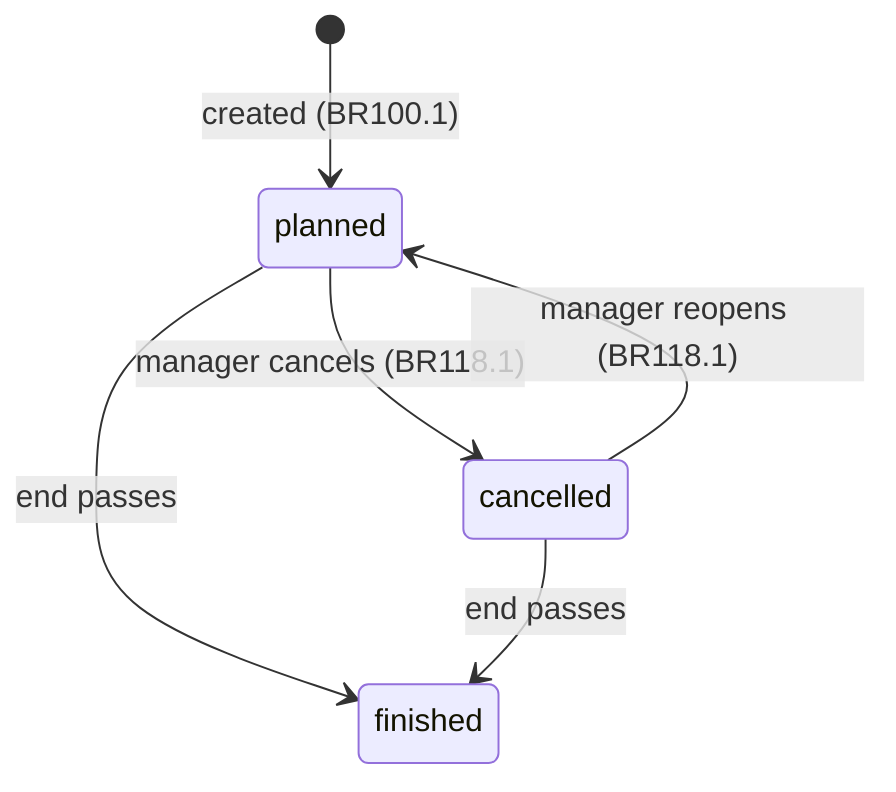
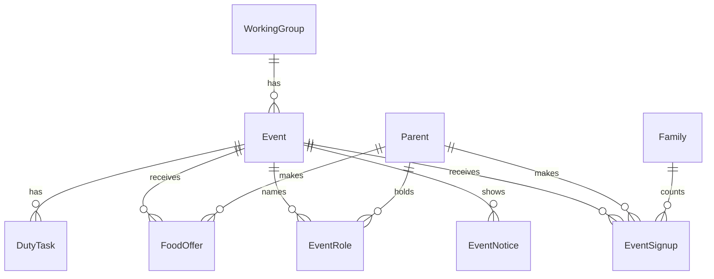

# Functional Specification: u10-events-and-signups

This unit (U10 in `unit-of-work.md`, mapped in `unit-of-work-story-map.md`) implements US11.1 to US11.4 and shows the event part of US17.1 from `stories.md`, against FR11 and FR17.4 in `requirements.md`, the components Events, Duties and WebApplication in `components.md`, and contracts C8 and C10 (used) and C13, C14 and C16 (provided) in `contract-summary.md`. Decisions: ADR-001, ADR-002, ADR-003 and ADR-010 in `decisions.md`, and the owner's answers Q1 to Q6 in `functional-design-questions.md`. Contains no names or contact details.

## Scope

One event model for community and working-group events, with notices, roles, the year's tale, sign-ups with a note and food offers.

| In this unit | Left to a later unit |
|---|---|
| Creating, changing and cancelling community and group events (US11.1) | Event checklists, claiming and done marks, templates, the organiser's checklist, the lead-time notice and unclaimed-task alert (U11) |
| Notices at the top of an event, replacing the three fixed notes (AC11.1.3, Q5) | The coordinator's management page that links to the event form (U12) |
| Sign-ups with a note, optional date and time, several per parent (US11.2, Q1) | Pulling to-do tasks into an event (U12) |
| Roles, organisers, typed names, the year's tale, finished events through a switch (US11.3, Q2, Q4) | What happens to today's event tasks (U11 decides, Q6) |
| Food offers with the eight categories and ingredient ticks (US11.4) | Removing a person across all records (U14 calls this unit's block) |
| Notices for a new, cancelled or changed event, with the event page as the link (AC17.1.1, AC17.1.6, Q3) | Mechanism, retries, failure list and no double sending (U5) |
| The events section on a working group's page (U4 left it to this unit) | |

## Event states

Text fallback: an event is created as planned. A manager can cancel it, which closes its open tasks and refuses new sign-ups and offers, and can set it back to planned. Once its end has passed it is finished in the lists and refuses new sign-ups and offers, whatever its status. "Open" means planned and not finished.

## Workflows

### W1. Create and change an event (AC11.1.1, AC11.1.2; BR100.1, BR100.2, BR101.1, BR102.1)

1. A super admin opens Események under the admin menu and presses Új esemény; a coordinator opens the same form from their group's page or the events list ("Új esemény", shown only to people who may manage). The form has title, place, start and end, scope, "Nyári esemény", "Étel jelentkezés", sign-up deadline and notice lead time. Scope is "Közösségi" for a super admin and the coordinator's group for a coordinator.
2. Saving a community event as a coordinator, or another group's event, is refused ("Ehhez nincs jogosultságod"). An archived group is refused on the group field.
3. The end may not be before the start. An event of several weeks is one event, shown with its first and last day.
4. Saving a change sends the event's version. A screen that is out of date is answered "Közben valaki módosította, töltsd újra" with the current values, and nothing is overwritten.
5. A second press, or a second administrator pressing at the same time, creates one event, not two (BR122.1).

### W2. Notices at the top (AC11.1.3; BR103.1, BR103.2)

1. On the form the manager adds lines, for example "Hozz saját poharat és tányért" and an allergen notice. At most 10, each up to 300 characters, in the order shown.
2. Saving stores the whole list with the event's version. The event page shows the lines in an Info Wash callout at the top, above everything else.
3. The old fixed notes (allergen, supply, food) are gone from the form and the page.

### W3. The events list and finished events (AC11.1.1, AC11.3.2; BR104.1 to BR104.3)

1. Every signed-in person, teachers included, opens `/szulo/esemenyek` and sees the open events, soonest first, each with its dates, place and group name (or "Közösségi"). A cancelled event is marked "Elmarad".
2. A switch "Korábbi események" shows the finished events, newest first. Their pages stay fully readable, tale included.
3. An empty list says "Most nincs közelgő esemény." An empty past list says "Még nincs korábbi esemény."
4. A teacher sees no sign-up, offer or manage controls.
5. A working group's page lists that group's open events in an "Események" section, each linking to its page (U4 left the section to this unit).

### W4. Sign up with a note (AC11.2.1 to AC11.2.3; BR108.1 to BR111.1)

1. On an open event a parent presses Jelentkezem, writes a note ("Pénteken segítek a pavilonok felállításában") and, if the time matters, picks a date and time inside the event. Saving adds the sign-up; the list shows the parent's name, the family, the note and the time.
2. The same parent may add up to 10 sign-ups to one event, each with its own note and time. The eleventh is refused ("Legfeljebb 10 jelentkezés lehet").
3. The parent changes or withdraws their own sign-up until the event ends. A manager of the event can remove any sign-up but not edit it.
4. A finished or cancelled event refuses new sign-ups and changes ("Ez az esemény már lezárult"); the parent can still withdraw their own.
5. The sign-up deadline is shown above the form. Nothing is refused after it (BR108.4).
6. Taking part counts towards nothing: the rota, the animal-care fair share, the family's standing and the duty reminders do not read sign-ups (BR111.1).
7. A leaving or new family may still sign up with a note, because it is not a duty. Taking a place on an event task is still refused for such a family (BR112.1).
8. A teacher, or any caller without a family, is refused.

### W5. Roles and organisers (AC11.3.1, AC11.3.3; BR105.1 to BR106.2)

1. A manager adds a role on the form, for example "Játékmester". The person is picked from a list of parents with an account, or typed as a name for someone without one (a visiting musician).
2. A role held by a parent can be marked "Szervező". That parent then also sees the organiser's list and gets the organiser alerts that the checklists work adds, but gets no right to edit the event.
3. The page shows each role with its person. A typed name shows without a link or profile. A removed parent shows as "korábbi tag".
4. At most 20 roles. Removing a role deletes it.
5. Marking and unmarking an organiser is audited without names.

### W6. The year's tale (AC11.3.2; BR107.1)

1. A manager writes the tale in a free-text field on the form, up to 5000 characters.
2. The event page shows it in a collapsed section "Az év meséje", for everyone, including when the event is viewed next year through the past switch.

### W7. Offer food (AC11.4.1 to AC11.4.3; BR113.1 to BR116.1)

1. A manager turns "Étel jelentkezés" on for an event. The page then shows the food sign-up below the roles.
2. A parent adds an offer: one of eight categories (Kenyérre kenhető, Pékáru, Gluténmentes és más speciális, Sós, Édes, Italok, Zöldség és gyümölcs, Egyéb), a text saying what it is, and tick boxes Tej, Tojás and Fokhagyma.
3. Everyone who opens the event sees the offers grouped by category, each with who brings it and the ticks worded as what the dish contains ("Tartalmaz: tej, tojás"). A category with no offer is shown as empty, so a missing drink is easy to see.
4. A parent changes or withdraws their own offer until the event ends. A manager may remove any offer.
5. Allergens describe the dish only. The screen carries no field, label or notice about a child's or family's health.
6. Turning the food sign-up off keeps the offers and refuses new ones. A parent can still withdraw their own.

### W8. Notices about an event (AC17.1.1, AC17.1.6; BR117.1 to BR117.3)

1. Saving a new open event sends one notice and email "Új esemény: [cím]" to every parent with an account for a community event, or to the group's members for a group event. The creator is left out.
2. Cancelling sends "Esemény elmarad: [cím]" to the parents with a sign-up or a food offer on the event and the parents of every family holding a place on one of its tasks.
3. Changing dates or place of a planned event sends "Esemény módosult: [cím]" with the new dates and place to the same people. Changing the title, notices, roles, tale or settings tells nobody.
4. Each notice opens `/szulo/esemenyek/[id]`. It never lists who signed up or what is offered.
5. Retries after a failed email, no double sending, a notice for a person who has not signed in for days and the failure list are U5's and are shown on the existing notices and failures screens.
6. A save of an event that has already finished sends nothing.

### W9. Cancel and reopen (BR118.1)

1. A manager sets the status to cancelled. In one transaction the event's open tasks close (the event row first, the tasks in ascending id order) and the cancellation notice is sent.
2. Sign-ups and offers stay and can be read. New ones, and changes, are refused; withdrawing one's own is allowed.
3. Setting the status back to planned makes the event open again if it has not ended. The closed tasks stay closed.

### W10. Functions delivered for other units (BR106.1, BR119.1, BR120.1, BR124.1, BR124.2)

1. U11 reads `event_is_summer`, `event_deadline` and `event_organisers` (contract C13); the organiser list now includes parents whose role is marked organiser.
2. U12 reads `event_list(group_id)` (contract C14) for the coordinator page; the group page reads `event_list_for_group`.
3. U14 calls `events_removal_preview` and `events_removal_apply` (contract C16). A removed person's sign-ups and offers lose their parent and family link and show "korábbi tag"; their roles are cleared; a typed name that matches exactly is cleared. A super admin clears other typed names with `event_role_clear_name`.

## Commands and reads of this unit

| Function | Kind | Who | Rules |
|---|---|---|---|
| `event_save` (extended) | command | manager | BR100, BR101, BR102, BR117, BR118 |
| `event_notices_save` (replaces `event_save_notes`) | command | manager | BR103 |
| `event_tale_save` | command | manager | BR107 |
| `event_role_save`, `event_role_remove` | command | manager | BR105, BR106 |
| `event_role_clear_name` | command | super admin | BR124.2 |
| `event_signup_add`, `event_signup_change`, `event_signup_withdraw` | command | parent with a family; a manager may withdraw | BR108 to BR110 |
| `food_offer_add`, `food_offer_change`, `food_offer_withdraw` | command | parent with a family; a manager may withdraw | BR113, BR116 |
| `event_list`, `event_get`, `event_list_for_group` | read | every signed-in reader | BR104 |
| `event_list(group_id)` for the coordinator page | read | manager of the group | BR119.1 |
| `event_is_summer`, `event_deadline`, `event_organisers` | internal | other functions | BR106.1, BR120.1 |
| `events_removal_preview`, `events_removal_apply` | internal | U14 | BR124.1 |

All commands start with `revoke all` and an explicit `grant execute`, take an idempotency key, return the C1 envelope and refuse through `U3R00`. Reads for a caller without access return the denied refusal, never an empty list. The three internal functions and the removal block are never granted to a signed-in user.

## Conversion of Existing Code

- **`events` table (20261026, 20261047).** Gains `is_summer`, `signup_deadline`, `notice_lead_days`, `food_signup_on` and `tale`; loses `allergen_note`, `supply_note`, `food_note` and `coordinator_name`. The data is invented test data and the local database is reset (the earlier U1 decision), so nothing is migrated. A new forward-only migration does this.
- **`event_save_notes`** is replaced by `event_notices_save`. `event_save` and `event_save_core` are extended with the new fields and the notices of W8; the cancel behaviour and the lock order stay.
- **The teacher schedule function (20261031)** read the event's coordinator name. It now shows the name of the event's oldest role, or nothing when the event has none.
- **Application layer.** `EventNoteModel` and the event note admin screen in `src/application/contracts.ts`, `src/data/admin-tasks.ts`, `src/data/parent-port.ts` and `src/application/parent-facade.ts` (the contribution note on an event task stays) are replaced by the new read and command models. The seed script `scripts/db/seed/write.ts` and the tests that name the old columns change in the same pull request.
- **`event_task` as an origin.** Contract C4 names `event_task` as a duty origin. Because today's tasks stay as they are (Q6), this unit does not use it; U11 decides.

## Screens (to design in Stitch before building)

| Screen | Path | Notes |
|---|---|---|
| Events list | `/szulo/esemenyek` | Upcoming events, "Korábbi események" switch, group name or "Közösségi", "Elmarad" mark, "Új esemény" for managers |
| Event detail | `/szulo/esemenyek/[id]` | Notices callout, roles, collapsed tale, sign-up with note and time, sign-ups list, food offers by category and form, deadline, manager controls |
| Event form | `/szulo/esemenyek/uj` and `/szulo/esemenyek/[id]/szerkesztes`; the admin menu item Események opens the community list | All fields of the mockup except "Start from template" (U11); notices, roles and tale editors |
| Working group page, events section | `/szulo/munkacsoportok/[id]` | Open events of the group |

The screens are Hungarian, work at phone width and by keyboard, and keep today's class names and measurements or change their tests in the same pull request (`team.md`). The owner compares each built screen with its Stitch design in the screenshot review.

## Derived views

### Entity relationships (derived from `entities.md`)

Text fallback: a working group has events, and a community event has none. An event has notices, roles, sign-ups, food offers and (today's) tasks. A parent makes sign-ups and food offers and may hold a role; a sign-up also names the parent's family.

### Rules summary (derived from `rules.md`)

| Question | Answer | Rule |
|---|---|---|
| Who creates and edits events? | Super admin (community), coordinator (own group) | BR100.1 |
| How are notices stored? | One list, up to 10 lines of 300 characters | BR103.1 |
| Who reads events? | Everyone signed in; teachers read only | BR104.1, BR104.3 |
| Where are finished events? | Behind the past switch | BR104.2 |
| Who is an organiser? | Coordinators or super admins, plus parents on a role marked organiser | BR106.1 |
| May a parent sign up twice? | Up to 10 sign-ups per event | BR109.2 |
| Does it count? | For nothing | BR111.1 |
| Offers and allergens | Eight categories, three ingredient ticks, no health link | BR113, BR115.1 |
| Who is told? | New event: all it concerns; cancel or change: sign-ups, offers, task holders | BR117.1, BR117.2 |
| On removal | Sign-ups and offers anonymised, roles cleared | BR124.1 |

## Assumptions and open points

- **Event readers.** Every signed-in reader sees every event of the community, including other working groups' events, because FR1.2 and FR1.6 give the whole community read access and the group page lists a group's events to everyone. Only changing is limited to the group.
- **The deadline informs, it does not block.** FR13.3 says the deadline is shown to parents, so a sign-up or offer after it is accepted (BR108.4). The owner can ask for a block in the screenshot review or in the checklists work.
- **The voluntary sign-up is not a duty.** The leaving and new family rule applies to event tasks (BR112.1). A sign-up with a note holds no duty and so has no such rule. The unit notes name only event tasks.
- **Notes stay after removal.** The note of an anonymised sign-up stays, because it describes the help and not the person. A note could still contain a name; whether U14 should clear notes too is left to U14 (BR124.1).
- **Roles keep no history.** Removing a role deletes it. A past event's roles stay while the event exists.
- **A role's person is picked from the directory.** The list shows only parents the caller may see. A parent who shares nothing in the directory is listed by name only (BR105.2).
- **Notice of a changed event.** Only a change of dates or place tells people (Q3). A change of title or notices does not, to avoid noise.
- **No notice for the creator.** The person who saves an event is not told about it.
- **Contract deltas, to update in `contract-summary.md` in the same pull request.** C13: `event_organisers` also returns parents whose role is marked organiser (settles the open question of C13, Q4). C16: U10's block also clears the parent and organiser mark on roles and keeps anonymised rows; the removal screen lists typed names for `event_role_clear_name`. C8: this unit's three notice kinds and the `event` target type are listed in `entities.md`. C14: `event_list(group_id)` returns the status and dates; a second read serves the group page. C4: `event_task` stays unused in this unit.
- **Lock order.** Every command locks the event row first, then the rows it changes by ascending id, then the event's tasks when it needs them (contract C1).
- **Fixed test list.** Each rule's six cases are planned in the unit's test instructions in the table agreed in U1, with "nem értelmezhető" and the reason where a case has no meaning, for example "two people at once" on a read.
