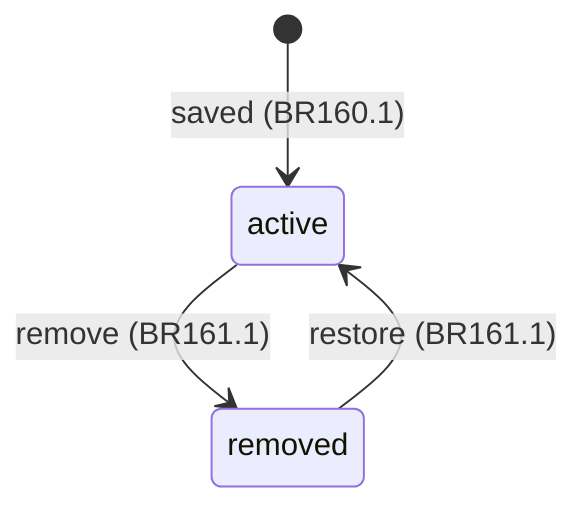
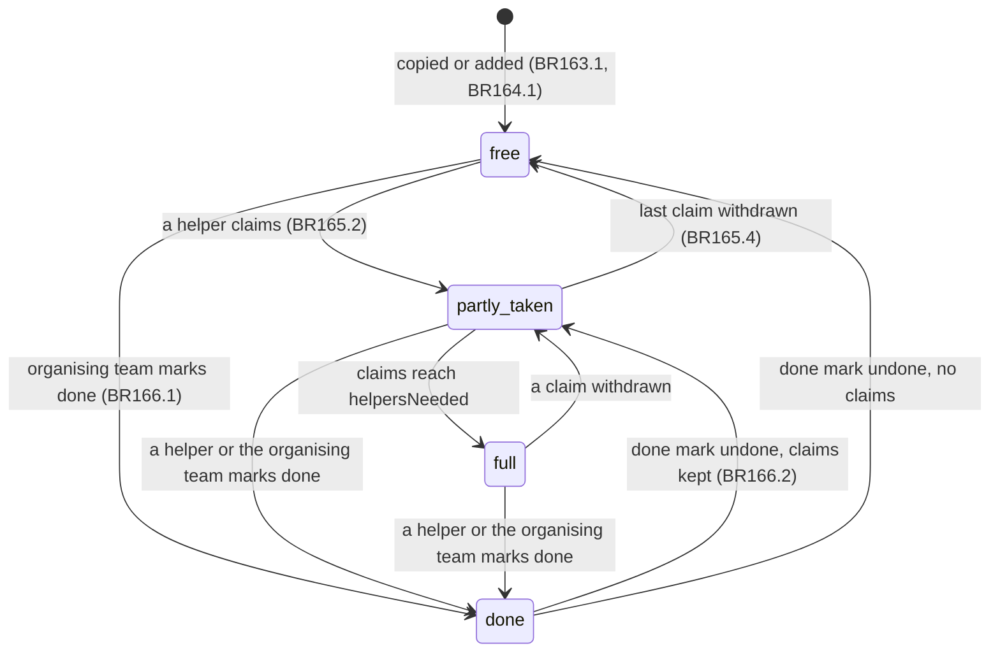
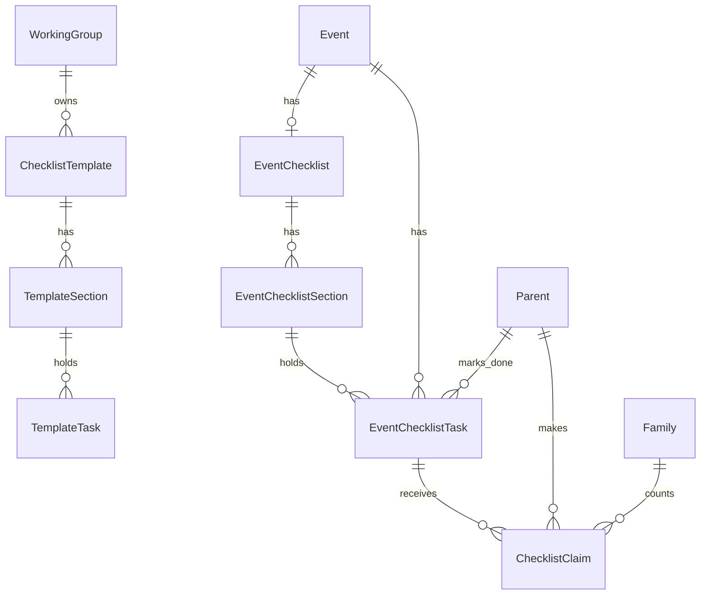

# Functional Specification: u11-checklists-and-templates

This unit (U11 in `unit-of-work.md`, mapped in `unit-of-work-story-map.md`) implements US12.1, US12.2, US12.3 and US13.1 from `stories.md`, against FR12 and FR13 in `requirements.md`, the components Checklists, Events, TimedChecks and WebApplication in `components.md`, and contracts C8, C9 and C13 (used) and C14, C15 and C16 (provided) in `contract-summary.md`. Decisions: ADR-005 and ADR-006 in `decisions.md`, and the owner's answers Q1 to Q8 in `functional-design-questions.md`. Contains no names or contact details.

## Scope

Editable checklist templates, the checklist each event copies from one, taking and finishing tasks, the organiser's list, and the two timed notices.

| In this unit | Left to another unit |
|---|---|
| Templates with sections and tasks: add, edit, remove and restore (US12.2) | The coordinator's management page with its Sablonok tab (U12); until then a link on the group page |
| The eight festival, big-cleaning and ship-repair starting templates (AC12.3.3) | Pulling to-do tasks into a checklist (U12, through C15) |
| Starting an event from a template, summer-only tasks (US12.3) | The event itself, its notices, roles, deadline and lead-time fields (U10) |
| The event's own checklist: taking, giving up, done marks, tips, notes and times (US12.1, AC13.1.5) | Removing a person across all records (U14 calls this unit's block) |
| The organisers' and teachers' sections, the closing-round cue (AC13.1.1, AC13.1.4) | Delivery, retries, no double sending and the failure list (U5) |
| The lead-time notice and the unclaimed-task alert (AC13.1.2, AC13.1.3, AC13.1.6) | |
| Retiring today's event tasks (owner answer Q1) | |

## States

### A template

Text fallback: a template is active once saved. Removing it hides it from new events; restoring makes it active again. It can be edited in either state. Events copied from it never change.

### A claimable checklist task

Text fallback: a task starts free. Each helper who claims it fills one of its places; when all places are filled it is full and the next person is told it is taken. A helper or the organising team marks it done, and who and when are recorded. Undoing the done mark returns it to its earlier state with its claims. Giving up a claim frees a place. A task with helpersNeeded 1 goes straight from free to full. A teachers' task has no states: it is information only. A cancelled or finished event freezes every task as it is: no claim, done mark, undo or removal by the organising team. The one exception is that a parent may still give back their own place on a task that is not done while the event is cancelled and has not ended, as with U10's sign-ups (BR165.4).

## Workflows

### W1. Manage templates (AC12.2.1 to AC12.2.3; BR160.1 to BR161.2)

1. A super admin opens Sablonok in the admin menu (`/admin/sablonok`) and sees every template of the community, with its group or "Közösségi", its number of tasks and an "Eltávolított" filter. A coordinator opens their group's templates from a "Sablonok" link on their working group's page (`/szulo/munkacsoportok/[id]/sablonok`).
2. Új sablon or a template's name opens the editor. It has the name, an optional description, the default lead time in days, and the sections in order. Each section has a title, a kind ("Szülők", "Szervezők", "Óvónők") and its tasks. Each task has a title and the optional fields: place, props, priority 1 to 3, tools and materials, tip, "Csak nyáron", number of helpers (1 by default) and "Fontos az időpont". A teachers' section hides the helpers and time fields.
3. Saving sends the whole template with its version. A coordinator saving another group's template, or a community template, is refused ("Ehhez nincs jogosultságod"). A name used by another template of the same owner is refused on the name field ("Ilyen nevű sablon már van"). An outdated screen is answered "Közben valaki módosította, töltsd újra", and nothing is overwritten.
4. Eltávolítás hides the template; it moves under the "Eltávolított" filter with Visszaállítás. Events already made from it do not change (AC12.2.4).
5. A second press saves once (BR170.1).

### W2. Start an event from a template (AC12.3.1, AC12.3.2, AC12.2.3; BR163.1, BR163.2)

1. On the new-event form (U10's `/szulo/esemenyek/uj`) a manager picks "Indítás sablonból". The list holds the active templates the caller may start from: for a super admin all of them, for a coordinator the community templates and their group's. A removed template is not offered.
2. Picking a template pre-fills the notice lead time with its default (14 days for Nagytakarítás); the manager may change it. A template with summer-only tasks shows a hint beside "Nyári esemény": "A nyári feladatok csak nyári eseménybe kerülnek."
3. Saving creates the event (U10), then copies the template into it in a second step. The event page opens with its own checklist: every section and task in order, nobody on any task, and the summer-only tasks only when "Nyári esemény" was ticked.
4. If the second step fails, the event exists with an empty checklist and the form says so ("Az esemény elkészült, de a feladatlista nem töltődött be"). While the checklist is empty, the event's edit page shows "Indítás sablonból" again. Once the checklist has a section, the choice is gone (Q7).
5. Changing "Nyári esemény" later does not add or remove tasks; the managers do that by hand (W3).

### W3. Adjust an event's own checklist (Q7; BR164.1 to BR164.3)

1. A manager opens "Feladatlista szerkesztése" on the event (`/szulo/esemenyek/[id]/feladatlista`). They add, change and reorder sections and tasks with the same fields as the template editor, plus an optional deadline date per task.
2. Each section and task carries its own version, and the list as a whole carries the checklist's version. Two managers editing at once are told "Közben valaki módosította, töltsd újra" instead of overwriting each other. Saving the checklist never changes the event's own version, so the event's edit form does not go out of date because of it.
3. Deleting a task that someone has taken, or that is done, is refused ("Ezt a feladatot már elvállalták; előbb vedd le a jelentkezőket"). Its claims can be removed from the event page (W4), and then it can be deleted.
4. The number of helpers cannot go below the people already on the task. A section's kind cannot change while one of its tasks is taken or done.
5. An organiser who is not a manager sees no edit link. A cancelled or finished event's checklist cannot be changed.

### W4. Take a task and finish it (AC12.1.1 to AC12.1.4, AC13.1.5; BR165.1 to BR166.2)

1. On the event page, below the sign-ups, the checklist shows each section with its tasks. Each task shows its title, place, props, priority, tools, deadline, a "Nyáron" tag when summer only, and how many helpers are on it out of how many ("2/4"). The tip opens in place under the task ("Tipp").
2. A parent presses Elvállalom. They may write a note ("3 rongyszőnyeget vittünk haza") and, when the time matters, pick a date and time inside the event. Their name, family, note and time appear on the task.
3. When the task is full, it shows the helpers and no Elvállalom; a parent who tries from an outdated screen is told "Ezt a feladatot már elvállalták". A parent who already holds the task sees Visszaadom instead.
4. A helper presses Kész. The task shows the check icon, Kész, who marked it and when. Any helper of the task, or the organising team, may mark it done; whoever marked it, or the organising team, may undo it ("Visszavonás").
5. A helper may give their place back (Visszaadom) until the task is done.
6. The organising team also sees, on each claimable task, "Jelentkező hozzáadása" to type the name of a helper without an account, and "Levétel" beside each helper to remove them.
7. A teacher, and any caller without a family, sees the checklist but no buttons. A cancelled or finished event shows the checklist read-only; on a cancelled event that has not ended, a helper still sees Visszaadom on their own task that is not done.
8. If the event's dates change and a chosen time falls outside them, the time stays and is marked "Az időpont kívül esik az esemény idején"; the helper picks a new one. Helpers are told about a cancellation or a change of dates or place by U10's notice, which now also reaches them (BR170.6).
9. The sign-up deadline is shown above the checklist ("Jelentkezési határidő: …"). Nothing is refused after it.
10. Taking a task counts towards nothing: not the rota, the animal-care fair share, the family's standing or the duty reminders.

### W5. The organisers' and teachers' parts (AC13.1.1, AC13.1.4; BR165.1, BR167.1, BR167.2)

1. An organisers' section ("Szervezők") is shown only to the organising team, marked "Csak a szervezők látják". Its tasks are taken and marked done like the others, by the organising team only. A parent outside the team does not see it at all, and the read leaves it out on the database side.
2. A teachers' section ("Óvónők") is shown to everyone as a plain list under the heading "Az óvónők feladata", with no buttons.
3. When every task in the parents' and organisers' sections is done, the organising team sees at the top of the checklist, in a success callout, "Minden kész: jöhet a záró kör." Nobody else sees it.

### W6. The lead-time notice (AC13.1.2, AC13.1.6; BR168.1)

1. The daily run (U5) calls the lead-time check. For each planned event with a lead time that has not started, once its start date minus the lead time is today or earlier, it sends "Közeleg: [cím]" once.
2. The notice goes to every parent with an account for a community event, or to the group's members for a group event. It opens the event page.
3. An event saved inside the window gets it at the next run. Changing the lead time or the dates afterwards does not send it again. An event with no lead time gets none.

### W7. The unclaimed-task alert (AC13.1.3; BR168.2)

1. The daily run calls the unclaimed-task check. For each planned event that has not started and has a sign-up deadline, from three days before the deadline up to the deadline, if a parents' task is not done and still has free places, the organisers get "Gazdátlan feladatok: [cím]" once.
2. The notice opens the event page, where the free tasks are visible. It names no person.
3. Moving the deadline allows one new alert for the new date. An event with no deadline gets none.

### W8. Retire today's event tasks (owner answer Q1; BR169.1)

1. The "Feladatok és események" task form no longer shows the event choice for a new task or a task with no event. A save that would create a new event link is refused on the event field; an old linked task can still be edited with its link unchanged, and its link can be removed.
2. Tasks with no event (for example rota duties and one-off jobs) work exactly as before.
3. The event page shows only the checklist for helping with an event; the sign-up with a note (U10) stays as it is.
4. U10's cancellation and change notice used to reach the families holding a place on an event task. It now also reaches the parents holding a checklist claim, read through `checklist_claimant_ids` (BR170.6).

### W9. Functions delivered for other units (BR161.2, BR170.4, BR170.5)

1. U12's coordinator page reads `template_list(group_id)` (contract C14).
2. U12's `todo_pull_to_event` calls `checklist_add_task(event_id, task_fields, source_ref, claimant)` (contract C15); the task lands in the parents' section with the given title, and the to-do task's claimant, when given and still active, arrives as its first helper.
3. U14 calls `checklists_removal_preview` and `checklists_removal_apply` (contract C16). Open claims of the removed person are freed; their other claims and done marks show "korábbi tag".

## Commands and reads of this unit

| Function | Kind | Who | Rules |
|---|---|---|---|
| `template_save` | command | super admin; coordinator for own group | BR160.1 to BR160.3 |
| `template_set_removed` | command | as `template_save` | BR161.1 |
| `template_get`, `template_list_admin` | read | managers of the template | BR160.1, BR161.2 |
| `template_list(group_id)` | read | manager of the group (C14) | BR161.2 |
| `template_options(group_id)` | read | managers creating an event | BR161.2, BR163.2 |
| `checklist_copy_template` | command | manager of the event | BR163.1, BR163.2 |
| `checklist_section_save`, `checklist_section_remove`, `checklist_task_save`, `checklist_task_remove`, `checklist_reorder` | command | manager of the event | BR164.1 to BR164.3 |
| `checklist_claim`, `checklist_claim_change`, `checklist_claim_withdraw` | command | parent with a family; the organising team may withdraw any | BR165.1 to BR165.4 |
| `checklist_claim_typed` | command | organising team | BR165.5 |
| `checklist_task_mark_done`, `checklist_task_undo_done` | command | helper or organising team | BR166.1, BR166.2 |
| `checklist_get` | read | every signed-in reader of the community | BR167.1 to BR167.3 |
| `event_lead_notice_check`, `checklist_unclaimed_check` | internal, daily check | U5's run only | BR168.1 to BR168.3 |
| `checklist_add_task` | internal | U12 (C15) | BR170.5 |
| `checklist_claimant_ids` | internal | U10's `event_save` | BR170.6 |
| `checklist_starting_templates_install` | internal, service role | the seed; later the hosting setup | BR162.1 |
| `checklists_removal_preview`, `checklists_removal_apply` | internal | U14 (C16) | BR170.4 |

All commands start with `revoke all` and an explicit `grant execute`, take an idempotency key, return the C1 envelope and refuse through `U3R00`. Reads for a caller without access return the denied refusal, never an empty list. Internal functions are never granted to a signed-in user.

## Conversion of Existing Code

- **`task_save` and `task_save_core`** (20261038, 20261047) refuse an event link (BR169.1). The task form component `app/admin/_components/TaskFields.tsx` loses its event select and its hint, and the lookups that feed it stop loading events; the tests that pick an event for a task change in the same pull request. The `tasks.event_id` column and its foreign key stay; no data is converted, because the local data is invented and reset.
- **U10's event screens** (`app/_events/EventScreens.tsx`, `app/_events/EventForms.tsx`) gain the checklist block on the detail page, the "Indítás sablonból" field on the new-event form, and the "Feladatlista szerkesztése" link for managers.
- **U10's `event_save_core`** (20261056) is replaced by a new migration that adds the parents from `checklist_claimant_ids` to the recipients of the cancellation and change notice (BR170.6). Nothing else in it changes.
- **The starting templates** live in the migration as `checklist_starting_templates_install` (BR162.1). The seed script `scripts/db/seed/data.ts` only calls it for the local community, and its test checks the result; the invented demo events may get a checklist to show the screens.
- **New database objects** come in one forward-only migration: the seven tables, their row-level security (signed-in roles read nothing directly; every read goes through the functions), the two notice kinds, the two registry rows, the audit actions and the functions above. `tests/database/identity-catalogue.test.ts` and `src/data/notification-use-cases.test.ts` are extended for the new functions and tables, as the project rules require.

## Screens (to design in Stitch before building)

| Screen | Path | Notes |
|---|---|---|
| Event detail, checklist block | `/szulo/esemenyek/[id]` | Sections in order; task rows with fields, Nyáron tag, helpers "x/y", tip in place, Elvállalom with note and time, Kész, Visszaadom, Visszavonás; organisers' section marked "Csak a szervezők látják"; teachers' section as a plain list; deadline line; closing-round callout for the organising team |
| New-event form, template field | `/szulo/esemenyek/uj` | "Indítás sablonból" select; pre-fills the lead time; summer hint |
| Event checklist editor | `/szulo/esemenyek/[id]/feladatlista` | Managers only; sections and tasks with the template fields plus deadline; reorder |
| Templates list and editor (administrator) | `/admin/sablonok`, `/admin/sablonok/uj`, `/admin/sablonok/[id]` | Group or "Közösségi", task count, "Eltávolított" filter, Eltávolítás and Visszaállítás |
| Group templates (coordinator) | `/szulo/munkacsoportok/[id]/sablonok` | The same list and editor for one group, linked from the group page until U12's management page has its Sablonok tab |
| Task form (existing) | `/admin/feladatok/uj`, `/admin/feladatok/[id]` | The event select is removed |

The screens are Hungarian, work at phone width and by keyboard, use the `checklist-` class prefix for the new area, and keep today's class names and measurements or change their tests in the same pull request (`team.md`). Each button names its task for screen readers ("Elvállalom: Ablakok lemosása"), and a result is announced through a status region. The owner compares each built screen with its Stitch design in the screenshot review.

## Derived views

### Entity relationships (derived from `entities.md`)

Text fallback: a working group may own templates; a community template has no group. A template has sections, each holding tasks. An event has at most one checklist head with its own version, and the checklist has its own sections and tasks, copied from a template or added on the event, with no link back to the template. A task receives claims, each from a parent (with the parent's family) or a typed name. A parent may be recorded as the one who marked a task done.

### Rules summary (derived from `rules.md`)

| Question | Answer | Rule |
|---|---|---|
| Who manages templates? | Super admins all; coordinators their own group's | BR160.1 |
| What does removing a template do? | Hides it from new events; restorable; events unchanged | BR161.1, BR163.3 |
| What does an event copy? | Every section and task, unclaimed; summer-only only in a summer event | BR163.1 |
| Who takes a task? | A parent with a family; organisers' tasks the organising team; teachers' tasks nobody | BR165.1 |
| How many per task? | Up to its number of helpers; then "taken" | BR165.2 |
| Who marks done and undoes? | A helper or the organising team; whoever marked it may undo | BR166.1, BR166.2 |
| Who sees the organiser's list? | The organising team only | BR167.1 |
| When is the closing round shown? | When every parents' and organisers' task is done | BR167.2 |
| When do the timed notices go? | Lead time once to everyone the event is for; unclaimed once, three days before the deadline, to the organisers | BR168.1, BR168.2 |
| Today's event tasks? | No new links; the checklist replaces them | BR169.1 |
| On removal? | Open claims freed; the rest anonymised | BR170.4 |
| Who hears of a cancellation or a move? | Also the parents holding a claim | BR170.6 |
| Pulled to-do tasks? | Arrive with their claimant when still active | BR170.5 |

## Assumptions and open points

- **Copy in a second step.** Starting from a template is a separate command run right after the event is saved, so Checklists depends on Events and not the other way round. A failed copy leaves an empty event that can be filled again (BR163.2). This reads "only at creation" (Q7) as "only into an empty checklist".
- **Lead time pre-filled, not written.** The template's default lead time only pre-fills the form; U10's event_save stores it. This unit never writes the event row.
- **The organising team.** Seeing and taking organisers' tasks, entering typed helpers, removing claims and marking done at the closing round are open to the organisers of C13 and to the managers of the event. Editing the checklist is open to managers only, as U10's BR106.2 gives organisers no edit right. A super admin with no parent record can manage and see everything but cannot be stored as the one who marked a task done (BR166.1).
- **Removal frees open places.** A removed person's claim on a task not yet done is deleted, so the place is free and the unclaimed-task alert can see it; other claims stay anonymised (BR170.4). Contract C16 said only "clears claimedBy and doneBy".
- **Starting-template content.** Appendix F lost its parents' and teachers' columns when it was copied. The install function places "létszám megadása" (Szent Miklós) and "darabszám megadása" (Gyermekek búcsúnapja) with the teachers, and the spiral, the fir gate and the rose and lily buying with the teachers as written; everything else with the parents. Appendix C lists nine areas, so the big cleaning has nine area sections. The owner can change all of it in the app.
- **Contract deltas, to update in `contract-summary.md` in the same pull request.** C4: the `event_task` origin is retired; no unit uses it. C8: the kinds `event_lead_time` and `checklist_unclaimed`, both with U10's target `event`. C9: the checks `event_lead_notice` and `checklist_unclaimed_alert`, daily, lock step 4. C14: `template_list(group_id)` as written; `template_list_admin` and `template_options` are added reads. C15: `checklist_add_task` gains an optional `claimant` (a parent id or a typed name), so U12 can carry over an existing claim; a caller that locks a family row does so before calling it, never after; the task lands in the parents' section named by `task_fields.section`, created at the end if missing. C8: U10's cancellation and change notice also reaches the parents from U11's internal `checklist_claimant_ids`; this is the one read from Events into Checklists, taking the place of today's event-task holders. C16: `checklists_removal_preview` and `checklists_removal_apply` free open claims and anonymise the rest (BR170.4). C1: the checklist path locks the event row, then the checklist head row, then sections, then checklist tasks, then claims, each kind ascending; `checklist_add_task` follows the same order.
- **Fixed test list.** Each rule's six cases (allowed, refused, out of reach, outdated screen, repeated click, two people at once) are planned in the unit's test instructions in the table agreed in U1, with "nem értelmezhető" and the reason where a case has no meaning, for example "two people at once" on a read.
