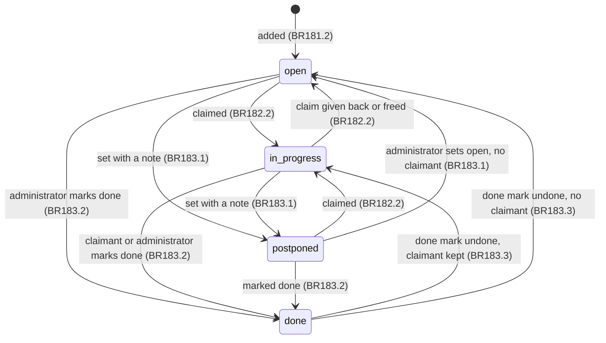
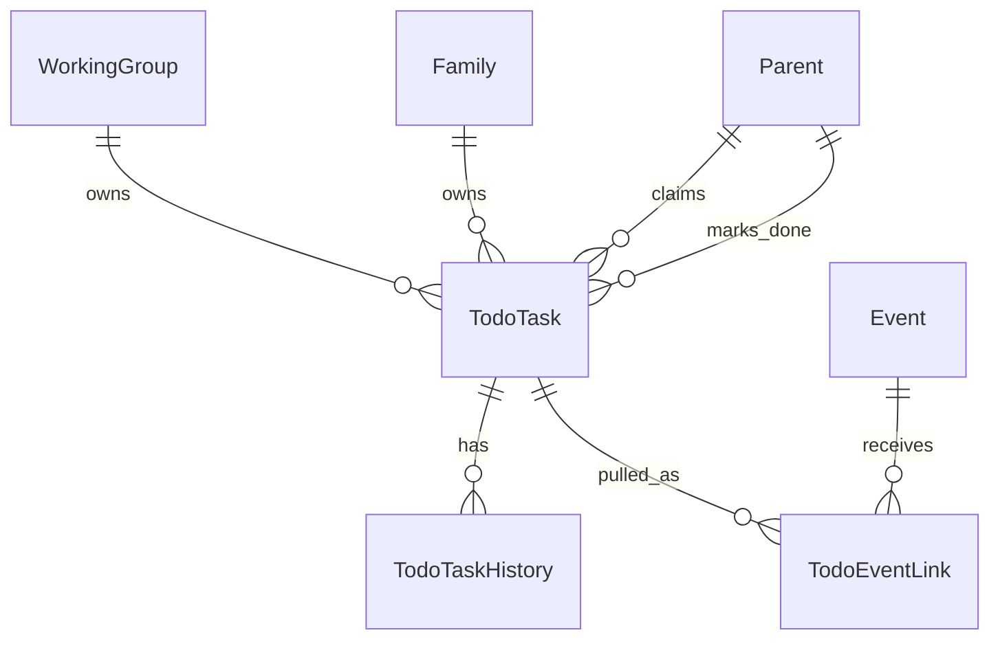

# Functional Specification: u12-todo-and-my-tasks

This unit (U12 in `unit-of-work.md`, mapped in `unit-of-work-story-map.md`) implements US2.4, US14.1, US14.2, US14.3 and US15.1 from `stories.md`, and shows AC17.1.1 and AC17.1.6 of US17.1 for to-do tasks, against FR2.3, FR14, FR15, FR17.3, FR17.4 and FR18.1 in `requirements.md`, the components TodoList, Checklists, Duties and WebApplication in `components.md`, and contracts C1, C2, C6, C8 and C9 (used), C14, C15, C16 and C17 (provided or extended) in `contract-summary.md`. The owner's answers Q1 to Q6 are in `functional-design-questions.md`. Contains no names or contact details.

## Scope

The shared to-do list with its history, pulling tasks into an event's checklist, the "My tasks" page, the coordinator's management page, two notices, and the one-off load of the spreadsheet's to-do tasks.

| In this unit | Left to another unit |
|---|---|
| Adding, changing, claiming, finishing and undoing to-do tasks, with history (US14.1, US14.2) | The checklist itself and its claims (U11); this unit only calls `checklist_add_task` |
| Pulling open tasks into an event's checklist (US14.3) | Duties and rota places shown on My tasks (U2, U6, U7, U8) and recurring duties (U9); this unit reads them |
| The "My tasks" page (US15.1) | The notice mechanism, delivery and retries (U5) |
| The coordinator's management page with four tabs (US2.4) | The events, recurring-duty and template editors (U10, U9, U11); the tabs open them |
| The change notice and the deadline reminder for claimed tasks (AC17.1.1, AC17.1.6) | The removal screen and flagging list (U14 calls this unit's block) |
| The removal block and the one-off load of to-do tasks (C16, C17) | The script that reads the spreadsheet and calls the load (U15) |

## States

### A to-do task

Text fallback: a task starts open. Claiming an open or postponed task makes it in progress; giving the claim back or an administrator freeing it makes an in-progress task open again (a postponed one stays postponed). The claimant or an administrator can set it to postponed with a note, and an administrator can set it open when nobody holds it. The claimant or an administrator marks it done, and who and when are recorded; undoing the mark returns it to in progress if someone still holds it, otherwise open. A task is never deleted. A removal can flag a task for an administrator without changing its state, apart from freeing a removed person's claim (BR190.1).

### Where a task is claimable and viewable

Text fallback: a task is hidden from the default list once it is done or while its "not before" date is in the future (BR184.1). A task cannot be claimed while its "not before" date is in the future (BR182.1). A task pulled into an event keeps its own state; the event's checklist keeps a copy that lives its own life (BR185.2).

## Workflows

### W1. Keep a to-do list (US14.1; AC14.1.1 to AC14.1.3; BR180.2, BR181.1 to BR181.3)

1. A coordinator opens the Teendők tab of their group's management page (W7) and presses Új teendő. A super admin opens `/admin/teendok` and also chooses the owner: a working group, or one family (for example the back-garden family for the kitchen-garden tasks).
2. The form has Téma (the heading), Prioritás 1 to 3, Leírás, Eszközök és anyagok, Állapot (new tasks start Nyitott), Megjegyzés, "Nem előbb" date and Határidő. A coordinator has no owner field and cannot pick another group.
3. Saving a new task shows it on the community list and on the group's tab. A coordinator who tries to save, change or free another group's task is refused ("Ehhez nincs jogosultságod"), as is anyone changing a family-owned task who is not a super admin.
4. An edit sends the task's version. An outdated screen is answered "Közben valaki módosította, töltsd újra", and nothing is overwritten. A second press saves once.
5. When the change touches a task someone else claimed, the claimant is told (W6).

### W2. Browse and claim (US14.2; AC14.2.1 to AC14.2.3; BR180.1, BR182.1, BR184.1, BR184.2)

1. A signed-in reader opens Teendők (`/szulo/teendok`; teachers use their own menu entry to the same list). The default list shows the open tasks as cards with topic, owner, priority and status; done tasks and tasks with a future "not before" date are behind the toggle "Elkészültek és későbbiek is". Filters narrow by owner, status and priority. An empty list says "Most nincs nyitott teendő."; a filter with no match says "Nincs találat" with a reset link.
2. A task's page shows its fields, claimant, done mark, the event links, and its history from oldest to newest with who and when.
3. A parent with a family presses Elvállalom on a task nobody holds; the task becomes "Folyamatban" with their name. On a family-owned task the button appears only for parents of that family. A second parent trying from an outdated screen is told "Ezt a teendőt már elvállalták."
4. The claimant presses Visszaadom to give it back, or sets Folyamatban or Elhalasztva (with a note) and edits the note. Another parent, even of the same family, sees none of these buttons.
5. The claimant, or an administrator, presses Kész; the card then shows the check icon, Kész, who marked it and when, and it leaves the default list but stays in the history. Whoever marked it, or an administrator, can use Visszavonás.
6. A teacher sees the list and the history and no button.

### W3. Pull tasks into an event (US14.3; AC14.3.1; BR185.1, BR185.2)

1. A coordinator or super admin opens an open event they manage (U10's page) and presses "Teendők hozzáadása". A list of open to-do tasks opens, with the same filters as the list. Tasks that are done are not offered; tasks already pulled into this event are marked "Már a listán".
2. They tick tasks and confirm. Each lands in the event's checklist, in the parents' section "Teendők", with the topic as its title, the priority and the materials; a task's current claimant, if still active, takes the task as its first helper. The to-do task itself is not changed: it keeps its status, claimant and history, and gains a history row "Felvéve az eseményre".
3. If any ticked task changed since the screen was loaded, nothing is added and the page says "Közben valaki módosította, töltsd újra". A second press adds once.
4. The to-do task's page now shows "Felvéve az eseményre: [cím]". When the checklist task is later done, it also shows "Az eseményen kész", and a manager of the to-do task presses Kész to close it. Nothing closes it automatically.

### W4. My tasks (US15.1; AC15.1.1, AC15.1.2; BR186.1, BR186.2)

1. A parent opens Feladataim (`/szulo/feladataim`). The cards come from three sources: the family's duties, the recurring duties of the family and groups, and the to-do tasks the parent claimed. No open tasks to browse and no event checklist tasks appear here.
2. The cards are grouped "Ezen a héten" (including anything overdue, marked "Lejárt"), "Később" and "Nincs dátum". Each shows a title, a date and a status pill, and a Kész button where the row's own screen has one; the button uses that screen's command.
3. When there is nothing, the page says "Most nincs feladatotok." with links to Teendők and to the animal-care sign-up.
4. A teacher and a super admin without a family do not see the menu entry, and the page answers them with the denied page.

### W5. Notices (AC17.1.1, AC17.1.6; BR188.1, BR188.2)

1. When an administrator saves, updates, frees or undoes a task another parent claimed, that claimant gets "A teendő módosult: [téma]" at once, in the app and by email, linking to the task page. A change by the claimant sends nothing, and new tasks send nothing.
2. The daily run (U5) calls the deadline check. A claimed task that is not done and has a deadline gets "Közeleg a határidő: [téma]" once, on the first run from three days before the deadline until the deadline. Moving the deadline allows one new reminder.
3. Neither notice names another person; both link to the task.

### W6. Removing a person (contract C16; BR190.1)

1. U14 calls `todo_removal_preview` and `todo_removal_apply` for a parent or a family. Names are cleared on done marks and history rows; the removed person's claim on an open task is released and the task is flagged for an administrator; a family's open tasks are flagged. The rows stay and show "korábbi tag".
2. An administrator's next save of a flagged task clears the flag.

### W7. The coordinator's management page (US2.4; AC2.4.1, AC2.4.2; BR187.1)

1. A coordinator opens "Kezelés" on their working group's page (`/szulo/munkacsoportok/[id]/kezeles`). A super admin can open it for any group. Others, including coordinators of other groups, get the denied page.
2. Four tabs: Események, Teendők, Ismétlődő feladatok, Sablonok. Each shows the group's items from its own list (contract C14) with a primary Új button. Teendők is built in this unit, with the form of W1 and Felszabadítom (free a claim). The other three tabs open the existing event, recurring-duty and template editors; the temporary links on the group page are replaced by this page.
3. A teacher who tells a coordinator about a repair is answered by the coordinator adding a task on the Teendők tab (AC2.4.2); there is no reporting screen.

### W8. The one-off load (contract C17; BR190.2)

1. U15's script calls `migration_load_todo` for each row with a stable source key and the row's values. A second run finds the key and creates nothing.
2. A done row is stored as done, appears in the history view, and not in the default list. A row with an unknown owner or a missing heading is refused; the script reports its position and carries on, and its output shows counts, never cell values.

## Commands and reads of this unit

| Function | Kind | Who | Rules |
|---|---|---|---|
| `todo_task_save` | command | managers of the task's owner | BR180.2, BR181.1 to BR181.3 |
| `todo_task_claim`, `todo_task_give_back`, `todo_task_free_claim` | command | parent with a family; claimant; managers | BR182.1 to BR182.3 |
| `todo_task_update` | command | claimant; managers | BR183.1 |
| `todo_task_mark_done`, `todo_task_undo_done` | command | claimant or managers; whoever marked it or managers | BR183.2, BR183.3 |
| `todo_pull_to_event` | command | managers of the event (C15) | BR185.1 |
| `todo_list`, `todo_get` | read | every signed-in reader | BR180.1, BR184.1, BR184.2, BR185.2 |
| `todo_list_for_group(group_id)` | read | managers of the group (C14) | BR187.1 |
| `my_tasks_get` | read | parent with a family | BR186.1, BR186.2 |
| `todo_deadline_reminder` | internal, daily check | U5's run only | BR188.2 |
| `todo_removal_preview`, `todo_removal_apply` | internal | U14 (C16) | BR190.1 |
| `migration_load_todo` | internal, service role | U15's script (C17) | BR190.2 |
| `checklist_task_done_state(ids)` | internal read | `todo_get`, `todo_list` | BR185.2 |
| `todo_task_set_attention(task_ids, flag)` | internal | the removal apply and `todo_task_save` | BR180.2, BR190.1 |
| `notice_facts_todo` | internal | notice delivery | BR188.1 |

All commands start with `revoke all` and an explicit `grant execute`, take an idempotency key, return the C1 envelope and refuse through `U3R00`. Reads for a caller without access return the denied refusal, never an empty list. Internal functions are never granted to a signed-in user.

## Conversion of Existing Code

- **The group page** (`app/szulo/munkacsoportok/[id]/page.tsx`) loses the temporary links to the recurring duties and templates lists and gets a "Kezelés" link for managers. The detail page of a group shows its to-do tasks, read through `todo_list_for_group`'s sibling read for community readers (the mockup shows "the group's events and its to-do tasks").
- **The family duties page** (`app/szulo/feladatok`, "Családi feladatok") stays as it is; "My tasks" is a new page that also reads the same duty read. Its menu entry follows the mockup's bottom bar (Feladataim, Teendők) and is added to navigation and to `verification/authorization-matrix.json`; the existing class names and measurements stay, or their tests change in the same pull request (`team.md`).
- **The task form** of an administrator is new (`/admin/teendok`); nothing existing is replaced. `app/admin/_components/TaskFields.tsx` (the duty form) is untouched.
- **New database objects** come in one forward-only migration: the three tables (`todo_tasks`, `todo_task_history`, `todo_event_links`), their row-level security (signed-in roles read nothing directly; every read goes through the functions), the two notice kinds and the target registration, the check registry row, the audit actions and the functions above. `tests/database/identity-catalogue.test.ts` and `src/data/notification-use-cases.test.ts` are extended for the new functions and tables, as the project rules require.

## Screens (to design in Stitch before building)

| Screen | Path | Notes |
|---|---|---|
| To-do list | `/szulo/teendok` | Cards with topic, owner, priority and status; filters; toggle for done and later; empty and no-match states |
| To-do task page | `/szulo/teendok/[id]` | Fields, claimant, history, event links; Elvállalom, Visszaadom, status, Kész, Visszavonás by right |
| My tasks | `/szulo/feladataim` | Cards grouped "Ezen a héten", "Később", "Nincs dátum"; Kész; empty state with links |
| My group, management | `/szulo/munkacsoportok/[id]/kezeles` | Four tabs; Teendők tab with Új, edit, Felszabadítom |
| To-do form (coordinator and administrator) | `/szulo/munkacsoportok/[id]/kezeles/teendo`, `/admin/teendok`, `/admin/teendok/[id]` | The fields of W1; the administrator also picks the owner |
| Pull into event | on the event page | "Teendők hozzáadása" list with tick boxes and confirmation |

The screens are Hungarian, work at phone width and by keyboard, use the `todo-` class prefix for the new area, and keep today's class names and measurements or change their tests in the same pull request (`team.md`). Each button names its task for screen readers ("Elvállalom: csap javítása"), and a result is announced through a status region. The owner compares each built screen with its Stitch design in the screenshot review.

## Derived views

### Entity relationships (derived from `entities.md`)

Text fallback: a task is owned by a working group or by one family. A parent may hold it as its single claimant and may be the one who marked it done. A task has history rows and may be pulled into events, each pull recorded as a link to the event. The checklist task that a pull creates belongs to Checklists and is only referred to by id.

### Rules summary (derived from `rules.md`)

| Question | Answer | Rule |
|---|---|---|
| Who sees the list? | Every signed-in reader; teachers read only | BR180.1 |
| Who manages a task? | The owner's administrators | BR180.2 |
| Who claims? | A parent with a family; family-owned only by that family | BR182.1 |
| Who changes or finishes a claimed task? | The claimant and the owner's administrators | BR183.1, BR183.2 |
| What is hidden by default? | Done and not-yet-due tasks | BR184.1 |
| Pulled tasks? | Original unchanged; claim carried; closed by hand | BR185.1, BR185.2 |
| What is on My tasks? | Family duties, recurring duties, claimed to-dos, by week | BR186.1, BR186.2 |
| Who uses the management page? | The group's coordinators and super admins | BR187.1 |
| Notices? | Change by an administrator, at once; reminder three days before a deadline | BR188.1, BR188.2 |
| On removal? | Names cleared, open claims and family-owned tasks flagged | BR190.1 |
| The spreadsheet load? | Once per source key, counts only | BR190.2 |

## Assumptions and open points

- **Contract deltas, to update in `contract-summary.md` in the same pull request.** C1: the to-do task step stays where the contract has it, after checklist tasks and before books; the pull takes the event row, then the checklist rows inside `checklist_add_task`, then the to-do rows ascending (BR185.1); no to-do command locks a family row; the audit action list gains `todo.claim_freed`, `todo.done_undone`, `todo.pulled_to_event`, `todo.removal_applied` and `todo.migration_loaded`. C8: the kinds `todo_changed` and `todo_due`, with target `todo_task` and the facts function `notice_facts_todo`. C9: the check `todo_deadline_reminder`, daily, lock step 4. C14: `todo_list_for_group(group_id)`, rows of id, title and status, answered to `can_manage_group`. C15: `todo_pull_to_event` takes `p_expected_versions` beside the ids, so an outdated screen fails the pull; the open point on what happens when a pulled task is done on the checklist is settled by answer Q1: nothing is written, the to-do task shows it and a manager closes it. C16: U12's block clears names and also flags claimed open tasks and the open tasks of a removed family, and releases the removed person's claim (BR190.1). C17: `migration_load_todo` is as written; the owner is a working group's name or a family key.
- **U11 gets one small read.** The state of a pulled checklist task is read through a new internal read `checklist_task_done_state(ids)` that this unit's migration adds in the Checklists block, because U11 is already merged and the read only reads. It returns, for each id, whether the task exists, is done, and whether its event is closed. Checklists still writes nothing about to-do tasks.
- **Which owner may pull.** Any open task the manager can read may be pulled, whoever owns it, because the checklist belongs to the event's manager and the original is not changed (BR185.1).
- **Who manages family-owned tasks, whether a not-yet-due task can be claimed, and the heading field** are explained under the assumptions of `rules.md` and `entities.md`.
- **Fixed test list.** Each rule's six cases (allowed, refused, out of reach, outdated screen, repeated click, two people at once) are planned in the unit's test instructions in the table agreed in U1, with "nem értelmezhető" and the reason where a case has no meaning, for example "two people at once" on a read.
