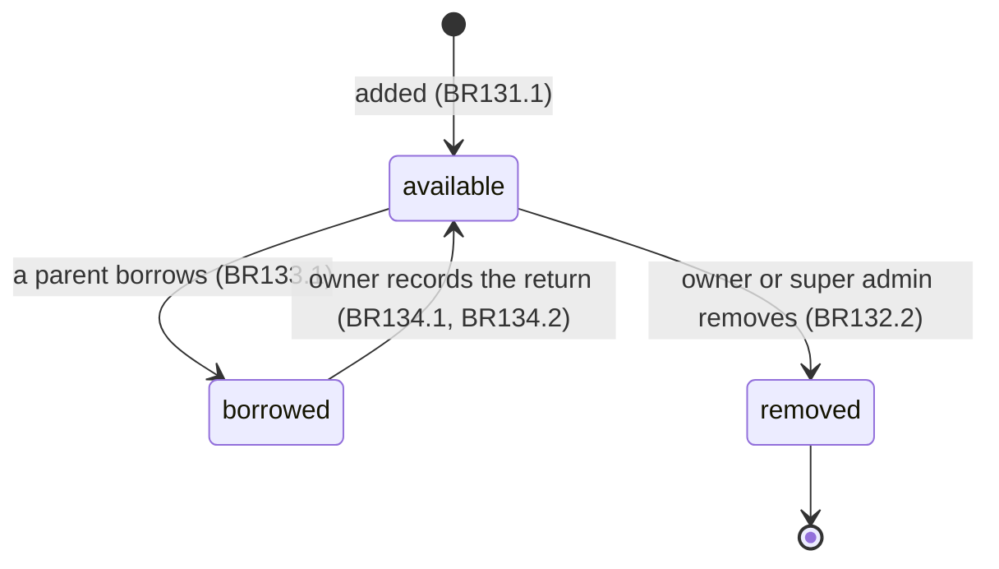
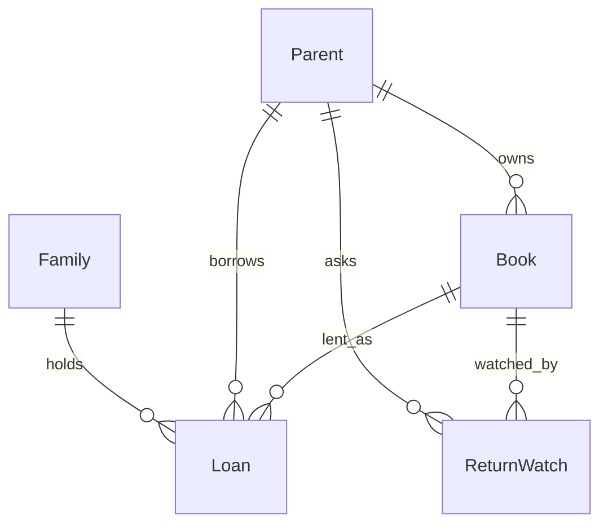

# Functional Specification: u13-lending-library

This unit (U13 in `unit-of-work.md`, mapped in `unit-of-work-story-map.md`) implements US16.1 to US16.3 and shows the book part of US17.1 from `stories.md`, against FR16 and FR17.4 in `requirements.md`, the components Library, TimedChecks and WebApplication in `components.md`, and contracts C8, C9, C3 and C20 (used) and C16 and C17 (provided) in `contract-summary.md`. Decisions: ADR-001 and ADR-006 in `decisions.md`, and the owner's answers Q1 to Q7 in `functional-design-questions.md`. Contains no names or contact details.

## Scope

A lending library for the whole community: a book list, borrowing and return, a request to be told when a book is back, and a reminder to a leaving family that still holds a book.

| In this unit | Left to a later unit |
|---|---|
| Adding a book, with an owner (US16.1, Q1) | Removing a person across all records, and the administrator's list of held books (U14 calls this unit's block) |
| Changing and removing a book (Q2) | The one-off script that reads the spreadsheet and calls `migration_load_book` (U15) |
| Borrowing with an optional "until when" date, and the owner recording the return (US16.2, Q3, Q4, Q7) | Mechanism of notices and email, retries, failure list and no double sending (U5) |
| Seeing where each book is, and who holds it (FR16.1, Q5) | The daily run itself (U5); this unit only registers its check |
| Asking to be told when a book is back, and the notice at the return (US16.3, AC16.3.1) | |
| The reminder to a leaving family 30 days before changeover (AC16.3.2, Q6) | |
| The book notices and their link (AC17.1.1, AC17.1.6) | |

## Book states

Text fallback: a book is added as available. A parent with a family borrows it, and it is borrowed until the owner records the return, when it is available again. While nobody holds it, the owner or a super admin may remove it, and a removed book leaves every list. A borrowed book cannot be removed.

## Workflows

### W1. Add a book (AC16.1.1, AC16.1.2; BR130.1, BR131.1, BR131.2)

1. A parent opens Könyvtár and presses Új könyv. The form has the title, the authors, an optional short description and the owner, which is the parent by default and can be set to another parent of the community.
2. Saving adds the book as available and shows it in the list. A second press, or a double click, adds one book, not two (BR138.1).
3. A title or authors that are empty or too long, or an owner who is not an active parent, are refused on that field. A teacher sees no "Új könyv" button and is refused if the call is made anyway.
4. A book without a description is listed as its title and authors only, with no empty box or broken layout.

### W2. Find books and see where they are (FR16.1, AC16.1.2; BR130.1, BR130.2)

1. Every signed-in person, teachers included, opens `/szulo/konyvtar` and sees the books ordered by title. Each shows the authors, the owner and either "Elérhető" (available) or "Kölcsönözve" with the holder's name and the "until when" date if there is one.
2. A search box filters by title or authors, ignoring case and accents. An empty result says "Nincs ilyen könyv."
3. An empty library says "Még nincs könyv a könyvtárban" with "Új könyv".
4. A removed person shows as "korábbi tag", and a book whose owner has no account shows its typed owner name. No contact details appear anywhere in the library.

### W3. Borrow a book (AC16.2.1, AC16.2.4; BR133.1 to BR133.3)

1. On an available book that is not their own, a parent with a family presses Kölcsönveszem and may pick an "until when" date, not earlier than today and not more than a year ahead.
2. The book shows as borrowed by that parent, with the date. If the parent had asked to be told about this book, that request is gone (BR133.1).
3. A parent presses on a book that was borrowed a moment before by someone else, or on a screen that is out of date. The answer is "Közben valaki kölcsönvette" or "Közben valaki módosította, töltsd újra", and nothing changes (BR133.2).
4. A parent cannot borrow their own book; a teacher or a person with no family sees no Kölcsönveszem button.
5. While holding the book, the borrower may change or clear the date. Nothing happens when the date passes except that the screen still shows it (BR133.3).

### W4. Record a return (AC16.2.2, AC16.2.3; BR134.1, BR134.2)

1. The owner of a borrowed book sees Visszakaptam on it and presses it. The book shows as available and the loan stays in the history.
2. The borrower, another parent, a coordinator and a teacher have no such button, and a call from any of them is refused ("Ezt csak a könyv tulajdonosa rögzítheti").
3. A book with no owner who has rights (a typed owner name, or an owner who was removed) shows Visszakaptam to a super admin only.
4. A second press, or the owner and a super admin pressing together, records one return; the second gets "A könyv már nincs kölcsönadva" (BOOK_NOT_ON_LOAN, or VERSION_CONFLICT on an out-of-date screen, shown with the same text; BR134.1, BR138.1).
5. If the borrower was removed meanwhile, the links of that loan to the removed person are cleared in the same step (BR139.1).

### W5. Be told when a book is back (AC16.3.1, AC17.1.1, AC17.1.6; BR135.1, BR135.2, BR137.1)

1. On a borrowed book, a parent who neither holds nor owns it presses Értesítést kérek. The button turns to "Mégsem kérem" and can be pressed again to take the request back. An available book shows Kölcsönveszem and no such button.
2. When the owner records the return, every parent who asked, and is still active, gets one notice "Könyv visszaérkezett" and an email (U5), and the notice opens the book at `/szulo/konyvtar/[id]`. The person recording the return is not told.
3. The requests then end, so the next return tells nobody unless a parent asks again. Asking twice is refused with "Már kértél értesítést."
4. Removing a book while nobody holds it ends its requests without telling anyone.

### W6. The reminder to a leaving family (AC16.3.2, AC17.1.1, AC17.1.6; BR136.1, BR136.2, BR137.1)

1. The daily run (U5) calls this unit's check once a day. For each book out with a family that is leaving, from 30 days before the changeover date until the day before it, the check finds the open loan.
2. Every active parent of that family with an account gets one notice "Könyvet vissza kell vinni" naming the book and the changeover date, and an email (U5). The notice opens the book.
3. A second run the same day, or any later run, sends nothing more for that loan. A family that returns the book before the window, or is staying or new, is never told. Nothing is sent from the changeover date on.
4. The owner is not told by this check.

### W7. Change or remove a book (Q2; BR132.1, BR132.2, BR139.2)

1. The owner, or a super admin, opens a book and presses Szerkesztés to change the title, authors, description or owner, or Törlés to remove it. A super admin who is not the owner is recorded in the audit log without any name or title.
2. A screen that is out of date is answered "Közben valaki módosította, töltsd újra" and nothing is overwritten.
3. Törlés is refused on a borrowed book ("Kölcsönadott könyv nem törölhető"). A removed book leaves the list and its loans stay as history.
4. Naming a new owner on a book with a typed owner name lets the book gain an owner with rights.

### W8. Functions delivered for other units (BR136.2, BR139.1, BR140.1)

1. U5's daily run calls `library_due_check` through the registry row this unit inserts. It is not callable by signed-in users.
2. U14 calls `library_removal_preview` and `library_removal_apply` (contract C16). Watches are deleted, closed-loan links and owner links are cleared, and held books are flagged for an administrator and not changed: the preview and apply return `held_loan_ids`, the opaque ids of the open loans held, so U14 can list the held books through the book read.
3. U15 calls `migration_load_book` (contract C17) for each of the 14 books. A second run creates no duplicate, and the books load as available.

## Commands and reads of this unit

| Function | Kind | Who | Rules |
|---|---|---|---|
| `library_book_add` | command | parent, group admin, super admin | BR131.1, BR131.2 |
| `library_book_change` | command | owner with rights, super admin | BR132.1, BR131.2 |
| `library_book_remove` | command | owner with rights, super admin | BR132.2 |
| `library_book_borrow` | command | parent with a family | BR133.1, BR133.2, BR133.3 |
| `library_loan_set_until` | command | the borrower | BR133.3 |
| `library_book_return` | command | owner with rights; super admin if none | BR134.1, BR134.2, BR135.2 |
| `library_watch_add`, `library_watch_remove` | command | parent, group admin, super admin | BR135.1 |
| `library_list`, `library_get` | read | every signed-in reader | BR130.1, BR130.2 |
| `library_due_check` | internal | the daily run | BR136.1, BR136.2 |
| `library_removal_preview`, `library_removal_apply` | internal | U14 | BR139.1 |
| `migration_load_book` | service role | U15 | BR140.1 |

All commands start with `revoke all` and an explicit `grant execute`, take an idempotency key, return the C1 envelope and refuse through `U3R00`. Reads for a caller without access return the denied refusal, never an empty list. The internal functions and `migration_load_book` are never granted to a signed-in user. The refusal codes this unit adds are BOOK_NOT_AVAILABLE, BOOK_NOT_ON_LOAN, BOOK_ON_LOAN, BOOK_AVAILABLE, BOOK_REMOVED and ALREADY_WATCHING.

## Conversion of Existing Code

There is no library in the code today (no table, function or screen), so this unit adds and converts nothing.

- **New migration.** Adds `books`, `loans` and `return_watches`, with a partial unique index that allows one open loan per book, and the functions above. It registers the notice kinds `book_returned` and `book_return_due`, the target type `book` and the registry row `library_return_due` (contracts C8 and C9). It is a new forward-only file; an applied file is never edited.
- **Application layer.** A new library module in `src/application`, `src/data` and the parent screens, beside the other feature modules, with the same port and facade shape.
- **Tests.** A new `tests/database/` file for the library rules, added by hand to its `test:database:*` script and to the shuffled run. `tests/database/identity-catalogue.test.ts` (elevated-function list, policy-test list, scope-probe decisions) and `src/data/notification-use-cases.test.ts` are extended for the new functions and tables (project rule).
- **Navigation.** The Könyvtár item is under "Több" on the phone and in the parent menu (mockups); the teacher menu shows it read-only. `role-policy.ts`, `authorization.ts` and `verification/authorization-matrix.json` gain the library pages.

## Screens (to design in Stitch before building)

| Screen | Path | Notes |
|---|---|---|
| Library list | `/szulo/konyvtar` | Search box, each book with its state and holder, "Új könyv"; empty state "Még nincs könyv a könyvtárban"; library cards use the `library-` class prefix on the parent task card |
| Book detail | `/szulo/konyvtar/[id]` | Kölcsönveszem with the optional date, Értesítést kérek or Mégsem kérem, Visszakaptam for the owner, Szerkesztés and Törlés for the owner and super admins, the date change for the borrower; the link target of every book notice |
| Book form | `/szulo/konyvtar/uj` and `/szulo/konyvtar/[id]/szerkesztes` | Title, authors, description, owner |

The screens are Hungarian, work at phone width and by keyboard, and keep today's class names and measurements or change their tests in the same pull request (`team.md`). The owner compares each built screen with its Stitch design in the screenshot review.

## Derived views

### Entity relationships (derived from `entities.md`)

Text fallback: a parent owns books. A book has loans over time, at most one open at once. A loan is by one parent of one family. A parent can ask to be told when a book is back, and each book can have such requests.

### Rules summary (derived from `rules.md`)

| Question | Answer | Rule |
|---|---|---|
| Who reads the library? | Everyone signed in; teachers read only | BR130.1 |
| Who adds a book? | Any parent; the owner defaults to the adder | BR131.1, BR131.2 |
| Who changes or removes it? | Owner and super admin; remove only when nobody holds it | BR132.1, BR132.2 |
| Who may borrow? | A parent with a family, not the owner | BR133.1 |
| Two at once? | One loan, one refusal | BR133.2 |
| The date | Optional, only shown | BR133.3 |
| Who records the return? | The owner; a super admin when there is no owner with rights | BR134.1, BR134.2 |
| Told when back | One request per parent, one notice, then ended | BR135.1, BR135.2 |
| Leaving family | One notice per parent per loan from 30 days before changeover | BR136.1 |
| On removal | Watches deleted, links cleared, held books flagged | BR139.1 |

## Assumptions and open points

- **Authors are required.** FR16.1 and AC16.1.1 list the authors with the title, and only the description is optional (AC16.1.2). A spreadsheet row with no authors is therefore refused and reported by position by U15.
- **A family member may borrow the family's own book.** Q4 refuses only the owner. Two parents of one family are treated as two people.
- **The date limit is a design choice.** The "until when" date may be at most one year ahead (BR133.3), to refuse typing mistakes. The stories give no limit.
- **The owner can be changed.** Q1 and Q2 do not say who changes an owner. This design lets the owner and a super admin do it (BR132.1), so a book with a typed owner name can gain an owner with rights and a book of a person who left does not stay without one for ever.
- **An owner who leaves.** The owner link of that person's books is cleared and the books stay in the list as ownerless, so a super admin records their return (BR134.2). Whether the books should instead be removed with the owner is left to U14 and the administrators.
- **The held book is flagged, not freed.** Removing a borrower leaves the open loan in place and flags it for an administrator (contract C16). The owner records the return as usual.
- **The reminder window is a day count.** "30 days before the changeover date" is the changeover date minus 30 days, counted in Budapest dates, and the reminder is sent on the first run on or after that day (BR136.1). A family marked leaving later still gets it once.
- **Where a book is now is not migrated.** The spreadsheet's loan state is not carried over; the 14 books load as available (BR140.1). This narrows nothing in FR18.1, which asks for the books only; U15 should say so in its own design.
- **Contract deltas, to update in `contract-summary.md` in the same pull request.** C16: U13's block also deletes the subject's return watches, clears closed-loan borrower links and clears the owner link of the subject's books, besides flagging held books, and its preview and apply return `held_loan_ids` (opaque ids, no names or titles) beside the counts. C1 audit list: gains the five actions of BR139.2. C17: `migration_load_book` takes a title, authors, an optional description and either an owner parent or a typed owner name; the refusal codes list gains the six codes above. C9: the check `library_return_due` is registered with the last run order.
- **Lock order.** Every command locks the book row first (the last step of contract C1), then its loan row and its watch rows by ascending id (BR138.1).
- **Fixed test list.** Each rule's six cases are planned in the unit's test instructions in the table agreed in U1, with "nem értelmezhető" and the reason where a case has no meaning, for example "two people at once" on a read.
