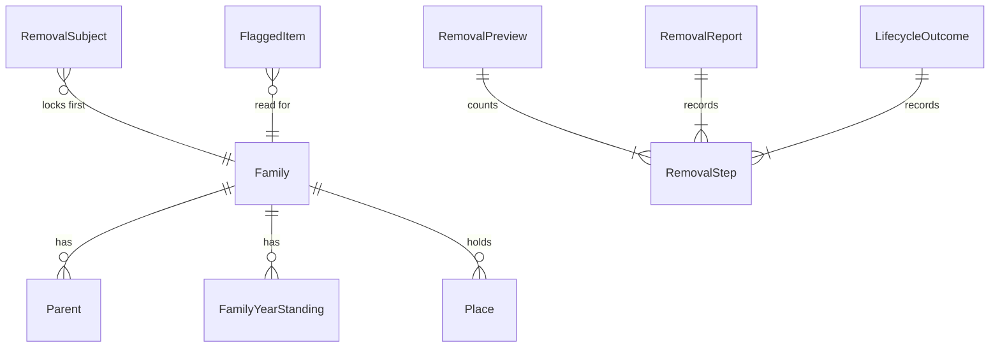

# Functional Specification: u14-removal-and-anonymisation

The behaviour of removing a parent, removing a family, and later deleting or anonymising a family that left, across every kind of record. This unit implements the removal parts of US3.6 in `stories.md` (AC3.6.2, AC3.6.5 to AC3.6.7, and the audit of AC3.6.4), together with U3, which built the directory record and the parent-removal screen. Built from `unit-of-work.md` (U14), `unit-of-work-story-map.md`, `requirements.md` (FR3.7, NFR1, NFR11), `components.md` (Lifecycle, WebApplication), `contract-summary.md` (C1, C6, C16), `entities.md`, `rules.md` and the owner's answers Q1 to Q8 in `functional-design-questions.md`. Contains no names or contact details.

## Scope

- **In scope:** the Lifecycle commands and reads that run the eleven removal steps; the new duties step; the name helpers' reading of removed people; the changes to U10's events step; the later delete or anonymise; restore; the confirmation, result and restore screens.
- **Not in scope:** the directory record itself, the parent-removal confirmation page's layout and the refusal of a family's last parent (U3, kept); each other component's own step (built by its unit, called here); loading real data (U15 and the later hosting work).

## Subject states

A family moves through these states. A parent has only the first two.

| State | How it is reached | What others see |
|---|---|---|
| Active | Added, or restored | The name |
| Removed (archived) | Removal (W2 or, for a parent, W1) | korábbi tag / korábbi család; the super admin sees the name on the record, archive and data-lifecycle screens |
| Anonymised | Later run, when links remain (W4) | korábbi család; stored names are Anonimizált … |
| Deleted | Later run, when nothing points at it (W4) | Nothing; any id left reads korábbi tag |

Transitions: Active to Removed by removal; Removed to Active by restore within 30 days (W5, family only); Removed to Anonymised or Deleted by the later run after 30 days. Anonymised and Deleted are final.

## Workflows

### W1. Remove a parent (AC3.6.4, AC3.6.5, AC3.6.7; BR200.1 to BR200.3, BR201.1 to BR201.4, BR203.1, BR204.1, BR205.1)

1. A super admin opens a family's record and chooses to remove one parent.
2. The confirmation page reads the removal preview for that parent (W6). If the parent is the family's only active parent, the page shows U3's refusal and the way to remove the family instead (Q1). Otherwise it lists, per kind of record, what will be cleared and flagged, and the groups that will be left without a coordinator.
3. The super admin confirms. The command locks the family row, checks the version, and calls the eleven steps in the fixed order with the parent as subject.
4. The steps end the parent's sign-in, empty their contact details and sharing choice, end their memberships and coordinator roles, remove their notices, release their claims on open checklist and to-do tasks and flag the to-do tasks, flag books they hold, end their pending swap requests, clear them from decided requests and anonymise their event sign-ups and offers, emptying the notes.
5. One audit row records the step counts. The server ends the parent's sessions.
6. The result page lists the flagged items (W7) and the groups left without a coordinator, each with a link.

Unhappy paths: outdated page (VERSION_CONFLICT, the page reloads with the current state); repeated click (the stored result); a step refuses (nothing changes, the refusal is shown).

### W2. Remove a family (AC3.6.2, AC3.6.5 to AC3.6.7; BR200.1, BR200.3, BR201.1 to BR201.4, BR202.1, BR203.1, BR204.1, BR205.1)

1. A super admin opens the family's record and chooses to remove the family (the archive action of today).
2. The confirmation page reads the removal preview for the family (W6).
3. The super admin confirms. The command locks the family row, checks the version and calls the eleven steps with the family as subject.
4. The duties step frees the family's future places on manual duties and keeps its rota, weekend and animal-care places, which now show on the flagged-duties list (Q3). Today's refusal of archiving a family with a rota place goes away. The other steps do for every parent of the family what W1 step 4 does for one, and also flag the family's to-do tasks and recurring schedules. The directory step archives every parent, the children and the family.
5. One audit row records the counts; the server ends the sessions of every parent.
6. The result page lists the flagged items and the groups left without a coordinator.

### W3. History after a removal (AC3.6.5; BR202.2, BR204.1, BR204.2)

1. Anyone who reads history (past places and done marks, rota weeks, picks, swaps, claims, checklists, sign-ups, books and loans) sees the removed parent as korábbi tag and the removed family as korábbi család, from the moment of removal.
2. The super admin's family record, archive and data-lifecycle screens still show the stored name until the family is deleted or anonymised.
3. No read returns a removed person's phone, email, residence, occupation, hobby or children.

### W4. Delete or anonymise a family that left (AC3.6.6; BR206.1 to BR206.4)

1. On the data-lifecycle screen a super admin chooses a family archived at least 30 days ago with no hold, and confirms.
2. The run locks the family row, checks the conditions, and calls the eleven steps again with the family (Q8).
3. It checks whether any record still points at the family or its parents. If so it anonymises; otherwise it deletes. Leaving and new standings go in both cases.
4. One audit row records the outcome and the counts.

### W5. Restore a removed family (BR207.1)

1. Within 30 days a super admin opens the archived family and chooses to restore it.
2. The restore page says what comes back (the family, its parents and children, the directory record) and what does not (sign-ins, memberships, coordinator roles, claims, swaps, notices, freed places), and that each parent needs a new invitation.
3. On confirmation the family is active again; its kept places stop being flagged.

### W6. Preview a removal (Q6; BR200.1, BR200.2, BR203.1, BR205.3)

1. The confirmation pages of W1 and W2 read the preview for the subject: per step the counts to clear and to flag, the totals, the groups left without a coordinator, and any refusal.
2. The read changes and locks nothing.

### W7. See the flagged items (AC3.6.2, AC3.6.7; BR205.1, BR205.2)

1. After a removal, and from the archived family's page later, a super admin reads the flagged items of the subject.
2. Each item shows its kind, its title, a date where there is one, and a link: the flagged-duties list for places, the library for held books, the to-do list for tasks, the recurring duties page for schedules.
3. Items already handled no longer appear.

## Commands and reads of this unit

| Name | Kind | Who | Returns |
|---|---|---|---|
| `parent_remove(key, parent_id, expected_version)` | command, body replaced (W1) | super admin | C1 envelope with the RemovalReport |
| `family_archive(key, family_id, expected_version)` | command, body replaced (W2) | super admin | C1 envelope with the RemovalReport |
| `removal_preview(subject_kind, subject_id)` | read, new (W6) | super admin | RemovalPreview |
| `removal_flagged_items(subject_kind, subject_id)` | read, new (W7) | super admin | list of FlaggedItem |
| `lifecycle_run(key, family_id, expected_version, confirmed)` | command, body extended (W4) | super admin | C1 envelope with the LifecycleOutcome |
| `family_restore(key, family_id, expected_version)` | command, unchanged rules (W5) | super admin | C1 envelope |
| `duties_removal_preview`, `duties_removal_apply(subject_kind, subject_id)` | internal step, new (BR202.1) | no role | `{ to_clear, to_flag }` |
| `working_groups_sole_coordinator_groups(subject_kind, subject_id)` | internal read, new in the WorkingGroups block (BR203.1) | no role | list of group id and name |

Each command follows the team's use-case template: active session, idempotency key, C1 result envelope, refusals through `U3R00`, `revoke all` then an explicit grant.

## Changes to other units' code

| Unit | Change | Why |
|---|---|---|
| U2 / Duties | New duties step; family_archive no longer refuses DUTY_ROTA_MANAGED | C16 gave U2 the step; Q3 |
| U1 / Community | parent_display_name and family_display_name read an archived parent or family as former; a family reads korábbi család | Q5, BR204.1 (C6 delta) |
| U3 / Directory | parent_remove and family_archive call the Lifecycle run instead of the directory core alone | BR201.1 |
| U4 / WorkingGroups | New internal read of groups whose only coordinator is a subject's parent | Q2, BR203.1 |
| U10 / Events | The events step also empties the notes of the rows it anonymises | BR204.2 (settles U10's open point) |
| Lifecycle (today) | lifecycle_run_core runs the steps again, decides by remaining links, deletes standings | Q4, Q8 |

Tests that expect korábbi tag for a family change in the same pull request. `tests/database/identity-catalogue.test.ts` and `src/data/notification-use-cases.test.ts` gain the new functions (project rule).

## Screens (to design in Stitch before building)

- **Parent removal confirmation** (`/admin/nyilvantartasok/[id]/szulo/[parentId]/eltavolitas`, exists): add the per-kind counts and the groups-without-coordinator warning.
- **Family removal confirmation** (new, from the family record): the same content for the family, replacing today's one-click archive.
- **Removal result** (new): the flagged items with links, and the groups without a coordinator.
- **Restore confirmation** (archive page, exists): add what does not come back.

All copy is Hungarian, works at phone width and by keyboard, and names no removed person except where the super admin is looking at that family's own record.

## Derived views

### Entity relationships (derived from `entities.md`)

<!-- Text fallback: a family has parents, standings and places. A removal subject always locks its family first. The preview, the report and the lifecycle outcome each hold one entry per removal step. Flagged items are read for a removed family. -->

### Rules summary (derived from `rules.md`)

| Group | Rules | Covers |
|---|---|---|
| Who and checks | BR200.1 to BR200.3 | super admin only, last parent, version and repeated click |
| Running | BR201.1 to BR201.4 | one transaction, fixed order, audit, two at once |
| Duties | BR202.1, BR202.2 | future places, done marks |
| Coordinators | BR203.1 | only coordinator |
| Display | BR204.1, BR204.2 | korábbi tag and korábbi család, notes |
| Flags | BR205.1 to BR205.3 | flags, result list, preview |
| Delete or anonymise | BR206.1 to BR206.4 | conditions, steps again, decision, what changes |
| Restore | BR207.1 | what comes back |

## Assumptions and open points

- A parent removed on their own keeps their name on the archived row until the family is deleted or anonymised. It is shown only on the super admin's family record. Confirm before go-live that this is acceptable under the kindergarten's privacy responsibilities.
- A removed owner's books stay in the library with no owner (U13's step); a super admin can give them a new owner or remove them. This settles U13's open point.
- The preview's counts are a guide; the run's own counts are the audited ones (BR205.3).
- Every database rule here gets the fixed test list: allowed, refused, out of reach, outdated screen, repeated click, two people at once.
