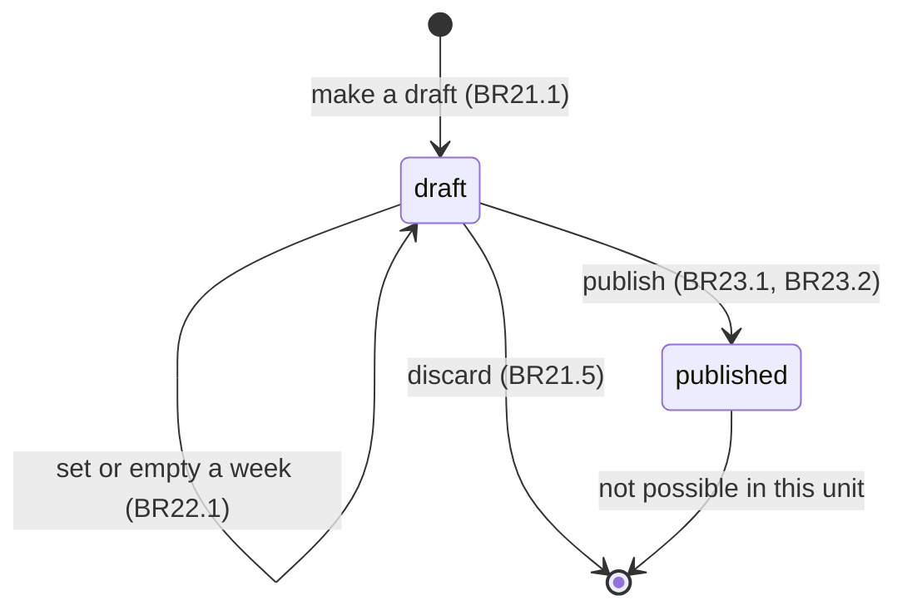
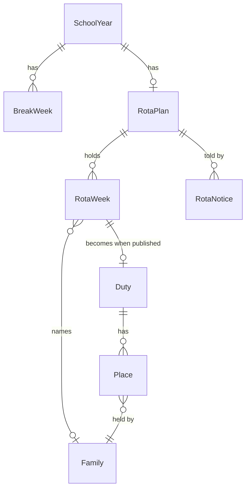

# Functional Specification: u2-first-rota-slice

This unit (U2 in `unit-of-work.md`, mapped in `unit-of-work-story-map.md`) implements US4.1, US5.1, US5.2, US5.3 and US8.1 from `stories.md`, against FR4, FR5 and FR8.1 in `requirements.md`, the components Community, Duties, RotaPlanning and WebApplication in `components.md` and contracts C3, C4, C5 and C18 in `contract-summary.md`. Decisions: ADR-002 and ADR-004 in `decisions.md`, and the owner's answers Q1 to Q6 in `functional-design-questions.md`. Contains no names or contact details.

## Scope

The thin first slice the owner checks before the rest is built: set a school year and break weeks, draft the indoor-cleaning rota, change a week, publish, and see the duty as a parent. One rota, break-week rules only.

| In this unit | Left to a later unit |
|---|---|
| School year changeover date and break weeks (US4.1) | Leaving and new families, and the changeover rule (US4.2, U6) |
| Draft, adjust, discard and publish the indoor-cleaning rota (US5.1, US5.2) | Front garden, water carrying, weekend animal care, the same-week rule, part-year shares (U6) |
| Overview and duty card for indoor cleaning (US8.1, US5.3 first criterion) | Front-garden watering and water-carrying texts (AC5.3.2, AC5.3.3, U6); swaps and cancellations (U7) |
| The shared duty and place model with duty_create, done mark and three place-changing functions (C4, C18, C5) | The screens for done marks (U9), the callers of the place functions (U7, U8) |
| A publishing notice in today's in-app notices | Email and the new notification function (U5, U6) |
| The old change functions refuse rota duties | Changing a published duty (US5.4, U7) |

## School week

A school week is a Monday-to-Sunday week of which at least one weekday falls inside the school year's dates. A week is named by its Monday. A duty week is a school week that is not a break week. The calendar functions of contract C3 return these weeks, so no rota keeps its own idea of the calendar.

## Rota plan lifecycle

Text fallback: no plan, then a draft. A draft can be edited, discarded (back to no plan) or published. Published is final here; changes to a published duty arrive with U7.

## Workflows

### W1. Record the school calendar (AC4.1.1, AC4.1.2; BR20.1 to BR20.5)

1. A super admin opens Tanév, `/admin/tanev`, for a school year.
2. The screen shows the year's dates, the changeover date (1 July of the year the school year ends until changed), the school weeks with their break flags, and a warning list of filled rota weeks that are now break weeks (BR20.5).
3. Adding a break week takes the Monday of a school week and an optional label. A non-Monday, a date outside the year or a week already recorded is refused with the reason (BR20.1).
4. Removing a break week and changing the changeover date save at once. The changeover date cannot be before the year starts (BR20.3).
5. Every write is refused for anyone but a super admin (BR20.2), and a stale version or a repeated click changes nothing twice (BR22.4 pattern).
6. With no break weeks the screen says so. A year with no school weeks cannot occur, because the year's own dates define them.

### W2. Make the draft (AC5.1.1 to AC5.1.5; BR21.1 to BR21.4)

1. A super admin opens Beosztás tervezése, `/admin/beosztas`, for a school year with no plan. The screen offers Tervezet készítése.
2. The function refuses when a plan exists (ROTA_PLAN_EXISTS) and says so; see W4 for starting again.
3. Otherwise it creates the plan as a draft and one indoor-cleaning row for every school week. Break week rows stay empty. Duty week rows get the families by the rule of BR21.4: the active families ordered by name, the cycle starting at (calendar year of the year's start) modulo the number of families, advancing one family for every duty week and not for a break week.
4. With no active family every duty week stays empty with reason no_family and the screen lists the weeks and the reason (AC5.1.5).
5. The screen then shows the week-by-job table, each family's count of weeks, and the list of empty weeks. A family more than one week above the lowest count is marked (BR22.3).
6. The draft is repeatable: the same families, calendar and year give the same result.

The even draft is checked by tests: for several family counts, break patterns and years, no two families differ by more than one week and each family's turns are as far apart as the cycle allows. The part of AC5.1.2 about part-year families needs family standing and is delivered by U6.

### W3. Adjust a week (AC5.2.2; BR22.1 to BR22.4)

1. In the draft table the administrator picks a week. The cell editor offers only active families, and "Üres" to empty the week.
2. Saving sends the row's version. A stale version is refused (VERSION_CONFLICT) and the screen reloads the row.
3. A family cannot be set on a break week (ROTA_BREAK_WEEK) and an inactive or foreign family is refused (ROTA_FAMILY_INELIGIBLE). The refusal names the rule in plain Hungarian and nothing is saved (AC5.2.2).
4. An uneven result is saved and shown as a warning (Q4).
5. Two administrators editing different weeks both succeed. Two editing the same week get one success and one conflict.

### W4. Discard and start again (BR21.5)

1. The draft screen offers Tervezet elvetése, showing how many weeks were changed by hand ("N hét kézzel módosítva").
2. Confirming sends the plan's version and that number. If the real number differs, the discard is refused (ROTA_DISCARD_OUTDATED) and the screen shows the new number.
3. A discard removes the plan and its rows, is audited (rota.discard), and returns the screen to W2 step 1.
4. A published plan cannot be discarded (ROTA_PLAN_PUBLISHED). To start over on the owner's computer, reset the local database.

### W5. Publish (AC5.2.3; BR23.1 to BR23.6)

1. The administrator presses Közzététel. The plan read has already shown whether it can be published: it lists every empty duty week and every filled break week (BR23.1).
2. Publishing is refused while a duty week is empty (ROTA_WEEKS_EMPTY), a family sits on a break week (ROTA_BREAK_WEEK) or a named family is no longer active (ROTA_FAMILY_INELIGIBLE). The plan stays a draft.
3. Otherwise one transaction locks the family rows, then, as the first lock of the rota week step, the plan row and then the week rows in ascending id order (C1 lock order; the plan row's place in the order is a note for C1) and creates, for each filled week in order, a duty and its one place for the family (BR23.2). It then marks the plan published.
4. In the same transaction each family on the plan gets its notice: one per active parent with an account, listing that family's weeks (BR23.4). The publishing is audited with the number of duties (BR23.5).
5. A second click, another administrator, or a repeated request does nothing further (BR23.3).

### W6. A parent or teacher opens the overview (AC8.1.1, AC8.1.2, AC5.2.1; BR24.1, BR22.5)

1. A signed-in person opens Beosztás: `/szulo/beosztas` for parents and working-group admins, a sub-page of the teacher's Beosztás for teachers, and the planning screen for super admins.
2. The overview function returns the school weeks of the school year (the one containing today, else the next one, else the latest), each with its break flag and, for filled weeks of a published plan, the family name.
3. The caller's own family is marked "Ti" and shown bold. Break weeks carry "Szünet". The phone shows weeks as cards and a computer a table, with a filter by family.
4. While no plan is published, or only a draft exists, it says "Még nincs közzétett beosztás." A draft reveals nothing else (AC5.2.1).
5. A caller who is not signed in is sent to sign-in and receives no data. A refusal or failed read shows the existing denied or error state, not the empty one.

### W7. A parent opens a duty card (AC5.3.1; BR24.2, BR24.3)

1. From the overview or a notice, a parent opens `/szulo/beosztas/[id]` for a week held by their family.
2. The card shows the job, the family name, the week's Monday and Sunday, the fixed Hungarian instruction and the sentence that there is no fixed day: the family does the job during its week.
3. If the week has since become a break week, the card shows a warning (BR20.5).
4. A parent of another family, a teacher, and a made-up id get the same denied page. A super admin may open any card.
5. The card has no swap or cancellation button yet (BR25.1).

### W8. The calendar changes after publishing (BR20.5)

1. A super admin adds a break week that holds a published duty. It saves. The calendar screen lists the week as a warning, and the duty card and overview mark it.
2. A super admin removes a break week. The week becomes an empty duty week; on a published plan it stays without a duty until U7.
3. Nothing in the published plan changes by itself.

### W9. The shared duty model's functions (BR26.1 to BR26.3)

1. `duty_create` is called only inside the database by rota publishing now and by later units. A repeat with the same origin returns the existing duty and places.
2. `place_mark_done` is the one signed-in command here that no screen of this unit uses. Its family-or-coordinator rule is tested directly; U9 adds the button.
3. `place_exchange`, `place_reassign` and `place_release` are internal and granted to no signed-in account. U7 and U8 call them. Their tests call them as the database owner and check that a signed-in account cannot.

## Conversion of Existing Code

| Existing piece | Change |
|---|---|
| `school_years` | Gains `changeover_date`; the school year save function accepts and validates it (BR20.3). |
| `tasks` | Gains `origin_kind` and `origin_id`; a unique index on a present origin. The seed and every existing row are `manual`. A rota duty has no working group; no change is needed for that, because U1 already made `group_id` nullable and the reach rules and the teacher schedule treat such a duty as community-wide. |
| `assignments` | Gains `done_at` and `done_by`; the `source` list gains `rota_publish`. |
| `notifications` | Gains kind `rota_published` and target `rota_plan`; the task link and start time may be empty for that kind only (a check keeps them required for every other kind). The dedupe key is `rota_published:<plan id>:<parent id>`, so publishing twice cannot notify twice. Task-based lookups and the reminder tick ignore rows with no task. `notification_list` builds the rota text. |
| `duty_list`, administrator task list and task form | Leave out rota duties (BR24.4). |
| Task save, assign, remove, sign-up, swap, cancellation and decision functions, and family archiving | Refuse a rota duty with DUTY_ROTA_MANAGED (BR25.1). |
| Audit action list | Gains `rota.publish` and `rota.discard`. |
| Seed | Gives the 2026-2027 year its changeover date and invented break weeks. No plan is seeded, so the owner makes the draft. |
| `verification/authorization-matrix.json`, navigation, `role-policy.ts`, `authorization.ts` | Gain Tanév, Beosztás tervezése, the parent and teacher overview and the duty card, with each role's right. No new role. |

## Screens (to design in Stitch before building)

| Screen | Who | Stories |
|---|---|---|
| Tanév (`/admin/tanev`) | super admin | US4.1 |
| Beosztás tervezése (`/admin/beosztas`) | super admin | US5.1, US5.2 |
| Beosztás (`/szulo/beosztas`, teacher sub-page) | parent, working-group admin, teacher | US8.1 |
| Duty card (`/szulo/beosztas/[id]`) | holding family, super admin | US5.3 |

The mockups in `mockups.md` describe them. The families-status list in the Tanév mockup (Marad, Távozik, Új) is U6's and is left out here. The teacher's overview route is a proposal to confirm in the Stitch design.

## Derived views

### Entity relationships (derived from `entities.md`)

### Rules summary (derived from `rules.md`)

| Question | Answer | Rule |
|---|---|---|
| Who may change the calendar, plan, edit and publish? | Super admin only | BR20.2, BR21.1, BR22.1, BR23.1 |
| Which weeks get a duty? | School weeks that are not break weeks | BR20.4 |
| How is the draft built? | Active families by name, even and spread, repeatable | BR21.3, BR21.4 |
| Can a draft be replaced? | No, only discarded with a count check | BR21.5 |
| Can a week hold a family in a break week? | No | BR22.2 |
| Is evenness enforced by hand? | Warning only | BR22.3 |
| Can a draft with empty weeks be published? | No | BR23.1 |
| Who is told on publishing? | Each family its own weeks | BR23.4 |
| Who sees the rota? | Everyone signed in, by family name, published only | BR24.1 |
| Who opens a duty card? | The holding family and super admins | BR24.2 |

## Assumptions and open points

- **Instruction text.** The sources hold no instructions for indoor cleaning, only that the week has no fixed day (FR5.7). The card therefore carries a short fixed Hungarian text, drafted here and corrected in the owner's screenshot review. Detailed instructions come with the information page (U8).
- **Even draft across years.** The cycle's starting point moves with the year (BR21.4), so the families that get an extra week change from year to year. Rotas are not carried over from year to year.
- **Weeks and time.** A week runs from Monday 00:00 to Sunday 23:59:59 in Budapest time (`entities.md`), and the week of a date is found in that time zone.
- **Published is final here.** The owner cannot unpublish a rota in this unit. A local reset starts over; changing a published duty is U7.
- **Families removed after publishing.** Archiving a family that holds a rota duty is refused (BR25.1) until U7 and U14 define what happens.
- **Contract delta.** Contract C8 says U2 uses today's notice function. Today's notices are tied to one task, so this unit adds one notice kind to them (BR23.4). `contract-summary.md` is unchanged otherwise.
- **Fixed test list.** Each rule's six cases are planned in the unit's test instructions in the table agreed in U1 (a row per rule, a cell per case, "nem értelmezhető" with the reason where a case has no meaning, for example "two people at once" on the overview read).
