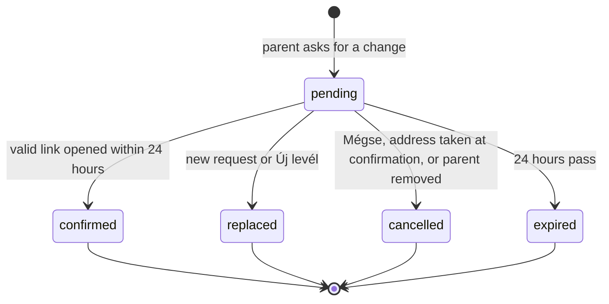
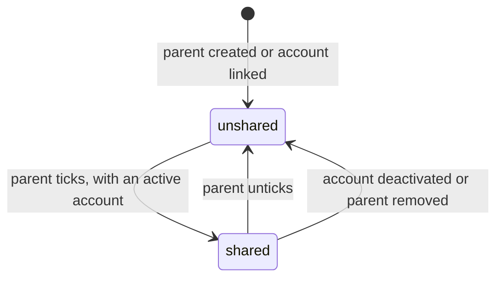
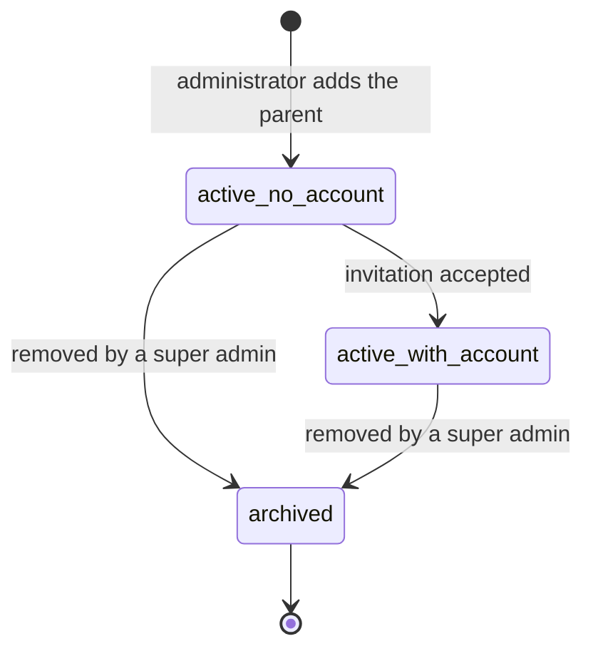
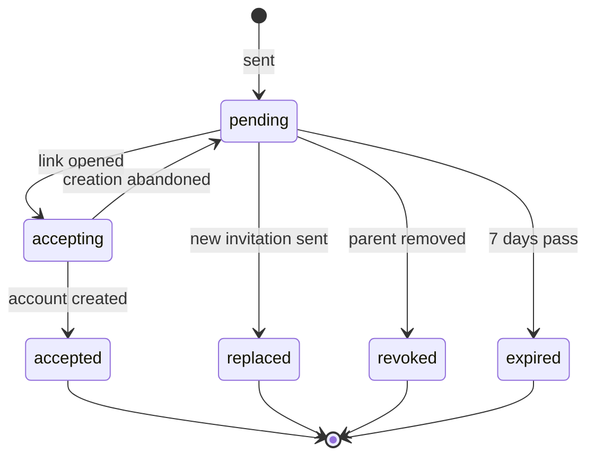
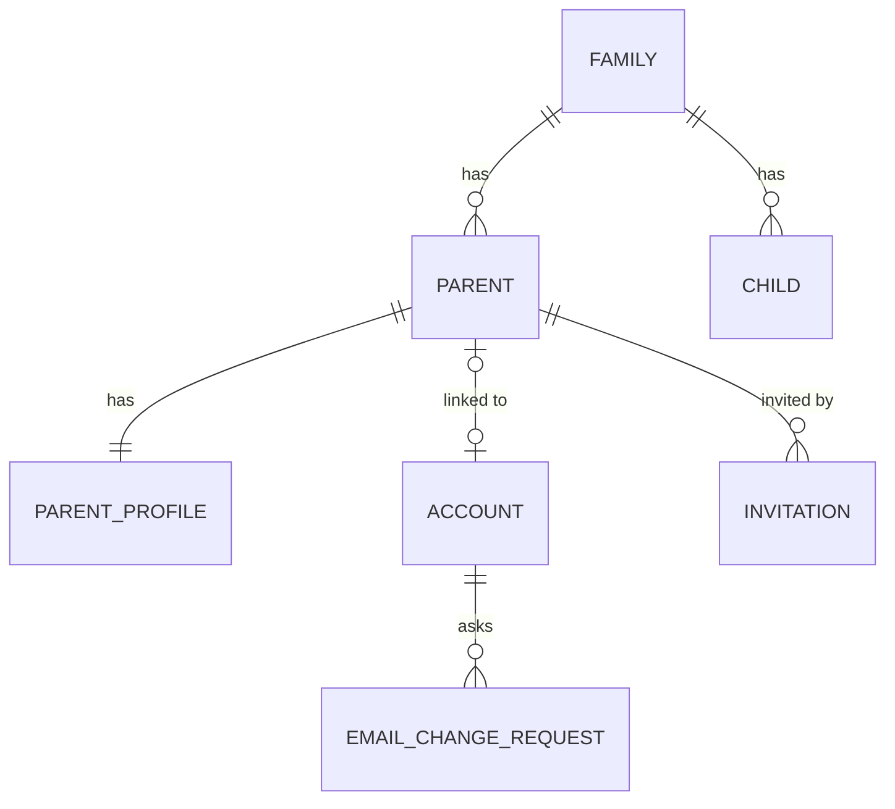

# Functional Specification: u3-directory-and-profile

This is the source of truth for U3's workflows and state transitions. The data shape is in `entities.md` and the decision logic in `rules.md`; the diagram and rules summary below are derived from them. Built from `unit-of-work.md` (U3), `unit-of-work-story-map.md`, `stories.md`, `requirements.md` (FR3), `components.md` (Identity, Community, WebApplication), `contract-summary.md` (C1, C2, C6, C16, C17), the screen designs in `mockups.md` (Directory, My account, Directory management) and the owner's answers in `functional-design-questions.md`. Contains no names or contact details.

## Scope

U3 implements these stories from `stories.md`: US3.1, US3.2, US3.3, US3.4, US3.5, US3.6 (shared with U14) and US3.7.

- **In:** the directory and its field-level visibility (ADR-008); the sharing tick box and its audit record; a parent's own details; password and email change; adding families and parents; removing a parent's directory record; invitations; the U3 parts of the removal contract (C16) and the one-off load (C17).
- **Out:** flagging a removed family's or parent's duties, books and claimed tasks, and showing their history as "korábbi tag" across every kind of record (AC3.6.2, AC3.6.5 to AC3.6.7, U14). Members of a working group are read through U4's list, which applies the same rules.

## Who Sees What

The matrix BR30 enforces. "Shared" means the shown parent's sharing box is ticked and the parent has an active, linked account (BR31.5); "Not shared" covers an unticked box, no account, and a deactivated account.

| Viewer | Shown parent | Name | Phone and email | Residence, occupation, hobby, how I support | Children |
|---|---|---|---|---|---|
| Parent or coordinator | Shared | Yes | Yes | Yes, where filled | Only if every parent of the family shared |
| Parent or coordinator | Not shared, or no account | Yes | No | No | Only if every parent of the family shared |
| Parent | Themself | Yes | Yes | Yes | Yes (own family) |
| Parent | The other parent of their own family | Follows the two rows above | | | Yes (own family) |
| Teacher | Shared | Yes | Yes | Yes, where filled | Only if every parent of the family shared |
| Teacher | Not shared, or no account | Yes | Yes | No | Only if every parent of the family shared |
| Super admin | Anyone | Yes | Yes | Yes | Yes |

A field marked "No" is absent from what the database returns, so it can never reach the page (ADR-008).

## Workflows

### W1 Browse the directory (US3.1, US3.5)

1. A signed-in user opens "Szülők" (`/szulo/szulok`; teachers reach the same list from their own menu).
2. The screen asks the directory list function for the cards. The function checks the caller (BR30.1) and builds one card per active family (BR30.8).
3. For each parent on a card it adds only the fields BR30.2 to BR30.7 allow for this viewer, and the email from BR30.6.
4. It adds the children only under BR30.4, and no children section for a family without children.
5. The screen shows the cards, parents of one family together (FR3.9). Long names wrap.
6. Typing in the search box filters the cards already received (BR30.9). No results shows "Nincs találat" with a reset link. An empty community shows "Még nincs szülő a névsorban."

Unhappy paths: a signed-out visitor is sent to sign-in; a request that bypasses the screen gets the same filtered result or the denied refusal, never a hidden field (AC3.1.5).

### W2 Tick or untick sharing (US3.2)

1. The parent opens "Fiókom" (`/szulo/fiokom`), panel "Láthatóság". It shows the current choice and explains exactly what others will see with and without the tick.
2. The parent changes the tick box and saves.
3. The function checks the caller is this parent (BR31.2) and has an active account (BR31.5), and checks the version (BR31.3).
4. It stores the new value with the time and writes `profile.sharing_changed` (BR31.3). Unticking keeps the other fields (BR31.4).
5. The panel shows the new state. Another parent's next directory load reflects it (NFR2).

Unhappy paths: an outdated page is refused and the panel says so and reloads the current value; a repeated click returns the first result.

### W3 Edit own details (US3.3)

1. In "Fiókom", panel "Adataim", the parent edits phone, place of residence, occupation, hobby and how they support the community.
2. On save the function checks the caller (BR32.1), every field (BR32.2) and the version (BR32.3), then stores the values.
3. The panel confirms the save.

Unhappy paths: an invalid field is named next to it and everything typed is kept (AC3.3.2); an outdated page is refused, the parent is told, and nothing is overwritten (AC3.3.3).

### W4 Change the password (US3.4)

1. In panel "Bejelentkezés", the parent enters the current password and a new one twice.
2. The sign-in service checks the current password; a wrong one counts towards the sign-in lockout (BR33.1).
3. The new password is checked against the app's rule and must differ from the current one (BR33.1).
4. The password changes, every other session of the account ends, this device stays signed in, and `account.password_changed` is written (BR33.2).

Unhappy paths: a wrong current password or an invalid new one is named; the password does not change.

### W5 Change the sign-in email (US3.4)

1. In panel "Bejelentkezés", the parent enters the new address and the current password.
2. The sign-in service checks the password (BR34.1). The function checks the address (BR34.1, BR34.2), replaces any pending request, and makes a new pending request valid for 24 hours (BR34.3). It writes `account.email_change_requested`.
3. An email with the confirmation link goes to the new address only (BR37.5).
4. The panel shows "Megerősítésre vár: [új cím]. A régi cím marad érvényes, amíg meg nem erősíted", with "Mégse" (cancel the request) and "Új levél" (send a new link, replacing the old one).
5. Until confirmation the old address signs in and is the one shown in the directory (BR34.5, BR30.6).
6. The parent opens the link. The confirmation page checks the token (BR34.4) and, in one transaction, rechecks the address and changes the sign-in email, the account email and the email on record (BR34.6).
7. The page says the change succeeded. The old address gets an email saying the address was changed (BR34.6).

Unhappy paths: an address that belongs to anyone else gets one fixed refusal that names nobody (AC3.4.4); a used, replaced, cancelled or expired link shows that it is no longer valid, with a route back to "Fiókom"; if the address was taken between request and confirmation, the request is cancelled and the same fixed refusal is shown.

### W6 Add a family and its parents (US3.6)

1. A super admin opens the records screen (`/admin/nyilvantartasok`) and chooses a new family.
2. They enter the family name, one or more parents with full name, email and optionally phone, and any children.
3. The function checks the caller (BR35.1), the fields (BR35.2) and that each email is free (BR35.3), stores the records with sharing off (BR31.1), and writes `family.added` and `parent.added`.
4. The family appears in the directory at the next load (AC3.6.1). Each parent's page offers "Meghívó küldése".

Adding a parent to an existing family follows steps 2 to 4 for one parent. Editing follows BR35.4.

Unhappy paths: a parent, teacher or coordinator is refused (AC3.6.3); invalid or taken fields are named.

### W7 Remove a parent (US3.6)

1. On a parent's page the super admin chooses removal. A confirmation page names the parent and what will happen: sign-in ends, details are cleared, and in history they will show as "korábbi tag".
2. On confirm, the function checks the caller and version (BR36.1) and that the parent is not the family's only active parent (BR36.2).
3. It locks the family row, then archives the parent, ends the sign-in through U1's step, drops the sharing choice, clears the contact and profile details, revokes open invitations and cancels a pending email change, and writes `parent.removed` (BR36.3).
4. The parent leaves the directory (BR30.8). The family's children are shown again only under BR30.4, now judged on the remaining parents.

Unhappy paths: the only parent is refused with the reason to remove the family instead (owner answer Q5).

Removing a whole family keeps today's archive action. Flagging its future duties (AC3.6.2) comes with U14.

### W8 Invite a parent (US3.7)

1. On the page of a parent without an account, the super admin chooses "Meghívó küldése" (or "Új meghívó" when one was sent before).
2. The function checks the caller and that the parent has no account (BR37.1), replaces any open invitation, and sends an email with a single-use link valid for 7 days to the email on record.
3. The parent page shows the invitation state (BR37.4).
4. The parent opens the link and creates their account on today's acceptance page; the account is linked with sharing off (BR37.3).

Unhappy paths: a used, replaced or expired link shows "Ez a meghívó már nem érvényes. Kérj újat az adminisztrátortól." (BR37.2).

### W9 Removal and load steps for later units

- **Removal (C16):** U3 provides the directory's preview and apply steps for a parent or a family (BR36.4). W7 calls them today for one parent; U14 later calls them for every block in the agreed order, with U3 next to last and U1 last.
- **One-off load (C17):** U3 provides the family load step for the migration script (BR38.1).

## State Transitions

### EmailChangeRequest

Text fallback: a request starts pending. It becomes confirmed when its link is opened in time, replaced when a newer request is made, cancelled by the parent, by a failed recheck or by removal, and expired once 24 hours pass. Expired is read from the time; it is not stored.

### Sharing choice (ParentProfile.sharingConsent)

Text fallback: every parent starts unshared. Only the parent can move to shared, and only with an active account. Unticking, losing the account or being removed returns to unshared. Unticking keeps the details; removal clears them.

### Parent

Text fallback: a parent added by an administrator has no account until an invitation is accepted. Either kind of active parent can be removed, except a family's only active parent. A removed parent is archived and has no sign-in.

### Invitation

Text fallback: unchanged from today, with one addition: removing a parent revokes their open invitation. Expiry is read from the time.

## Concurrency and Repeats

- Every database command takes the C1 idempotency key; a repeated key returns the stored result (NFR5). Two steps are outside that template: the password change runs through the sign-in service, where a repeated submit fails because the old password is no longer current (BR33.1); and the email confirmation is a server-only step keyed by its single-use token (BR34.6).
- Commands on an existing record take the expected version; an outdated one gets `VERSION_CONFLICT`.
- Removal locks the family row first, as C1 and C16 require. A parent saving their details while being removed gets `VERSION_CONFLICT` or, once removed, the denied refusal.
- Two requests for an email change at once leave exactly one pending request. Two confirmations of the same link change the email once; the second sees a request that is no longer pending.
- Two administrators adding parents with the same email at once: one succeeds, the other gets `EMAIL_UNAVAILABLE`.

## Entity Relationships (derived from `entities.md`)

Text fallback: a family has parents and children. Each parent has one profile and may be linked to one account. An account may have several email-change requests over time, at most one pending. A parent may have several invitations over time, at most one open.

## Rules Summary (derived from `rules.md`)

| Group | Rules | In short |
|---|---|---|
| Directory reads | BR30.1 to BR30.9 | Field-level visibility per viewer, decided in the database |
| Sharing choice | BR31.1 to BR31.5 | Off by default, the parent's own, recorded, unticking only hides |
| Own details | BR32.1 to BR32.3 | Five fields, field errors named, outdated page refused |
| Password | BR33.1 to BR33.2 | Current password needed, other devices signed out |
| Email change | BR34.1 to BR34.6 | Password, one pending change, 24-hour link, old address told |
| Adding records | BR35.1 to BR35.4 | Super admin only, unique email |
| Removing a parent | BR36.1 to BR36.4 | Not the only parent; sign-in and details cleared |
| Invitations | BR37.1 to BR37.5 | 7-day single-use link, state on the parent page |
| One-off load | BR38.1 | Repeat-safe family load for the migration |

## Existing Code That Changes

U3 replaces the old free-text profile, its consent flag and the separate contact email. Database changes are forward-only, so applied migration files are never edited: each live function below is redefined in U3's new migration, in the same change that alters the tables. The old import, which also wrote these fields, was already removed by U1 and needs nothing.

| Where today | What it does with the old fields | What U3 does |
|---|---|---|
| Database: the records save function (latest definition in the U1 migration) | Writes the profile text, consent flag and contact record | Redefined: writes ParentProfile under BR35.2 to BR35.4; no consent or profile fields |
| Database: the contact read helper and the contact table's read rule | Lets the family and administrators in reach read contacts | Replaced: contacts are read only through the directory functions (BR30); the table's direct read rule allows super admins and the parent themself |
| Database: the profile-text read helper | Returns the free text with consent | Dropped, with the column |
| Database: the parents table's column rights | Hides the profile-text column | Updated for the removed columns |
| Database: the lifecycle anonymisation step (latest in the U1 migration) | Deletes contacts and empties profile text and consent | Redefined: clears ParentProfile as BR36.3 does |
| Database: Identity's account-status step | Deactivates or reactivates an account | Extended: deactivation sets sharingConsent to false (BR31.5) |
| App: the admin records data adapter, payload builders, contracts, field projection and record form | Read and send `optionalProfile`, `optionalProfileConsent`, `contactEmail`, `locality` | Updated: send name, email on record (before an account), phone and children only; show residence and profile fields read-only; show invitation state |
| Seed data and its writer | Fill the old fields with invented values | Updated to the new fields, still invented |

Tests that read or write the old fields change in the same pull request: the database tests for directory schema and functions, lifecycle, seed, community roles and structure, identity, data adapters and schedule; the admin port and teacher port tests; the admin forms integration test; the record payload unit test; and the directory browser spec. The lifecycle erasure and admin records tests gain cases for the new fields.

## Screens

New or changed screens are designed in Stitch first and compared with the design in the owner's screenshot review (`team.md`).

| Screen | Path | Change |
|---|---|---|
| Directory | `/szulo/szulok`, and the teacher's equivalent | New |
| My account | `/szulo/fiokom` | New: Adataim, Láthatóság, Bejelentkezés |
| Email confirmation | A new link page | New: success, or no longer valid |
| Records (families, parents, children) | `/admin/nyilvantartasok` | Changed: profile text and consent removed; invitation state and removal confirmation added |
| Invitation acceptance | `/meghivas/[token]` | Unchanged, apart from the invalid-link text |

Every user-facing text is Hungarian (NFR8).

## Testing Notes

Each database rule gets the fixed test list: allowed, refused, out of reach, outdated screen, repeated click, two people at once (NFR6). For the read rules (BR30), "outdated screen" and "repeated click" have no meaning; the test plan records that, and instead each row of the "Who sees what" matrix gets its own test, run as the real database roles (`team.md`), including a parent who ticked and whose account was then deactivated (BR31.5). The password change (BR33) runs through the sign-in service: its tests cover allowed, refused (wrong current password, invalid new one) and repeated submit; "outdated screen" and "two people at once" have no meaning there, and the test plan records why. The email confirmation tests also check that the guard still refuses every other route that changes a sign-in email (BR34.6). Directory reads are checked for 20 invented families against the 2-second list target (NFR9).
