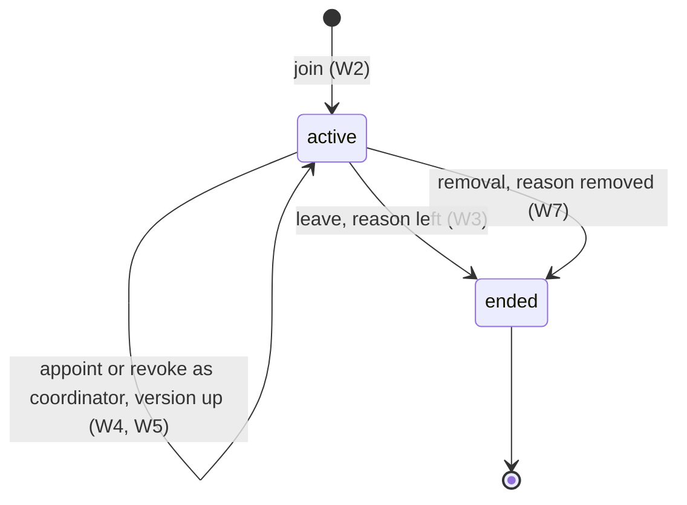
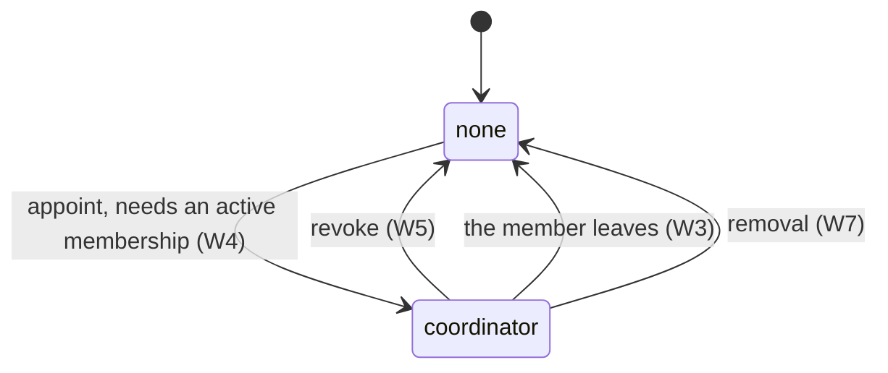
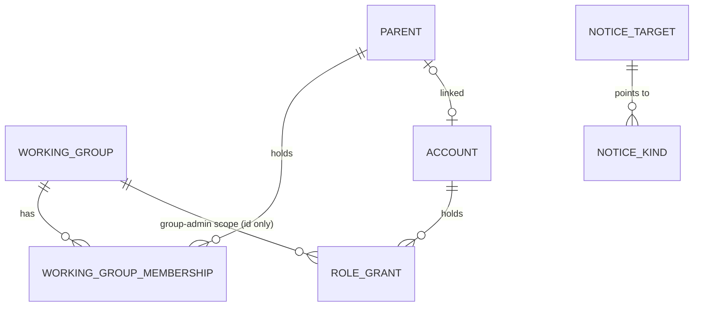

# Functional Specification: u4-working-groups

This is the source of truth for U4's workflows and state transitions. The data shape is in `entities.md` and the decision logic in `rules.md`; the diagram and rules summary below are derived from them. Built from `unit-of-work.md` (U4), `unit-of-work-story-map.md`, `stories.md`, `requirements.md` (FR2.1, FR2.2, FR2.4), `components.md` (WorkingGroups, Identity, WebApplication), `contract-summary.md` (C1, C2, C7, C8, C16), ADR-008 and ADR-010, the screen designs in `mockups.md` (Working groups, Directory management), the U1, U3 and U5 designs this unit builds on, and the owner's answers in `functional-design-questions.md`. Contains no names or contact details.

## Scope

U4 implements these stories from `stories.md`: US2.1, US2.2 and US2.3.

- **In:** joining and leaving a working group; a group's page with its member list under the directory rules; the no-coordinator notice; a super admin appointing and revoking coordinators; the notice and email to the person; closing the old direct way of granting the group-admin right; the C7 facts functions; U4's block of the removal contract (C16).
- **Out:** the coordinator's management page and the "Csoportom" menu entry (US2.4, U12); the group's events and to-do tasks on its page, which U10 and U12 add as sections; what happens when the removed person is a group's only coordinator beyond the no-coordinator notice (open question of C16, U14); new groups for a new school year.

## Who Sees What on a Group's Page

The matrix BR42.2 enforces. "Shared" is U3's definition: the box is ticked and the parent has an active, linked account.

| Viewer | Member | Name | Phone and email | Coordinator label | Anything else of the profile, children |
|---|---|---|---|---|---|
| Parent or coordinator | Shared | Yes | Yes | Yes | No (on the directory card) |
| Parent or coordinator | Not shared, or no account | Yes | No | Yes | No |
| Parent | Themself | Yes | Yes | Yes | No |
| Teacher | Anyone | Yes | Yes | Yes | No |
| Super admin | Anyone | Yes | Yes | Yes | No |

The name links to the person's card in the directory, where U3's rules decide the rest (Q1). A field marked "No" is absent from what the database returns (ADR-008).

## Workflows

### W1 Open a group (US2.2, AC2.1.6)

1. A signed-in user opens "Munkacsoportok" and picks a card. Parents go to `/szulo/munkacsoportok/[id]`, teachers to `/teacher/munkacsoportok/[id]`, super admins to `/admin/munkacsoportok/[id]`.
2. The screen asks the group detail function for the page. The function checks the caller and the group (BR42.1).
3. It builds the member list row by row under BR42.2 and works out whether the group has a coordinator (BR42.3).
4. The screen shows the name, description and school year, then the no-coordinator notice when it applies, then the members with the "Koordinátor" label on coordinators.
5. It shows Csatlakozom or Kilépek for a parent (BR42.4), and the coordinator actions for a super admin (BR42.5). A teacher sees no button.
6. An empty member list shows "Még nincs tagja ennek a csoportnak."

Unhappy paths: a signed-out visitor is sent to sign-in; an archived, missing or other-community group shows "Ez a munkacsoport nem érhető el." with a link back to the list; any other refusal shows the existing error state.

### W2 Join a group (US2.1: AC2.1.1 to AC2.1.3)

1. On a group's page a parent who is not a member presses Csatlakozom. The screen sends the join command with a fresh idempotency key and the group's id.
2. The function checks the caller and the group (BR40.1).
3. It creates the active membership. If one already exists, it returns success with ALREADY_MEMBER (BR40.3).
4. The page reloads with the parent in the list and Kilépek in place of Csatlakozom. Their other groups are unchanged (BR40.2).

Unhappy paths: a double click repeats the same key and gets the stored result; the group was archived meanwhile, so GROUP_UNAVAILABLE is shown.

### W3 Leave a group (US2.1: AC2.1.4, AC2.1.5)

1. A member presses Kilépek. If they coordinate the group, a confirmation says their right ends; pressing Mégse stops here.
2. The screen sends the leave command with a fresh key, the membership id and its version.
3. The function locks the membership and checks it (BR40.4).
4. If the caller coordinates the group, Identity revokes the grant and audits it with the reason left_group (BR40.5).
5. The membership ends with reason left. The page reloads without the parent; the parent's past claims and sign-ups are unchanged.

Unhappy paths: they had already left in another tab, so NOT_A_MEMBER is shown; the page was stale, so VERSION_CONFLICT is shown and the page offers a reload.

### W4 Appoint a coordinator (US2.3: AC2.3.1 to AC2.3.3)

1. A super admin opens the group's admin page and presses "Koordinátorrá teszem" on a member row. The page notes that only members can be coordinators (BR42.5).
2. The screen sends the appoint command with a fresh key, the membership id and its version.
3. The function checks the caller (BR41.1), then locks the membership and checks it is active in this group (BR41.2).
4. It checks the member is not already a coordinator (BR41.4) and the version (BR41.3).
5. Identity adds the grant and audits it; the membership's version goes up.
6. The person gets the "Koordinátor lettél:" notice and its email, with the once key coordinator_appointed:<grant id> (BR41.6).
7. The page reloads with the label on the member. Any earlier coordinators keep theirs.

Unhappy paths: the member left meanwhile, so NOT_A_MEMBER is shown with the advice to ask them to join; their account is inactive, so ACCOUNT_REQUIRED is shown; another admin appointed them first, so ALREADY_COORDINATOR is shown; the group was archived meanwhile, so GROUP_UNAVAILABLE is shown.

### W5 Revoke a coordinator (US2.3: AC2.3.4)

1. On the group's admin page a super admin presses "Visszavonom a jogot" on a coordinator's row.
2. The screen sends the revoke command with a fresh key, the membership id and its version.
3. The function checks the caller, locks the membership and checks the grant and the version (BR41.5).
4. Identity revokes the grant and audits it; the membership's version goes up; the member stays in the group.
5. The person gets the "Megszűnt a koordinátori jogod:" notice and its email, with the once key coordinator_revoked:<grant id> (BR41.6).
6. Their next request as an administrator of that group is refused.

Unhappy paths: they had left meanwhile, so NOT_A_MEMBER is shown; another admin revoked first, so NOT_COORDINATOR is shown; the row changed otherwise, so VERSION_CONFLICT is shown.

### W6 Old direct grant path (Q3)

A direct request to the general role-change function naming the group-admin role is refused with GRANT_USE_COORDINATOR_ACTION before any change (BR41.7). No screen reaches it. The database tests that set up group admins through it move to a fixture insert in the same change.

### W7 Removal of a parent or family (C16, called by U14)

1. U14 calls the working-groups preview inside its removal transaction and shows the counts (BR44.1).
2. On apply, U4's block runs before U3's directory block, which clears the account link. It locks the subject's active memberships by ascending id, ends each with reason removed, and ends the grant on the same group through Identity only where one exists (BR44.2).
3. No notice is sent. A group left with no coordinator shows the notice of W1 from the next request.

### W8 Family deletion or anonymisation (existing lifecycle step)

When the family-lifecycle step deletes or anonymises a family, it now ends every unrevoked group-admin grant of the family's parents with reason removed before it deletes their memberships and clears their account links (BR41.8). No notice is sent.

## State Machines

### Membership

<!-- Text fallback: a membership is created active by joining. While active, appointing or revoking its parent as coordinator only raises its version. It ends either by the parent leaving (reason left) or by removal (reason removed). An ended membership never becomes active again; joining again creates a new membership. -->

### Coordinator right on one group

<!-- Text fallback: a member starts with no coordinator right. A super admin's appointment, which needs an active membership, makes them coordinator. The right ends by revocation, by the member leaving, or by removal. Each ending revokes the group-admin grant and is audited. -->

## Concurrency and Repeats

| Situation | Outcome | Rule |
|---|---|---|
| Same click sent twice | The stored result is returned | C1, BR40.3 |
| Two joins at once by one parent, different keys | One membership; the second answers ALREADY_MEMBER | BR40.3 |
| Two parents join at once | Both become members | BR40.2 |
| Appoint and leave at once | The membership row lock orders them. Appoint first: the leave, sent with the old version, gets VERSION_CONFLICT and the reload shows the coordinator warning. Leave first: the appoint gets NOT_A_MEMBER | BR40.4, BR41.2, BR41.8 |
| Two admins appoint the same member at once | The second gets ALREADY_COORDINATOR, which is checked before the version | BR41.3, BR41.4 |
| Revoke and leave at once | Revoke first: the leave gets VERSION_CONFLICT. Leave first: the revoke gets NOT_A_MEMBER | BR40.4, BR41.5 |
| Two admins revoke the same coordinator at once | The second gets NOT_COORDINATOR | BR41.5 |
| Join and removal of the same parent at once | Join locks the family and parent rows for share, so it waits for the removal and is then refused, or finishes first and the removal ends the new membership | BR40.1, BR44.2 |

Join locks the caller's family row, then parent row, for share. Leave, appoint and revoke lock one membership row and then, through Identity, that parent's grant. Removal locks the subject's memberships by ascending id after the family, account and parent locks U14 holds, and runs before U3's directory block. No other unit's block locks membership rows (C16), so no C1 lock step is added.

## Entity Relationships (derived from `entities.md`)

<!-- Text fallback: a working group has many memberships, and a parent holds many memberships, one active per group. A role grant belongs to an account and, for the group-admin role, names a working group by id only. A parent may be linked to an account. U5's notice target registry gains working_group, which the two coordinator notice kinds point to. -->

## Rules Summary (derived from `rules.md`)

| Rules | In short |
|---|---|
| BR40.1 to BR40.6 | Parents join and leave themselves; one membership per group; leaving ends a coordinator's right and is audited; leaving an archived group is allowed |
| BR41.1 to BR41.8 | Only super admins appoint and revoke; only members; several allowed; revocation applies at the next request; notice and email with the kind in the once key; the old path is closed; no grant without a membership, including after family deletion |
| BR42.1 to BR42.5 | Every signed-in role reads the page; phone and email only where the directory allows; the no-coordinator notice; buttons by role |
| BR43.1 | `group_members` and `group_coordinators` for other units |
| BR44.1, BR44.2 | Removal preview and apply |

## Functions (names proposed; C7 and C16 fix what crosses the boundary)

| Function | Kind | Purpose |
|---|---|---|
| `working_group_detail(group_id)` | signed-in read | W1; the member list function C7 names for screens |
| `working_group_join(key, group_id)` | signed-in command | W2 |
| `working_group_leave(key, membership_id, version)` | signed-in command | W3 |
| `coordinator_appoint(key, membership_id, version)` | signed-in command | W4 |
| `coordinator_revoke(key, membership_id, version)` | signed-in command | W5 |
| `group_members(group_id)`, `group_coordinators(group_id)` | internal | C7 |
| `working_groups_removal_preview`, `working_groups_removal_apply` | internal | C16 |
| two contact helpers ("counts as shared", "email shown") | internal | BR42.2; U3's `directory_list` moves onto them |

Every command returns the C1 envelope. U1's `grant_admin` stays as it is; `end_admin` gains an optional audit reason (BR40.5); the general role-change function gains the BR41.7 refusal; `lifecycle_run_core` ends grants before deleting memberships (BR41.8).

## Screens

New screens are designed in Stitch first and compared with that design in the owner's screenshot review.

- **Group page** for parents and teachers: name, description, school year, the no-coordinator notice, the member list, and Csatlakozom or Kilépek for a parent. Later units add their sections below the members.
- **Group admin page** for super admins: the same, with the coordinator actions on each row and the note that coordinators must be members.
- The existing list pages link each card to its group page. CSS classes keep the area prefixes `parent-`, `teacher-` and `admin-`.
- The three group routes are added to the navigation, `role-policy.ts`, `authorization.ts` and `verification/authorization-matrix.json` together (BR42.5).
