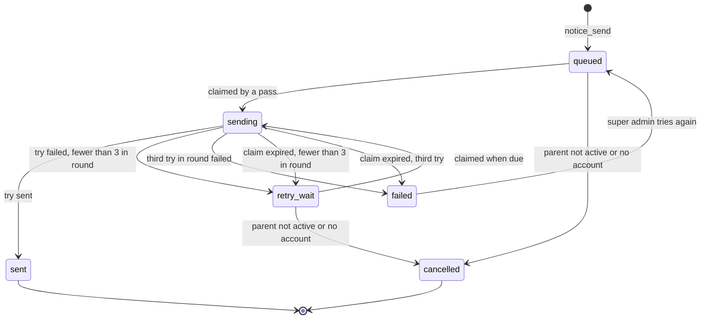
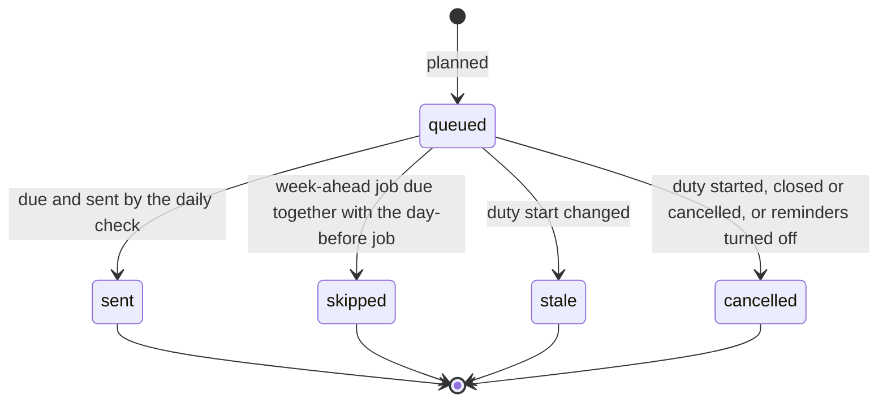
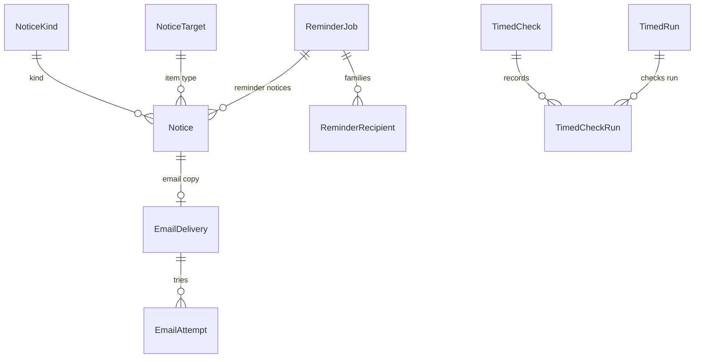

# Functional Specification: u5-reminders-and-email

The behaviour of reminders by notice and email, and of the daily run. This piece of work implements the story about reminders by email and in the app (US17.1 in `stories.md`). It builds on:

- the unit definition in `unit-of-work.md` (U5) and the story map in `unit-of-work-story-map.md`
- `requirements.md` (FR17, NFR1, NFR3, NFR5, NFR10)
- the Notifications and TimedChecks components in `components.md`
- the contracts for sending a notice (C8), the daily run (C9) and removal (C16) in `contract-summary.md`
- ADR-006 and ADR-007
- the owner's answers in `functional-design-questions.md` (Q1 to Q6)

The data shape is in `entities.md` and the rules are in `rules.md`; both are the source of truth for what they hold. Contains no names or contact details.

## Scope

- **In:** the notice-sending function every later unit uses (C8), with real email through the existing mail adapter checked against the local test mailbox. Also in: tries and failures, the daily run with its registry and records (C9), and the local command that triggers it. The week-ahead and day-before duty reminders move onto the daily run (Q1). Today's reminders screen becomes the super admin's delivery-problems screen (Q5). Also in: U5's removal step (C16).
- **Out:** each feature's own "what is due" check and its own notice kinds and item types. They are added by U6 to U13 through the registries, without editing U5's functions. Moving today's directly written notices (sign-up confirmed, swaps, rota published) onto notice_send is for U6 and U7. A real mail service and a real schedule are for the hosting work.
- **Story split.** US17.1 is shared with U9, U10, U12 and U13. U5 delivers the mechanism and every criterion that needs no feature record. Each of those units shows AC17.1.1 and AC17.1.6 for its own kind of item.

## Workflows

### W1 A feature sends a notice (C8)

1. A feature function calls notice_send with the parent ids, a kind, a target type, the item id and a once key, inside its own transaction.
2. notice_send checks that the kind and the target type are registered and that the list and id are not empty; otherwise it refuses and the caller's transaction rolls back (BR50.3).
3. For each parent, ascending by id: skip the parent if they are not active, have no account or belong to another community (BR50.1). Skip the parent if a notice with this once key already exists for them (BR50.2).
4. Create the notice and one queued email delivery due at once (BR50.6).
5. Return the number of notices created. Nothing contacts the mail server here (BR50.7).

### W2 The daily run (C9)

1. The hosting schedule, or locally the owner, runs the timed command with `daily` or `friday_noon` (BR52.4, BR52.6).
2. The command calls `timed_checks_run_system(run_kind)` with the server's service access; any other caller is denied (BR52.1).
3. The run records a TimedRun and fixes its moment (BR52.3).
4. For each active TimedCheck of that run kind, in `lock_step` order, then check-name order (BR52.2):
   - call its function with the moment, on its own;
   - record success with the created and skipped counts, or failed with the error code, or missing when the function does not exist;
   - go on with the next check.
5. The run records its finish time and returns the counts per check.
6. The command then runs one delivery pass (W3) and prints counts only: no address, name or item.

U5 registers one check of its own, the duty reminders (W4), with run kind `daily`. The run is complete and works with only that check (C9 provider).

### W3 A delivery pass

1. The hosting schedule runs the command with `deliver` every 15 minutes. The command also runs a pass after each run, and locally the owner runs it on request (BR52.6).
2. Tries that were claimed more than 10 minutes ago and never recorded are recorded as failed with `claim_expired` (BR51.4).
3. The pass claims up to 50 due emails (BR51.1). For each one the claim returns:
   - the round and try number;
   - the parent's current sign-in email (BR51.2);
   - the notice title;
   - the item name, its date and its page path (BR50.4).

   A parent who is no longer active, or has no account, is cancelled at the claim and returns no address.
4. The application builds the email (BR55.1, BR55.2) and sends it through the existing mail adapter to one address (ADR-007).
5. The application records the outcome: sent, or failed with `mail_unavailable` or `mail_rejected` (BR51.3, BR51.5). The mail server's reply text is never passed on.
6. The pass prints the counts sent, failed, waiting and cancelled.

### W4 Duty reminders (U5's daily check)

1. Planning is unchanged (BR53.1). It runs when a duty is saved, a place changes, a family is archived or the setting changes. The only difference is that a job now has a due date instead of a due moment (BR53.2).
2. At the daily run, the check takes the queued jobs due on or before today, locked by ascending id (BR53.3).
3. A job whose duty has started, closed or been cancelled is cancelled. A job whose duty's start moved is stale.
4. If both jobs of one duty are due, the week-ahead job is skipped (BR53.4).
5. Each remaining job is sent through notice_send to every parent of its active recipient families. The once key is the job and the parent. The job becomes sent.
6. The check returns jobs sent as created, and cancelled, stale or skipped as skipped.

### W5 A parent reads notices

1. The parent opens "Értesítések". No reminder runs on opening (BR53.5).
2. The list shows the parent's own notices, newest first, each with its title, link, read state and time (BR50.4, BR50.5). The duty-reminder notices keep today's "stale" and "cancelled" marks. The simulated delivery label is removed, because delivery is real now.
3. Opening a notice marks it read once and follows its link (BR50.5).

### W6 A super admin sees and retries failures

1. A super admin opens the delivery-problems screen. It is today's "Emlékeztetők" address with a new title, "Kézbesítési hibák" (BR54.1). The screen is designed in Stitch before it is built (`team.md`).
2. The first list shows failed email groups (BR54.2):
   - the notice title;
   - when the group was last tried;
   - "N címzett";
   - an "Újrapróbálás" button.
3. The second list shows failed or missing checks from the last 30 days: check name, run kind, time and error code.
4. Pressing "Újrapróbálás" starts a new round for the group (BR54.3). A stale screen gets the invalidated result and reloads. A second admin acting at the same time gets the conflict result (BR54.4).
5. An empty screen says that there are no delivery problems.

### W7 Removal step for U14 (C16)

`notifications_removal_preview` and `notifications_removal_apply`, with the subject kind and id, count and then delete a parent's notices, emails and tries. For a family they do this for every parent of the family and mark the family's reminder recipients removed (BR56.1). They run inside U14's transaction in the C16 order, after U9 and before U4.

### W8 How a later unit plugs in

A unit that needs notices adds the following in its own migration:

- its NoticeKind rows, each with a Hungarian prefix;
- if it has a new kind of item, a NoticeTarget row and a facts function that returns the item's name, date and page path and names no other person or family (BR50.4, BR55.2);
- if something is timed, its check function and a TimedCheck row (C9).

It calls notice_send from its own functions. It edits none of U5's functions.

## State Transitions

### EmailDelivery

<!-- Text fallback: a new email delivery is queued. A delivery pass claims it and it becomes sending. A sent try makes it sent. A failed or expired try makes it retry_wait while fewer than 3 tries were made in the round, and failed after the third. A retry_wait delivery is claimed again when due. A queued or waiting delivery whose parent is no longer active or has no account is cancelled at the claim. A super admin's try again turns a failed delivery back into queued with a new round. Sent and cancelled are final. -->

The cancellation of a parent who is no longer active happens at the claim, so a delivery is never in sending for such a parent.

### ReminderJob

<!-- Text fallback: a planned job is queued. The daily check sends it when it is due, or skips the week-ahead job when both jobs of the duty are due together. A changed duty start makes it stale; a started, closed or cancelled duty, or reminders turned off, cancels it. All four ends are final; a re-plan creates a new job. -->

### TimedCheckRun

A check record is written once, with its outcome success, failed or missing, and is never changed.

## Concurrency and Repeats

- **Two delivery passes at once:** each claims different rows; no email is taken twice (BR51.1).
- **A pass stops mid-way:** its claimed tries count as failed after 10 minutes and are retried (BR51.4).
- **Two runs on the same day, or overlapping:** once keys stop duplicates (BR50.2, BR52.5). The duty-reminder check locks its jobs by ascending id, so two overlapping checks send each job once.
- **Repeated outcome record:** ignored (BR51.5).
- **Repeated or simultaneous Try again:** the stored result for a repeated key; one new round for two admins (BR54.3, BR54.4).
- **A feature calls notice_send twice with the same key:** the second creates nothing (BR50.2).

## Entity Relationships (derived from `entities.md`)

<!-- Text fallback: each notice has one registered kind and one registered item type, and at most one email delivery, which has many tries. A reminder job has many recipient families and many reminder notices. A registered check has many run records, and each run has one record per check it ran. -->

## Rules Summary (derived from `rules.md`)

- **Notices (BR50):** recipients, once keys, registered kinds and item types, title and link from the item's facts, read once, every notice_send notice emailed, mail never undoes the caller.
- **Email delivery (BR51):** one claim per email, address looked up at send time and never stored, at most 3 tries 15 minutes apart, expired claims, repeat-safe recording, the notice always remains, service access only.
- **Daily run (BR52):** service access only, every check runs and failures are recorded, one moment in Budapest time, two run kinds, safe twice, a delivery pass every 15 minutes and after each run, no sign-in needed.
- **Duty reminders (BR53):** planned as today, due seven days and one day before the duty's day, sent once, the week-ahead one skipped when both are due, nothing sent on page open.
- **Failures for the administrator (BR54):** super admins only, grouped with no address or name, Try again gives a new round, one round for two admins.
- **Email content (BR55):** title, item, date, link and an automatic-email line; no other person or family; one recipient.
- **Removal (BR56):** notices, emails and recipients of a removed parent or family.

## Existing Code That Changes

| Area | Change |
|---|---|
| Notifications schema | Kind and target-type lists become registries. The simulated attempt table is dropped, and its jobs' simulated states become cancelled. `scheduled_for` becomes a due date. Email delivery, email attempt, check registry, run and run-record tables are added. |
| `reminder_run_jobs`, `reminder_run_due`, `reminder_run_due_system` | Removed. The duty-reminder check, `timed_checks_run_system`, and the claim and record functions replace them (BR53.5). |
| `reminder_plan` | Plans a due date instead of a due moment. Its recipient rules are unchanged. |
| `notification_list`, `notification_link` | Build the title and link from the registries and facts functions. The simulated delivery field is removed. |
| `reminder_list`, `reminder_retry` | Replaced by the super admin's delivery-problems list and Try again (BR54). |
| `src/data/notifications.ts` and its port | No longer call the member tick before reading. The reminders port becomes the delivery-problems port. |
| `app/admin/emlekeztetok` | Becomes "Kézbesítési hibák" for super admins only, from a Stitch design. |
| `src/runtime/navigation.ts`, `role-policy.ts`, `authorization.ts`, `verification/authorization-matrix.json` | The screen moves from group admins to super admins only, changed together (`team.md`). |
| `src/identity/mail.ts` | Gains a notice mailer beside the invitation and account mailers, using the same transport and sender. |
| `scripts/db/reset.ts`, the seed | Call the daily run in place of the system tick. |
| New timed command | `npm run timed:run -- daily`, `friday_noon` or `deliver`, under `scripts/`, using the server-only service access. |
| `contract-summary.md` | C8 records that the target type `duty` is stored as `task`, and that `rota_plan` exists. C9 records the optional moment of BR52.3 and the delivery pass. Both are additive, in the same pull request. |

## Screens

- **Értesítések (parent):** layout unchanged; the simulated-delivery label is removed. Existing browser checks keep their class names.
- **Kézbesítési hibák (super admin):** two lists and the "Újrapróbálás" button (W6). Classes use the `admin-` prefix. Designed in Stitch first, checked in the owner's screenshot review, usable at phone width and by keyboard.

## Testing Notes

- **Database rules:** every rule in `rules.md` gets the fixed list: allowed, refused, out of reach, outdated screen, repeated click, two people at once. Where a case has no meaning (for example "outdated screen" for the service-role claim), the test plan records why.
- **Clock:** the run's moment (BR52.3) lets tests run the daily check on chosen dates. The delivery tests drive the claim and record functions directly.
- **Email:** application tests use a fake transport to cover sent, unavailable and rejected. One integration check sends through the local test mailbox and reads the message there, to show that it holds the title, item, link and automatic line and no other family's details (AC17.1.1, AC17.1.4).
- **No sign-in:** a test runs the daily command with no session at all and finds the notice and the email (AC17.1.5).
- **Test data:** every test address is invented and added to `scripts/verification/privacy-allowlist.json`.
