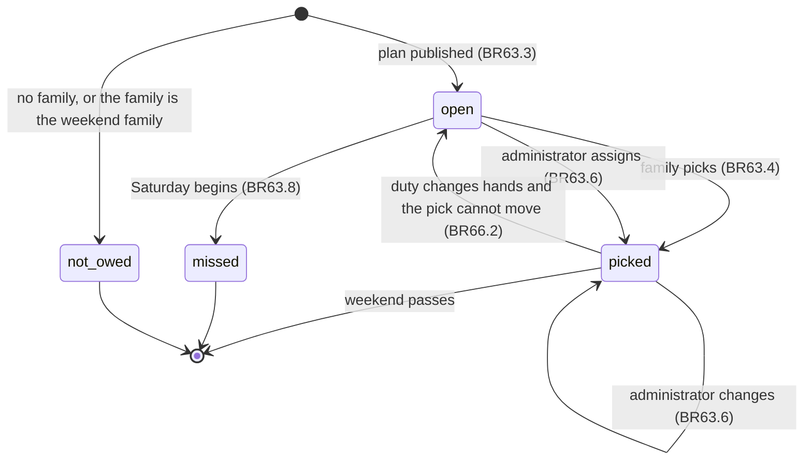
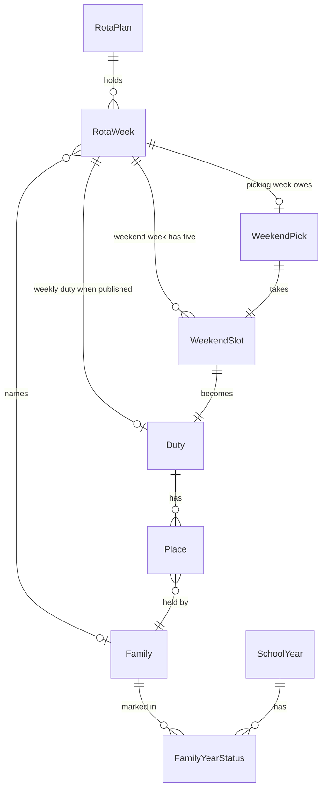

# Functional Specification: u6-full-rotas-and-weekend-picks

This unit (U6 in `unit-of-work.md`, mapped in `unit-of-work-story-map.md`) implements US4.2, US6.1 and US6.2 and completes US5.1 and US5.3 from `stories.md`, against FR4 to FR6, FR8.1 and FR17 in `requirements.md`, the components Community, RotaPlanning, Duties, TimedChecks and WebApplication in `components.md`, and contracts C8 and C9 (used) and C10, C11, C12, C16 and C20 (provided) in `contract-summary.md`. Decisions: ADR-002, ADR-004, ADR-006 and ADR-011 in `decisions.md`, and the owner's answers Q1 to Q5 in `functional-design-questions.md`. Contains no names or contact details.

## Scope

All four yearly rotas in one plan, the rule about leaving and new families, and the weekend duties that the week's families share.

| In this unit | Left to a later unit |
|---|---|
| Marking families as leaving or new, and the changeover rule wherever a duty is given (US4.2) | Reassigning a flagged duty (US5.4, U7) |
| Front garden, water carrying and weekend animal care in the draft, with the same-week rule and part-year shares (US5.1) | Swaps and changes to a published duty (U7) |
| Duty-card facts for front garden and water carrying (US5.3) | The information page the cards link to (U8); bottle cleaning (U9) |
| Five weekend duties, picks, changing a pick, the administrator's assignment (US6.1) | Moving a pick when a duty is swapped is called by U7; the function is delivered here |
| Wednesday reminder, Friday-noon alert, missing-picker notice, the Friday-before reminder of a rota week (US6.2, Q4) | Real scheduling of the daily run (hosting work) |
| The publishing notice through the notification function, so it is also emailed | |

## Times of a week

All times are Budapest time. For a week starting on Monday:

| Moment | Meaning |
|---|---|
| Friday before the Monday | The rota-week reminder is due from here until the week starts |
| Wednesday 00:00 | The pick reminder and the missing-picker notice are due from here |
| Friday 12:00 | A family can no longer change a pick; the administrators' alert is due from here |
| Saturday 00:00 | Picks close; an owed pick still open is missed |

## A picking week's pick

Text fallback: a published indoor-cleaning or front-garden week owes one pick unless it has no family or its family is also the weekend family. It is open until the family picks or an administrator assigns. A picked week can be changed by the family before Friday noon and by an administrator until Saturday. If a later duty change cannot keep the pick, the week is open again. An open week on Saturday is missed. None of these states is stored: each is read from the pick, the plan and the clock.

## Workflows

### W1. Mark a family as leaving or new (AC4.2.1 to AC4.2.3; BR60.1, BR60.5)

1. A super admin opens Tanév, `/admin/tanev`. Below the break weeks it lists the active families with their standing for the year: Marad, Távozik or Új.
2. The administrator changes one family's standing and saves. The request carries the standing's version; a stale one is refused and the list reloads.
3. The answer says how many duties are now flagged. The screen shows them in the warning list "Beosztások a váltónap rossz oldalán" with family, job and week. Nothing is taken from the family.
4. Setting the family back, or moving the changeover date, changes the list at the next read without any other step.
5. A parent, teacher or working-group admin is refused, also when the request bypasses the screen. A repeated click changes nothing twice.

### W2. The changeover rule in action (AC4.2.1, AC4.2.2; BR60.2 to BR60.4)

1. Wherever a family is about to receive a duty, the database asks whether it may hold a duty on that date.
2. A leaving family is refused from the changeover date on, a new family before it, with DUTY_INELIGIBLE and the reason. The screen says "A család távozik, a váltónap után nem kaphat feladatot" or "Az új család a váltónap előtt nem kaphat feladatot".
3. This holds for a draft week set by hand, publishing, an administrator's manual assignment, a parent's sign-up, and proposing or accepting a swap. The draft itself simply never offers such a family the week.
4. A rota week is judged by its Monday, so a family that may hold the Monday does the whole week, weekend included (BR60.3).

### W3. Make the draft of four rotas (AC5.1.1 to AC5.1.5; BR61.1 to BR61.6)

1. A super admin presses Tervezet készítése on Beosztás tervezése, `/admin/beosztas`, as in U2.
2. The plan gets four rows for every school week. Indoor cleaning and water carrying stay empty in break weeks; front garden and weekend animal care are drafted for every school week.
3. Each rota is drafted in turns: the family with the fewest weeks goes next, a family with no other job that week is preferred, and ties go to the family that waited longest (BR61.3). A leaving family stops at the changeover date; a new family starts there, level with the others (BR61.4). Front garden never takes that week's indoor-cleaning family.
4. The draft then evens itself out if two full-year families differ by more than one week (BR61.5).
5. The screen shows a week-by-job table, each family's count per rota, the empty weeks with their reason ("Nincs beosztható család" or "A szabályok miatt nem tölthető ki"), and the warnings of W4.
6. The same families, standings, calendar and year always give the same draft.

### W4. Adjust a week (AC5.1.3; BR62.1, BR62.2)

1. The cell editor of U2 now works in all four columns and offers only families that may hold the week.
2. Saving is refused, with the rule named, for a family on a break week of indoor cleaning or water carrying, a family on the wrong side of the changeover date, and a family that has the other of indoor cleaning and front garden that week.
3. Saved but marked: a full-year family more than one week above the lowest in a rota, and a family with two jobs in one week ("Két feladat egy héten").

### W5. Publish (BR62.3 to BR62.5, BR63.1, BR63.2)

1. Közzététel publishes the whole plan, never one rota. It is refused while any duty week of any rota is empty, or any week breaks a rule of W4 step 2. The plan read lists those weeks.
2. One transaction creates a weekly duty for every indoor-cleaning, front-garden and water-carrying week, and five weekend duties for every school week, all five held by the weekend animal-care family.
3. Each family gets one notice, also by email, listing its weeks per rota and saying that an indoor-cleaning or front-garden week comes with a weekend pick.
4. A repeated click or a second administrator publishes nothing twice (BR23.3).

### W6. Pick a weekend opening or closing (AC6.1.1, AC6.1.2, AC6.1.4, AC6.1.5; BR63.3 to BR63.5, BR63.7)

1. A parent opens the duty card of their indoor-cleaning or front-garden week. It shows the weekend picker: four radio rows (szombat reggeli nyitás, szombat esti zárás, vasárnap reggeli nyitás, vasárnap esti zárás). A row taken by the other picking family is disabled and labelled with that family's name. The shelter cleaning is shown as "A hétvégi család feladata" and is not a choice.
2. The parent picks a free row and saves. The slot's place moves from the weekend family to the picking family, and the card confirms the choice.
3. If the other family took that slot a moment earlier, or the screen was out of date, the answer is "Ezt közben más választotta, válassz másikat" with the list refreshed (WEEKEND_SLOT_TAKEN).
4. A direct request for the shelter cleaning, or for another weekend's slot, is refused (WEEKEND_SLOT_NOT_PICKABLE). A parent of any other family is denied.
5. Until Friday noon the family can pick a different free slot; the old one returns to the weekend family. From Friday noon the picker is read-only for a family that has picked. A family that has not picked can still do so until Saturday begins.
6. In a break week only the front-garden card has a picker. A family that is also the weekend family that week sees "Ezen a héten ti vagytok a hétvégi család, nem kell választanotok."

### W7. The weekend family's view (AC6.1.1 to AC6.1.3; BR63.2, BR65.3)

1. The weekend animal-care family opens the card of its shelter cleaning. It lists the five weekend duties with who holds each, its own ones first, and "Még nem választott: [család]" for each picking family that owes a pick.
2. When a picking family is missing, the card says the slot stays with them: "Ezen a héten nincs [belső takarítás / előkert] család, ezért ez a feladat is a tiétek."
3. The parents of the two picking families and super admins see the same list on their own cards, as "Ki mit választott?".

### W8. Nobody forgets to pick (AC6.2.1 to AC6.2.3, AC6.1.3; BR64.1 to BR64.3, BR63.6, BR63.8)

1. The daily run on Wednesday sends each family that owes a pick and has not made it one reminder, in the app and by email, linking to its duty card. A family that has picked gets none. A run made on Thursday instead still sends it once.
2. The same run tells the weekend family and the administrators once when a picking family is missing that week.
3. The Friday-noon run tells the administrators about every pick still open.
4. A super admin opens Ki nem választott? on the admin dashboard. It lists the open picks from this week on, each with family, job, week and free slots, and the missed picks of the school year marked "Elmaradt". Hozzárendelés assigns a free slot to the family, or changes its pick, until Saturday begins. The family is told, and the assignment is audited.
5. If nobody acts, nothing happens on Saturday: the weekend family holds all four and the week stays on the list as missed.

### W9. See the rotas and a duty card (AC5.3.1 to AC5.3.3; BR65.1, BR65.2)

1. The overview of U2 shows, per week, the family of each of the four rotas and who holds each weekend duty. On a phone a week is a card; on a computer the table has a column per rota, with the weekend column listing the five duties.
2. A front-garden card includes "Locsold meg az előkertet is" when the week's Monday is in March to October. A water-carrying card says "A hét végén töltsd fel az összes palackot". Weekly cards say there is no fixed day.
3. A weekend-duty card names the day and the part of the day. Only the holding family and super admins open a card.

### W10. A reminder before the week (BR64.4)

1. On the Friday before a week starts, the daily run sends the holding family of each indoor-cleaning, front-garden and water-carrying duty, and the weekend family, one notice and email: "Jövő héten ti vagytok: [feladat], [hét]".
2. A late run sends it until the week starts; a second run sends nothing.

### W11. Functions delivered for later units (BR60.2, BR60.6, BR66.1 to BR66.4)

| Function | Contract | Used by | Tested here |
|---|---|---|---|
| `family_may_hold_duty` | C10 | U7, U8, U9, U10 and this unit | Through every command of W2, and directly |
| `family_standing`, `families_with_standing` | C20 | U8, U13 | Directly, as the database owner |
| `rota_check_change`, `rota_adjust_picks_after_change` | C11 | U7 | Directly; a signed-in account cannot call them |
| `rota_family_for` | C12 | U9 | Directly |
| `rota_planning_removal_preview`, `rota_planning_removal_apply` | C16 | U14 | Directly |

## Conversion of Existing Code

| Existing piece | Change |
|---|---|
| `rota_weeks` | The job list gains three values and the empty-reason list two. Existing plans get the new rows as `not_drafted` (BR62.6). |
| `rota_plan_make`, `rota_week_set`, `rota_plan_publish`, `rota_plan_get`, `rota_overview`, `rota_duty_card` | Work on four rotas, with the changeover rule, the same-week rule, the warnings, the weekend duties and the card facts. |
| `tasks`, `assignments` | Origin `weekend_slot`, the new categories and source `weekend_pick`. The helper that recognises rota-managed duties includes weekend duties (BR65.5). |
| `duty_sign_up`, `assignment_assign`, today's swap request and acceptance | Call `family_may_hold_duty` and refuse with DUTY_INELIGIBLE (BR60.4). |
| `school_calendar_get` | Returns the families' standings and the flagged duties to super admins. |
| Publishing notice | Sent through `notice_send`; the rota-plan notice text lists all four rotas. |
| Notice registry, daily-run registry, audit action list | This unit's values are added by its own database change (BR67.2). The notice facts for a duty give rota and weekend duties their card as the link, and the two administrator kinds the unpicked list. |
| `verification/authorization-matrix.json`, navigation, `role-policy.ts`, `authorization.ts` | Gain the standing command, the pick command, the assign command and the unpicked list, with each role's right. No new role. |

## Screens (to design in Stitch before building)

| Screen | Who | Change | Stories |
|---|---|---|---|
| Tanév (`/admin/tanev`) | super admin | Family standings and the flagged-duty list added | US4.2 |
| Beosztás tervezése (`/admin/beosztas`) | super admin | Four columns, per-rota counts, new warnings and reasons | US5.1 |
| Beosztás (`/szulo/beosztas`, teacher sub-page) | everyone signed in | Four rotas and the weekend duties | US5.1 |
| Duty card (`/szulo/beosztas/[id]`) | holding family, super admin | Weekend picker, weekend family's list, front-garden and water texts | US5.3, US6.1 |
| Ki nem választott? (admin dashboard list) | super admin | New | US6.2 |

`mockups.md` describes them. Changed screens keep today's class names, measurements and colour-token format, or the matching tests change in the same pull request (`team.md`).

## Derived views

### Entity relationships (derived from `entities.md`)

Text fallback: a family may have a standing row per school year. A plan holds rota weeks, each naming a family. A weekly rota week becomes one duty when published; a weekend week becomes five weekend slots, each one duty. An indoor-cleaning or front-garden week may have one pick, which takes one weekend slot. Every duty has a place held by a family.

### Rules summary (derived from `rules.md`)

| Question | Answer | Rule |
|---|---|---|
| Who marks a family as leaving or new? | Super admin only | BR60.1 |
| When may a leaving or new family hold a duty? | Leaving: before the changeover date. New: from it on. A week counts by its Monday | BR60.2, BR60.3 |
| What happens to duties already held? | Flagged, kept until reassigned | BR60.5 |
| Which rotas run in break weeks? | Front garden and weekend animal care | BR61.1 |
| How is the draft built? | In turns, fewest weeks first, even, repeatable | BR61.3 to BR61.5 |
| Which clash is refused? | Indoor cleaning and front garden in one week | BR61.2, BR62.1, BR62.3 |
| Two other jobs in one week? | Avoided by the draft, a warning by hand | BR61.3, BR62.2 |
| Who holds an unpicked weekend duty? | The weekend family | BR63.2 |
| Who picks, and what? | Indoor-cleaning and front-garden families, one opening or closing each, never the shelter cleaning | BR63.3, BR63.4 |
| Can a pick change? | By the family until Friday noon, by an administrator until Saturday | BR63.5, BR63.6 |
| Who is chased, and when? | The family from Wednesday, the administrators from Friday noon | BR64.1, BR64.2 |
| Is there a reminder before a rota week? | Yes, the Friday before | BR64.4 |

## Assumptions and open points

- **The week of the changeover date.** A week is judged by its Monday (BR60.3), so a leaving family may finish a week that contains the changeover date, its weekend included. The stories give only the date, not how a week across it is treated.
- **Weekend duty times.** The sources say morning opening and evening closing without clock times. An opening is the morning half of its day and a closing the afternoon and evening half; the shelter cleaning spans the weekend. The owner can correct this in the screenshot review.
- **Reminder for the weekend family.** Its rota-week reminder also goes on the Friday before the week, eight days before the weekend, the same as every other rota (Q4).
- **Administrators without a parent record.** Notices go to parents with an account (contract C8). A super admin with no parent record gets no notice or email and relies on the unpicked list on the dashboard.
- **Missing families before U7.** In this unit a published week can lose its family only when a break week is removed after publishing. A weekend with no weekend family cannot occur yet; U7 and U14 decide what happens then.
- **Instruction texts.** The cards carry short fixed Hungarian texts drafted here; detailed instructions and their links come with the information page (U8).
- **Contract deltas, to update in `contract-summary.md` in the same pull request.** C5: this unit's pick functions may call `place_reassign` for weekend-slot places (BR63.9). C20: an active family with no standing row is staying, and nothing is returned only for an unknown family or year (BR60.6). C10: the answer also carries a reason. C9: the check `rota_week_reminder` joins the list. C11: `rota_adjust_picks_after_change` also keeps the rota week's family in step with the duty, and a weekend family's week is named by its shelter-cleaning place (BR66.2). C8's open question for this unit is settled by the six notice kinds in `entities.md`.
- **Lock order.** Standing changes lock the family first. Pick commands lock both families, then the picking week, the pick, the duty and the place (contract C1).
- **Fixed test list.** Each rule's six cases are planned in the unit's test instructions in the table agreed in U1, with "nem értelmezhető" and the reason where a case has no meaning, for example "two people at once" on a read-only function.
