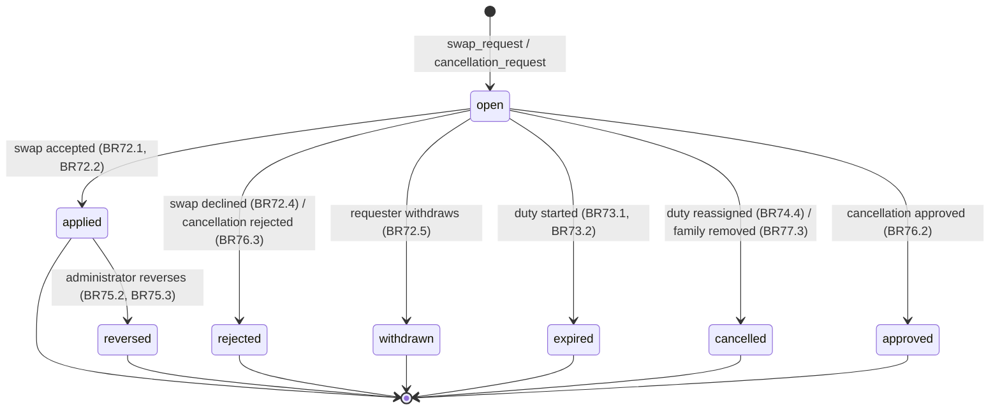
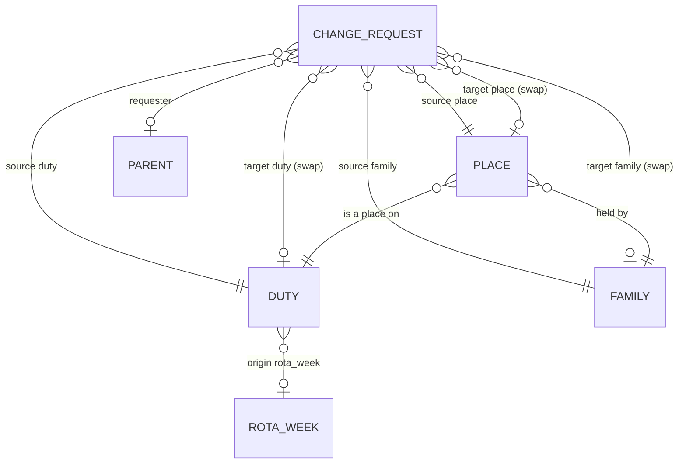

# Functional Specification: u7-swaps-and-duty-changes

## Scope

U7 delivers the DutyChanges block: swaps between families across any kind of duty, the reason shown with a request, cancellations decided by an administrator, an administrator's reassignment of a published duty, the reversal of an applied swap, and the daily expiry of pending swaps. It implements US5.4, US8.2 and US8.3 of `stories.md`, as `unit-of-work-story-map.md` assigns them, within the boundary `unit-of-work.md` gives U7. Inputs: `requirements.md` (FR4.4, FR5.4, FR8.2 to FR8.5, NFR4, assumption A6), `components.md` (DutyChanges and its dependencies), `contract-summary.md` (C1, C5, C8, C9, C10, C11, C16, C19), `decisions.md` (ADR-004, ADR-011) and the owner's answers Q1 to Q4 in `functional-design-questions.md`. Data shape is in `entities.md`, decision logic in `rules.md`. Contains no names or contact details.

Out of scope: giving up an animal-care slot (U8, C19, which rests on this block), changing a weekend pick (U6), removal itself (U14, which calls this block's C16 functions).

## A change request's states

<!-- Text fallback: a request starts open. A swap goes to applied when accepted, and an applied swap can later go to reversed. A swap or a cancellation can end as rejected, withdrawn, expired or cancelled. A cancellation request goes to approved when an administrator approves it. Every state except open and applied is final; applied is final unless it is reversed. -->

While a request is open, its places are `swap_pending` or `cancellation_pending`; every end state returns the places that still exist to `active`.

## Workflows

### W1. Propose a swap (AC8.2.1, AC8.2.2, AC8.2.8, AC8.3.1; BR70.1, BR71.1 to BR71.5, BR77.2)

1. On a duty card or the swaps page (`/szulo/cserek`), a parent opens "Csere kérése" for one of their family's future places.
2. The screen loads `swap_candidates(place)`: other families' future places of any kind, without weekend slot places and places already in a request (BR77.2).
3. The parent picks one, may type a reason, and sends `swap_request(key, place, version, target_place, target_version, reason)`.
4. The database locks (BR77.1), checks BR70.1, BR71.1 to BR71.4, stores the request with both families, duties, versions and the reason, and marks both places `swap_pending` (BR71.5).
5. The other family gets `swap_requested` with the reason. The parent sees the request as pending under "Saját kérések".

Unhappy paths: a weekend slot (SWAP_SLOT_FOLLOWS_WEEK), a place already in a request (REQUEST_DUPLICATE), a rule clash (DUTY_INELIGIBLE or ROTA_SAME_WEEK_CLASH with the reason), an outdated screen (REQUEST_VERSION_STALE), a started duty (DUTY_CLOSED). A repeated click returns the first result.

### W2. Accept or decline (AC8.2.1 to AC8.2.3, AC8.2.5, AC8.2.9; BR72.1 to BR72.4, BR77.1)

1. The other family sees the request under "Beérkező kérések", with both duties, the proposer's family and the reason.
2. Accept sends `swap_respond(key, request, true, version)`. Under the locks, BR72.1 checks that nothing changed and the rules still hold.
3. The swap applies in one transaction (BR72.2): rule check, `place_exchange`, `rota_adjust_picks_after_change`, request `applied` with the versions after the exchange.
4. A week that carried a weekend pick follows BR72.3: the pick moves with the duty, or the slot goes back to the weekend family and the new family is asked to pick.
5. Both families get `swap_decided` (accepted).
6. Decline sends `swap_respond(key, request, false, version)`; the request becomes `rejected`, both places return to `active` and the proposer gets `swap_decided` (declined).

Two at once: an acceptance arriving together with a withdrawal, a reassignment or another change to either place ends as if one came first; the later one is refused (SWAP_REQUEST_NOT_OPEN or SWAP_CANNOT_BE_APPLIED).

### W3. Withdraw (AC8.2.6; BR72.5)

The proposer withdraws an open request with `swap_withdraw(key, request)`. It becomes `withdrawn`, both places return to `active`, and the other family gets `swap_withdrawn`. A cancellation request is withdrawn the same way, with no notice.

### W4. Expiry (AC8.2.7; BR73.1)

1. The daily run (C9) calls this unit's check `swap_expiry`, registered as `dutychanges_swap_expiry_check`.
2. Every open swap whose earlier duty has started becomes `expired`; both places return to `active`; both families get `swap_expired`, once per request.
3. Until the run has marked it, every command already treats such a request as expired (SWAP_EXPIRED) and the screens show it so.
4. The same check ends every open cancellation request whose duty has started (BR73.2): it becomes `expired`, the place returns to `active` so the family keeps the duty, and the family gets `cancellation_decided` with the outcome expired. Until then `cancellation_decide` answers CANCELLATION_EXPIRED.

### W5. Reassign a published duty (AC5.4.1 to AC5.4.6; BR70.2, BR74.1 to BR74.4)

1. On the rota screen (`/admin/beosztas`), a super admin opens a future rota duty and chooses "Átadás másik családnak". Weekend openings and closings keep U6's assign action (BR74.1).
2. The screen offers the community's active families; the super admin picks one and sends `duty_reassign(key, duty, version, family)`. A flagged week with nobody (after an approved cancellation or a removal) uses the same action, labelled "Család kijelölése".
3. The database checks BR70.2, BR74.3, then BR74.2 (changeover with C10, same-week clash with C11).
4. In one transaction: an open swap on the place becomes `cancelled` and both of its families get `swap_cancelled`; an open cancellation request becomes `cancelled`; then `place_reassign` when the duty has a place, or `place_add` when it has none (BR74.1); then `rota_adjust_picks_after_change` with the new family (BR72.3).
5. The old and the new family get `duty_reassigned`; the action is audited as `duty.reassigned`.

A working-group admin, a parent or a teacher is refused. A started duty is refused (DUTY_CLOSED).

### W6. See and reverse swaps (AC8.2.4, AC8.2.10, AC8.3.1; BR75.1 to BR75.4)

1. A new administrator page lists swaps (`swap_list`): pending and ended ones of the current school year, newest first, with both families, both duties, the status, the times, the reason, and whether it can be reversed now.
2. For an applied swap that can be reversed, "Visszavonás" sends `swap_reverse(key, request, version)`.
3. BR75.2 checks that both places still have the versions the swap left and neither duty has started. If either place changed since, the reversal is refused with the reason (SWAP_CHANGED_SINCE) and the page offers reassigning the duties one by one (W5).
4. Otherwise the places swap back with the same rules and the pick follows (BR75.3, BR72.3). The request becomes `reversed`; both families get `swap_reversed`; the action is audited as `swap.reversed`.

Pending swaps are shown but not decided here; only the families decide them (Q4).

### W7. Ask to cancel and decide (AC8.3.2; BR76.1 to BR76.3)

1. A parent asks to cancel one of the family's future places with an optional reason (`cancellation_request`). A weekend slot place is refused (change the pick instead), and an animal-care slot is given up through U8.
2. The administrator sees the request with its reason on the approvals screen (`/admin/jovahagyasok`), which now lists cancellations only.
3. Approve, for a rota duty: the request is marked `approved` first, then the place is freed (so freeing it does not end the request as withdrawn), then the rota week becomes empty with reason `cancelled` and shows among the flagged duties, and the week's pick goes and its slot returns to the weekend family (Q3). The super admin then fills the week with "Család kijelölése" (W5), which adds a new place. For another duty: the place is removed the same way, as today.
4. Reject: the place returns to `active`.
5. The family gets `cancellation_decided`; the decision is audited as `approval.approve` or `approval.reject`.

### W8. Functions delivered for other units (BR77.3; contracts C9, C16, C19)

- C9: the check `swap_expiry` (W4), registered by this unit.
- C16: `dutychanges_removal_preview(kind, id)` and `dutychanges_removal_apply(kind, id)`, internal, returning counts only. U14 calls them in the C16 order (U6, U7, U2, ...).
- C19: the DutyChanges block that U8's `slot_give_up` joins; it refuses a place in an open request (BR71.3).

## Commands and reads of this unit

| Function | Kind | Callers | Rules |
|---|---|---|---|
| `swap_candidates(place, from, to)` | read | parent of the place's family | BR77.2, BR71.2 |
| `swap_request(key, place, version, target, target_version, reason)` | command | parent of the source family | BR70.1, BR71.1 to BR71.5 |
| `swap_respond(key, request, accept, version)` | command | parent of the target family | BR72.1 to BR72.4, BR73.1 |
| `swap_withdraw(key, request)` | command | parent of the source family | BR72.5 |
| `swap_incoming()` | read | parent | BR70.3 |
| `swap_list(school_year)` | read | administrator (BR70.2) | BR75.1 |
| `swap_reverse(key, request, version)` | command | super admin, or admin reaching both non-rota duties | BR75.2, BR75.3 |
| `duty_reassign(key, duty, version, family)` | command | super admin for rota duties; group reach otherwise | BR74.1 to BR74.4 |
| `place_add(duty, family)` | internal, C5 | DutyChanges block only | BR74.1 |
| `cancellation_request(key, place, version, reason)` | command | parent of the place's family | BR76.1 |
| `cancellation_decide(key, request, approve, version)` | command | administrator (BR70.2) | BR76.2, BR76.3 |
| `dutychanges_swap_expiry_check()` | internal, daily run | TimedChecks | BR73.1, BR73.2 |
| `dutychanges_removal_preview(kind, id)`, `dutychanges_removal_apply(kind, id)` | internal | U14 | BR77.3 |

Every command uses the team's use-case template: active session, idempotency key, the C1 result envelope, refusals through `U3R00`, `revoke all` followed by an explicit `grant execute`. The existing names are kept (this settles the C5 open question); `swap_decide` is retired (BR75.4).

## Conversion of Existing Code

- The swap and cancellation functions of the earlier kernel work (`swap_request`, `swap_respond`, `swap_withdraw`, `swap_incoming`, `swap_candidates`, `cancellation_request`, `cancellation_decide`, and their `_core` bodies) move into the DutyChanges block in one new migration and are rewritten to these rules. Applied migration files are not edited.
- The same-group rule and the group membership check in today's swap check are dropped (Q1). The refusal of rota duties (`duty_rota_managed`, DUTY_ROTA_MANAGED) is retired for swaps and cancellations; it stays for whatever U2 still guards with it.
- `swap_standing_check` is folded into BR71.4's check, which also asks C11.
- `swap_decide` loses its grant; the approvals screen and its adapter drop the swap branch (Q4).
- The `change_requests` table gains the columns and statuses in `entities.md`; no new index (BR71.3). Existing rows keep their values: an old open request is kept and judged by the new rules when answered (its stored versions were taken before the pending mark, so the conversion raises each by one for an open swap whose source is `swap_pending`); an old `approved` swap stays as history and cannot be reversed (it has no applied versions).
- `coordination_withdraw_requests`, called by `place_release`, today returns only the source place to `active`. Now that a swap's target place is `swap_pending` too, it returns both places; its status for the request stays `withdrawn`, because its other callers (removal and U8's slot release) rely on it. The DutyChanges commands never leave a request of their own for it to find: `cancellation_decide` marks its own request before calling `place_release` (BR76.2), and `duty_reassign` cancels the place's open request before changing the place (BR74.4).
- C5 delta: a new internal `place_add(duty, family)` adds a place for one family to a duty that has room, with the same closed-duty and already-assigned checks as `place_reassign`; it is called only from the DutyChanges block (BR74.1).
- C11 delta: `rota_adjust_picks_after_change` accepts a change with `new_family_id` null, for a `rota_week` place only. The rota week's family becomes null with empty reason `cancelled`; for a picking week with a pick, the pick is deleted and its slot place is reassigned to the weekend family (never to null), unless that weekend's Saturday has begun. A null family for a weekend slot place raises an error, because BR76.1 never lets one get there. A change with a family (BR74.1) clears the empty reason as today.
- Notice kinds and audit actions are added as listed in `entities.md`; `tests/database/identity-catalogue.test.ts` and `src/data/notification-use-cases.test.ts` are extended for the new functions (project rule).
- The TypeScript layers (`parent-port.ts`, `parent-facade.ts`, `admin-tasks.ts`, `authorization.ts`, `role-policy.ts`) and `verification/authorization-matrix.json` follow the new and retired functions together.

## Screens (to design in Stitch before building)

- Parent swaps page `/szulo/cserek`: incoming and own requests with reason, status and the actions accept, decline and withdraw; expired and ended ones shown with why.
- "Csere kérése" from a duty card: choose the other place (any kind, with a date filter), optional reason, plain refusal text.
- Administrator swap list (new page): pending and ended swaps with reasons and the reverse action, and the "changed since" message pointing to reassignment.
- Reassign action on a rota duty in `/admin/beosztas`.
- Approvals screen `/admin/jovahagyasok`: cancellations only, with the reason and what approving a rota duty does.

All user-facing copy is Hungarian; class names use the existing `parent-` and `admin-` prefixes.

## Derived views

### Entity relationships (derived from `entities.md`)

<!-- Text fallback: a change request names its source place, duty and family, and for a swap also a target place, duty and family; it may name the parent who asked. A place is on one duty and held by one family. A rota duty comes from one rota week. -->

### Rules summary (derived from `rules.md`)

| Rules | Summary |
|---|---|
| BR70.1 to BR70.3 | Families propose and answer; a super admin reassigns rota duties, reverses swaps and decides rota cancellations; reasons go to the other family and administrators |
| BR71.1 to BR71.5 | Any kind of duty, no group check; weekend slots never alone; one open request per place; changeover and same-week rules; versions and reason stored |
| BR72.1 to BR72.5 | Accept applies at once if unchanged, in one transaction with the pick following; decline and withdraw tell the other side |
| BR73.1, BR73.2 | A swap expires when the earlier duty starts; an undecided cancellation ends when its duty starts |
| BR74.1 to BR74.4 | Reassignment of rota duties with the same rules; it cancels a pending swap |
| BR75.1 to BR75.4 | Swap list, reversal only if unchanged, no admin approval of swaps |
| BR76.1 to BR76.3 | Cancellation asked by a family, decided by an administrator; a rota week is freed and flagged |
| BR77.1 to BR77.4 | Lock order, candidates, removal, the fixed test list |

## Assumptions and open points

- The administrator in AC8.2.4 and AC8.3.2 is read as a super admin for rota duties and an admin reaching the group for other duties, the same reach as assigning a duty today (BR70.2). [assumption]
- A swap the families agree on is not audited; only administrator interventions are (NFR4). The request row records every swap. [assumption]
- Swaps applied before this unit used the administrator's approval; they stay as history and cannot be reversed. [assumption]
- The reason stays optional, as today; FR8.5 asks for it to be saved and shown, not required. [assumption]
- U14 decides nothing further for this block: C16's question on the requester and decidedBy fields is settled in `entities.md`.
