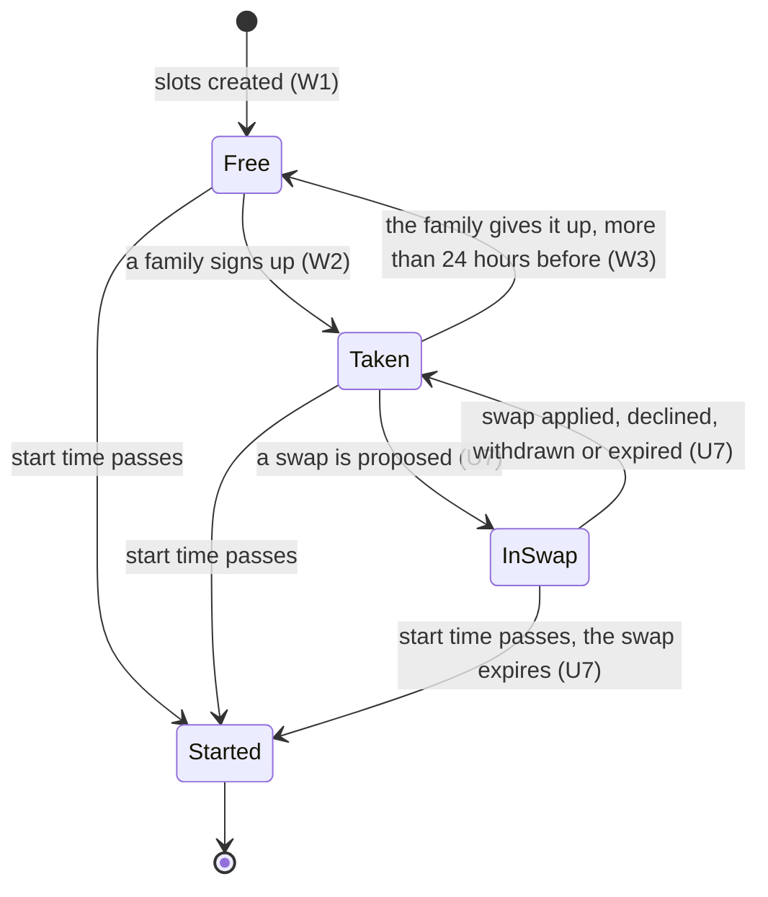
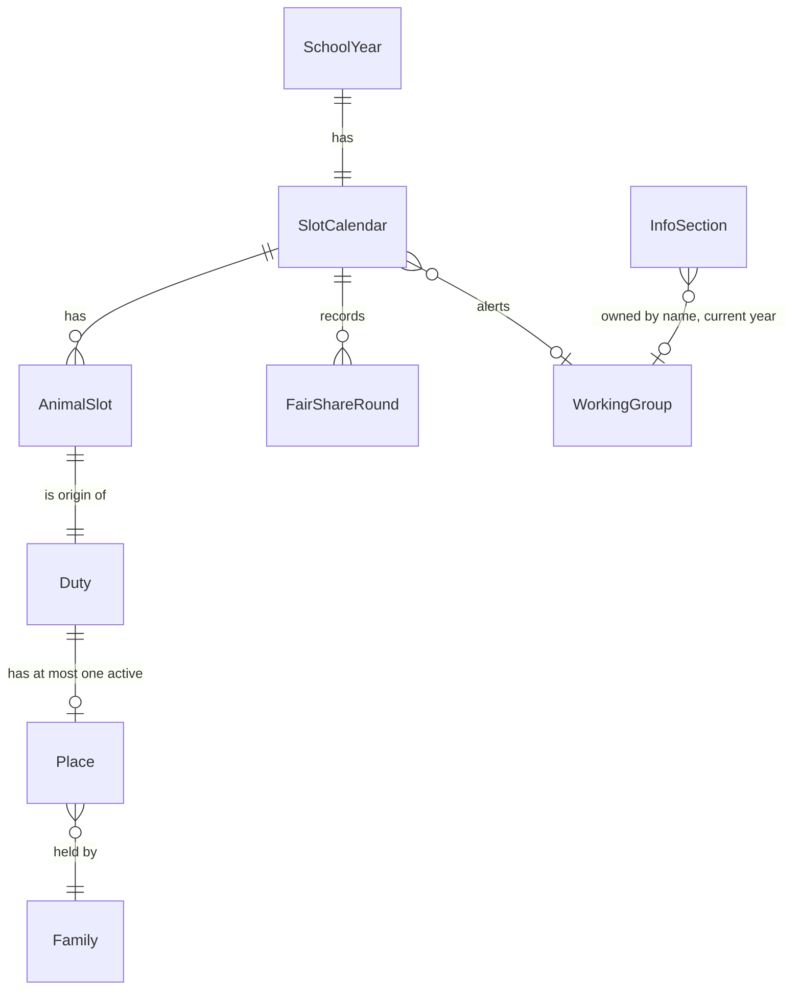

# Functional Specification: u8-animal-care-and-information

## Scope

This unit delivers the daily animal-care sign-up and the information page: US7.1, US7.2 and US7.3 (sign-up, fair share, empty-slot warnings) and US10.1 and US10.2 (reading and editing the information page) from `stories.md`, plus giving up a slot (ADR-012, contract C19), whose acceptance criteria this design adds below. It is built from `unit-of-work.md` (U8), `unit-of-work-story-map.md`, `requirements.md` (FR7, FR10, FR4.4, FR17), `components.md` (AnimalCareSignup, DutyChanges, Information, TimedChecks, WebApplication), `contract-summary.md` (C1, C3, C4, C5, C7, C8, C9, C10, C18, C19, C20), `decisions.md` (ADR-012) and the owner's answers Q1 to Q8 in `functional-design-questions.md`. The data shape is in `entities.md` and the decision logic in `rules.md`; this file is the source of truth for the workflows and the slot's states. Contains no names or contact details.

Out of this unit: drop-off and pick-up are not recorded (FR7.6); the summer animal rota is out of scope; weekend animal care is U6's rota; swapping a slot is U7's swap, unchanged; removing a family's places is U2's removal block (C16).

## Acceptance criteria added for giving up a slot (US7.4)

ADR-012 asks this design to add them; they are written in the stories' Given/When/Then form and are traced by BR82.1 to BR82.5.

- **Give-up 1** Given a slot my family holds more than 24 hours ahead, When I give it up, Then the slot is free again, my family's count drops, and anyone can sign up for it.
- **Give-up 2** Given a slot my family holds that starts in 24 hours or less, When I try to give it up, Then it is refused with the reason, and I am offered a swap instead.
- **Give-up 3** Given a slot another family holds, When I try to give it up, Then it is refused, and I learn nothing about it.
- **Give-up 4** Given my slot is in an open swap, When I try to give it up, Then it is refused until the swap ends.
- **Give-up 5** Given I click give-up twice or on an outdated page, When the second request arrives, Then nothing more changes and the page shows the current state.

## A slot's states

<!-- Text fallback: a slot is created Free. A family signing up makes it Taken. Giving it up more than 24 hours before makes it Free again. A proposed swap puts it InSwap, and when the swap ends it is Taken again, by whichever family then holds it. From Free, Taken or InSwap it becomes Started when its start time passes, and then nothing more changes. -->

| State | Meaning | What can happen |
|---|---|---|
| Free | No active place | Sign up (BR81.2); listed by the daily check (BR85) |
| Taken | One family holds it, more than 24 hours ahead | Give up (BR82), swap (U7), counts for fair share (BR83.1) |
| Taken, within 24 hours | One family holds it, 24 hours or less ahead | Swap only (BR82.3) |
| InSwap | The place is in an open swap | Neither give-up (BR82.4) nor a second request |
| Started | The start time has passed | Nothing; still counts for fair share |

Sign-up and give-up never meet a slot in a different state than the screen showed without the call being refused: the duty and place locks with the version check turn a stale view into a refusal (BR81.3, BR82.5).

## Workflows

### W1. Set up a school year's slots (BR80.1 to BR80.5, BR89.1)

1. A super admin opens the animal-care settings of a school year.
2. If the year has no calendar yet, the screen shows the default times 07:30 and 16:00 and the year's Állatgondozás group as the alert group.
3. The super admin may change the times or the alert group and saves (animal_calendar_save). A save on an outdated screen is refused; a change of times moves the slots from tomorrow on, and each family holding a moved slot gets one notice with the new time (BR80.4).
4. The super admin presses "Időpontok létrehozása" (animal_slots_create). For every Monday to Friday of every week of the year, breaks included, the missing morning and afternoon slots are created; existing ones and their families stay (BR80.2, BR80.3).
5. The result says how many slots were added; pressing again adds none.

### W2. Sign up for a slot (AC7.1.1 to AC7.1.3; BR81.1 to BR81.6)

1. A parent opens the sign-up page, from the navigation or from an empty-slot message.
2. The page lists the coming days from today, two weeks at a time, each with a morning and an afternoon row; a taken row shows the family name, a free row shows "üres" and Elvállalom (refined mockups, Slot Row).
3. The parent presses Elvállalom on a free row (duty_sign_up with the duty's version and a fresh key).
4. If the family may hold a duty that day and the slot is still free, the family holds it, the row shows "Ti", and the family's count in the panel rises (BR81.2).
5. If another family took it first, the row shows "Már foglalt" and refreshes (BR81.3). If the changeover rule applies, the button is off and the reason is shown; a call made anyway is refused with it (BR81.1).

### W3. Give up a slot (Give-up 1 to 5; BR82.1 to BR82.5)

1. On a row the family holds, more than 24 hours ahead, the page offers Lemondás; within 24 hours it offers only Csere.
2. The parent presses Lemondás and confirms (slot_give_up with the place's version and a fresh key).
3. If allowed, the slot is free at once, the family's count drops and the row shows Elvállalom to everyone.
4. If the limit has just passed, the slot is in a swap, the screen is outdated or the caller is not of the holding family, the call is refused with its code and the row refreshes.

### W4. See the fair share (AC7.2.1; BR83.1 to BR83.5)

1. The panel at the top of the sign-up page shows the caller's family's count and own share and the year's average.
2. Opened, it lists every counted family with its count and own share, the caller's family first.
3. The figures are worked out when the page is read, from the slots held and the family standings (C20).

### W5. Monthly fair-share reminder (AC7.2.2, AC7.2.3; BR84.1 to BR84.4, BR85.6)

1. The daily run calls animal_fair_share_check with the run's moment.
2. If today is before the month's first weekday, outside the school year's weeks, or the month's round is already recorded, it does nothing.
3. Otherwise it works out every counted family's count and share, sends one reminder to the parents of each family below its share that may hold a duty today, records the round with the average and the number of families reminded, and returns the counts created and skipped.

### W6. Daily empty-slot warnings (AC7.3.1 to AC7.3.3; BR85.1 to BR85.6)

1. The daily run calls animal_empty_slots_check with the run's moment, date D.
2. It reads the free slots dated D+1 to D+3.
3. For each active family (no standing row counts as staying), it keeps the listed slots the family may hold and, if any, sends one message to its parents listing them (once per family per day).
4. If any free slot is dated D+1, it sends one alert to the super admins and the alert group's coordinators listing those slots (once per person per day).
5. It returns the counts created and skipped. A slot filled before the run is not listed.

### W7. Read the information page and follow a duty link (AC10.1.1 to AC10.1.3; BR86.1 to BR86.3, BR88.1 to BR88.3)

1. Any signed-in member opens Információ; the visible sections are shown in order as accordions, each with its anchor.
2. A duty card shows links to its sections (BR88.1); "Locsolás" is added on morning and afternoon slots from March to October only (BR88.2); a hidden section is left out (BR88.3).
3. Following a link opens the page at that section, expanded.

### W8. Edit a section (AC10.2.1, AC10.2.2; BR87.1 to BR87.5)

1. A coordinator of the owning group (the current school year's group of the section's owner name, BR87.6), or a super admin, sees Szerkesztés on the section.
2. They change the text (a super admin also the title, owner, season and order) and save with the version they saw (info_section_update).
3. If the text is valid and the version current, everyone sees the change at their next page load; otherwise the save is refused with its code and the editor keeps their text to retry.
4. A super admin can add a section (info_section_create) or hide and restore one (info_section_set_hidden).

## Commands and reads of this unit

| Name | Kind | Caller | Rules |
|---|---|---|---|
| animal_calendar_get(school_year_id) | read | super admin | BR80.1 |
| animal_calendar_save(school_year_id, morning_start, afternoon_start, care_group_id, p_expected_version, p_idempotency_key) | command | super admin | BR80.1, BR80.4, BR80.5, BR89.1 |
| animal_slots_create(school_year_id, p_idempotency_key) | command | super admin | BR80.1 to BR80.3, BR89.1 |
| animal_slots_list(school_year_id, from_date, weeks) | read | signed-in member | BR81.6, BR82.3 (which action is offered); see the row fields below |
| duty_sign_up (C18, existing) | command | parent | BR81.1 to BR81.5 |
| slot_give_up(place_id, p_expected_version, p_idempotency_key) (C19) | command | parent of the holding family | BR82.1 to BR82.5 |
| animal_fair_share(school_year_id) | read | signed-in member | BR83.1 to BR83.4 |
| animal_fair_share_check(now) | daily check (C9) | the daily run | BR84.1 to BR84.4, BR85.6 |
| animal_empty_slots_check(now) | daily check (C9) | the daily run | BR85.1 to BR85.6 |
| info_sections_list() | read | signed-in member | BR86.1, BR86.3 |
| info_section_update(section_id, title, body, owning_group_name, season_months, position, p_expected_version, p_idempotency_key) | command | coordinator (text only) or super admin | BR87.1 to BR87.6 |
| info_section_create(title, body, owning_group_name, season_months, position, p_idempotency_key) | command | super admin | BR87.2, BR87.5, BR87.6 |
| info_section_set_hidden(section_id, hidden, p_expected_version, p_idempotency_key) | command | super admin | BR87.2, BR87.4 |
| info_links_for_duty(duty_id) | internal read for the duty card | the duty card read | BR88.1 to BR88.3 |

Each row of animal_slots_list returns: the slot's date and part, start time, the duty id and version (for sign-up, C18), the place id and version when the slot is taken (for give-up, C19), the holding family's name, whether the holder is the caller's family, whether the place is in an open swap, whether the slot has started, and whether giving up is still allowed (more than 24 hours ahead). It returns no contact details.

Every command returns the C1 envelope and starts with revoke all and an explicit grant. New notice kinds: `animal_empty_slots`, `animal_empty_slots_alert`, `animal_fair_share`, `animal_slot_time_changed`; new notice target type `animal_signup` (the school year), which opens the sign-up page. The two checks are registered in the daily run's registry (C9) by this unit's migration.

## Screens (to design in Stitch before building)

- **Állatgondozás, /szulo/allatok**: the sign-up page with the fair-share panel and the slot rows (refined mockups, Slot Row states default, taken, mine, disabled, error). Row buttons are named with the day and part, for example "Elvállalom: hétfő reggel"; results are announced in a status region.
- **Állatgondozás for teachers, /teacher/allatok**: the same slot rows read-only (BR81.6), with no sign-up, give-up, swap or hold-back text; added after the owner's review because the teacher schedule leaves the daily slots out (they would bury the real entries).
- **Információ, /informacio**: the section accordions with anchors; Szerkesztés for those allowed.
- **Section editor**: title (super admin only), text with a short formatting help, and for super admins owner, season months, order and hide or restore.
- **Animal-care settings** (super admin): the year's two times, the alert group and Időpontok létrehozása with its result.
- **Duty card**: the information links of BR88 on existing duty cards.

## Derived views

### Entity relationships (derived from `entities.md`)

<!-- Text fallback: a school year has one slot calendar. The calendar has many animal slots and records many fair-share rounds, and may name one working group to alert. Each animal slot is the origin of one duty, which has at most one active place; a place is made on sign-up and held by one family. An information section may be owned, by name, by the current school year's working group of that name. -->

### Rules summary (derived from `rules.md`)

| Group | Rules | In short |
|---|---|---|
| The year's slots | BR80.1 to BR80.5 | Super admins create two slots per weekday, breaks included; re-creation adds only missing days |
| Signing up | BR81.1 to BR81.6 | Own family, free and not started, changeover rule, no limit, everyone sees holders |
| Giving up | BR82.1 to BR82.5 | Holder only, until 24 hours before, not in a swap; frees the slot |
| Fair share | BR83.1 to BR83.5 | Past and coming slots, share by active weeks, never blocks |
| Fair-share reminder | BR84.1 to BR84.4 | First weekday of the month, below share, once a month |
| Empty-slot warnings | BR85.1 to BR85.6 | Next three calendar days, once per family per day, day-before alert |
| Information page | BR86.1 to BR87.6 | Everyone reads; coordinators of the current year's named group edit their text; super admins edit, add, hide |
| Duty-card links | BR88.1 to BR88.3 | Slot and weekend links, watering March to October |
| Locking | BR89.1 | Calendar, then duties, then places |

## Assumptions and open points

- Two super admins saving a year's first calendar at once: the loser reads a version conflict, never a raw database error. A coordinator never reaches a hidden section (it answers as a missing one), and the caller is checked before the section row is locked. [decision after review]

- A slot duty lasts one hour from its start; nothing depends on the end time beyond showing it. [assumption]
- Slot duties belong to no working group, so coordinators gain no right to reassign them; an administrator does not assign slots in this unit. [assumption]
- The existing duty reminder before a duty starts (U5) applies to slots like any other duty the family holds. [assumption]
- A family whose standing changes after it signed up for slots past its last active week keeps those slots; U6's handling of standing changes and U14's flagging apply to them as to any place. [assumption]
- Creating slots never deletes one; a week taken out of a school year after its slots were made leaves those slots in place. [assumption]
- The starting text of the six sections is copied from the appendices of the spreadsheet review in the repository's knowledge folder, checked for names and contact details.
