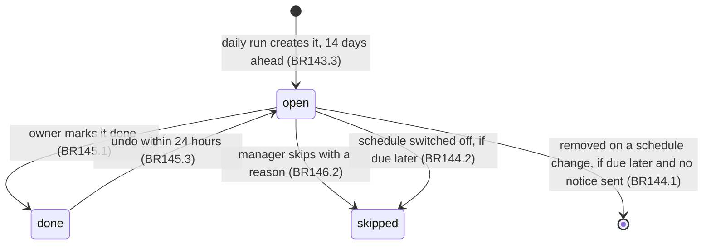
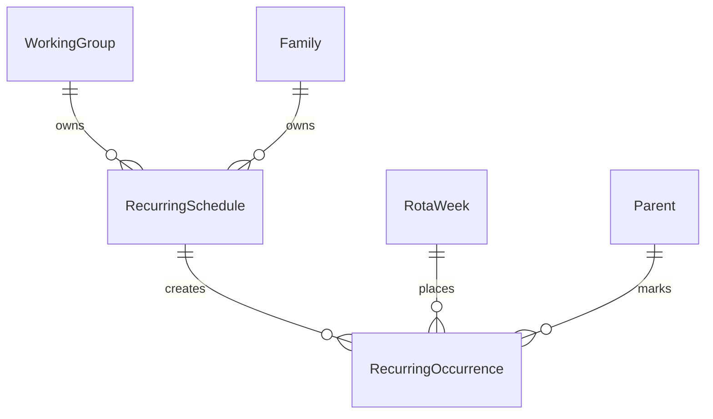

# Functional Specification: u9-recurring-duties

This unit (U9 in `unit-of-work.md`, mapped in `unit-of-work-story-map.md`) implements US9.1 to US9.4 and shows the recurring-duty part of US17.1 from `stories.md`, against FR9 and FR17.4 in `requirements.md`, the components RecurringDuties, RotaPlanning, Duties, TimedChecks and WebApplication in `components.md`, and contracts C8, C9 and C12 (used) and C14 and C16 (provided) in `contract-summary.md`. Decisions: ADR-002, ADR-003 and ADR-010 in `decisions.md`, and the owner's answers Q1 to Q7 in `functional-design-questions.md`. Contains no names or contact details.

## Scope

Schedules that repeat, their occurrences, done marks, skipping, reminders, bottle cleaning and the starting list.

| In this unit | Left to a later unit |
|---|---|
| Setting up and changing schedules for a group, a family or a rota job (US9.1) | The My tasks page that lists a parent's recurring duties with other work (U12 calls this unit's read) |
| Occurrences, done marks, undo, skipping, overdue (US9.1, US9.2) | The coordinator's management page that links here (U12, through `recurring_list`) |
| Bottle cleaning on the water week and its interval (US9.3) | The duty card and school calendar page themselves (U2 owns them; this unit adds a line and a number) |
| The starting list of regular care, inspection rounds and seasonal jobs (US9.4) | Moving seasonal jobs out of the to-do list when migrating the spreadsheet (U15) |
| Due and overdue notices linking to the duty (AC17.1.1, AC17.1.6) | Mechanism, retries, failure list and no double sending (U5) |
| Flagging a removed family's schedules (U14 calls this unit's block) | Removing a person across all records (U14) |

## Occurrence states

Text fallback: an occurrence is created open. The owner marks it done, and may take that back for 24 hours. A manager may skip it with a reason. Switching a schedule off skips its later open occurrences, and changing a schedule removes later open ones that nobody has been told about. "Overdue" is not a state: it means open with a due date in the past.

## Workflows

### W1. Set up a recurring duty (AC9.1.1 to AC9.1.3; BR141.1, BR141.2, BR142.1 to BR142.3, BR144.1)

1. A coordinator opens the recurring duties of their group (from the group page or the coordinator page of U12) and presses Új ismétlődő feladat. A super admin opens the same list for any group, or the list of family and rota schedules under the admin menu.
2. The form has the title, a category, how often ("minden N. hét"), the first due date, the optional season (from month, to month) and the owner (fixed for a coordinator).
3. Saving a schedule for another group is refused ("Ehhez nincs jogosultságod"). A parent has no such form. A season whose from month is after the to month is refused.
4. Saving makes the upcoming occurrences appear for the owner, up to 14 days ahead, on the next daily run, and at once for what is due today (the save runs the same creation for that schedule). Due dates count from the start date and the interval only.
5. Saving a change sends the schedule's version. A screen that is out of date is answered "Közben valaki módosította, töltsd újra" and nothing is overwritten. A second press creates one schedule.
6. Changing the interval, start or season removes later open occurrences that nobody was told about and the run creates them again by the new rule.

### W2. Seasons and fixed counting (AC9.1.1, AC9.1.2; BR143.1)

1. A schedule from March to October has no occurrence for a due date in November. The due date after it is unchanged, so a job every 2 weeks stays on the same weeks all season.
2. Marking an occurrence done late, or not at all, moves nothing.

### W3. Mark a duty done (AC9.2.1, AC9.2.2; BR145.1 to BR145.3)

1. A member or coordinator opens their group's duties, a parent opens their family's duties (or the duty card for bottle cleaning), and presses Kész on an open occurrence. The card then shows the name, the time and the word Kész.
2. A parent of another family, or a person who is not in the group, trying it directly (for example through an old link) is refused with "Ezt a feladatot csak a felelős jelölheti késznek."
3. A second press, or two people pressing at the same moment, records one done mark. The second gets "Ezt már késznek jelölték".
4. For 24 hours the person who marked it, a coordinator of the group or a super admin can press Mégsem to take it back. After that it is refused.
5. A teacher sees the list and no buttons.

### W4. Overdue and skipped (Q2; BR146.1 to BR146.3)

1. An open occurrence past its due date shows "lejárt" in the owner's list. The next occurrence appears on its own date regardless.
2. A coordinator of the group, or a super admin, can press Kihagyom, give a short reason, and close it as "kihagyva". For a family or rota-week duty only a super admin can.
3. An occurrence more than 60 days overdue disappears from the current list and stays in the schedule's history.

### W5. Bottle cleaning (AC9.3.1, AC9.3.2; BR143.2, BR147.1, BR147.2)

1. A fresh install holds "Palackok tisztítása" for the water-carrying job, every 4th water week. The 1st, 5th, 9th and so on published water weeks of the year each get an occurrence due on that week's Monday.
2. When the family opens its water duty card, an occurrence of that week shows a "Palackok tisztítása" line with Kész.
3. If the water week is swapped, cancelled or reassigned, the family now holding the week sees the line and the previous one does not.
4. A super admin changes the number on the school calendar page. The next weeks use the new interval; occurrences already announced stay.

### W6. The starting list (AC9.4.1 to AC9.4.3; BR148.1 to BR148.3)

1. After a fresh install, the Animal Care coordinator opens the recurring duties and sees six periodic care items, three of them (category "nyúl") switched off. The coordinator can switch one on or change its interval.
2. The playground and maintenance coordinators each see an inspection round every 4 weeks and set the interval for their group.
3. Mowing, weeding and turning the compost appear as recurring duties with their seasons, and not in the to-do list.

### W7. Reminders (AC17.1.1, AC17.1.6; BR149.1, BR149.2)

1. On the morning of the due date, the daily run sends "Esedékes: [cím]" as a notice and an email to the owner people. For a group schedule that is the group's coordinators.
2. If the occurrence is still open 3 days later, one "Lejárt: [cím]" goes out. Nothing is sent for a done or skipped occurrence, and nothing twice.
3. Each notice opens the occurrence. It shows the title and date and nothing about other families.
4. Retries after a failed email, the failure list and a notice for a person who has not signed in for days are U5's and show on the existing screens.

### W8. Functions delivered for other units (BR150.2, BR151.1)

1. U12 reads `recurring_list(group_id)` (contract C14) for the coordinator page and `recurring_my_occurrences` for the My tasks page.
2. The duty card of U2 reads `recurring_bottle_for_duty(duty_id)`; the school calendar page reads and changes the bottle interval through `recurring_schedule_save`.
3. U14 calls `recurring_duties_removal_preview` and `recurring_duties_removal_apply` (contract C16).

## Commands and reads of this unit

| Function | Kind | Who | Rules |
|---|---|---|---|
| `recurring_schedule_save` | command | coordinator of the group; super admin | BR141, BR142, BR144.1, BR147.1 |
| `recurring_schedule_set_active` | command | as above | BR141, BR144.2 |
| `recurring_occurrence_mark_done`, `recurring_occurrence_undo_done` | command | the owner people; undo also coordinator or super admin | BR145 |
| `recurring_occurrence_skip` | command | coordinator of the group; super admin | BR146.2 |
| `recurring_list_for_group`, `recurring_occurrence_get` | read | every signed-in reader (family duties: the family and super admins) | BR146.1, BR146.3, BR150.1 |
| `recurring_my_occurrences` | read | a parent with a family; group duties of the parent's groups | BR150.1 |
| `recurring_bottle_for_duty` | read | the parents of the water-week family, super admins | BR147.2 |
| `recurring_list(group_id)` | read | manager of the group | BR150.2 |
| `recurring_due_check`, `recurring_notice_facts` | internal | the daily run, notices | BR143, BR149 |
| `recurring_duties_removal_preview`, `recurring_duties_removal_apply` | internal | U14 | BR151.1 |

All commands start with `revoke all` and an explicit `grant execute`, take an idempotency key, return the C1 envelope and refuse through `U3R00`. Reads for a caller without access return the denied refusal, never an empty list. Internal functions are never granted to a signed-in user.

## Conversion of Existing Code

- **No recurring code exists today.** The schedule and occurrence tables, the six functions above, the two notice kinds with the `recurring_duty` target type and the registered daily check are new in one forward-only migration.
- **The starting list** is added to the seed script (`scripts/db/seed/write.ts`) with invented Hungarian titles, so a fresh install holds it. The tests that count seeded rows change in the same pull request.
- **Tests that list new objects.** `tests/database/identity-catalogue.test.ts` and `src/data/notification-use-cases.test.ts` are extended for the new functions and tables (project rule).
- **Application layer.** New read and command models in `src/application/contracts.ts`, port methods in `src/data/` and facade methods, following the pattern of U10.

## Screens (to design in Stitch before building)

| Screen | Path | Notes |
|---|---|---|
| Group recurring duties | `/szulo/munkacsoportok/[id]/ismetlodo` (and the working group page section) | Occurrences by due date with Kész, lejárt and kihagyva marks; coordinator controls to add, change, switch on or off, skip |
| Recurring duty form | `/szulo/ismetlodo/uj` and `/szulo/ismetlodo/[id]/szerkesztes` | Title, category, interval, first date, season, owner |
| My recurring duties | `/szulo/ismetlodo` | The family's duties and its groups' duties, with Kész; the My tasks page of U12 will show the same cards |
| Duty card, bottle-cleaning line | `/szulo/beosztas/[id]` | A line with Kész, added to U2's card |
| School calendar page, bottle interval | the existing admin calendar page | One number, "Palackok tisztítása minden N. vízhordó héten" |

The screens are Hungarian, work at phone width and by keyboard, and keep today's class names and measurements or change their tests in the same pull request (`team.md`). New classes use the `recurring-` prefix. The owner compares each built screen with its Stitch design in the screenshot review.

## Derived views

### Entity relationships (derived from `entities.md`)

Text fallback: a working group or a family owns schedules. A schedule creates occurrences. A rota-week schedule's occurrence belongs to a rota week. A parent marks occurrences done or skipped.

### Rules summary (derived from `rules.md`)

| Question | Answer | Rule |
|---|---|---|
| Who sets up schedules? | Group coordinator (own group), super admin | BR141.1 |
| What decides due dates? | The schedule only | BR143.1 |
| How far ahead? | 14 days | BR143.3 |
| Who may mark done? | Group members and coordinators, or the owning family | BR145.1 |
| Undo? | 24 hours | BR145.3 |
| Missed? | Overdue until done or skipped | BR146.1 |
| Bottle cleaning? | Every 4th water week, follows the week | BR143.2, BR147.2 |
| Who is told? | Owner people, due date and 3 days after | BR149.1 |
| On removal? | Flagged, nothing deleted | BR151.1 |

## Assumptions and open points

- **Occurrences are not duty rows.** `components.md` says occurrences are duties and contract C18 expects `place_mark_done` to carry the done mark. This design keeps the done mark on the occurrence (ADR-003) and creates no duty or place, for three reasons: a group-owned occurrence has no single family to hold a place, a place on a rota-week occurrence would have to be moved by every swap (a change to U7), and the contract's own idea of "a coordinator of the owning group" does not cover group members. The cost is that an occurrence cannot be swapped and does not appear in the duty overview of U2; U12's My tasks page reads `recurring_my_occurrences` instead. Contract delta: C18's `place_mark_done` is not used by this unit; C4's `recurring_occurrence` origin stays unused; C9's check name is `recurring_due_check`. The reviewer and the owner can overrule this.
- **Group notices go to coordinators.** A group's reminder reaches its coordinators, who are responsible for the group's regular care, not every member, to avoid noise. The members still see the duty on the group page and may mark it. With no coordinator the members are told (BR151.2).
- **Teachers read group duties.** Group duties are community-wide reading like the rest of the group page; family duties are private to the family and super admins.
- **A season does not wrap New Year.** A job from November to February is two schedules.
- **A save creates today's occurrences at once.** So a new duty due today shows immediately; the daily run creates the rest.
- **Skipped on switch-off uses the actor as the person.** The reason text is fixed ("kikapcsolva").
- **The invented starting list.** About six animal-care items, two inspection rounds and three seasonal jobs, titles and intervals invented in Hungarian, to be replaced by the owner (Q6). Contains no real person.
- **Contract deltas, to update in `contract-summary.md` in the same pull request.** C9: the check is `recurring_due_check`. C14: `recurring_list(group_id)` returns the schedule's status. C16: U9's block flags a removed family's schedules and clears done and skip names for a removed parent. C8: the two notice kinds and the `recurring_duty` target type. C18: not used here.
- **Lock order.** Every command locks the schedule row first, then occurrence rows by ascending id (contract C1).
- **Fixed test list.** Each rule's six cases are planned in the unit's test instructions in the table agreed in U1, with "nem értelmezhető" and a reason where a case has no meaning.
