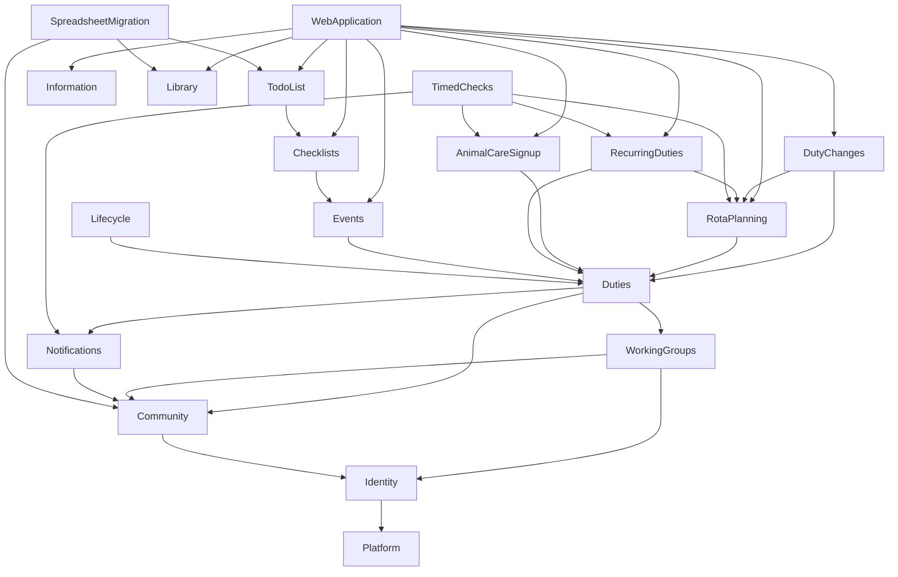

# Components

Logical building blocks for matching the app to the Ovis tábla workflow, derived from `requirements.md` and `stories.md`, extending what `architecture.md` and `component-inventory.md` describe. They follow the conventions in `team-practices.md`. Decisions are in `decisions.md`.

## Component Catalogue

```yaml
components:
  - name: Platform
    summary: Audit log and repeat-safe request handling shared by every rule.
    behaviour: >
      Append-only audit with 365-day purge. Idempotency records make a repeated request return the stored result.
    responsibilities:
      - Audit events
      - Idempotency records
    depends_on: []
    dependents:
      - component: Identity
        interaction: audit sign-in and role changes
      - component: Community
        interaction: audit and idempotency
      - component: WorkingGroups
        interaction: audit and idempotency
      - component: Notifications
        interaction: audit delivery failures
      - component: Duties
        interaction: audit and idempotency
      - component: DutyChanges
        interaction: audit and idempotency
      - component: RotaPlanning
        interaction: audit publishing
      - component: AnimalCareSignup
        interaction: idempotency
      - component: RecurringDuties
        interaction: idempotency
      - component: Events
        interaction: idempotency
      - component: Checklists
        interaction: idempotency
      - component: TodoList
        interaction: idempotency
      - component: Information
        interaction: idempotency
      - component: Library
        interaction: idempotency
      - component: Lifecycle
        interaction: audit deletions; the audit log keeps opaque ids and is never rewritten
      - component: SpreadsheetMigration
        interaction: audit migration runs
    external_dependencies:
      - name: PostgreSQL
        kind: database
        purpose: storage
    entities:
      - name: AuditEvent
        identifier: id
        attributes: [action, actor, target, occurredAt]
      - name: IdempotencyRecord
        identifier: key
        attributes: [operation, result, createdAt]

  - name: Identity
    summary: Accounts, sessions, passwords, invitations and role grants.
    behaviour: >
      A signed-in parent can change their password and confirm a new sign-in email; the old email works until
      confirmation. Invitations are single-use and expire after 7 days. The former group-admin role is scoped to a
      working group, and teachers read across the community. Revoked rights apply at the next request. Identity owns
      the link from an account to its parent and the database access helpers that use it to find the signed-in
      person's parent and family, checking that the parent and grant are still active.
    responsibilities:
      - Sign-in, sessions, password and email change
      - Invitations
      - Role grants and their scopes
    depends_on:
      - component: Platform
        interaction: audit role changes
        style: sync
    dependents:
      - component: Community
        interaction: send invitations, change sign-in email
      - component: WorkingGroups
        interaction: grant and end the working-group admin role
      - component: Lifecycle
        interaction: end the sign-in of a removed parent
      - component: WebApplication
        interaction: sessions and role checks
    external_dependencies:
      - name: Supabase Auth
        kind: third-party-api
        purpose: credentials and sessions
      - name: SMTP server
        kind: third-party-api
        purpose: invitation and confirmation emails
    entities:
      - name: Account
        identifier: id
        attributes: [email, status]
        references:
          - entity: Parent
            owned_by: Community
            relationship: an account may be linked to one parent
      - name: Invitation
        identifier: id
        attributes: [status, expiresAt]
        references:
          - entity: Parent
            owned_by: Community
            relationship: each invitation is for one parent
      - name: RoleGrant
        identifier: id
        attributes: [role, scope, revokedAt]
        references:
          - entity: WorkingGroup
            owned_by: WorkingGroups
            relationship: a working-group admin grant is scoped to one group

  - name: Community
    summary: School years, families, parents, children, the school calendar and who may see whom.
    behaviour: >
      Holds break weeks and the changeover date per school year (1 July by default). Marks a family as staying,
      leaving or new, and answers whether a family may hold a duty on a date. A parent's sharing choice decides what
      others read: without it only the full name. Children are shown only when every parent of the family has shared.
      Teachers always read phone and email. Fields that may not be shown never leave the database.
    responsibilities:
      - Family, parent and child records
      - School calendar and changeover rule
      - Profile fields, sharing consent and directory reads
    depends_on:
      - component: Platform
        interaction: audit consent changes
        style: sync
      - component: Identity
        interaction: send invitations and change sign-in email
        style: sync
    dependents:
      - component: WorkingGroups
        interaction: members are parents
      - component: Notifications
        interaction: recipients are parents
      - component: Duties
        interaction: family identity and duty eligibility
      - component: DutyChanges
        interaction: duty eligibility for swaps and reassignment
      - component: RotaPlanning
        interaction: families, breaks and eligibility
      - component: AnimalCareSignup
        interaction: active families and part-year weeks
      - component: RecurringDuties
        interaction: a family as schedule owner
      - component: Events
        interaction: sign-ups and offers belong to parents
      - component: TodoList
        interaction: a family as task owner
      - component: Library
        interaction: owners, borrowers and leaving families
      - component: Lifecycle
        interaction: delete or anonymise family records
      - component: SpreadsheetMigration
        interaction: load the directory
      - component: WebApplication
        interaction: directory, profile and calendar screens
    external_dependencies:
      - name: PostgreSQL
        kind: database
        purpose: storage and row-level access rules
    entities:
      - name: SchoolYear
        identifier: id
        attributes: [name, startsOn, endsOn, changeoverDate]
      - name: BreakWeek
        identifier: id
        attributes: [startsOn, label]
        references:
          - entity: SchoolYear
            owned_by: Community
            relationship: each break week belongs to one school year
      - name: Family
        identifier: id
        attributes: [displayName, status]
      - name: FamilyYearStatus
        identifier: id
        attributes: [standing]
        references:
          - entity: Family
            owned_by: Community
            relationship: each row is one family in one school year
          - entity: SchoolYear
            owned_by: Community
            relationship: each row is one family in one school year
      - name: Parent
        identifier: id
        attributes: [displayName, status]
        references:
          - entity: Family
            owned_by: Community
            relationship: each parent belongs to one family
      - name: ParentProfile
        identifier: parentId
        attributes: [phone, email, residence, occupation, hobby, howISupport, sharingConsent, consentedAt]
        references:
          - entity: Parent
            owned_by: Community
            relationship: one profile per parent
      - name: Child
        identifier: id
        attributes: [displayName, status]
        references:
          - entity: Family
            owned_by: Community
            relationship: each child belongs to one family

  - name: WorkingGroups
    summary: The working groups, their members and their coordinators.
    behaviour: >
      Parents join and leave themselves and may be in several groups. A coordinator must be a member. Leaving a group
      ends that group's admin right at once. A group with no coordinator is managed only by a super admin.
    responsibilities:
      - Working groups and descriptions
      - Parent membership
      - Which parents coordinate which group
    depends_on:
      - component: Platform
        interaction: audit and idempotency
        style: sync
      - component: Community
        interaction: check members are parents
        style: sync
      - component: Identity
        interaction: grant and end the admin role
        style: sync
    dependents:
      - component: Duties
        interaction: a duty may belong to a group
      - component: RecurringDuties
        interaction: group ownership
      - component: Events
        interaction: group events
      - component: Checklists
        interaction: group templates
      - component: TodoList
        interaction: group ownership
      - component: Information
        interaction: section ownership
      - component: Lifecycle
        interaction: remove memberships
      - component: WebApplication
        interaction: working-group screens
    external_dependencies:
      - name: PostgreSQL
        kind: database
        purpose: storage
    entities:
      - name: WorkingGroup
        identifier: id
        attributes: [name, description]
        references:
          - entity: SchoolYear
            owned_by: Community
            relationship: each group is delegated for one school year
      - name: WorkingGroupMembership
        identifier: id
        attributes: [isActive, isCoordinator, joinedAt, leftAt]
        references:
          - entity: WorkingGroup
            owned_by: WorkingGroups
            relationship: membership of one group
          - entity: Parent
            owned_by: Community
            relationship: membership of one parent

  - name: Notifications
    summary: In-app notices, reminder jobs and email delivery.
    behaviour: >
      A notice can concern any kind of item and links to it. Each reminder is sent once. A failed email is tried at
      most 3 times, 15 minutes apart, and the in-app notice remains. Emails carry no other family's contact details.
    responsibilities:
      - Notices and read state
      - Reminder jobs and send-once rule
      - Email delivery and failure view
    depends_on:
      - component: Platform
        interaction: audit delivery failures
        style: sync
      - component: Community
        interaction: find recipients
        style: sync
    dependents:
      - component: Duties
        interaction: place notices
      - component: DutyChanges
        interaction: swap and reassignment notices
      - component: RotaPlanning
        interaction: publish and pick notices
      - component: AnimalCareSignup
        interaction: fair-share and empty-slot notices
      - component: RecurringDuties
        interaction: due notices
      - component: Events
        interaction: event notices
      - component: TodoList
        interaction: task notices
      - component: Library
        interaction: book notices
      - component: TimedChecks
        interaction: send what is due
      - component: Lifecycle
        interaction: remove a leaving family's notices
      - component: WebApplication
        interaction: notification screens
    external_dependencies:
      - name: SMTP server
        kind: third-party-api
        purpose: email delivery
    entities:
      - name: Notice
        identifier: id
        attributes: [kind, targetType, targetId, readAt]
        references:
          - entity: Parent
            owned_by: Community
            relationship: each notice is for one parent
      - name: ReminderJob
        identifier: id
        attributes: [cause, status, dueAt, targetType, targetId]
      - name: ReminderRecipient
        identifier: id
        attributes: [status]
        references:
          - entity: ReminderJob
            owned_by: Notifications
            relationship: each recipient row belongs to one job
          - entity: Parent
            owned_by: Community
            relationship: each recipient row is one parent
      - name: DeliveryAttempt
        identifier: id
        attributes: [attempt, outcome, occurredAt]
        references:
          - entity: ReminderJob
            owned_by: Notifications
            relationship: each attempt belongs to one job

  - name: Duties
    summary: Who holds which duty, with sign-up and done marks.
    behaviour: >
      A duty belongs to the community or a working group. Duties that have passed cannot change. A place can be marked
      done with who and when. Changing who holds a place is done through DutyChanges.
    responsibilities:
      - Duties and places
      - Duty overview for parents and teachers
      - Sign-up and done marks
    depends_on:
      - component: Platform
        interaction: audit and idempotency
        style: sync
      - component: Community
        interaction: family and eligibility checks
        style: sync
      - component: WorkingGroups
        interaction: group ownership
        style: sync
      - component: Notifications
        interaction: tell families about changes
        style: sync
    dependents:
      - component: DutyChanges
        interaction: exchange and change places
      - component: RotaPlanning
        interaction: published weeks become duties
      - component: AnimalCareSignup
        interaction: slots are duties
      - component: RecurringDuties
        interaction: occurrences are duties
      - component: Events
        interaction: event tasks are duties
      - component: Lifecycle
        interaction: flag or free a leaving family's duties
      - component: WebApplication
        interaction: duty and swap screens
    external_dependencies:
      - name: PostgreSQL
        kind: database
        purpose: storage
    entities:
      - name: Duty
        identifier: id
        attributes: [title, category, startsAt, endsAt, capacity, status, originKind, originId]
        references:
          - entity: WorkingGroup
            owned_by: WorkingGroups
            relationship: a duty may belong to one group
          - entity: Event
            owned_by: Events
            relationship: an event task names its event; a rota week, slot or occurrence is named by originKind and originId
      - name: Place
        identifier: id
        attributes: [status, source, doneAt, doneBy]
        references:
          - entity: Parent
            owned_by: Community
            relationship: doneBy is the id of the parent who marked it done
          - entity: Duty
            owned_by: Duties
            relationship: each place is on one duty
          - entity: Family
            owned_by: Community
            relationship: each place is held by one family

  - name: DutyChanges
    summary: Swaps, cancellations and an administrator's changes to a duty already given out.
    behaviour: >
      Swaps work across any kind of duty: when both families agree the swap applies at once, and an administrator can
      see and reverse it unless the duties have changed since. A duty is in at most one pending swap. A pending swap
      ends on decline, withdrawal, reassignment or when the earlier duty starts. Before applying a swap or reassignment
      of a rota duty it asks RotaPlanning whether the rota rules allow it, and afterwards tells RotaPlanning to move or
      reopen any weekend pick. Reasons are stored and shown to the other family and the administrator. A family gives up
      an animal-care slot directly, with no administrator, until 24 hours before it; assigned duties are cancelled only
      by an administrator's decision.
    responsibilities:
      - Swaps and cancellations
      - Reassigning a published duty
      - Giving up an animal-care slot
    depends_on:
      - component: Platform
        interaction: audit and idempotency
        style: sync
      - component: Community
        interaction: eligibility checks
        style: sync
      - component: Notifications
        interaction: tell families
        style: sync
      - component: Duties
        interaction: exchange and change places
        style: sync
      - component: RotaPlanning
        interaction: check rota rules and adjust weekend picks
        style: sync
    dependents:
      - component: TimedChecks
        interaction: expire pending swaps
      - component: Lifecycle
        interaction: end a leaving family's pending swaps and clear a removed person from decided requests
      - component: WebApplication
        interaction: swap, cancellation and reassignment screens
    external_dependencies:
      - name: PostgreSQL
        kind: database
        purpose: storage
    entities:
      - name: ChangeRequest
        identifier: id
        attributes: [kind, status, reason, sourceVersion, targetVersion, decidedBy, decidedAt]
        references:
          - entity: Place
            owned_by: Duties
            relationship: each request concerns one or two places; the versions show whether they have changed since
          - entity: Parent
            owned_by: Community
            relationship: each request is made by one parent; `decidedBy` holds the deciding person's parent id
          - entity: Family
            owned_by: Community
            relationship: a swap names the other family

  - name: RotaPlanning
    summary: Yearly rotas, the fair draft and linked weekend duties.
    behaviour: >
      Drafts one family per job per week so that no two full-year families differ by more than one week per rota, part
      years in proportion. No family has indoor cleaning and front garden in one week. Publishing turns weeks into
      duties. A weekend has two openings, two closings and one shelter cleaning: that week's indoor-cleaning and
      front-garden families each pick an opening or closing, and the weekend family does the rest and the cleaning.
    responsibilities:
      - Draft generation, editing and publishing
      - Weekend duty set and picks
    depends_on:
      - component: Platform
        interaction: audit publishing
        style: sync
      - component: Community
        interaction: families, breaks and eligibility
        style: sync
      - component: Duties
        interaction: create and change duties
        style: sync
      - component: Notifications
        interaction: tell families
        style: sync
    dependents:
      - component: DutyChanges
        interaction: rota rule checks and weekend pick moves
      - component: RecurringDuties
        interaction: which family is on a rota week
      - component: TimedChecks
        interaction: find unpicked weekends
      - component: WebApplication
        interaction: rota screens
    external_dependencies:
      - name: PostgreSQL
        kind: database
        purpose: storage
    entities:
      - name: RotaPlan
        identifier: id
        attributes: [status, publishedAt]
        references:
          - entity: SchoolYear
            owned_by: Community
            relationship: each plan is for one school year
      - name: RotaWeek
        identifier: id
        attributes: [job, weekStart]
        references:
          - entity: RotaPlan
            owned_by: RotaPlanning
            relationship: each week belongs to one plan
          - entity: Family
            owned_by: Community
            relationship: each week names one family
      - name: WeekendPick
        identifier: id
        attributes: [slot]
        references:
          - entity: RotaWeek
            owned_by: RotaPlanning
            relationship: each pick belongs to the weekend of one published week
          - entity: Family
            owned_by: Community
            relationship: each pick is made by one family

  - name: AnimalCareSignup
    summary: Daily morning and afternoon slots and the fair-share view.
    behaviour: >
      Two slots per weekday, breaks included, one family each. Giving up a slot is handled by DutyChanges. The average
      is over families active that year, part-year families in proportion to their weeks. Families below it get
      at most one reminder a month. Nothing is blocked.
    responsibilities:
      - Generating the year's slots
      - Fair-share counts
    depends_on:
      - component: Platform
        interaction: idempotency
        style: sync
      - component: Community
        interaction: active families and part-year weeks
        style: sync
      - component: Duties
        interaction: slots are duties
        style: sync
      - component: Notifications
        interaction: reminders
        style: sync
    dependents:
      - component: TimedChecks
        interaction: find empty slots and families below average
      - component: WebApplication
        interaction: sign-up screen
    external_dependencies:
      - name: PostgreSQL
        kind: database
        purpose: storage
    entities:
      - name: SlotCalendar
        identifier: id
        attributes: [generatedAt, slotDutyOrigin]
        references:
          - entity: SchoolYear
            owned_by: Community
            relationship: one calendar per school year

  - name: RecurringDuties
    summary: Duties that repeat on a schedule or a season.
    behaviour: >
      A schedule has an interval, an optional season in months, and an owner: a working group, a family, or the family
      on a rota week, which it gets from RotaPlanning for that job and date. The next due date counts from the schedule,
      not from the last done mark.
    responsibilities:
      - Schedules and their occurrences
    depends_on:
      - component: Platform
        interaction: idempotency
        style: sync
      - component: Community
        interaction: a family as owner
        style: sync
      - component: WorkingGroups
        interaction: group ownership
        style: sync
      - component: Duties
        interaction: occurrences are duties
        style: sync
      - component: RotaPlanning
        interaction: find the family on a rota week
        style: sync
      - component: Notifications
        interaction: due notices
        style: sync
    dependents:
      - component: TimedChecks
        interaction: create due occurrences
      - component: WebApplication
        interaction: recurring-duty screens
    external_dependencies:
      - name: PostgreSQL
        kind: database
        purpose: storage
    entities:
      - name: RecurringSchedule
        identifier: id
        attributes: [title, interval, seasonMonths, ownerKind, rotaJob, isActive]
        references:
          - entity: WorkingGroup
            owned_by: WorkingGroups
            relationship: a schedule may be owned by one group
          - entity: Family
            owned_by: Community
            relationship: a schedule may be owned by one family
          - entity: RotaWeek
            owned_by: RotaPlanning
            relationship: when owned by a rota week, rotaJob names the job and each occurrence takes the family of that job's RotaWeek

  - name: Events
    summary: Community and working-group events, sign-ups, roles and food offers.
    behaviour: >
      An event has a date range, notices, roles and an optional year's tale. A sign-up has a note and may have a date
      and time. Food offers have one of eight categories and tick boxes for milk, egg and garlic, about ingredients
      only. Participation is voluntary and counts towards nothing.
    responsibilities:
      - Events and notices
      - Roles and the year's tale
      - Food offers and notice timing
    depends_on:
      - component: Platform
        interaction: idempotency
        style: sync
      - component: Community
        interaction: sign-ups and offers belong to parents
        style: sync
      - component: WorkingGroups
        interaction: group events
        style: sync
      - component: Duties
        interaction: event tasks are duties
        style: sync
      - component: Notifications
        interaction: event notices
        style: sync
    dependents:
      - component: Checklists
        interaction: a checklist belongs to an event
      - component: TimedChecks
        interaction: send lead-time notices
      - component: Lifecycle
        interaction: anonymise offers and sign-ups
      - component: WebApplication
        interaction: event screens
    external_dependencies:
      - name: PostgreSQL
        kind: database
        purpose: storage
    entities:
      - name: Event
        identifier: id
        attributes: [title, startsOn, endsOn, notices, tale, isSummer, signupDeadline, noticeLeadTime]
        references:
          - entity: WorkingGroup
            owned_by: WorkingGroups
            relationship: an event may belong to one group
      - name: EventRole
        identifier: id
        attributes: [name, personName]
        references:
          - entity: Event
            owned_by: Events
            relationship: each role is on one event
      - name: FoodOffer
        identifier: id
        attributes: [category, text, hasMilk, hasEgg, hasGarlic]
        references:
          - entity: Event
            owned_by: Events
            relationship: each offer is for one event
          - entity: Parent
            owned_by: Community
            relationship: each offer is made by one parent
      - name: EventSignup
        identifier: id
        attributes: [note, chosenAt]
        references:
          - entity: Event
            owned_by: Events
            relationship: each sign-up is for one event
          - entity: Parent
            owned_by: Community
            relationship: each sign-up is by one parent

  - name: Checklists
    summary: Editable templates and the checklist each event copies from them.
    behaviour: >
      Super admins manage all templates and working-group admins their own. An event takes its own copy, so later
      edits never change it. Removing a template hides it and it can be restored. Summer-only tasks appear only in a
      summer event. A task is claimed, then marked done with who and when. An organiser's checklist is visible to
      organisers only. Unclaimed tasks and "all done" are reported to organisers.
    responsibilities:
      - Templates
      - Event checklists, claims and done marks
    depends_on:
      - component: Platform
        interaction: idempotency
        style: sync
      - component: WorkingGroups
        interaction: group templates
        style: sync
      - component: Events
        interaction: a checklist belongs to an event
        style: sync
    dependents:
      - component: TodoList
        interaction: pull tasks into a checklist
      - component: TimedChecks
        interaction: find unclaimed tasks
      - component: Lifecycle
        interaction: anonymise claims
      - component: WebApplication
        interaction: template and checklist screens
    external_dependencies:
      - name: PostgreSQL
        kind: database
        purpose: storage
    entities:
      - name: ChecklistTemplate
        identifier: id
        attributes: [name, isRemoved]
        references:
          - entity: WorkingGroup
            owned_by: WorkingGroups
            relationship: a template may belong to one group
      - name: TemplateTask
        identifier: id
        attributes: [section, title, place, props, priority, materials, tip, summerOnly]
        references:
          - entity: ChecklistTemplate
            owned_by: Checklists
            relationship: each task belongs to one template
      - name: EventChecklistTask
        identifier: id
        attributes: [section, title, place, props, priority, materials, tip, isOrganiserOnly, claimedBy, doneAt, doneBy]
        references:
          - entity: Event
            owned_by: Events
            relationship: each task belongs to one event

  - name: TodoList
    summary: The shared list of repairs and improvements.
    behaviour: >
      A task is owned by a working group or one family. Status is open, in progress, done or postponed, with a note. A
      future "not before" date and done tasks stay out of the default view. Parents claim tasks and mark them done.
      Teachers read only. The full list, done tasks included, is loaded at migration.
    responsibilities:
      - To-do tasks, claims and history
    depends_on:
      - component: Platform
        interaction: idempotency
        style: sync
      - component: Community
        interaction: a family as owner
        style: sync
      - component: WorkingGroups
        interaction: a group as owner
        style: sync
      - component: Checklists
        interaction: pull tasks into a checklist
        style: sync
      - component: Notifications
        interaction: task notices
        style: sync
    dependents:
      - component: Lifecycle
        interaction: anonymise claims
      - component: SpreadsheetMigration
        interaction: load the list
      - component: WebApplication
        interaction: to-do screens
    external_dependencies:
      - name: PostgreSQL
        kind: database
        purpose: storage
    entities:
      - name: TodoTask
        identifier: id
        attributes: [topic, priority, description, materials, status, note, notBefore, deadline, ownerKind, claimedBy, doneAt, doneBy]
        references:
          - entity: WorkingGroup
            owned_by: WorkingGroups
            relationship: a task may be owned by one group
          - entity: Family
            owned_by: Community
            relationship: a task may be owned by one family
      - name: TodoTaskHistory
        identifier: id
        attributes: [change, changedBy, changedAt]
        references:
          - entity: TodoTask
            owned_by: TodoList
            relationship: each history row belongs to one task

  - name: Information
    summary: The editable information and FAQ page.
    behaviour: >
      Every signed-in user reads it. Super admins edit every section and working-group admins their own. Sections can
      be limited to a season, so watering shows only from March to October.
    responsibilities:
      - Sections and their owners
    depends_on:
      - component: Platform
        interaction: idempotency
        style: sync
      - component: WorkingGroups
        interaction: section ownership
        style: sync
    dependents:
      - component: WebApplication
        interaction: information screens and duty links
    external_dependencies:
      - name: PostgreSQL
        kind: database
        purpose: storage
    entities:
      - name: InfoSection
        identifier: id
        attributes: [slug, title, body, seasonMonths]
        references:
          - entity: WorkingGroup
            owned_by: WorkingGroups
            relationship: a section may be owned by one group

  - name: Library
    summary: The parents' lending library.
    behaviour: >
      Anyone adds a book. The borrower records borrowing, the owner records the return. A person can ask to be told
      when a book is back. A leaving family holding a book is reminded 30 days before the changeover date.
    responsibilities:
      - Books, loans and return notices
    depends_on:
      - component: Platform
        interaction: idempotency
        style: sync
      - component: Community
        interaction: owners, borrowers, leaving families
        style: sync
      - component: Notifications
        interaction: book notices
        style: sync
    dependents:
      - component: TimedChecks
        interaction: find books held by leaving families
      - component: Lifecycle
        interaction: flag held books
      - component: SpreadsheetMigration
        interaction: load the books
      - component: WebApplication
        interaction: library screens
    external_dependencies:
      - name: PostgreSQL
        kind: database
        purpose: storage
    entities:
      - name: Book
        identifier: id
        attributes: [title, authors, description]
        references:
          - entity: Parent
            owned_by: Community
            relationship: each book has one owner
      - name: Loan
        identifier: id
        attributes: [borrowedAt, until, returnedAt]
        references:
          - entity: Book
            owned_by: Library
            relationship: each loan is of one book
          - entity: Parent
            owned_by: Community
            relationship: each loan is by one parent
      - name: ReturnWatch
        identifier: id
        attributes: [createdAt]
        references:
          - entity: Book
            owned_by: Library
            relationship: each watch is on one book

  - name: TimedChecks
    summary: The daily run that finds what is due and sends it.
    behaviour: >
      Runs on its own without anyone signing in, in Budapest time. Each check is safe to run twice. It covers weekend
      picks, empty slots, fair-share reminders, recurring occurrences, event notices, unclaimed tasks and books held by
      leaving families. Empty-slot warnings are at most one message per family per day.
    responsibilities:
      - Deciding what is due
    depends_on:
      - component: DutyChanges
        interaction: expire pending swaps
        style: sync
      - component: RotaPlanning
        interaction: unpicked weekends
        style: sync
      - component: AnimalCareSignup
        interaction: empty slots and fair share
        style: sync
      - component: RecurringDuties
        interaction: due occurrences
        style: sync
      - component: Events
        interaction: lead-time notices
        style: sync
      - component: Checklists
        interaction: unclaimed tasks
        style: sync
      - component: Library
        interaction: books held by leaving families
        style: sync
      - component: Notifications
        interaction: send
        style: sync
    dependents: []
    entities: []

  - name: Lifecycle
    summary: Removing parents and deleting or anonymising families that left.
    behaviour: >
      Covers every kind of record. History stays readable with the person shown as "korábbi tag". Future duties, held
      books and claimed tasks are flagged for an administrator. Everything is audited.
    responsibilities:
      - Removing and anonymising people across the app
    depends_on:
      - component: Platform
        interaction: audit
        style: sync
      - component: Identity
        interaction: end sign-in
        style: sync
      - component: Community
        interaction: delete or anonymise records
        style: sync
      - component: WorkingGroups
        interaction: remove memberships
        style: sync
      - component: Notifications
        interaction: remove notices
        style: sync
      - component: Duties
        interaction: flag or free duties
        style: sync
      - component: DutyChanges
        interaction: end pending swaps and clear the person from decided requests
        style: sync
      - component: Events
        interaction: anonymise offers and sign-ups
        style: sync
      - component: Checklists
        interaction: anonymise claims
        style: sync
      - component: TodoList
        interaction: anonymise claims
        style: sync
      - component: Library
        interaction: flag held books
        style: sync
    dependents:
      - component: WebApplication
        interaction: removal and data-lifecycle screens
    entities: []

  - name: SpreadsheetMigration
    summary: The one-off script that loads the current spreadsheet.
    behaviour: >
      Loads the directory, the whole to-do list and the books, not the rotas. One bad row is reported by position and
      the rest continue. Prints counts, never cell values. Running it twice creates no duplicates. Automatic checks use
      an invented workbook only.
    responsibilities:
      - Reading the spreadsheet and loading it
    depends_on:
      - component: Platform
        interaction: audit runs
        style: sync
      - component: Community
        interaction: load the directory
        style: sync
      - component: TodoList
        interaction: load the list
        style: sync
      - component: Library
        interaction: load the books
        style: sync
    dependents: []
    entities: []

  - name: WebApplication
    summary: Screens, server actions, facades and access checks.
    behaviour: >
      Screens call a facade, which checks the access policy and calls a database function. All user-facing text is
      Hungarian. It presents and translates; business rules stay in the database.
    responsibilities:
      - Parent, teacher, coordinator and administrator screens
      - Authorization matrix and navigation
    depends_on:
      - component: Identity
        interaction: sessions and role checks
        style: sync
      - component: Community
        interaction: directory, profile, calendar
        style: sync
      - component: WorkingGroups
        interaction: working-group screens
        style: sync
      - component: Notifications
        interaction: notices
        style: sync
      - component: Duties
        interaction: duties and sign-up
        style: sync
      - component: DutyChanges
        interaction: swaps, cancellations, reassignment
        style: sync
      - component: RotaPlanning
        interaction: rotas
        style: sync
      - component: AnimalCareSignup
        interaction: sign-up
        style: sync
      - component: RecurringDuties
        interaction: recurring duties
        style: sync
      - component: Events
        interaction: events
        style: sync
      - component: Checklists
        interaction: templates and checklists
        style: sync
      - component: TodoList
        interaction: to-do list
        style: sync
      - component: Information
        interaction: information page
        style: sync
      - component: Library
        interaction: library
        style: sync
      - component: Lifecycle
        interaction: removal screens
        style: sync
    dependents: []
    entities: []
```

## Component Diagram



Text fallback: the web application calls the feature components. Swaps and reassignments go through DutyChanges, which asks rota planning about its rules and changes places in Duties. Rotas, sign-up, recurring duties and events all create duties in the Duties component. Recurring duties also ask rota planning which family is on a rota week. Checklists belong to events, and to-do tasks can be pulled into checklists. Duties depend on the working groups, community and notifications. Timed checks ask the feature components what is due and send it through notifications. Lifecycle and the migration script act on several components. Most components also use Platform; only some of those edges are drawn.

## Component Summary

| Component | Purpose | Depends On | Dependents | Entities Owned |
|---|---|---|---|---|
| Platform | Audit, idempotency | none | most | AuditEvent, IdempotencyRecord |
| Identity | Accounts and roles | Platform | Community, WorkingGroups, Lifecycle, WebApplication | Account, Invitation, RoleGrant |
| Community | People and calendar | Platform, Identity | most features | SchoolYear, BreakWeek, Family, FamilyYearStatus, Parent, ParentProfile, Child |
| WorkingGroups | Groups and members | Platform, Community, Identity | features with group ownership | WorkingGroup, WorkingGroupMembership |
| Notifications | Notices and email | Platform, Community | features | Notice, ReminderJob, ReminderRecipient, DeliveryAttempt |
| Duties | Who holds what | Platform, Community, WorkingGroups, Notifications | DutyChanges, rotas, sign-up, recurring, events | Duty, Place |
| DutyChanges | Swaps and reassignment | Platform, Community, Notifications, Duties, RotaPlanning | TimedChecks, Lifecycle, WebApplication | ChangeRequest |
| RotaPlanning | Yearly rotas | Platform, Community, Duties, Notifications | DutyChanges, RecurringDuties, TimedChecks, WebApplication | RotaPlan, RotaWeek, WeekendPick |
| AnimalCareSignup | Daily slots | Platform, Community, Duties, Notifications | TimedChecks, WebApplication | SlotCalendar |
| RecurringDuties | Repeating duties | Platform, Community, WorkingGroups, Duties, RotaPlanning, Notifications | TimedChecks, WebApplication | RecurringSchedule |
| Events | Events | Platform, Community, WorkingGroups, Duties, Notifications | Checklists, TimedChecks, Lifecycle, WebApplication | Event, EventRole, FoodOffer, EventSignup |
| Checklists | Templates and lists | Platform, WorkingGroups, Events | TodoList, TimedChecks, Lifecycle, WebApplication | ChecklistTemplate, TemplateTask, EventChecklistTask |
| TodoList | To-do list | Platform, Community, WorkingGroups, Checklists, Notifications | Lifecycle, SpreadsheetMigration, WebApplication | TodoTask, TodoTaskHistory |
| Information | Info page | Platform, WorkingGroups | WebApplication | InfoSection |
| Library | Books | Platform, Community, Notifications | TimedChecks, Lifecycle, SpreadsheetMigration, WebApplication | Book, Loan, ReturnWatch |
| TimedChecks | Daily run | DutyChanges, RotaPlanning, AnimalCareSignup, RecurringDuties, Events, Checklists, Library, Notifications | none | none |
| Lifecycle | Removal | eleven components | WebApplication | none |
| SpreadsheetMigration | One-off load | Platform, Community, TodoList, Library | none | none |
| WebApplication | Screens | all feature components | none | none |

## Entity Ownership

| Entity | Owning Component | Identifier | Attributes | References |
|---|---|---|---|---|
| Duty | Duties | id | title, category, times, capacity, status, origin | WorkingGroup, Event |
| Place | Duties | id | status, source, done mark | Duty, Family, Parent |
| ChangeRequest | DutyChanges | id | kind, status, reason, versions, decision | Place, Parent, Family |
| RotaPlan | RotaPlanning | id | status, publishedAt | SchoolYear |
| RotaWeek | RotaPlanning | id | job, weekStart | RotaPlan, Family |
| SlotCalendar | AnimalCareSignup | id | generatedAt, slotDutyOrigin | SchoolYear |
| WeekendPick | RotaPlanning | id | slot | RotaWeek, Family |
| RecurringSchedule | RecurringDuties | id | title, interval, season, owner | WorkingGroup, Family, RotaWeek |
| Event | Events | id | title, dates, notices, tale, summer, deadline | WorkingGroup |
| EventRole | Events | id | name, personName | Event |
| FoodOffer | Events | id | category, text, allergens | Event, Parent |
| EventSignup | Events | id | note, chosen time | Event, Parent |
| ChecklistTemplate | Checklists | id | name, removed | WorkingGroup |
| TemplateTask | Checklists | id | section, title, optional fields | ChecklistTemplate |
| EventChecklistTask | Checklists | id | fields, claim, done mark | Event |
| TodoTask | TodoList | id | fields, owner, claim, done mark | WorkingGroup, Family |
| TodoTaskHistory | TodoList | id | change, who, when | TodoTask |
| InfoSection | Information | id | title, body, season | WorkingGroup |
| Book, Loan, ReturnWatch | Library | id | see catalogue | Parent |
| Family, Parent, Child, SchoolYear, BreakWeek, FamilyYearStatus | Community | id | see catalogue | each other |
| ParentProfile | Community | parentId | see catalogue | Parent |
| WorkingGroup, WorkingGroupMembership | WorkingGroups | id | see catalogue | SchoolYear, Parent |
| Notice, ReminderJob, ReminderRecipient, DeliveryAttempt | Notifications | id | see catalogue | Parent |
| Account, Invitation | Identity | id | see catalogue | Parent |
| RoleGrant | Identity | id | see catalogue | WorkingGroup |
| AuditEvent, IdempotencyRecord | Platform | id, key | see catalogue | none |

## External Dependencies

| Component | Dependency | Kind | Purpose |
|---|---|---|---|
| Most components | PostgreSQL | database | Storage and access rules |
| Identity | Supabase Auth | third-party-api | Credentials and sessions |
| Identity, Notifications | SMTP server | third-party-api | Email; a local test mailbox in this work |

## Rationale

| Component | Why it is separate |
|---|---|
| Duties | The one place that decides who holds what, so every kind of duty behaves the same |
| DutyChanges | Sits above Duties and RotaPlanning so a swap can honour rota rules without a circular call (ADR-011) |
| RotaPlanning | Distinct lifecycle: planned yearly, then published once |
| AnimalCareSignup | Distinct concern: open sign-up and fair share |
| RecurringDuties | Distinct concern: schedules, not one-off work |
| Events and Checklists | A checklist is a reusable list with its own editing rights; an event is a dated occasion |
| TodoList | No date or end, unlike events (`requirements.md`, FR14) |
| Information, Library | Independent features with their own data |
| TimedChecks | Keeps "when is it due" apart from each feature's rules and keeps dependencies one-way |
| Lifecycle | One place that removes a person across all components |
| SpreadsheetMigration | Used once, then retired |

**Alternatives rejected:** separate duty tables per rota (swaps across kinds would need special handling, ADR-002), and a shared "completion" entity (ADR-003).

**Deliberate two-way data references:** Identity's records point to a Parent and a WorkingGroup by id, while Community and WorkingGroups call Identity. Calls stay one-way; the references are ids only (ADR-010). Likewise a Duty names its origin by kind and id, so Duties doesn't call the components that create duties. The person fields `claimedBy`, `doneBy`, `changedBy` and `decidedBy` are also parent ids held this way, and Lifecycle clears them when it anonymises a person. A decided ChangeRequest's requester is cleared too, so a past swap decision shows "korábbi tag" for both the person who asked and the person who decided. The audit log's `actor` is an opaque account id and the log is append-only: once the account is gone the id no longer identifies anyone, so the log is never rewritten.
