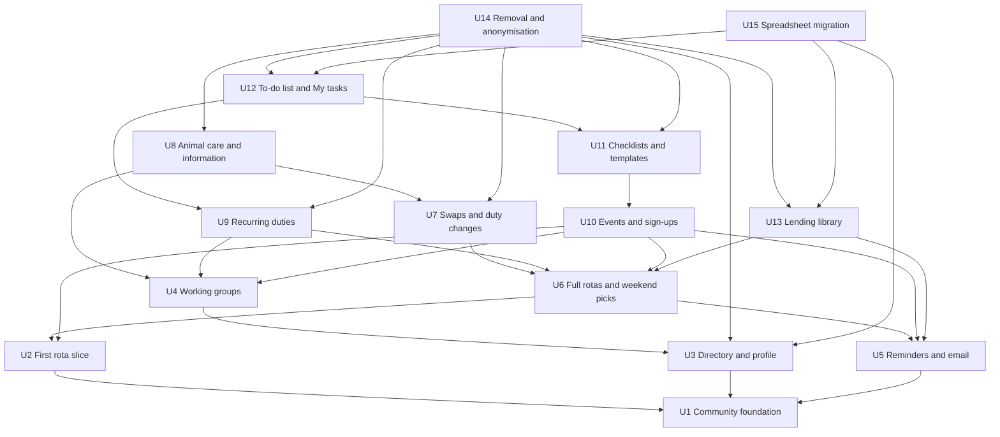

# Unit Dependencies

Which units in `unit-of-work.md` need which others, derived from the call directions in `components.md`, the decisions in `decisions.md` and the rules in `requirements.md` and `stories.md`. This describes topology only; Delivery Planning decides the build order.

## Dependency Graph



Text fallback: each arrow points to a unit that must exist first. U2, U3 and U5 need only U1. U4 needs U3. U6 needs U2 and U5. U7 needs U6. U8 needs U4 and U7. U9 needs U4 and U6. U10 needs U2, U4, U5 and U6. U11 needs U10. U12 needs U9 and U11. U13 needs U5 and U6. U14 needs U3, U7, U8, U9, U11, U12 and U13. U15 needs U3, U12 and U13.

```yaml
units:
  - name: u1-community-foundation
    kind: service
    depends_on: []
  - name: u2-first-rota-slice
    kind: service
    depends_on: [u1-community-foundation]
  - name: u3-directory-and-profile
    kind: service
    depends_on: [u1-community-foundation]
  - name: u4-working-groups
    kind: service
    depends_on: [u3-directory-and-profile]
  - name: u5-reminders-and-email
    kind: service
    depends_on: [u1-community-foundation]
  - name: u6-full-rotas-and-weekend-picks
    kind: service
    depends_on: [u2-first-rota-slice, u5-reminders-and-email]
  - name: u7-swaps-and-duty-changes
    kind: service
    depends_on: [u6-full-rotas-and-weekend-picks]
  - name: u8-animal-care-and-information
    kind: service
    depends_on: [u4-working-groups, u7-swaps-and-duty-changes]
  - name: u9-recurring-duties
    kind: service
    depends_on: [u4-working-groups, u6-full-rotas-and-weekend-picks]
  - name: u10-events-and-signups
    kind: service
    depends_on: [u2-first-rota-slice, u4-working-groups, u5-reminders-and-email, u6-full-rotas-and-weekend-picks]
  - name: u11-checklists-and-templates
    kind: service
    depends_on: [u10-events-and-signups]
  - name: u12-todo-and-my-tasks
    kind: service
    depends_on: [u9-recurring-duties, u11-checklists-and-templates]
  - name: u13-lending-library
    kind: service
    depends_on: [u5-reminders-and-email, u6-full-rotas-and-weekend-picks]
  - name: u14-removal-and-anonymisation
    kind: service
    depends_on: [u3-directory-and-profile, u7-swaps-and-duty-changes, u8-animal-care-and-information, u9-recurring-duties, u11-checklists-and-templates, u12-todo-and-my-tasks, u13-lending-library]
  - name: u15-spreadsheet-migration
    depends_on: [u3-directory-and-profile, u12-todo-and-my-tasks, u13-lending-library]
```

## Why Each Dependency Exists

| Unit | Needs | Reason |
|---|---|---|
| U2, U3, U5 | U1 | The one-community structure and re-scoped roles |
| U4 | U3 | A member's name follows the directory rules (US2.2) |
| U6 | U2 | Extends the rota and duty model |
| U6 | U5 | Weekend-pick chasing is a timed reminder (US6.2) |
| U7 | U6 | Swaps respect the same-week rule, changeover and weekend picks (US8.2, ADR-011) |
| U8 | U7 | Giving up a slot is owned by DutyChanges (ADR-012) |
| U8 | U4 | Group-owned information sections and Animal Care coordinators (US7.3, US10.2) |
| U9 | U6 | Bottle cleaning needs the family on a rota week (FR9.3) |
| U9 | U4 | Duties owned by a working group |
| U10 | U2 | Event tasks are duties (ADR-002) |
| U10 | U4 | Working-group events belong to coordinators (US11.1) |
| U10 | U5 | Events are a kind of item notices concern (FR17.4) |
| U10 | U6 | Signing up for an event task is a duty sign-up, so the leaving or new family rule must exist (FR4.4, AC4.2.1) |
| U11 | U10 | Checklists belong to events |
| U12 | U11 | Tasks are pulled into checklists (US14.3) |
| U12 | U9 | The coordinator page manages recurring duties (US2.4) |
| U13 | U5 | Return notices and reminders (US16.3) |
| U13 | U6 | Leaving families are marked there (US16.3) |
| U14 | U3, U7, U8, U9, U11, U12, U13 | Removal must reach every kind of record (NFR11); U4 and U10 are covered through these |
| U15 | U3, U12, U13 | The script loads the directory, the to-do list and the books |

## Integration Points

| Between | How they connect |
|---|---|
| Every feature and U1 | Database access helpers owned by Identity; ids checked inside functions (ADR-010) |
| U6, U8, U9, U10 and U2 | Create duties and places through named Duties functions, naming their origin by kind and id |
| U7 and U6 | DutyChanges calls RotaPlanning functions within one database transaction (ADR-011) |
| U8 and U7 | AnimalCareSignup defers a slot release to DutyChanges (ADR-012) |
| U6, U7, U8, U9, U11, U13 and U5 | Each adds its own due check to the daily run and sends through Notifications |
| U6 and U2 | U6 moves U2's rota-publishing notice onto the Notifications function U5 delivers |
| U12 and U11 | Pulling tasks into a checklist by id |
| U14 and the rest | Named anonymise and flag functions in each owning block |
| U15 and U3, U12, U13 | The script calls named functions (ADR-009) |

## Independent Sets

The owner chose to build one unit at a time (Q3), so these sets are recorded only to show what does not depend on what:

- U2, U3 and U5
- U4 and U6
- U7, U9, U10 and U13
- U8, U9, U11 and U13
- U8 and U12
- U14 and U15

The thin first slice is U2, resting on U1. The active plan has no walking-skeleton Bolt, so U2 being checked before the rest is a sequencing decision for Delivery Planning.
